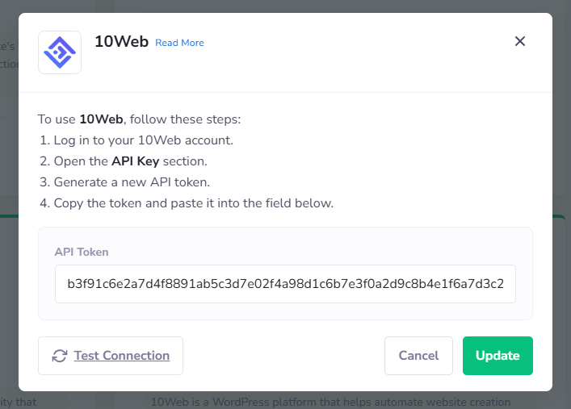
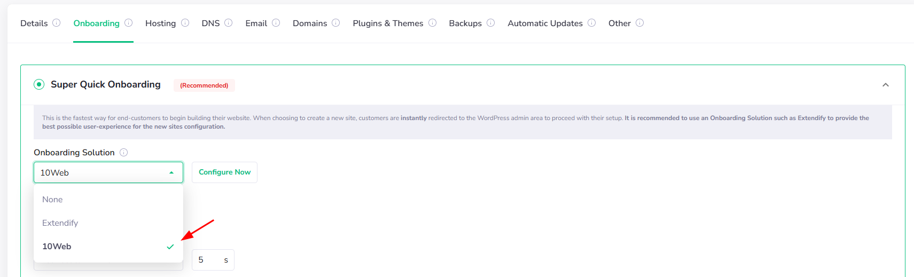
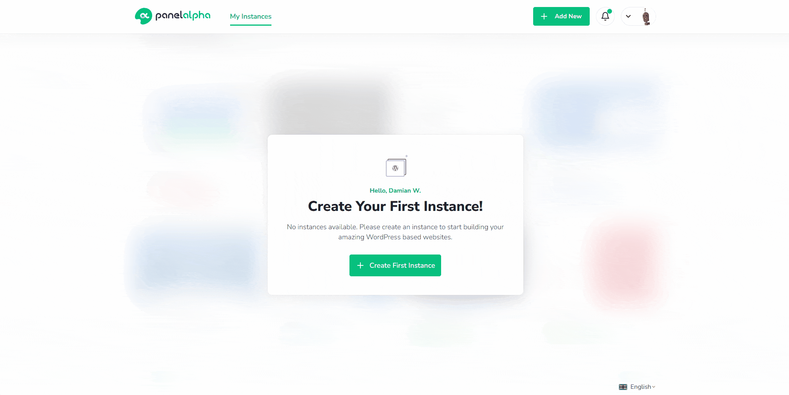

# 10Web

Enable 10Web to utilize the quickest onboarding method for WordPress instances: [Super Quick Onboarding](../onboarding-methods/super-quick-onboarding.md).

[10Web](https://10web.io/website-builder-api/hosting-providers/?panelalpha_refering_url=1) is a WordPress platform that automates website creation using AI. Integrate with PanelAlpha to empower hosting clients to instantly generate professional WordPress websites by simply describing what they want to build.

## Installation

The installation is automatic — no manual steps are required on your server. Once the integration is enabled and a plan is configured to use 10Web as the Onboarding Solution, PanelAlpha automatically installs the **10Web AI Builder** plugin on every new WordPress instance created under that plan.

Enable the integration before configuring it, as only active integrations expose the configuration form.

## Configuration

1. Enable the integration and click **Configure**.

2. In the configuration form, enter your **API Token**.

To obtain the API Token:

1. Log in to your [10Web](https://10web.io/) account. If you do not have an account, create one at [10web.io](https://10web.io/website-builder-api/hosting-providers/?panelalpha_refering_url=1).
2. Open the **API Key** section.
3. Generate a new API token.
4. Copy the token and paste it into the **API Token** field.

3. Click **Test Connection** to verify the credentials, then click **Update** to save.

## Usage in Plans

Once 10Web is configured, utilize it as an onboarding solution when setting up [Super Quick Onboarding](../onboarding-methods/super-quick-onboarding.md) in your plans. In the plan's **Onboarding** tab, select **Super Quick Onboarding** and choose **10Web** as the Onboarding Solution.

When **10Web** is selected, the following additional limits are available:

- **Website creation limit** — Maximum number of AI website generations allowed per instance.
- **Edit limit** — Maximum number of AI edits allowed per instance.

## End-User Experience

After a client creates a WordPress instance and accesses WP Admin via SSO, the 10Web AI wizard launches automatically. The wizard asks the user to describe what kind of website they want to build, then generates the site based on that description.

