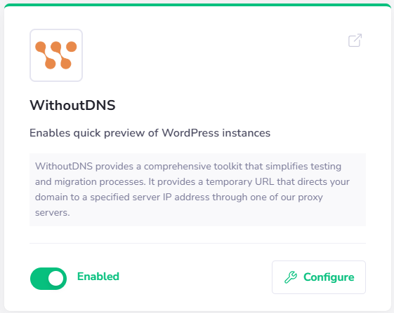
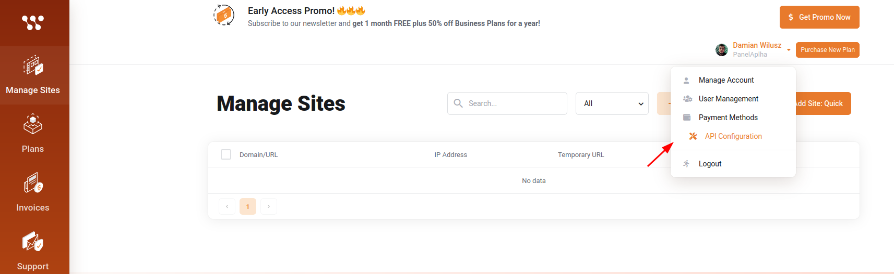
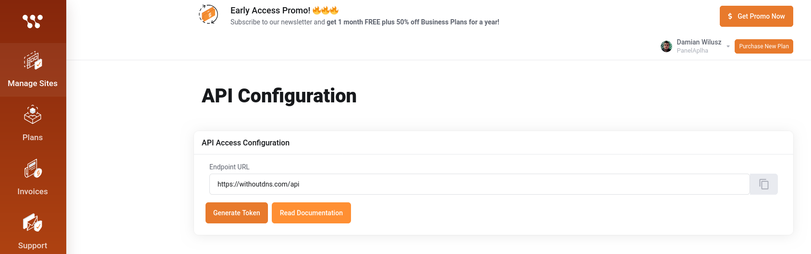
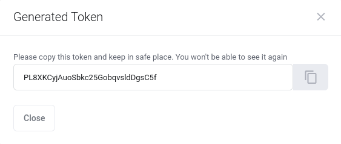
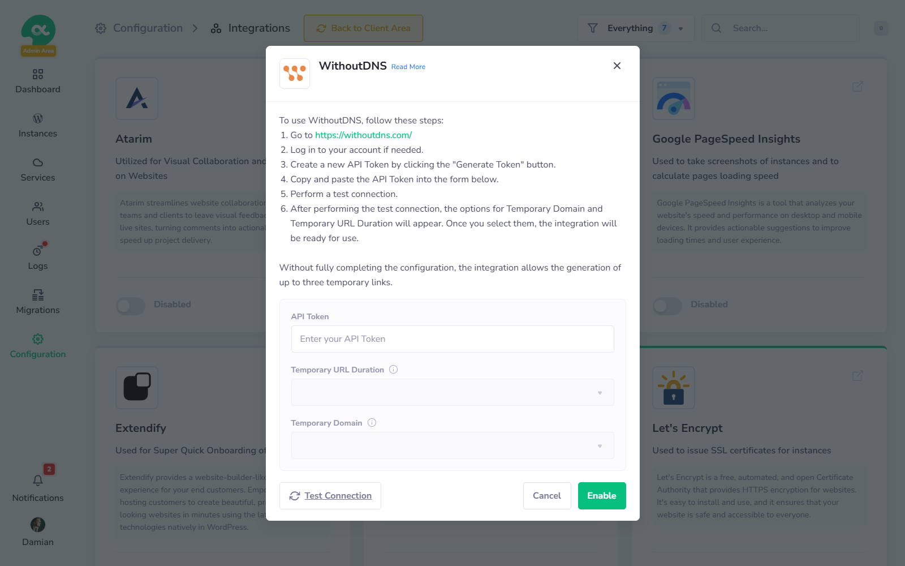
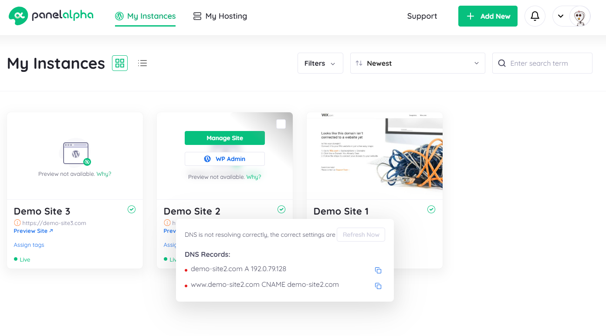
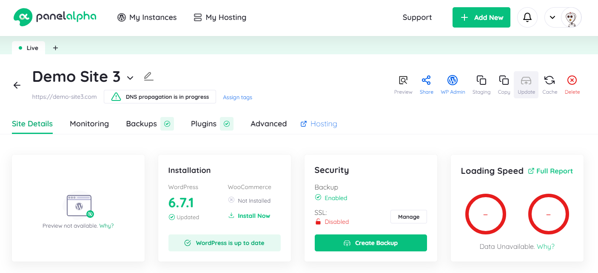
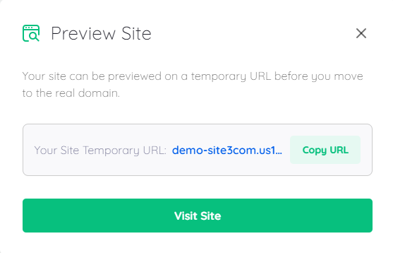

# WithoutDNS

[WithoutDNS](https://withoutdns.com/) provides a temporary URL for your domain, allowing you to preview and test a website on a different server without changing your local hosts file. Traffic is redirected to a specified server IP through a proxy, offering a safe way to test sites before they go live.

The integration is enabled by default for new PanelAlpha users *(version 1.1.7 and above)*. It allows generating up to three temporary links to preview sites that have not been migrated yet. Existing users can enable it manually. Trial links are valid for five minutes only.

## Installation

The installation is automatic and enabled by default for new PanelAlpha users *(version 1.1.7 and above)*. Only an active integration can be fully configured. WithoutDNS allows up to three free trial links. For extensive use, fully configure it with the [WithoutDNS](https://withoutdns.com/) panel.

## Configuration

1. Make sure the integration is enabled, then click the **Configure** button.

   

2. A modal form will appear. Follow the steps described in the form:
   - Proceed to the [WithoutDNS](https://withoutdns.com/) panel and log in. If you are a new user, sign up first.
   - Go to the **API Configuration** section under your account details in the top right corner.

   

   - Create a new **API Token** by clicking the **Generate Token** button.

   

   - Copy the API token and keep it safe.

   

3. Go back to the PanelAlpha admin area and paste the generated token in the modal form.

   

4. Test the connection. If successful, configure the available options:
   - **Temporary URL Duration** — Define how long the generated preview URL remains accessible.
   - **Temporary Domain** — Select the domain for the temporary URL.

   

### Preview Site

The **Preview Site** option appears in the client area for WordPress instances whose DNS status is "DNS propagation is in progress." A **Preview Site** redirect link opens the site using the temporary URL.

Press the **Visit Site** button to open the preview. Copy the URL if needed. The link remains valid only for the configured duration. In trial mode, links expire after five minutes.

