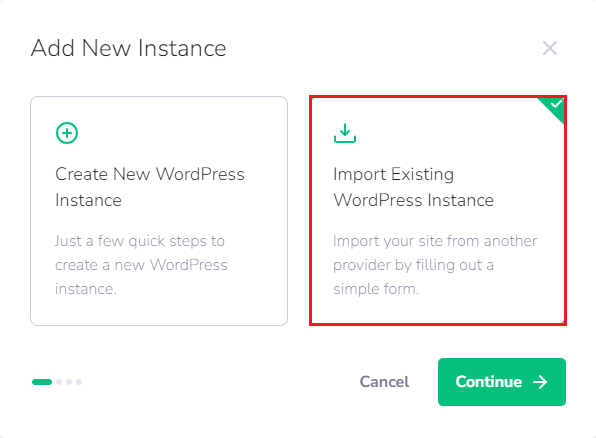
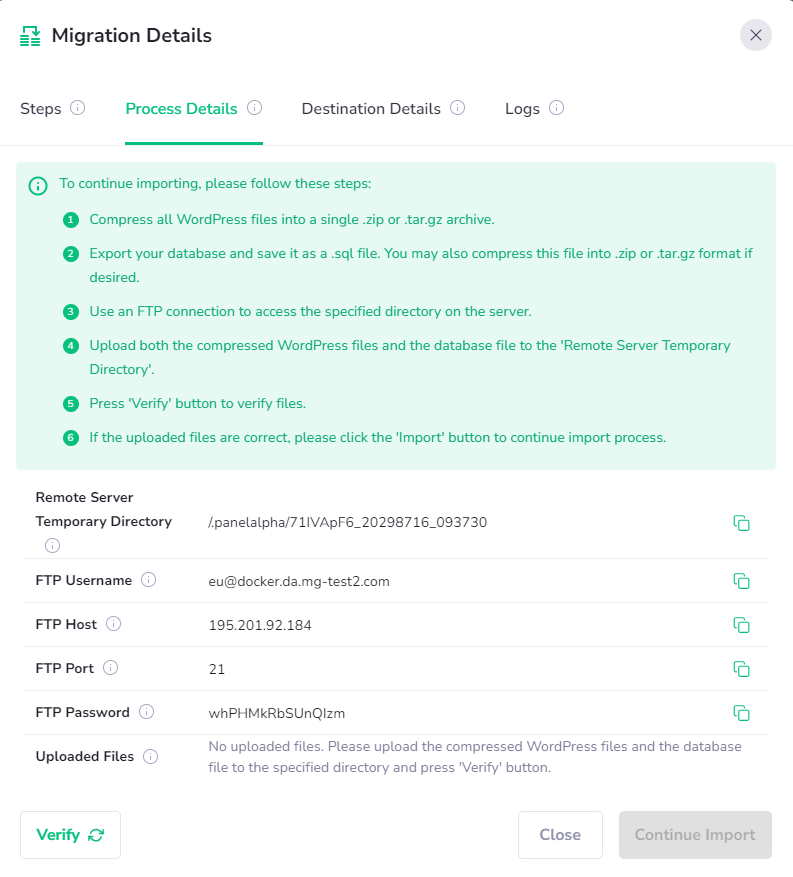

# Best Practices

Follow these best practices to ensure smooth and successful WordPress migrations with minimal issues.

## Common Migration Scenarios

### Scenario-to-Method Map

| Scenario | Recommended Method | Why |
|----------|-------------------|-----|
| Move from any host to PanelAlpha | Automatic (Plugin) | Fastest, least friction, supports stop/retry |
| WP admin blocked / 2FA enforced | Automatic (FTP/SFTP) | Bypasses WP admin access requirements |
| Client auto-migration failed | Manual (admin) | Admin controls uploads, can verify before run |
| Very large site (10GB+ / 500MB+ DB) | Manual (admin, off-hours) | More control, avoids timeouts, can resume/retry |
| Cross-server move inside PanelAlpha | Automatic (Plugin) or FTP | Minimal downtime; keeps audit trail |
| Security-sensitive client | Automatic (FTP) or Manual | Avoids sharing WP admin credentials |

**Learn more:**
- Plugin vs FTP: [Migration Types](migration-types.md)
- Large sites: [For Large Sites](#for-large-sites)
- Failed client imports: [Manual Migrations](migration-types.md#manual-migrations)

## For Automatic Migrations

### Client Education

1. **Provide clear instructions** on both import methods (plugin vs FTP):
   - Create documentation or video tutorials
   - Explain when to use each method
   - Show the step-by-step process

2. **Set expectations**:
   - Migration time depends on site size
   - Large sites may take several hours
   - Some downtime may be required

3. **Prepare checklist** for clients:
   - Backup source site before migration
   - Disable security plugins temporarily
   - Note any custom configurations
   - Document any .htaccess rules

### Method Selection

1. **Recommend plugin method** as default:
   - More reliable and user-friendly
   - Better error handling
   - Automatic cleanup
   - Works for most cases

2. **Use FTP method** when:
   - WordPress admin access is not available
   - Security plugins block auto-login
   - Two-factor authentication cannot be disabled
   - Client prefers not to share admin credentials

### Monitoring

1. **Check In Progress tab** daily:
   - Identify stuck migrations
   - Take action on alerts
   - Contact clients if needed

2. **Review failures** regularly:
   - Identify common issues
   - Address systemic problems
   - Update documentation based on patterns

3. **Track success rates**:
   - Monitor which hosting providers have issues
   - Document problematic configurations
   - Share findings with the team

## For Manual Migrations

### Preparation

1. **Prepare files beforehand**:
   - Have clients create files before starting migration
   - Test file integrity locally
   - Verify ZIP can be extracted
   - Check SQL file for syntax errors

2. **Check file naming**:
   - Exactly `wordpress-files.zip`
   - Exactly `database.sql` (or `.sql.gz`, `.sql.zip`, `.sql.tar.gz`)
   - Case-sensitive on Linux servers

3. **Verify file contents**:
   - ZIP must contain WordPress root files
   - No nested WordPress folder in ZIP
   - SQL must include all WordPress tables
   - Check for correct database prefix

### File Optimization

1. **Use compression** for large files:
   - Gzip database dumps: `database.sql.gz`
   - Can reduce size by 80–90%
   - Faster upload times
   - Supported formats: `.gz`, `.zip`, `.tar.gz`

2. **Optimize before packing**:
   - Remove unused themes/plugins from source
   - Clean up media library
   - Delete cache files
   - Remove old backups from wp-content

3. **Test extraction locally**:
   - Verify ZIP extracts correctly
   - Check file permissions are preserved
   - Ensure no corruption

### Upload Process

1. **Use reliable FTP client**:
   - FileZilla, Cyberduck, or similar
   - Enable resume support
   - Use binary transfer mode
   - Monitor upload progress

2. **Verify immediately**:
   - Do not wait to verify uploads
   - Do it right after upload completes
   - Check error messages carefully
   - Retry if verification fails

3. **Monitor logs during import**:
   - Keep Migration Details modal open
   - Watch for warnings
   - Take note of any issues
   - Be ready to assist if needed

## For Large Sites

### Definition of Large Sites

Consider a site "large" if:
- Total size over 5GB
- Database over 500MB
- More than 10,000 files
- Many large media files

### Planning

1. **Schedule during off-hours**:
   - Migrate during low-traffic periods
   - Reduces impact on source server
   - Better network performance
   - Less chance of timeouts

2. **Consider manual migration**:
   - More control over process
   - Can pause and resume
   - Better for sites over 10GB
   - Easier to troubleshoot

3. **Communicate with client**:
   - Set realistic time expectations
   - Explain potential downtime
   - Provide progress updates
   - Have a backup plan ready

### Technical Preparation

1. **Check server resources**:
   - Verify adequate disk space (3x site size)
   - Ensure sufficient RAM for import
   - Check PHP `memory_limit` (512MB+)
   - Verify MySQL `max_allowed_packet` (256MB+)

2. **Optimize source site**:
   - Clean up database before export:
     - Delete spam comments
     - Remove post revisions: `wp post delete $(wp post list --post_type='revision' --format=ids)`
     - Clean transients: `wp transient delete --all`
   - Compress images
   - Remove unused plugins/themes

3. **Split if necessary**:
   - Consider migrating files and database separately
   - Use staging approach for critical sites
   - Test on subdomain first

### Monitoring

1. **Watch progress closely**:
   - Keep Migration Details modal open
   - Monitor logs in real-time
   - Check server load on destination
   - Watch for timeout warnings

2. **Have support ready**:
   - System admin on standby
   - Client contact available
   - Rollback plan prepared

## Security Considerations

### Credential Management

1. **Temporary FTP accounts**:
   - Always removed automatically after migration
   - Limited access to temporary directory only
   - Secure password generation
   - Short-lived credentials

2. **Source credentials**:
   - Not stored after migration completes
   - Transmitted over secure connections
   - Access logs maintained
   - Client can change after migration

3. **Database passwords**:
   - Visible only to admins with appropriate privileges
   - Stored encrypted in PanelAlpha
   - Never logged in plain text
   - Rotated after migration if desired

### Access Control

1. **Role-based access**:
   - Limit who can initiate manual migrations
   - Restrict access to migration logs
   - Audit trail for all actions
   - Review permissions regularly

2. **Plugin cleanup**:
   - Migration plugin removed from source if auto-installed
   - Temporary files deleted
   - Staging directories cleaned
   - No artifacts left behind

### Compliance

1. **Audit trail**:
   - All migrations logged with timestamps
   - User actions recorded
   - Error details captured
   - Retention policy followed

2. **Data protection**:
   - Files transferred over secure protocols
   - Temporary storage encrypted
   - Backups before migration
   - GDPR compliance maintained

## Testing and Validation

### Pre-Migration Checklist

- Backup source site
- Verify source WordPress version
- Check PHP version compatibility
- Note custom configurations
- Document current DNS settings
- Record current SSL setup
- List active plugins
- Note theme customizations

### DNS Cutover

1. **Before switching DNS**:
   - Test site on destination server (hosts file or temp domain)
   - Verify all functionality works
   - Ensure SSL is active
   - Check email delivery

2. **During cutover**:
   - Lower DNS TTL 24 hours in advance
   - Update DNS records
   - Monitor propagation
   - Keep source site running until confirmed

3. **After cutover**:
   - Verify site loads on new server
   - Check from multiple locations
   - Monitor for any issues
   - Keep backup of source site for 1–2 weeks





## Documentation and Knowledge Sharing

### Internal Documentation

1. **Document patterns**:
   - Which hosting providers work well
   - Common issues by provider
   - Workarounds for known problems
   - Server-specific configurations

2. **Create runbooks**:
   - Step-by-step procedures
   - Troubleshooting flowcharts
   - Emergency contacts
   - Escalation procedures

3. **Share learnings**:
   - Team meetings to discuss issues
   - Knowledge base articles
   - Update documentation regularly
   - Train new team members

### Client Communication

1. **Pre-migration**:
   - Send preparation guide
   - Set expectations for timeline
   - Explain potential downtime
   - Provide support contacts

2. **During migration**:
   - Send progress updates
   - Notify of any delays
   - Be available for questions
   - Provide ETA for completion

3. **Post-migration**:
   - Send completion notification
   - Provide new credentials
   - Explain next steps (DNS change, etc.)
   - Offer testing checklist

## Performance Optimization

### Before Migration

1. **Clean source database**:
   ```bash
   wp db optimize
   wp transient delete --all
   wp cache flush
   ```

2. **Remove unnecessary files**:
   - Old backups in wp-content
   - Cache directories
   - Error logs
   - Temp files

### After Migration

1. **Set up caching**:
   - Enable object caching if available
   - Configure page caching
   - Set appropriate cache TTLs
   - Test cache functionality

2. **Optimize database**:
   ```bash
   wp db optimize
   wp rewrite flush
   ```

3. **Configure PHP settings**:
   - Set appropriate `memory_limit`
   - Enable OPcache
   - Configure `max_execution_time`
   - Set `upload_max_filesize`

## Related Documentation

- [Migration Types](migration-types.md) — Choose the right method
- [Import Process](import-process.md) — Understand the steps
- [Troubleshooting](troubleshooting.md) — Solve common issues
- [Managing Migrations](managing-migrations.md) — Monitor migrations
