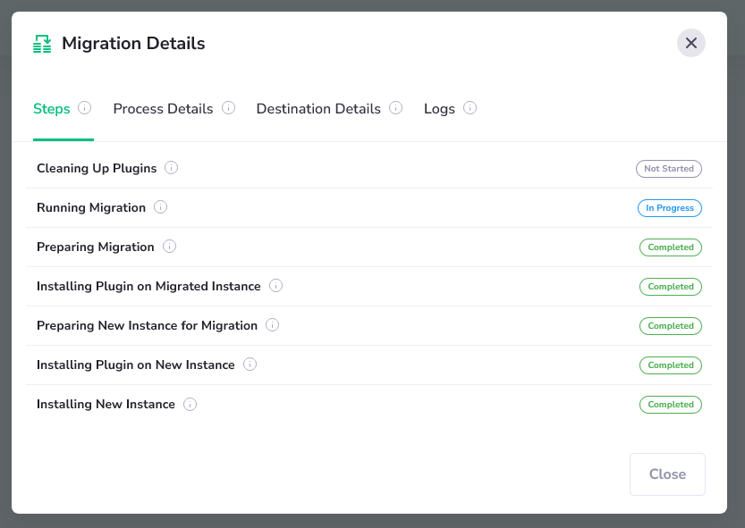
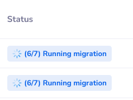

# Import Process

All migrations in PanelAlpha follow a standardized process with multiple steps, regardless of the import method used (automatic or manual). Understanding these steps helps troubleshoot issues and monitor progress effectively.

## Import Steps Breakdown

Each import goes through these steps in order:

1. **Install new instance** — Create hosting account, set limits, domain, docroot, PHP/web server config, DNS (if enabled).
2. **Install plugin on destination** *(plugin methods only)* — Fresh WordPress, migrator plugin, credentials configured.
3. **Prepare destination workspace** — Stage directory, temp FTP (manual), permissions, server readiness checks.
4. **Install plugin on source** *(plugin auto-login path)* — Log into WP admin, upload/activate plugin, link to PanelAlpha. Skipped if client installed manually.
5. **Prepare migration** — Analyze source, size check, manifest/checksums, compatibility, download files + DB.
   - Plugin: transfer via plugin API with chunking
   - FTP: download via FTP/SFTP from source server
   - Manual: use uploaded ZIP and SQL files
6. **Run migration** — Extract files, create DB, import SQL, update URLs (search-replace + serialized), update `wp-config.php`, set keys/salts, clear caches, validate.
   - Plugin-only tasks: auto-cleanup after plugin handoff
   - Manual: proceeds after verification; no stop button once started
7. **Clean up** — Remove source plugin (auto-install), delete temp FTP and staging files, remove artifacts, finalize record and set instance active.

### Data Sources by Method

| Step | Plugin (Simple) | Plugin (Manual Install) | FTP/SFTP | Manual |
|------|-----------------|-------------------------|----------|--------|
| Files source | WP Admin via plugin API | WP Admin via plugin API | FTP/SFTP path | `wordpress-files.zip` uploaded |
| DB source | Plugin export | Plugin export | FTP/SFTP download | `database.sql` (or compressed) |
| Stop mid-run | Yes | Yes | Yes | No |
| Needs WP admin creds | Optional (auto-login) | No (client installs) | No | No |

## Post-Import Automatic Actions

After successful import completion, PanelAlpha automatically performs the following:

- **Caches instance details**: Stores instance information for faster dashboard loading
- **Initiates PageSpeed analysis**: Scheduled 2 minutes after import
- **Creates DNS zone and records**: If external DNS server is configured
- **Sets up email domain**: If external email server is configured
- **Generates automatic SSL certificate**: If AutoSSL/Let's Encrypt is enabled
- **Syncs report providers**: Connects Google Analytics, etc.
- **Enables automatic backup**: Activates backup schedule if configured for the plan
- **Sends notifications**: Notifies user and admins about successful import

## Import Status Indicators

Each step can have one of the following statuses:

- **Not Started** (gray circle): Step hasn't been executed yet
- **In Progress** (yellow/orange spinner): Step is currently being executed
- **Completed** (green checkmark): Step finished successfully
- **Failed** (red alert icon): Step encountered an error

When a step fails, the entire import is marked as failed, and you will see:
- The specific step that failed highlighted in red
- Detailed error message describing what went wrong
- Step-specific error details in the Logs tab
- Suggested actions to resolve the issue
- Retry option to re-run the migration

## Migration Process Flow

### Automatic Migration (Plugin Method with Login)

1. Client initiates import and enters WordPress URL.
2. Provides WP admin credentials.
3. PanelAlpha validates credentials and lets client choose service/options.
4. PanelAlpha logs into WordPress and installs migration plugin.
5. Plugin analyzes source, downloads files and database.
6. Uploads to destination, extracts/imports, configures WordPress.
7. Cleanup completes and migration is marked done.

### Automatic Migration (Plugin Method - Manual Install)

1. Client initiates import and enters WordPress URL.
2. Downloads plugin ZIP and installs/activates it in WordPress.
3. Plugin connects to PanelAlpha; client selects service/options.
4. Plugin analyzes source, downloads files and database.
5. Uploads to destination, extracts/imports, configures WordPress.
6. Cleanup completes and migration is marked done.

### Automatic Migration (FTP Method)

1. Client initiates import and enters WordPress URL.
2. Provides FTP/SFTP credentials and path.
3. PanelAlpha verifies connection and detects WordPress install.
4. Client selects service and options.
5. PanelAlpha downloads files and database via FTP/SFTP.
6. Uploads to destination, extracts/imports, configures WordPress.
7. Cleanup completes and migration is marked done.

### Manual Migration

1. Admin initiates migration and selects user + service.
2. PanelAlpha creates instance and generates temporary FTP credentials.
3. Admin uploads `wordpress-files.zip` and `database.sql` (or compressed).
4. Admin clicks **Verify**; PanelAlpha validates uploads.
5. Admin clicks **Continue Import** to extract/import.
6. PanelAlpha configures WordPress.
7. Cleanup completes and migration is marked successful.

## Related Documentation

- [Migration Types](migration-types.md) — Understand different migration methods
- [Managing Migrations](managing-migrations.md) — Monitor and manage migrations
- [Migration Details](migration-details.md) — Detailed information about each migration
- [Troubleshooting](troubleshooting.md) — Solve common migration issues
