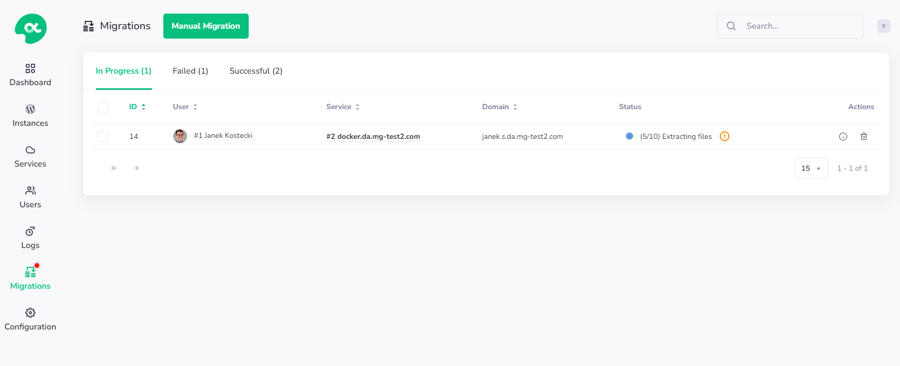
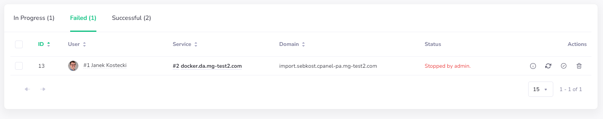
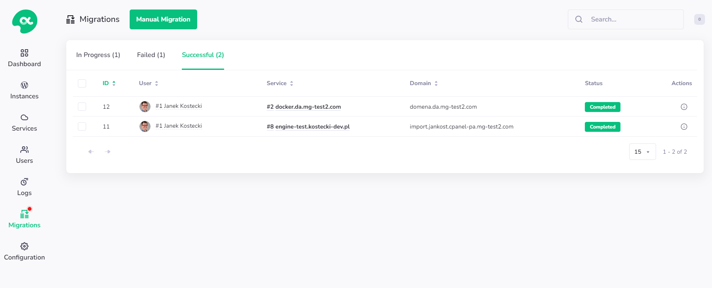

# Managing Migrations

The main migrations table is divided into three tabs: **In Progress**, **Failed**, and **Successful**. Each tab follows the same pattern: purpose, key columns, and primary actions.

## Migrations in Progress

Purpose: monitor migrations that are currently executing (automatic or manual) and intervene when needed.

### Key Columns

- **ID Number:** unique migration identifier (also service ID); click to view the service details page
- **User:** user who owns the instance; hover to see tooltip with user details (email, status), click to view user profile
- **Service:** service / plan to which the WordPress installation is assigned; displays plan name
- **Domain:** domain of the migrated WordPress installation; hover to see instance details tooltip
- **Status:** current migration step and progress
  - Shows which step is currently executing (e.g. "Downloading Files...")
  - Displays alert icon if action is required
  - Shows progress percentage for applicable steps
  - Click the status or alert icon to open migration details

### Primary Actions

- **Show Details** (eye icon): opens the Migration Details modal with full information about the migration
- **Stop Migration** (stop icon): halts the migration immediately (only for automatic migrations)
  - Confirms before stopping
  - Migration will be marked as failed with reason "Stopped by admin"
  - Cannot stop manual migrations that are past the upload stage
- **Delete** (trash icon): stops and removes the migration permanently
  - Confirms before deletion
  - Stops the migration process if running
  - Removes all migration records
  - Does NOT delete the partially created instance
- **Bulk Delete:** select multiple migrations using checkboxes and use the mass actions dropdown

### Status Indicators

- **Green checkmark:** step completed successfully
- **Yellow / orange spinner:** step currently in progress
- **Red alert:** step failed or requires manual action
- **Gray circle:** step not yet started

### Taking Action on In-Progress Migrations

When a migration shows an alert status, it typically means:

**1. Manual upload required:** for manual migrations waiting for admin to upload files
- **Action:** Upload `wordpress-files.zip` and `database.sql` via FTP
- **Next:** Click Verify to check uploads, then Continue Import

**2. Verification needed:** files uploaded but not yet verified
- **Action:** Click the Verify button in Process Details
- **Next:** If successful, the Continue Import button will be enabled

**3. Error occurred:** a step failed during execution
- **Action:** Review the Logs tab for the specific error message
- **Next:** Retry migration or Mark as Failed

**4. Admin intervention needed:** configuration or permission issue requires manual resolution
- **Action:** Follow instructions in the Process Details tab
- **Next:** Contact hosting server admin if needed, then Retry

**Note:** When you see an alert icon:

- Open Migration Details → Logs to read the exact failing step
- Check Process Details for required admin action (upload / verify)
- If credentials are wrong, edit and retry; if blocked by provider, switch to manual migration
- If truly unrecoverable, delete or mark as failed to clear the queue

## Failed Migrations

Purpose: review migrations that encountered errors and choose to retry, mark successful after manual fix, or delete.

### Key Columns

- **ID Number:** migration / service identifier; click to view service details
- **User:** user who owns the instance; hover for tooltip, click for user profile
- **Service:** service / plan assignment
- **Domain:** domain of the failed migration
- **Status:** reason for migration failure (detailed error message)

### Common Failure Reasons

- **"Stopped by admin"**: admin manually stopped the migration
- **"Cannot connect to FTP server"**: FTP credentials invalid or server unreachable
- **"Cannot dump MySQL database on remote server"**: database export failed on source
- **"Insufficient disk space"**: not enough space on destination server
- **"WordPress not found at specified path"**: invalid path provided for FTP method
- **"Database import failed: Table already exists"**: database collision on destination
- **"File extraction failed"**: corrupted ZIP file or permission issues
- **"Connection timeout"**: network connectivity issues during file transfer
- **"Maximum execution time exceeded"**: PHP timeout during large data processing

### Primary Actions

**1. Show Details** (eye icon):

- Opens Migration Details modal
- Review Logs tab for specific error messages
- Check which step failed
- See source and destination details

**2. Retry** (refresh icon):

- Re-initiates the WordPress instance migration
- Starts from the beginning
- Useful if failure was due to temporary issue (network, server load)
- Only available for automatic migrations and manual migrations that failed after upload

**3. Mark As Successful** (checkmark icon):

- Manually marks the migration as successful
- Use when you have manually fixed the issue outside PanelAlpha
- Migration moves to Successful tab
- Instance status is updated to active
- **Important:** ensure you have actually completed the migration manually before using this

**4. Delete** (trash icon):

- Permanently removes the migration record
- Stops any retry attempts
- Removes partial data if migration did not complete
- Confirms before deletion
- Can bulk delete multiple failed migrations

**Note:** Safe to delete?

- OK to delete if: migration is failed / stopped, logs collected, no further retries planned
- Avoid deleting if: client is still uploading files or investigation is ongoing
- Deleting does not remove any partially created instance; verify instances separately

### Troubleshooting Workflow

1. **Review failure reason:** check Status column for initial indication
2. **Open details:** click Show Details to see full logs
3. **Identify root cause:** read error messages in Logs tab
4. **Attempt resolution:**
   - For credential errors: verify and retry with correct credentials
   - For space issues: free up disk space on destination server
   - For timeout issues: consider manual migration for large sites
   - For plugin errors: try FTP method instead
5. **Retry or manual completion:** use Retry if issue resolved, or complete manually and Mark As Successful

## Successful Migrations

Purpose: reference completed migrations for audit, verification, or comparisons.

### Key Columns

- **ID Number:** migration / service identifier; click to view service details
- **User:** user who owns the instance; hover for tooltip, click for user profile
- **Service:** service / plan the instance is assigned to
- **Domain:** domain of the successfully migrated WordPress
- **Status:** always shows "Completed" with green checkmark
- **Completed At:** timestamp when migration finished

### Available Actions

**Show Details** (eye icon):

- View complete migration information
- Review Steps tab to see all completed steps
- Check Destination Details for instance information
- Review Logs for complete migration history
- Useful for audit trails and verification

### Information Available in Details

- All steps with completion times
- Total migration duration
- Source details (for automatic migrations)
- Destination server and database credentials
- Full log history

### Use Cases

- **Audit trail:** review who migrated what and when
- **Documentation:** reference for setting up similar migrations
- **Troubleshooting:** compare successful migration logs with failed ones
- **Reporting:** export data for management reports
- **Verification:** confirm all post-migration actions completed

## Related Documentation

- [Migration Types](migration-types.md) - understand different migration methods
- [Migration Details](migration-details.md) - detailed information about each migration
- [Troubleshooting](troubleshooting.md) - solve common migration issues
