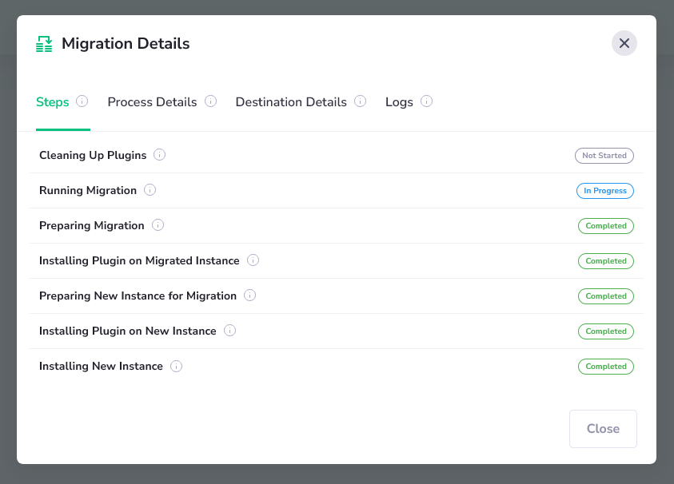
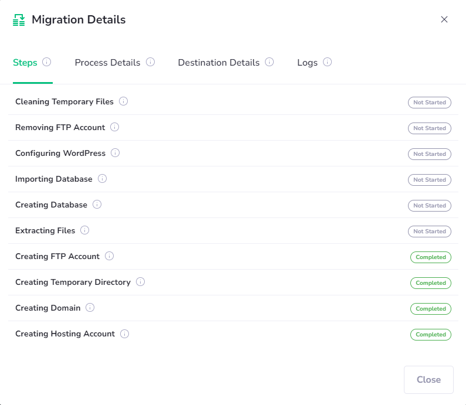
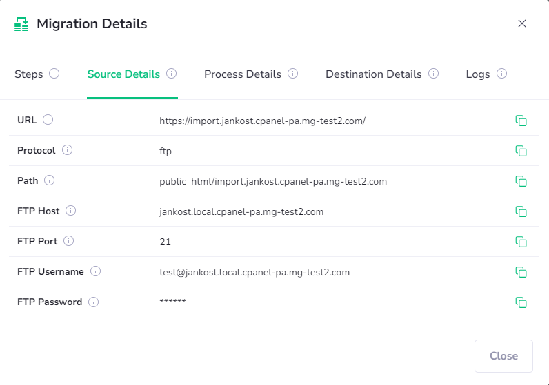
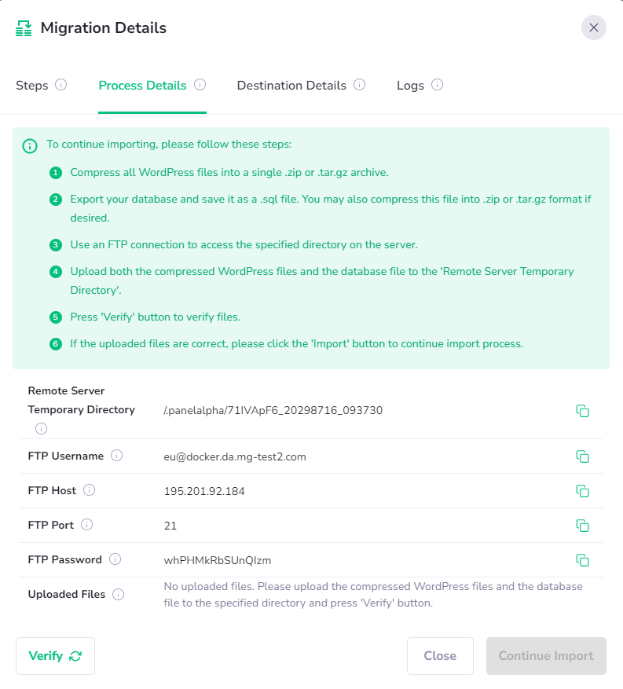
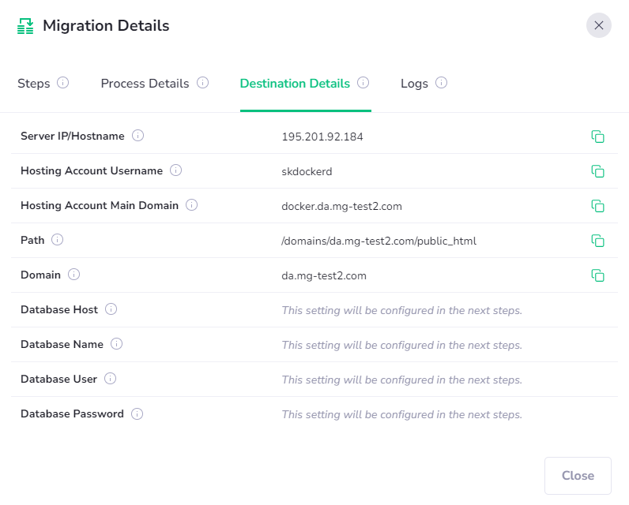
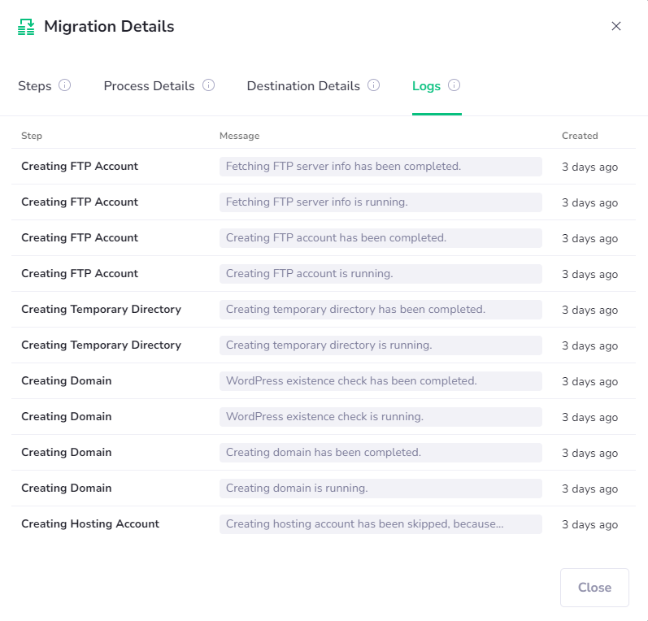

# Migration Details

The **Migration Details** modal provides comprehensive information about a migration. Click **View Details** on any migration to open it.

The modal contains several tabs providing different aspects of migration information.

### Quick Tab Map

| Tab | What You See | Best Use |
|-----|--------------|----------|
| Steps | Each step with status, duration, info tooltips | Spot where it failed or how long it took |
| Source Details | Source URL, method, plugin/FTP credentials | Confirm you are pulling from the right site |
| Process Details | Instructions, temp FTP, verification state, current step | Act on uploads, verification, and ongoing progress |
| Destination Details | Target server, account, domain, DB credentials | Verify destination matches the intended service |
| Logs | Full chronological log with levels and filters | Deep troubleshooting and evidence for support |

**Status legend:**
- **INFO** (blue): Normal operation and progress
- **WARNING** (yellow/orange): Non-critical issues or recommendations
- **ERROR** (red): Blocking issues that stopped a step
- **DEBUG** (gray): Low-level technical details

## Steps Tab

Track the progress of each migration step:

- **Step Name**: Descriptive name of the step
- **Status**: Visual indicator (checkmark, spinner, alert, or circle)
- **Duration**: Time taken to complete (for completed steps)
- **Actions**: Tooltip with detailed information

### Step Status Display

- Completed steps: green checkmark with completion time
- In-progress step: yellow spinner with current action
- Failed steps: red alert icon with error summary
- Not started steps: gray circle

Click the info icon next to any step to see a detailed description.

## Source Details Tab

**Note:** Available only for automatic migrations initiated by clients. Manual migrations do not have source details since files are uploaded directly by admins.

Shows connection information for the source WordPress:

### For FTP-Based Migrations

- **URL**: The website address of the source WordPress installation
- **Import Method**: Type of migration (Plugin or FTP/SFTP)
- **Protocol**: Connection type (FTP, SFTP, or FTPS)
- **Path**: Directory path to the WordPress installation on the source server
- **FTP Host**: The FTP server address
- **FTP Port**: The port number used for the connection
- **FTP Username**: The FTP account username
- **FTP Password**: The FTP account password (click eye icon to reveal)

### For Plugin-Based Migrations

- WordPress admin URL (if credentials were provided)
- Plugin installation method (automatic or manual)
- Plugin status and version

## Process Details Tab

Provides instructions and connection details for the migration process. Content varies based on migration type and current step.

### For Manual Migrations (During Upload Stage)

Shows FTP account details for uploading files:

- **Remote Server Temporary Directory**: Path where files should be uploaded
- **FTP Host**: The FTP server address (usually hosting server IP or hostname)
- **FTP Port**: The port number for FTP connection (default: 21)
- **FTP Username**: Temporary FTP account username
- **FTP Password**: Temporary FTP account password (click copy icon to copy)

### Upload Instructions

1. Connect to the FTP server using provided credentials
2. Upload `wordpress-files.zip` to the temporary directory
3. Upload `database.sql` (or `database.sql.gz`) to the temporary directory
4. Click the **Verify** button to confirm uploads
5. If verification succeeds, click **Continue Import**

### Verification Status

- **Not verified**: Files not yet checked (Verify button enabled)
- **Verifying**: Currently checking uploaded files (spinner shown)
- **Verified**: Files found and valid (Continue Import button enabled)
- **Failed**: Files missing or invalid (error message shown)

### For All Migrations (After Upload Stage)

Shows current migration progress and technical details:
- Current step being executed
- Files being processed
- Database import progress
- Any warnings or notices

### Action Buttons

- **Verify**: Check if required files are uploaded (manual migrations only)
- **Continue Import**: Proceed with migration after verification (manual migrations only)
- **Copy**: Copy individual field values to clipboard

## Destination Details Tab

Contains information about the target location for the imported WordPress.

### Server Information

- **Server IP/Hostname**: The address of the destination hosting server
- **Server Name**: Name of the hosting server in PanelAlpha
- **Control Panel**: Type of control panel (cPanel, DirectAdmin, Plesk, etc.)

### Hosting Account Information

- **Hosting Account Username**: Username of the hosting account on the destination server
- **Hosting Account Main Domain**: Primary domain associated with the hosting account
- **Hosting Account Status**: Account status (active, suspended, etc.)

### WordPress Installation Details

- **Domain**: Website domain for the imported WordPress
- **Path**: Directory path to the WordPress installation on the destination server
- **URL**: Full URL where WordPress will be accessible
- **PHP Version**: PHP version configured for the instance

### Database Information

- **Database Host**: Address of the database server (usually localhost or specific hostname)
- **Database Name**: Name of the WordPress database created on destination
- **Database User**: MySQL user created for the WordPress database
- **Database Password**: Password for database access (click eye icon to reveal)

### Additional Details

- **WordPress Version**: Detected version of WordPress being migrated
- **Instance ID**: PanelAlpha instance ID for the imported site
- **Created At**: Timestamp when migration was initiated

### Actions

- **Copy**: Copy individual field values to clipboard
- **Test Database Connection**: Verify database credentials are working (if migration failed during DB import)

## Logs Tab

Provides detailed real-time log information about the import process, including all actions performed and any encountered errors.

### Log Entry Components

- **Timestamp**: Exact date and time (for example "2026-01-28 14:32:15")
- **Log Level**:
  - **INFO** (blue): Normal operation, step completion, progress updates
  - **WARNING** (yellow/orange): Non-critical issues, version mismatches, recommendations
  - **ERROR** (red): Critical errors that caused step or migration failure
  - **DEBUG** (gray): Technical details for advanced troubleshooting
- **Step**: Which migration step generated the entry
- **Message**: Description of the action or error
- **Details**: Additional technical information (hover over message or click expand icon)

### Common Log Messages

**Informational (INFO):**
- "Import process started"
- "Step completed: Creating Domain"
- "WordPress files downloaded successfully (1.2 GB)"
- "Database imported: 45,234 records processed"
- "Import process completed successfully"

**Warnings (WARNING):**
- "Source WordPress version (6.2) differs from latest (6.4)"
- "Large file detected, splitting into chunks"
- "Deprecated plugin detected: [plugin-name]"
- "Database optimization recommended"

**Errors (ERROR):**
- "Cannot connect to FTP server: Connection refused"
- "Database import failed: Access denied for user"
- "File extraction failed: Insufficient disk space"
- "WordPress configuration error: wp-config.php not writable"

### Using Logs for Troubleshooting

1. **Identify failed step**: Look for ERROR entries
2. **Review error message**: Read the specific error
3. **Check preceding entries**: Review INFO/WARNING messages before the error
4. **Look for patterns**: Multiple timeouts might indicate network issues
5. **Copy for support**: Use the copy button to share excerpts

### Log Features

- **Filter by log level**: ALL, INFO, WARNING, ERROR, DEBUG
- **Search logs by keyword**: Find specific messages quickly
- **Export logs to file**: Save for offline analysis
- **Auto-refresh**: Logs update every 5 seconds for in-progress migrations

## Related Documentation

- [Managing Migrations](managing-migrations.md) — Monitor and manage migrations
- [Import Process](import-process.md) — Understand the import steps
- [Troubleshooting](troubleshooting.md) — Solve common migration issues
