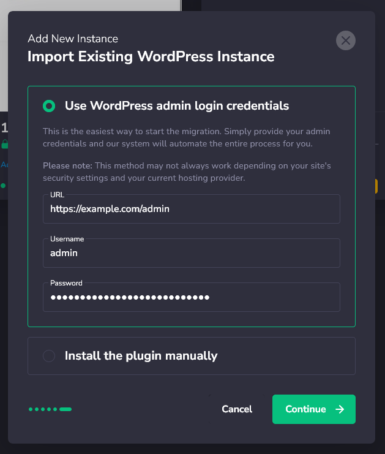
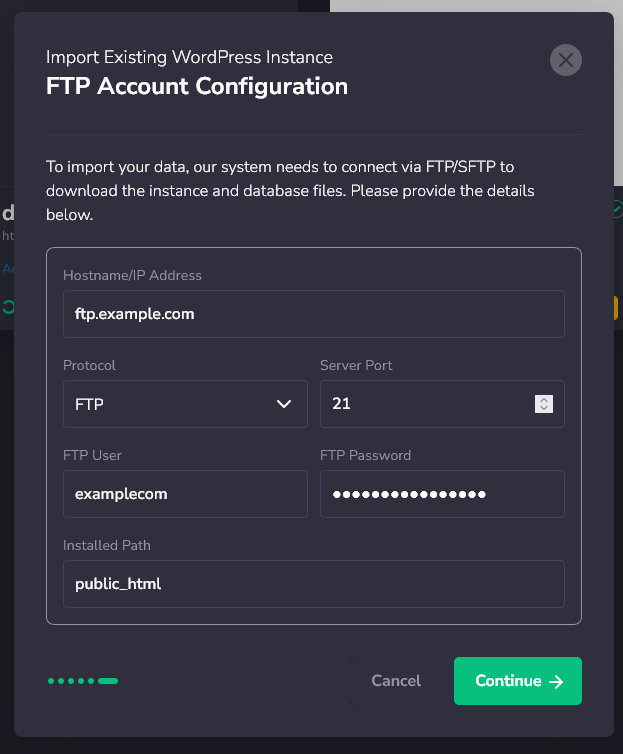
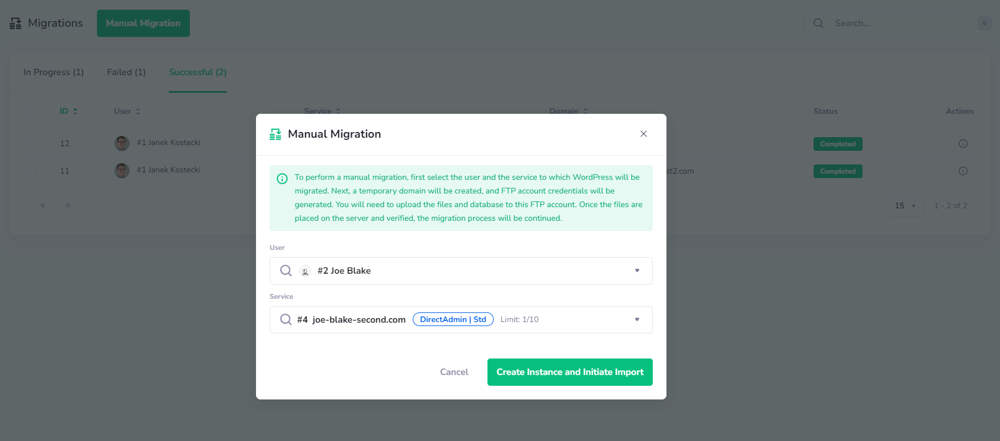
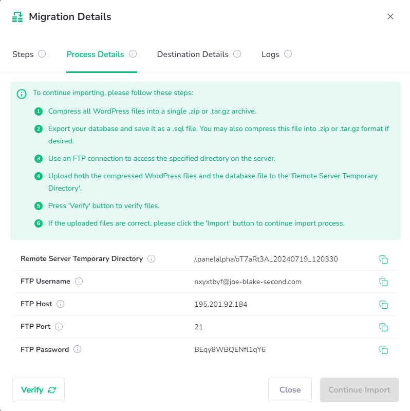

# Migration Types

PanelAlpha supports four types of migrations, each designed for different scenarios and levels of control.

## Quick Comparison

- **Automatic (client-initiated)** — Fastest path with plugin or FTP; supports stop/retry; minimal admin effort.
- **Manual (admin-initiated)** — Best for failed imports, large sites, or when you want to verify uploads before continuing.
- **Plugin-based (admin-initiated)** — Runs the migrator plugin on both source and destination sites and pairs them with a migration token; useful for admin-driven recoveries and server-to-server cutovers.
- **Bulk Migration (admin-initiated)** — Imports many WordPress sites from a CSV file with per-row user/service mapping; best for onboarding batches.

1. **Automatic migrations** — initiated by clients; fully handled via plugin or FTP with stop/retry and live logs.
2. **Manual migrations** — initiated by admins; rely on uploaded files and give full control for edge cases and failed retries.
3. **Plugin-based migrations** — initiated by admins from the **Admin Area → Migrations** page; the migrator plugin is installed manually on both sites and connected via a migration token.
4. **Bulk migrations** — initiated by admins from **Admin Area → Migrations → Bulk Migration**; sites are listed from a CSV and imported with the plugin method after credential checks.

For the CSV format and mapping steps, see [Bulk Migration](../admin-area/migrations.md#bulk-migration-csv).

## 1. Automatic Migrations

Automatic migrations are initiated by clients through the Client Area when they choose to [import an existing WordPress instance](../client-area-instances/importing-existing-instance.md).

### Import Methods

**Note:** Use the plugin method when WP Admin access is available. It offers the best reliability and least friction.

#### Simple Method (Plugin)

The plugin-based method offers two approaches:

**With login credentials:**
- PanelAlpha logs into WordPress admin automatically
- Installs the migration plugin
- Runs the migration automatically
- Fully automated file and database transfer
- Real-time progress updates
- Recommended for most scenarios

**Manual plugin installation:**
- Client downloads and installs the plugin manually
- Client activates the plugin in WordPress admin
- Plugin connects to PanelAlpha
- Initiates migration process
- Fully automated after plugin activation

#### Advanced Method (FTP/SFTP)

The FTP/SFTP method provides direct access:
- Direct FTP/SFTP connection to the source server
- Downloads WordPress files and database
- Useful when the plugin method is not feasible
- Requires FTP credentials and path to the WordPress installation

### Automatic Migration Features

- **Real-time progress tracking**: See which step is currently executing
- **Stop capability**: Ability to stop an automatic migration at any time
- **Source details**: View plugin or FTP connection details used for import
- **Live logs**: Real-time log updates as migration progresses
- **Retry on failure**: Can retry failed automatic migrations

### Key Differences from Manual Migrations

| Area | Automatic | Manual |
|------|-----------|--------|
| Initiated by | Client (self-serve) | Admin (after failure or by choice) |
| Stop mid-process | Yes (Stop button) | No once processing starts |
| Source credentials shown | Yes (plugin/FTP) | No (files uploaded) |
| Cleanup | Auto-removes plugin/temp credentials | Removes temp FTP after finish |
| Best when | Standard sites, client-led imports | Large sites, recover failed imports, more control |

**Note:** Manual migrations give admins control after uploads are in place. Once processing starts, they must run to completion (no Stop button).

## 2. Manual Migrations

Manual migrations are initiated by administrators when automatic imports fail or when more control is needed.

### When to Use Manual Migration

Choose manual migration when:

- The Client Area import failed and you want an admin to continue
- You want the admin team to handle the file and database upload steps
- You need more control over the process (verify files, review logs, retry, mark successful)
- Working with large sites that may timeout during automatic transfer
- The source server has restrictions that prevent automatic methods

### Starting a Manual Migration

1. Click the **Manual Migration** button at the top of the Migrations page.

2. **Fill out the form:**
   - Select **User**: Choose the user who will own the imported instance
   - Select **Service**: Choose the service (plan and hosting server) where the instance will be created
   - Click **Create Instance and Initiate Import**

3. After creating the migration, the Migration Details screen shows FTP credentials and upload instructions.

4. **Upload required files:**
   - Connect to the provided FTP account
   - Upload two files to the temporary directory:
     - `wordpress-files.zip` — ZIP archive of all WordPress files
     - `database.sql`, `database.sql.zip`, or `database.sql.tar.gz` — Database dump file

5. **Verify uploads:**
   - Click the **Verify** button to confirm files are present and valid
   - Expected result: Verification status changes to **Verified**, and **Continue Import** becomes enabled

6. **Continue migration:**
   - Once verification succeeds, click **Continue Import**
   - The migration proceeds automatically through all remaining steps
   - Expected result: Steps advance and finish with status **Completed**

### File Upload Requirements

**1. WordPress Files**: A ZIP archive containing all WordPress files
- Include all files from the WordPress root directory
- Preserve directory structure (wp-content, wp-includes, etc.)
- File must be named: `wordpress-files.zip`

**2. Database Backup**: An SQL dump of the WordPress database
- Export using phpMyAdmin, WP-CLI, mysqldump, or your preferred tool
- File must be named: `database.sql` (or `database.sql.gz` if compressed)
- Ensure export includes all WordPress tables
- Gzip compression is supported and recommended for large databases

### Important Notes

- Large file uploads may take significant time depending on connection speed
- Ensure your ZIP archive is not corrupted before uploading (test extraction locally)
- The temporary FTP account is automatically removed after migration completes
- All uploaded files in the temporary directory are cleaned up automatically

## Method Comparison

| Feature | Automatic (Plugin) | Automatic (FTP) | Manual |
|---------|-------------------|-----------------|--------|
| Initiated by | Client | Client | Administrator |
| Source access | WP Admin or Plugin | FTP/SFTP | Admin uploads files |
| Can be stopped | Yes | Yes | No (after upload stage) |
| File transfer | Automatic | Automatic | Manual upload |
| Best for | Most migrations | No WP admin access | Failed migrations, large sites |
| Skill level | Beginner | Intermediate | Advanced |
| Control level | Low | Medium | High |

## 3. Plugin-Based Migration (Admin-Initiated)

In addition to the client-initiated automatic plugin method and the admin-initiated manual method, PanelAlpha also offers a **plugin-based migration that can be triggered from the Admin Area**. This method uses the same PanelAlpha WordPress Migrator plugin, but it is installed manually on both the source and the destination sites, and the connection is established by exchanging a migration token between them.

### Accessing the Download

The plugin is downloaded from the **Admin Area → Migrations** page using the **Download Plugin** button in the top toolbar.

Clicking the button opens the **Download Migration Plugin** modal, which contains the download link and the full step-by-step procedure.

### Workflow

1. **Download the WordPress migrator plugin** using the **Download Plugin** button inside the modal.
2. **Install and activate the plugin on both the source site and the destination site.** Create the destination instance in PanelAlpha first if it does not exist yet.
3. **On the destination site**, open the plugin settings and copy the migration token that the plugin generates.
4. **On the source site**, paste the copied token into the plugin settings to establish the connection.
5. **Start the migration from the source site.** The plugin transfers the WordPress files and database directly to the destination instance and reports progress back to PanelAlpha.

### When to Use This Method

Choose the plugin-based admin method when:

- You cannot run the [Client Area import wizard](../client-area-instances/importing-existing-instance.md).
- You want full control over the connection by manually pairing the source and destination via a migration token.
- You are migrating from a hosting provider that the automatic plugin installer cannot reach, but you can still upload and activate a WordPress plugin manually.

## Related Documentation

- [Import Process](import-process.md) — Understand the import steps
- [Managing Migrations](managing-migrations.md) — Monitor and manage migrations
- [Client Area: Importing Existing Instance](../client-area-instances/importing-existing-instance.md) — Client-side import guide
