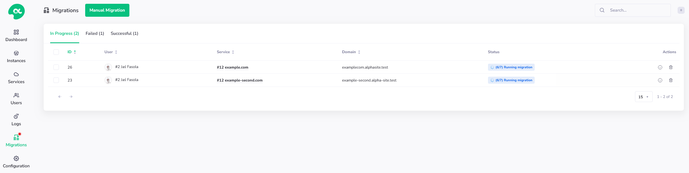
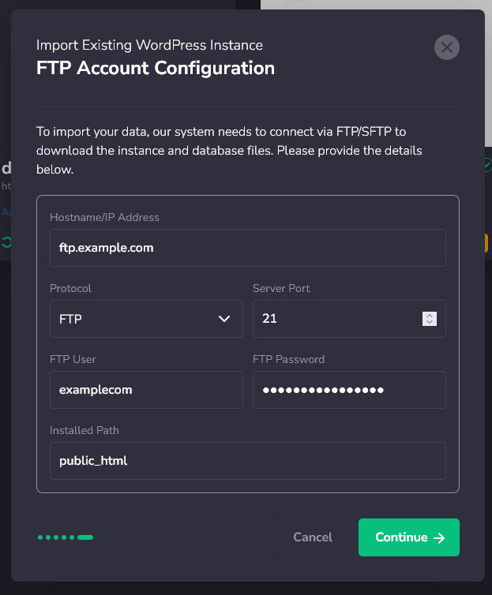
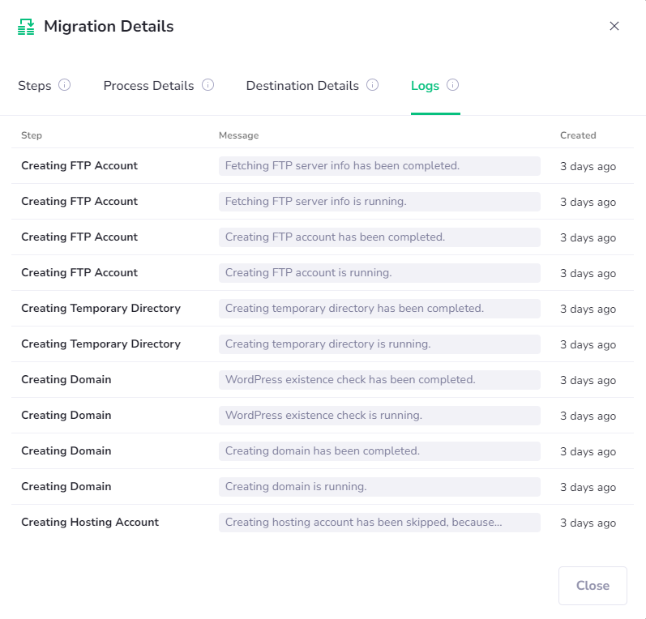

# Troubleshooting

This guide covers common migration issues and their solutions. When troubleshooting, always start by checking the [Migration Details](migration-details.md) modal, particularly the **Logs** tab.

## First-Look Decision Path

1. **Which tab is red or alerting?** Steps or Logs — note the failing step and code.
2. **Is this automatic or manual?**
   - Automatic: consider retry/stop, or flip to manual if source blocks access.
   - Manual: ensure files are uploaded and verified.
3. **Symptom bucket:** connection, download speed/size, extraction/import, search-replace, SSL.
4. **Action:** use the symptom sections below; if unresolved, export logs and escalate.



## Migration Stuck on "Downloading Files"

### Possible Causes

- Large file set (many files or large total size)
- Slow network connection to source server
- Source server throttling connections
- FTP connection timeout settings

### Solutions

1. **Wait longer** — large sites can take hours to download
2. **Check source server logs** for connection issues
3. **Try manual migration** with a pre-prepared ZIP file
4. **Consider splitting large sites** into smaller chunks

## Cannot Connect to FTP Server

### Possible Causes

- Incorrect FTP credentials
- FTP server firewall blocking PanelAlpha
- Wrong FTP port specified
- FTP server down or under maintenance

### Solutions

1. **Verify FTP credentials** with a separate FTP client (FileZilla, Cyberduck)
2. **Check source server firewall rules** — ensure PanelAlpha IP is allowed
3. **Try a different port**:
   - Port 21 for FTP
   - Port 22 for SFTP
   - Port 990 for FTPS (implicit)
4. **Contact source hosting provider** to verify FTP service status
5. **Check passive/active mode** settings if using FTP



## Database Import Failed

### Possible Causes

- Corrupted database dump
- MySQL version incompatibility
- Insufficient MySQL privileges
- Database too large for destination server limits
- Character encoding issues

### Solutions

1. **Re-export database** with a different tool:
   - Try phpMyAdmin instead of WP-CLI or vice versa
   - Use `mysqldump` with the `--single-transaction` flag
   - Ensure UTF-8 encoding is used
2. **Check MySQL version compatibility**:
   - Source MySQL 8.0 may have issues with destination MySQL 5.7
   - Consider upgrading the destination MySQL version
3. **Verify database user privileges**:
   ```sql
   GRANT ALL PRIVILEGES ON database_name.* TO 'user'@'localhost';
   FLUSH PRIVILEGES;
   ```
4. **Increase MySQL settings** on the destination server:
   - `max_allowed_packet = 256M` (or higher)
   - `innodb_buffer_pool_size` for large imports
5. **Split large database imports**:
   - Export individual tables
   - Import in batches

## WordPress Not Found

### Possible Causes

- Incorrect path specified
- WordPress installed in a subdirectory
- Non-standard WordPress structure
- Files not readable by FTP user

### Solutions

1. **Verify exact path** to the WordPress installation:
   - Common paths: `/`, `/public_html`, `/public`, `/htdocs`, `/www`
   - Check for subdirectories like `/wordpress` or `/blog`
2. **Look for wp-config.php**:
   - Navigate via FTP to find the `wp-config.php` file
   - Use that directory as the WordPress path
3. **Check for wp-content directory**:
   - Must be present alongside `wp-config.php`
4. **Verify FTP user permissions**:
   - Ensure the FTP user has read access to all WordPress files
   - Check file ownership and permissions

## Plugin Method Fails

### Possible Causes

- WordPress admin credentials incorrect
- Security plugins blocking login attempts
- Two-factor authentication enabled
- WordPress in maintenance mode
- Admin area protected by .htaccess

### Solutions

1. **Verify admin credentials**:
   - Test login manually in a browser
   - Ensure username and password are correct
   - Check for special characters in the password
2. **Temporarily disable security plugins**:
   - Wordfence
   - iThemes Security
   - Sucuri Security
3. **Disable 2FA** for migration duration:
   - Turn off Google Authenticator
   - Disable Duo Security
4. **Take WordPress out of maintenance mode**:
   - Delete `.maintenance` file from WordPress root
5. **Remove .htaccess restrictions**:
   - Check for IP restrictions
   - Temporarily rename `.htaccess` to `.htaccess.bak`
6. **Try manual plugin installation** option instead

## File Extraction Failed

### Possible Causes

- Corrupted ZIP file
- Insufficient disk space on destination
- File permissions issues
- ZIP file too large
- Unsupported compression format

### Solutions

1. **Test ZIP file integrity**:
   - Extract locally to verify it is not corrupted
   - Re-create ZIP if necessary
2. **Check disk space** on destination server:
   - Need at least 2x the ZIP size free
   - Clean up unnecessary files
   - Upgrade hosting plan if needed
3. **Fix file permissions**:
   - Ensure destination directory is writable
   - Check hosting account ownership
4. **Split large sites**:
   - Create smaller ZIP files
   - Import in stages
5. **Use standard ZIP compression**:
   - Avoid 7z, RAR, or other formats
   - Use standard ZIP or gzip



## Connection Timeout

### Possible Causes

- Network connectivity issues
- Source server slow to respond
- Large file transfer interrupted
- Firewall blocking prolonged connections

### Solutions

1. **Retry the migration** — may be a temporary network issue
2. **Check network connectivity**:
   - Test with `ping` or `traceroute`
   - Verify no packet loss
3. **Try during off-peak hours**:
   - Less server load
   - Better network performance
4. **Use manual migration** for large sites:
   - More control over transfer
   - Can resume if interrupted
5. **Contact hosting provider**:
   - May need to whitelist IPs
   - Adjust timeout settings

## Maximum Execution Time Exceeded

### Possible Causes

- PHP timeout during large data processing
- Database import takes too long
- File extraction timeout
- Search-replace operation on large database

### Solutions

1. **Increase PHP timeout** on destination server:
   - `max_execution_time = 600` (or higher)
   - `max_input_time = 600`
2. **Use manual migration** for large sites:
   - More stable for large datasets
3. **Optimize database before export**:
   - Clean up spam comments
   - Delete post revisions
   - Remove transients
4. **Split migration** into smaller parts:
   - Migrate files first
   - Then database separately

## Insufficient Disk Space

### Possible Causes

- Destination server quota exceeded
- Hosting account disk limit reached
- Temporary files filling up disk
- Large WordPress installation

### Solutions

1. **Check disk space** on destination:
   - Use cPanel Disk Usage tool
   - Run `df -h` command
2. **Clean up destination server**:
   - Delete old backups
   - Remove temporary files
   - Clear caches
3. **Upgrade hosting plan**:
   - Increase disk quota
   - Choose a plan with more space
4. **Optimize source before migration**:
   - Remove unused plugins and themes
   - Clean up media library
   - Compress images

## Search-Replace Failed

### Possible Causes

- Serialized data corruption
- Special characters in URLs
- Database encoding issues
- Tables with different charset

### Solutions

1. **Check database encoding**:
   - Ensure UTF-8 charset
   - Convert if necessary
2. **Verify URLs** do not contain special characters:
   - Avoid spaces and accents in domains
3. **Manual search-replace** using WP-CLI:
   ```bash
   wp search-replace 'old-url.com' 'new-url.com' --skip-columns=guid
   ```
4. **Use specialized tools**:
   - Better Search Replace plugin
   - WP Migrate DB Pro

## SSL Certificate Issues After Migration

### Possible Causes

- AutoSSL not enabled
- Domain DNS not pointed yet
- SSL validation timeout
- Firewall blocking Let's Encrypt

### Solutions

1. **Wait for DNS propagation** (up to 48 hours)
2. **Manually order SSL** certificate:
   - Use PanelAlpha SSL management
   - Or control panel's AutoSSL
3. **Check domain points** to correct server:
   - Verify A record
   - Check nameservers
4. **Temporarily use HTTP**:
   - Update WordPress URLs to use `http://`
   - Switch to HTTPS after SSL is issued

## Using Logs for Troubleshooting

### Step-by-Step Process

1. Open **Migration Details** modal
2. Navigate to **Logs** tab
3. Filter by **ERROR** level
4. Identify the failed step
5. Read the error message carefully
6. Check timestamps — when did it fail?
7. Review **WARNING** messages before the error
8. Look for patterns in repeated errors
9. Copy relevant logs for support tickets

### What to Look For

- **Connection errors**: Network/firewall issues
- **Permission denied**: File/folder permissions
- **Timeout messages**: Need to increase limits
- **MySQL errors**: Database-specific problems
- **Path not found**: Incorrect directory paths

## Getting Support

If you have tried the solutions above and still need help:

1. **Gather information**:
   - Migration ID
   - Error message from Logs tab
   - Source hosting provider details
   - Destination server details
2. **Export logs** from Migration Details
3. **Take screenshots** of error messages
4. **Note what you have already tried**
5. **Contact PanelAlpha support** with all details

## Related Documentation

- [Migration Details](migration-details.md) — Understanding migration logs
- [Managing Migrations](managing-migrations.md) — Retry and manage failed migrations
- [Best Practices](best-practices.md) — Prevent common issues
