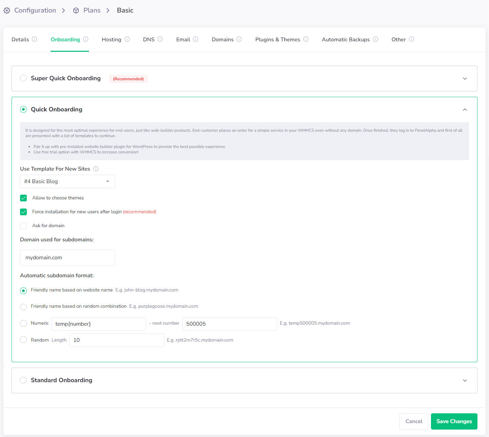
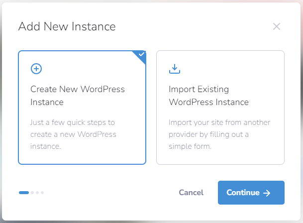
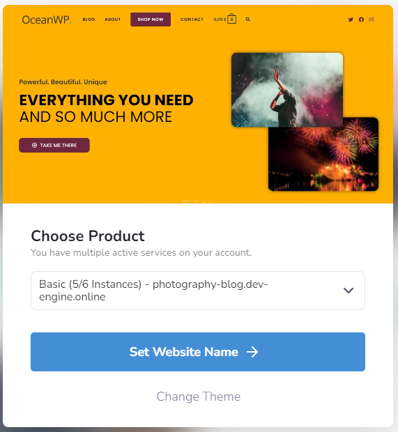
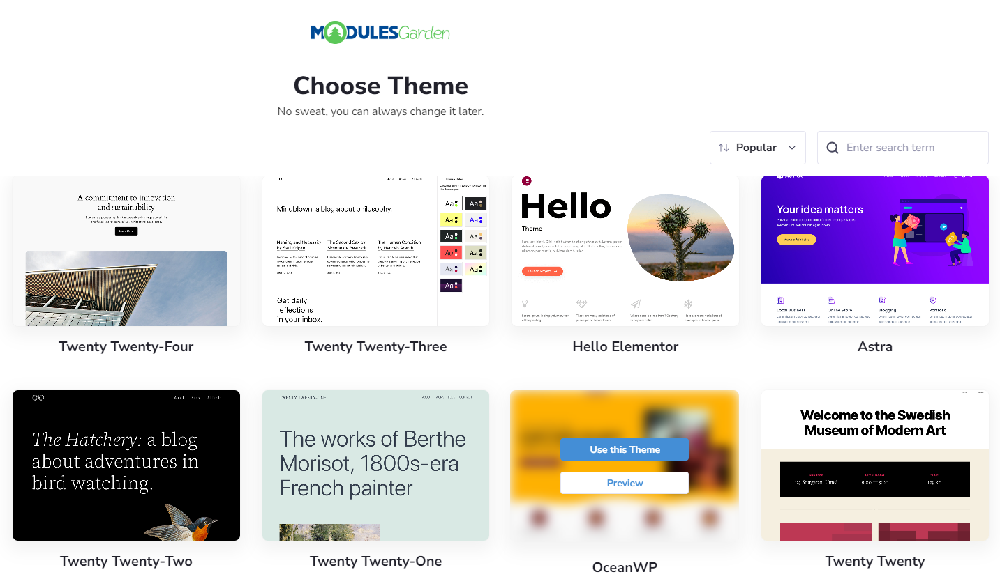
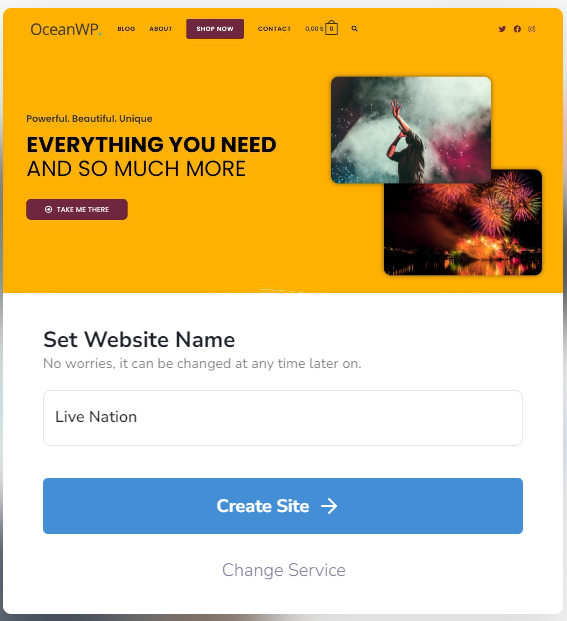

# Quick Onboarding

The **Quick Onboarding** method allows PanelAlpha end users to create new WordPress instances quickly. The entire process can be minimized to selecting a **theme** and entering a **site name**. No additional configuration is required to create a basic, fully functional website.

Try out the free trial in your billing system (like WHMCS) to boost conversion rates.

## Configuration

To offer Quick Onboarding, assign it to a plan and create a service with that plan.

1. Navigate to **Configuration → Plans** and press **Add**.
2. In the **Onboarding** step, select **Quick Onboarding**.
3. Configure the **Quick Onboarding** options:
   - **Use Template For New Sites** — Select a default template. You may also let clients choose a theme. If left empty, clients cannot create websites based on an instance template.
   - **Force installation for new users after login** — New users are automatically prompted to create their first instance after logging in (recommended and selected by default).
   - **Ask for domain** — Clients are asked to provide a domain before instance creation (selected by default). If not selected, additional configuration fields appear and the domain is automatically generated:
     - **Domain used for subdomains** — Enter the main domain for creating subdomains. You will also need to set up a wildcard in the DNS server.
     - **Automatic subdomain format**:
       - **Friendly name based on website name** — For example `john-blog.mydomain.com`
       - **Friendly name random combination** — For example `purplegoose.mydomain.com`
       - **Specified number** — For example `temp100000.mydomain.com`
       - **Random length** — For example `4d7wg9r98x.mydomain.com`

## Workflow

The flow below is an example. It may vary depending on the number of services, assigned plans, and their specifications.

1. The end-user purchases a service in your billing system (for example WHMCS) and is redirected to the PanelAlpha client area via SSO.

2. If **Force installation** is selected, instance creation is triggered immediately. Otherwise, the client manually starts: **Add New → Create New WordPress Instance → Continue**.

3. The client selects a product (for example "Basic"). This step is skipped if the client owns only one service.

4. If **Ask for domain** is selected, the client provides a domain name. Otherwise, the client moves to the **theme selection** page.

5. The client provides a **name for the new website**. The domain is created according to the plan configuration (for example "Automatic subdomain format → Friendly name based on website name"). The domain can be changed later using the **Change Domain** button.

6. Wait for the site installation to complete.

7. After installation on a custom domain, if Domain DNS Verification fails, the Client Area can show DNS setup guidance (for example **Set DNS Records** and **Set Nameservers**). What appears depends on the plan settings under **DNS → Domain DNS Verification → Show options** and the selected **Verification condition**. See [Plans — DNS](../system-configuration/plans.md#advanced-dns-configuration).

**Important:**
1. If a client has multiple services and **all require a theme**, the flow is: **Choose theme → Select product → Provide domain → Provide instance name**.
2. If a client has multiple services and **only some require a theme**, the flow is: **Select product → Choose theme** (for products that require it) **→ Provide domain → Provide instance name**.
