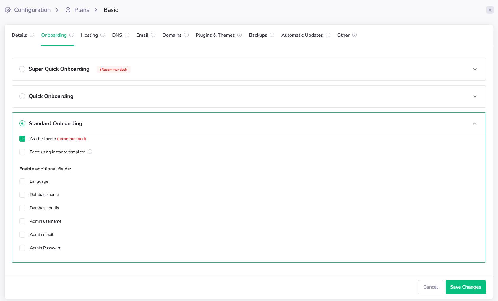
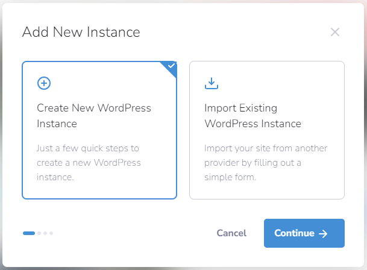
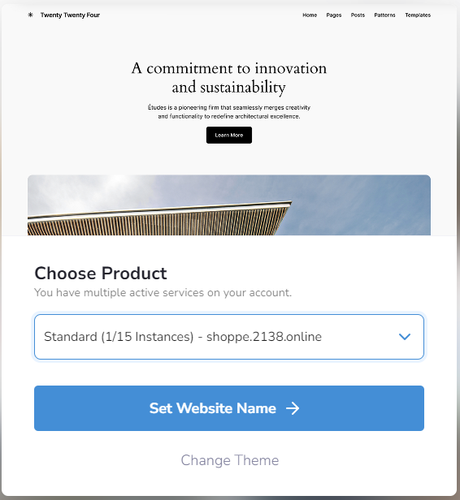
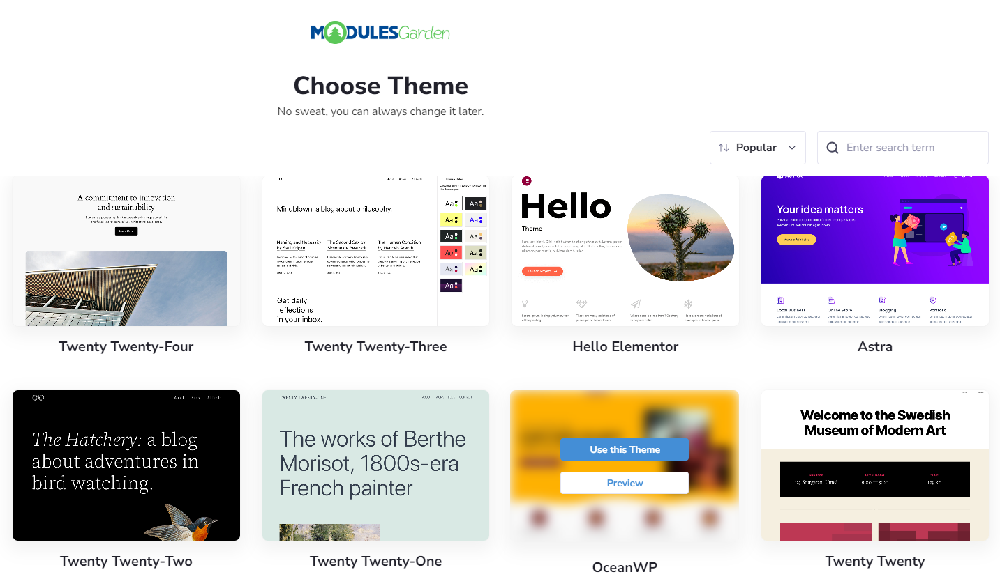
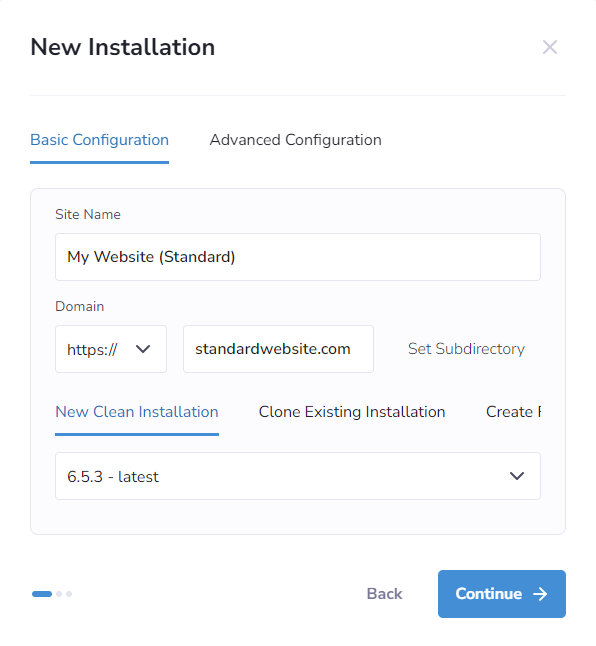

# Standard Onboarding

The Standard Onboarding method gives users full control over instance creation. It is **recommended for advanced users**. Customers who purchase a service with this onboarding method can provide additional website details during installation.

## Configuration

To offer Standard Onboarding, assign it to a plan and create a service with that plan.

1. Navigate to **Configuration → Plans** and press **Add**.
2. In the **Onboarding** step, select **Standard Onboarding**.
3. Configure the Standard Onboarding options:
   - **Ask For Theme** — If selected, clients choose a theme before installation. Otherwise, a default theme is used.
   - **Force Using Instance Template**:
     - If **enabled**, select a template that will be used by default.
     - If **disabled**, the client can pick any active instance template.
   - **Additional Fields** — Select which fields the end-user must provide:
     - Language
     - Database name
     - Database prefix
     - Admin username
     - Admin email
     - Admin password

## Workflow

The flow below is an example. It may vary depending on the number of services, assigned plans, and their specifications.

1. The end-user purchases a service in your billing system (for example WHMCS) and is redirected to the PanelAlpha client area via SSO.

2. The client manually starts creating the website: **Add New → Create New WordPress Instance → Continue**.

3. The client selects a product (for example "Standard"). This step is skipped if the client owns only one service.

4. The client selects a preferred theme (if **Ask for theme** is enabled; otherwise a default theme is used and this step is omitted).

5. Provide required information for the website:
   - **Site Name**
   - **Domain** and **Subdirectory**
   - For **New Clean Installation**:
     - **WordPress version**
   - When **Cloning Existing Installation**:
     - Select an existing installation
   - When **Creating Instance from Template**:
     - Select an active template
     - Or use the default template imposed by the admin (if **Force Using Instance Template** is enabled)
   - Any **Advanced Configuration** fields specified in the plan (admin username, email, password)

6. Wait for the site installation to complete.

7. After installation on a custom domain, if Domain DNS Verification fails, the Client Area can show DNS setup guidance (for example **Set DNS Records** and **Set Nameservers**). What appears depends on the plan settings under **DNS → Domain DNS Verification → Show options** and the selected **Verification condition**. See [Plans — DNS](../system-configuration/plans.md#advanced-dns-configuration).

**Important:**
1. If a client has multiple services and **all require a theme**, the flow is: **Choose theme → Select product → Provide domain → Provide instance name**.
2. If a client has multiple services and **only some require a theme**, the flow is: **Select product → Choose theme** (for products that require it) **→ Provide domain → Provide instance name**.
