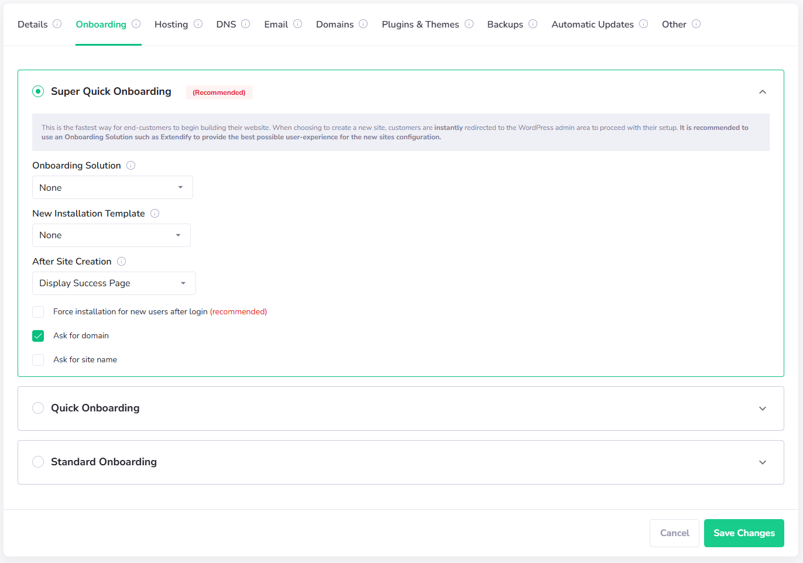
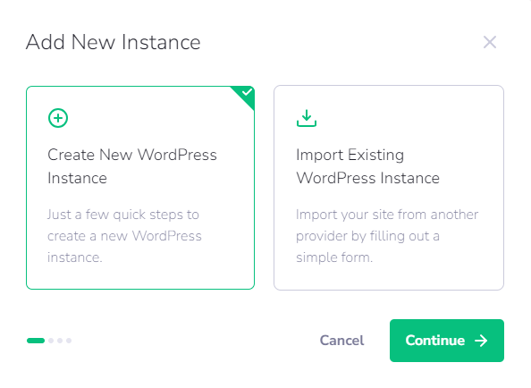
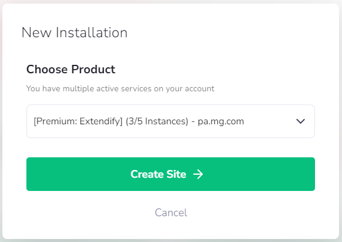
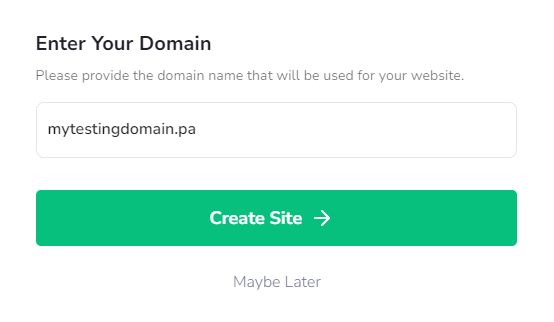
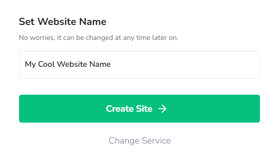
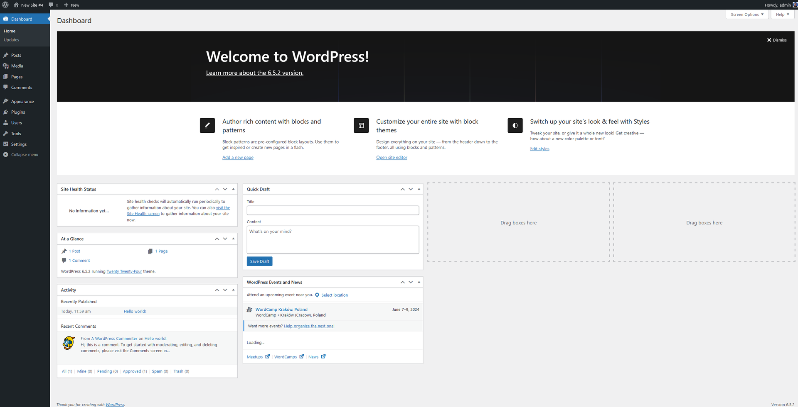
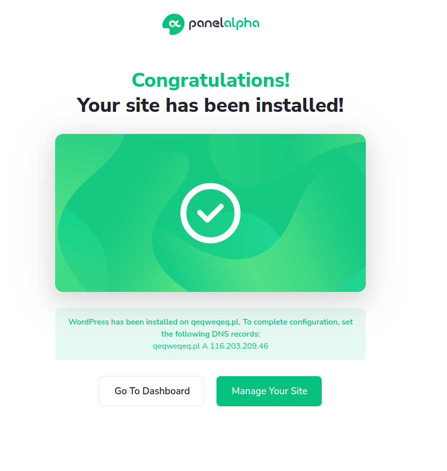
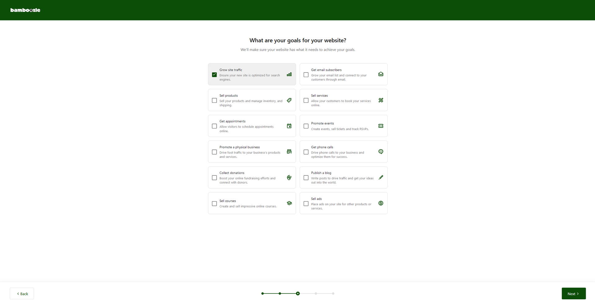
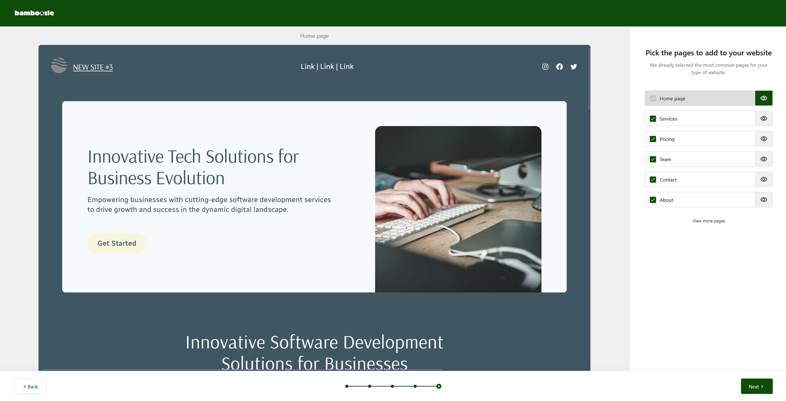
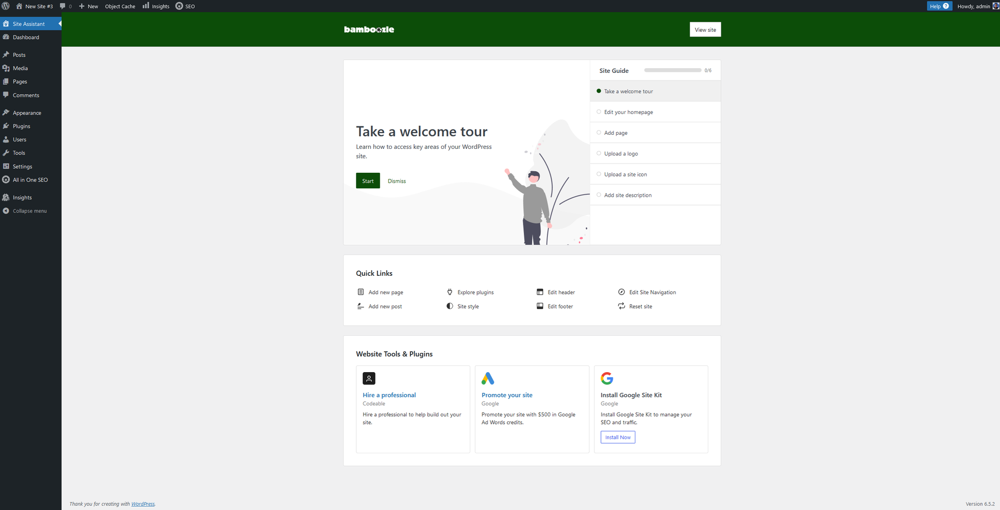

# Super Quick Onboarding

**Super Quick Onboarding** is the fastest method for PanelAlpha end-users to install new WordPress websites. It distinguishes itself from [Standard](standard-onboarding.md) and [Quick Onboarding](quick-onboarding.md) through integration with an AI-powered onboarding solution — [Extendify](../integrations/extendify.md) or [10Web](../integrations/ten-web.md) — for direct website creation, design, and editing.

Utilize the [free trial](../billing-scenarios/free-trial-period.md) feature in your billing panel (for example WHMCS) to increase conversion rates.

## Onboarding Solutions

### Extendify

- [Extendify](https://extendify.com/) is a platform for creating and customizing WordPress websites with pre-built blocks and templates, including AI-powered development.
- To take full advantage of Super Quick Onboarding, enable and configure the [Extendify integration](../integrations/extendify.md). An [active account](https://extendify.com/pricing/) is required.

### 10Web

- [10Web](https://10web.io/) is an AI-powered WordPress platform that generates websites based on a text description provided by the end-user.
- To use 10Web with Super Quick Onboarding, enable and configure the [10Web integration](../integrations/ten-web.md). An active 10Web account with API access is required.

## Configuration

To offer Super Quick Onboarding, assign it to a plan and create a service with that plan.

1. Navigate to **Configuration → Plans** and press **Add**.
2. In the **Onboarding** step, select **Super Quick Onboarding**.
3. Configure the **Super Quick Onboarding** options:
   - **Onboarding Solutions** — Select the solution to use:
     - **[Extendify](../integrations/extendify.md)** — After creating the instance, the end-user is redirected to the WordPress admin panel where the Extendify plugin and theme are automatically installed, and the website builder process begins.
     - **[10Web](../integrations/ten-web.md)** — After creating the instance, the end-user is redirected to WP Admin where the 10Web AI Builder plugin is automatically installed. The AI wizard prompts the user to describe their website and generates it accordingly.
       Additional options available for 10Web:
       - **Website creation limit** — Maximum AI website generation allowed per instance.
       - **Edit limit** — Maximum AI edits allowed per instance.
   - **New Installation Template** — If you do not use an onboarding solution, impose an instance template for new websites.

     **Important:** You may pick only one option: an onboarding solution (Extendify or 10Web) or a default instance template. If both are set to **None**, the end-user is redirected to the WordPress admin panel.
   - **After Site Creation** — Choose what happens after installation:
     - **Redirect To WP Admin** — Redirect users to the WordPress admin area after creation. Specify a delay in seconds.
     - **Display Success Page & Domain DNS Verification** — Verify DNS records after creation. If verification fails, necessary DNS records are displayed.
     - **Display Success Page** — Only the success page is displayed.
   - **Force installation for new users after login** — New users are automatically prompted to create their first instance after logging in (recommended and selected by default).
   - **Ask for domain** — Clients are asked to provide a domain before instance creation (selected by default).
   - **Ask for site name** — Clients are additionally asked to enter the site name.

**Additional options:**

If **Ask for domain** is **not marked**, additional configuration fields appear. The domain is automatically generated based on:

- **Domain used for subdomains** — Enter the main domain for creating subdomains. You will also need to set up a wildcard in the DNS server.
- **Automatic subdomain format**:
  - **Friendly name based on website name** — For example `john-blog.mydomain.com`. Requires "Ask for site name" to be enabled.
  - **Friendly name random combination** — For example `purplegoose.mydomain.com`
  - **Specified number** — For example `temp100000.mydomain.com`
  - **Random length** — For example `4d7wg9r98x.mydomain.com`

## Workflow

The flow below is an example. It may vary depending on the number of services, assigned plans, and their specifications.

1. The end-user purchases a service in your billing system (for example WHMCS) and is redirected to the PanelAlpha client area via SSO.

2. If **Force installation** is selected, instance creation is triggered immediately. Otherwise, the client manually starts: **Add New → Create New WordPress Instance → Continue**.

3. If the client owns **more than one service**, they select the product on which the instance will be created.

4. If both **Ask for domain** and **Ask for site name** are enabled, the client provides a domain and site name.

5. If **Ask for domain** is disabled and **Ask for site name** is enabled, the client provides a site name. Otherwise, the website is instantly created and the client is redirected to the WP Admin panel. The domain can be changed later using the **Change Domain** button.

6. After creating the website (clean installation or from a template), the client is:
   - Redirected to WP Admin (if "Redirect to WP-Admin" is enabled and no Extendify integration)

   - Informed about a successfully installed website (if "Display Success Page" is enabled)
   - Informed about a successfully installed website with DNS records to configure (if "Display Success Page & Domain DNS Verification" is enabled)

   - Upon pressing **Manage Your Site**, redirected to WP Admin (no Extendify integration)
   - Redirected to the Extendify panel for further site configuration (if Extendify is enabled)

7. For services **with Extendify**, the client composes their website using suggestion prompts:
   - WordPress site subject
   - Website name
   - Goals for the website
   - Website design
   - Additional pages
   - Plugins installation

   Extendify allows complete, website-builder-like management directly from the WP Admin panel. The available toolset varies based on your Extendify account type: standard prompts in "Extendify Essential" and AI-powered functionalities in "Extendify AI".

   For services **with 10Web**, the client is greeted by the 10Web AI wizard, which asks them to describe what kind of website they want to build and generates it automatically based on that description.
