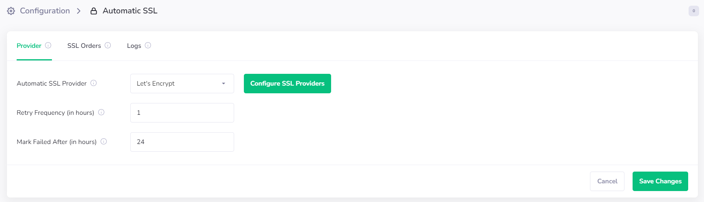
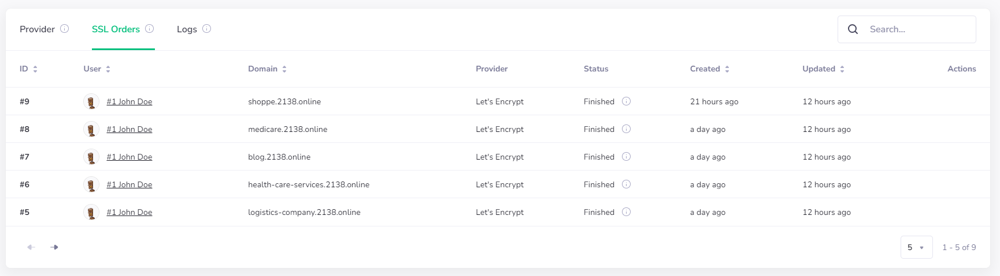
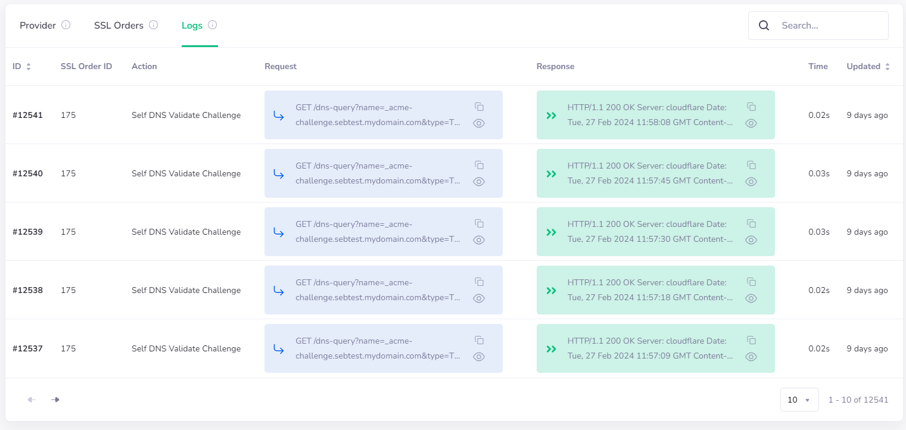

# Automatic SSL

Automatic SSL configuration automatically sets up SSL certificates for websites. [Let's Encrypt](../integrations/lets-encrypt.md) is the recommended provider.

## Quick Start (Let's Encrypt)

For working HTTPS with Let's Encrypt:

1. Ensure domains point to the correct server and ports **80/443** are open.
2. Go to **Configuration → Automatic SSL** and set **Automatic SSL Provider → Let's Encrypt**.
3. PanelAlpha queues certificate requests automatically.
4. If an order is stuck, click **Process Now** next to the order in the **SSL Orders** list.

### Provider Configuration

Define basic settings:

- **Automatic SSL Provider** — Select from:
  - [Let's Encrypt](../integrations/lets-encrypt.md) *(recommended)*
  - Self Signed Certificate
  - Disable
- **Retry Frequency (hours)** — Interval between attempts to download the certificate.
- **Mark Failed After (hours)** — Duration after which the SSL order is marked as failed.

### SSL Orders

- List of SSL orders, their status, and date of last update
- Actions: **Process Now** — process the order immediately (if applicable)

If Let's Encrypt rejects the validation, the next attempt starts a new order. The old order cannot be used again. The reason given by Let's Encrypt is saved in the order status message and in the logs, so you can see why the validation failed.

If a newer order for a domain fails, the domain keeps the status of its last valid certificate. A failed order does not replace a working certificate.

### Logs

List of events on SSL orders:

- SSL order ID number
- Action type
- Request
- Response
- Time
- When updated

For help with stalled or skipped SSL orders, visit the [Automatic SSL troubleshooting](../../troubleshooting-center/configuration/automatic-ssl.md) guide.
