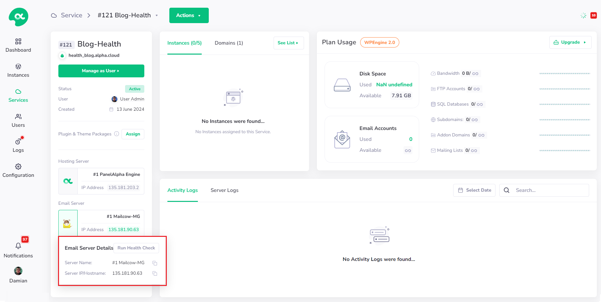
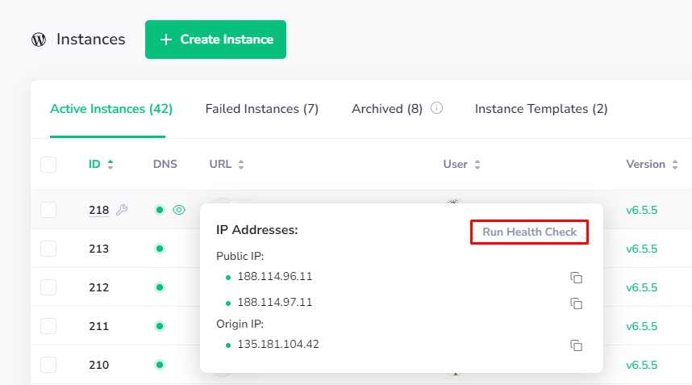
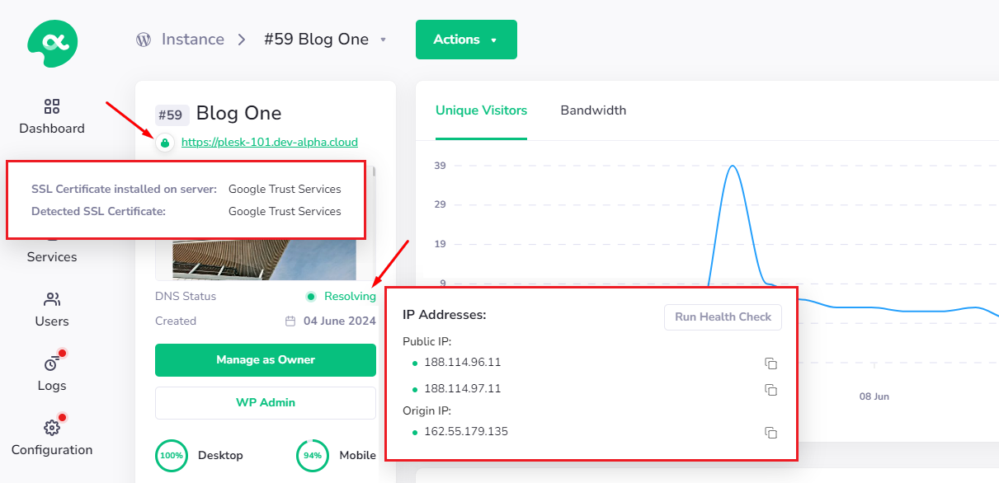
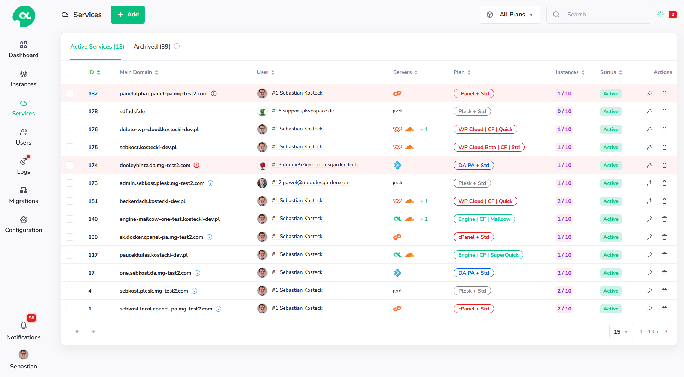
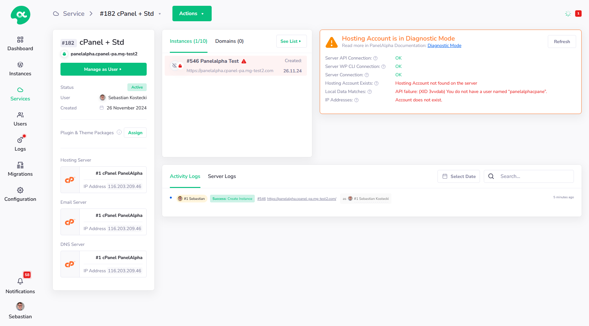
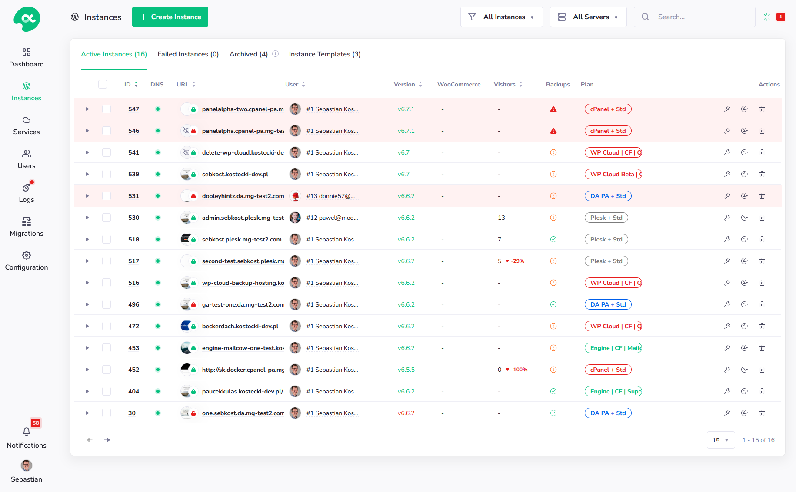
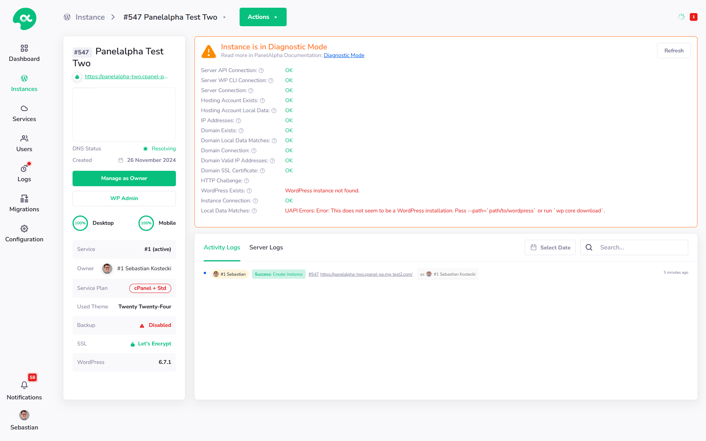
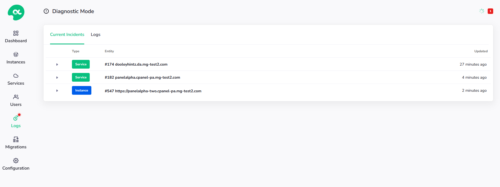
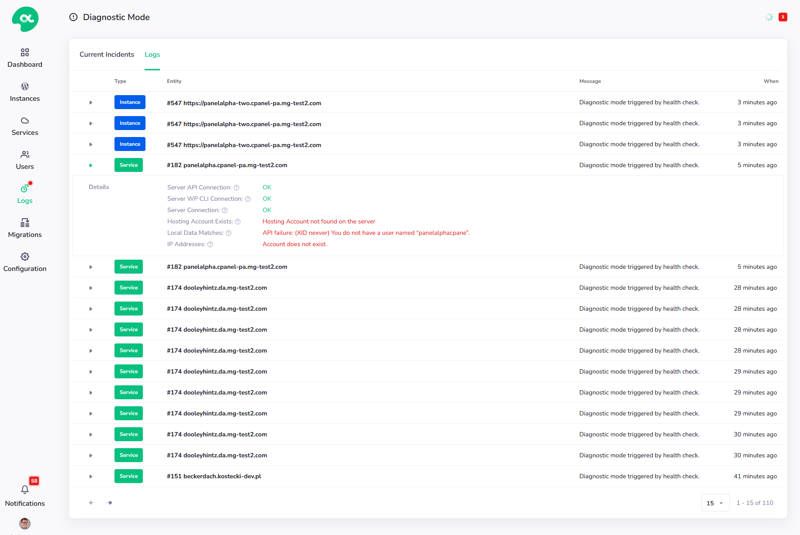

# Health Check & Diagnostic Mode

The PanelAlpha platform includes a tool for monitoring system condition, functionalities, and overall health. When issues are detected during health checks, instances or services may enter **Diagnostic Mode** to protect your settings and data.

The Health Check feature must be triggered manually for the part of the system you wish to monitor.

## Running Health Checks

1. Navigate to the specific part of the system you wish to check.
2. Click the **Run Health Check** button.
3. After a brief moment, the data will refresh.

## System Parts

After manual triggering, the following aspects are verified:

### Service Details

- **Hosting Server**
  - **Server Connection** — Checks if the server is reachable
  - **API Connection** — Checks API connectivity (for example verifies if the token is valid)
  - **WP-CLI Connection** — Checks if the PanelAlpha connector is functioning
  - **Hosting Account Exists** — Checks if the account exists
- **DNS Server**
  - **Server Connection** — Checks if the server is reachable
  - **API Connection** — Checks API connectivity
- **Email Server**
  - **Server Connection** — Checks if the server is reachable
  - **API Connection** — Checks API connectivity

### Instance Details

- **Hosting Server** — As described above
- **Domain Exists** — Checks if the domain exists
- **Domain Connection** — Checks if the domain is reachable
- **Instance Connection** — Checks if the instance URL is reachable
- **WordPress Exists** — Checks if the WordPress instance exists

### Domain Details

- **Hosting Server** — As described above
- **Domain Exists** — Checks if the domain exists
- **Domain Connection** — Checks if the domain is reachable
- **Email Domain**
  - **Email Server** — As described above
  - **MX DNS Record Exists** — Checks if the MX record is correct
- **DNS Zone**
  - **DNS Server** — As described above
  - **DNS Zone Exists** — Checks if the zone exists on the DNS server

## What is Diagnostic Mode?

When an instance or service is marked as being in Diagnostic Mode, it indicates a problem preventing management through PanelAlpha. This typically occurs when:

- The WordPress instance no longer exists on the hosting server (for example due to direct deletion).
- The hosting account or service associated with the instance does not exist.

Diagnostic Mode activates when PanelAlpha **detects issues that prevent successful connection or management** during health checks. This status protects your settings and data and alerts you to potential issues.

### Diagnostic Mode in Client Area

Instances or services in Diagnostic Mode still appear in lists, but management options are limited:

- **Instance Management** — Displays: "Managing the site is currently not possible (Diagnostic Mode). Please contact support for more details."
- **Hosting Management** — Only the **Summary** tab is accessible. Other sections display: "Managing the hosting is currently not possible (Diagnostic Mode). Please contact support for more details."

### Diagnostic Mode in Admin Area

Services or instances in Diagnostic Mode are visually flagged:

- **Services List View** — A "!" symbol is displayed next to the domain name.

- **Service Details** — An information box displays details detected by the Health Check. After [resolving the issues](../../troubleshooting-center/diagnostics/diagnostic-mode.md), use the **Refresh** button to confirm the service is operational.

- **Instances List View** — Instances in Diagnostic Mode are marked with a **red background**.

- **Instance Details** — An information box displays details detected by the Health Check. After [resolving the issues](../../troubleshooting-center/diagnostics/diagnostic-mode.md), use the **Refresh** button.

- **Logs Section** — A dedicated **Diagnostic Mode Logs** section provides detailed information.

## How to Fix Diagnostic Mode

To resolve issues with instances or services in Diagnostic Mode, refer to the [Troubleshooting Center](../../troubleshooting-center/diagnostics/diagnostic-mode.md) for detailed steps to re-establish connection and address instance issues.
