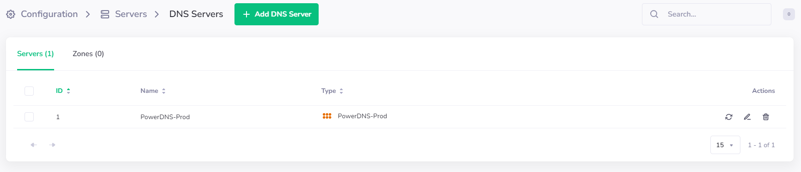
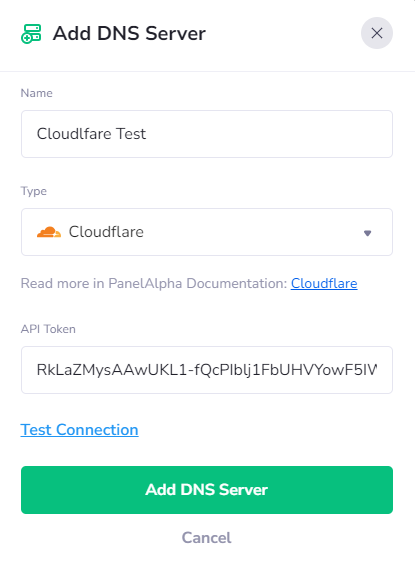
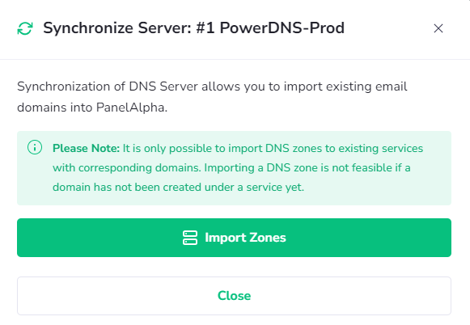
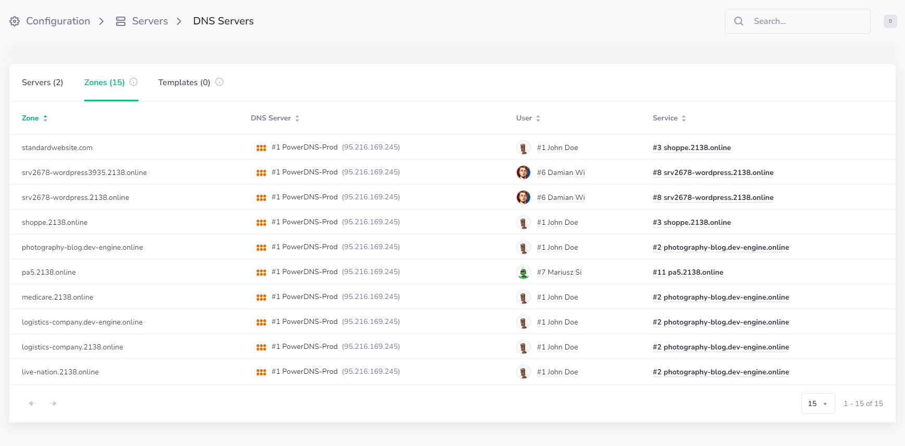
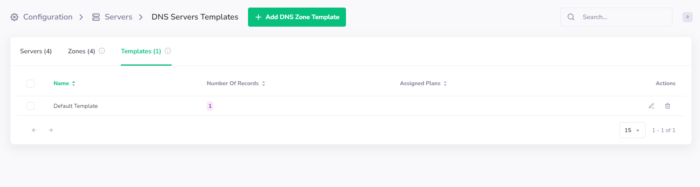
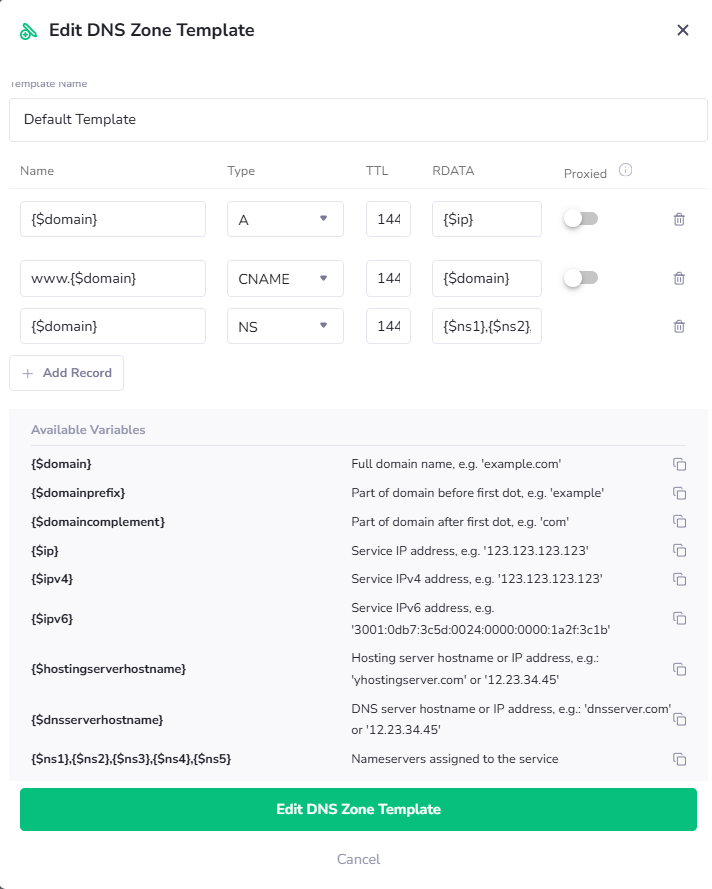

# DNS Servers

DNS servers translate human-friendly domain names (like www.example.com) into numerical IP addresses that computers use to communicate. PanelAlpha supports multiple DNS providers for flexible domain management.

## DNS Servers

Server, Zones, and Templates are the three sections dedicated to DNS servers.

**Servers** — List of existing DNS servers with:

- Server ID number
- Server name
- Server type:
  - [Bunny.net](../dns-servers/bunny.md)
  - [Cloudflare](../dns-servers/cloudflare.md)
  - [cPanel DNSOnly](../dns-servers/cpanel-dns-only.md)
  - [PowerDNS](../dns-servers/powerdns.md)
- Allowed actions:
  - [Synchronize](dns-servers.md#server-synchronization) the server
  - Edit the server
  - Delete the server

### Adding a New Server

Add a DNS server by pressing the button and filling in the short form:

- Provide the DNS server custom name
- Select type:
  - [Bunny.net](../dns-servers/bunny.md)
  - [PowerDNS](../dns-servers/powerdns.md)
  - [Cloudflare](../dns-servers/cloudflare.md)
  - [cPanel DNSOnly](../dns-servers/cpanel-dns-only.md)

Depending on the selected type, provide additional details. For example, **Bunny.net** uses an **API Key** and optionally accepts custom **Nameserver 1 / Nameserver 2**. For more details on each type, refer to its dedicated documentation page.

## Server Synchronization

DNS server synchronization enables importing DNS zones into PanelAlpha. You can import DNS zones only for existing services with corresponding domains.

## DNS Zones

After successful synchronization, imported zones appear in the **Zones** tab. This section displays zones from external DNS servers only.

## Automatic DNS Actions (Plan-Based)

DNS changes are handled automatically according to [Plan configuration](plans.md), not by a single global rule.

When PanelAlpha provisions a domain or subdomain for a service, DNS handling follows the plan DNS settings, including:

- Creating a domain for a new instance
- Creating a domain for a staging instance
- Creating a new domain/subdomain during instance copy (for example `copied-from-...`)

Behavior depends on plan DNS options, for example:
- **Create DNS Zone For Domain**
- **Subdomain DNS Action** (Create new DNS zone, Create A record on parent zone, or None)
- **Onboarding/Quick subdomain DNS action** (same action types)
- Proxy settings for auto-created A/CNAME records (if supported by the DNS provider, for example Cloudflare or Bunny.net)

Staging and copied instances do not always create a separate zone. If the plan action is set to parent-zone records, only records are created in the parent zone. If action is set to `None`, no DNS records or zones are created automatically.

Cleanup behavior is also plan-based (auto-delete zones and records options).

## DNS Templates

Templates configure DNS records automatically assigned to a zone on creation. To assign a template, set it up for each plan.

### Adding a DNS Zone Template

To assign a DNS template, set it up for each plan:

- Provide a template name
- Add records (supported types: A, AAAA, CNAME, TXT, MX, NS)
- Set whether a record should be **Proxied**. If the DNS server supports Proxy (like Cloudflare or Bunny.net), the record will have it enabled if checked.

Example DNS records:

| Name | Type | TTL | RDATA |
|------|------|-----|-------|
| example.com. | A | 60 | 208.93.64.253 |
| example.com. | AAAA | 3600 | 3001:0db7:3c5d:0024:0000:0000:1a2f:3c1b |
| example.com. | CAA | 3600 | 0 issue "ca.example.net" |
| www.example.com. | CNAME | 3600 | example.com. |
| example.com. | MX | 14400 | 10 onemail.example.com. |
| example.com. | NS | 3600 | ns1.example.com. |
| example.com. | PTR | 3600 | 110.164.252.222 |
| _sip._tcp.example.com. | SRV | 3600 | 0 5 5060 sipserver.example.com. |
| example.com | TXT | 1800 | example-site-verification=H7um1gh346Cop5nd6613Fvs |

**Available variables** retrieve information from the user's instance/service:

- `{$domain}` — Full domain name, for example `example.com`
- `{$domainprefix}` — Part before the first dot, for example `example`
- `{$domaincomplement}` — Part after the first dot, for example `com`
- `{$ip}` — Service IP address, for example `123.123.123.123`
- `{$hostingserverhostname}` — Hosting server hostname or IP address
- `{$dnsserverhostname}` — DNS server hostname or IP address
- `{$ns1}`, `{$ns2}`, `{$ns3}`, `{$ns4}`, `{$ns5}` — Nameservers assigned to the service

For plans with a DNS template configured, template records are applied automatically when domains are provisioned (for example during instance or staging creation).
