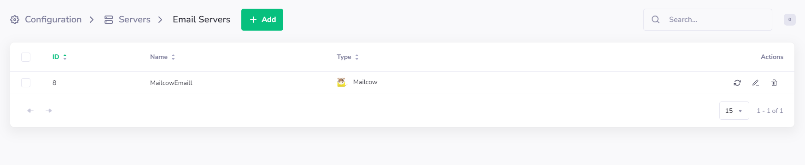
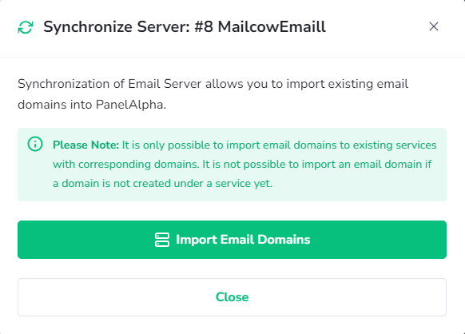
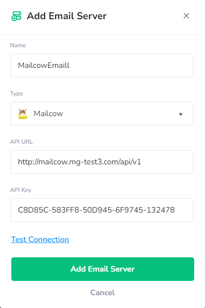

# Email Servers

Email servers facilitate the sending, receiving, and storage of email messages. PanelAlpha currently supports [Mailcow](../email-servers/mailcow.md) and [cPanel](../email-servers/cpanel.md) as email servers.

## List of Servers

Navigate to **Configuration → Servers → Email Servers**. Specific details on server types can be found in the dedicated sections under **Email Server Connections**.

## Server Synchronization

Email server synchronization allows importing existing email domains into PanelAlpha. You can import email domains only for existing services with corresponding domains.

## Adding an Email Server

Add an email server by pressing the button and filling in the short form.

- Provide the email server custom name
- Select type: [Mailcow](../email-servers/mailcow.md) or [cPanel](../email-servers/cpanel.md)
- Provide required data depending on the selected type:
  - For [Mailcow](../email-servers/mailcow.md):
    - API URL
    - API Key
  - For [cPanel](../email-servers/cpanel.md):
    - **IP/Hostname** — Enter the server IP address or hostname.
    - **Username** — Enter the username for which the token has been generated.
    - **API Token** — Previously generated [API token](https://support.cpanel.net/hc/en-us/articles/1500011416602-How-to-create-an-API-token-for-a-cPanel-user)
    - **SSL Verification** — Select if you want to connect via SSL
    - **Test Connection** — Check if the connection is successful

You may edit details or delete the server at any time.
