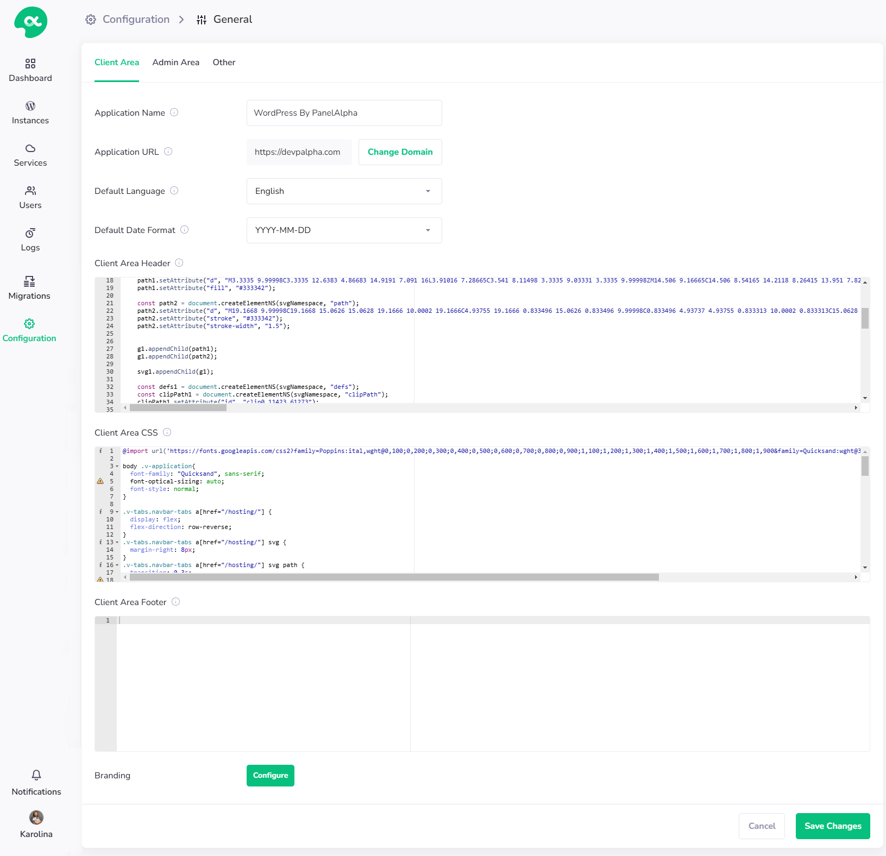
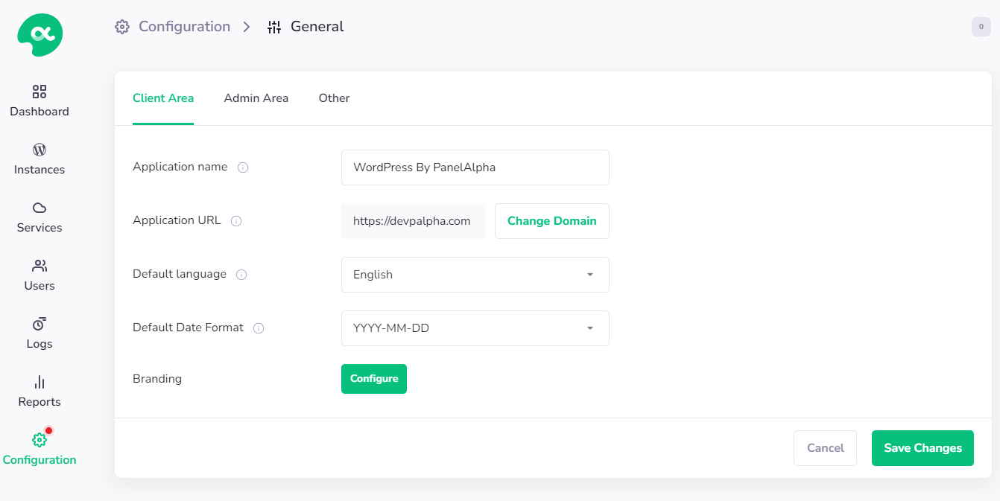
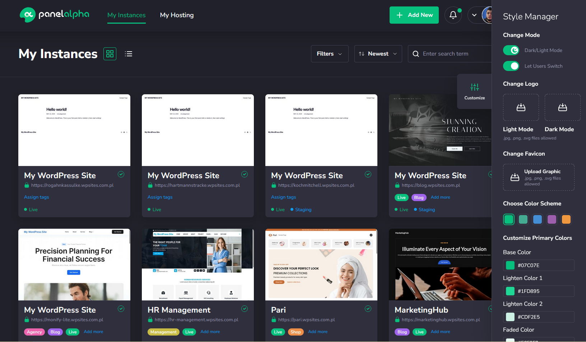
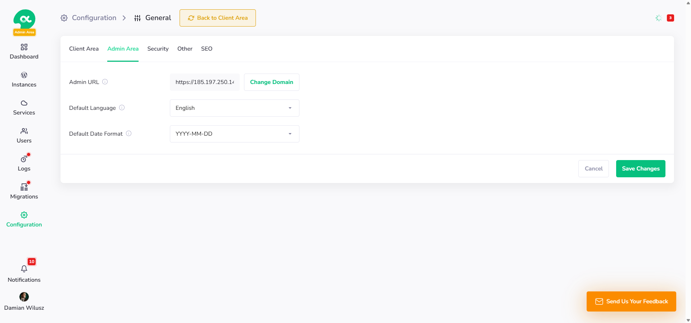
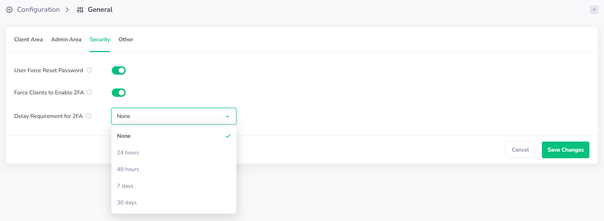
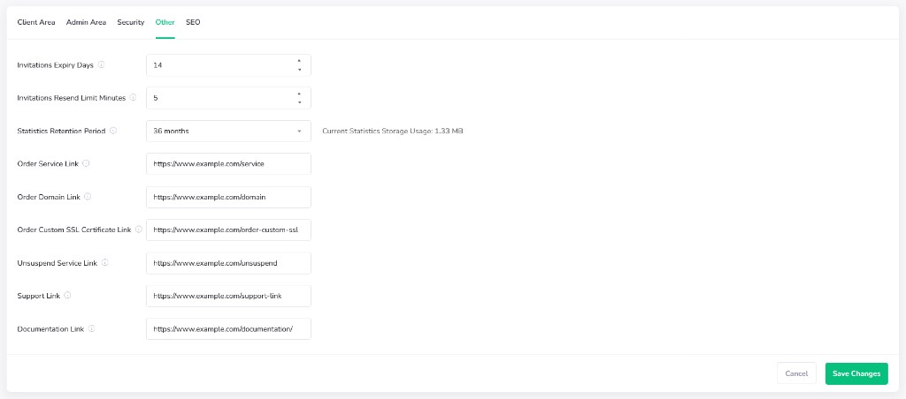
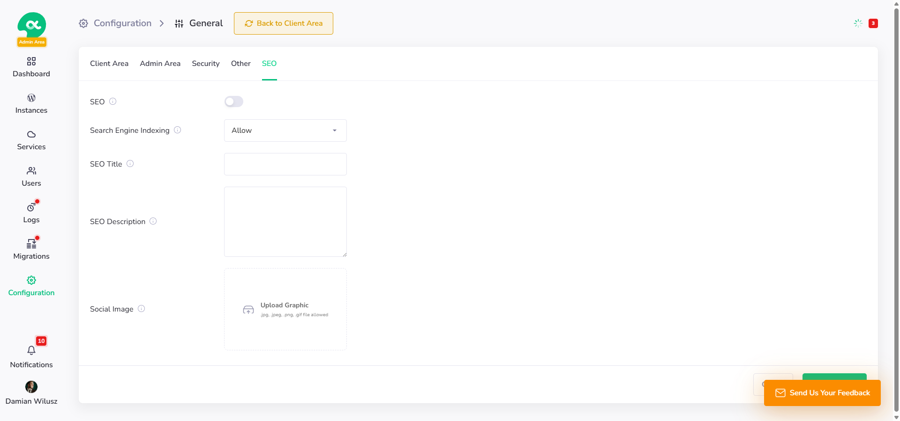

# General Configuration

This article provides comprehensive information about general configuration options in PanelAlpha. These settings provide the essential data needed to initialize the system and enable full management of WordPress instances.

To begin, navigate to **Configuration → General** in your admin panel.

## Client Area

The **Client Area** section contains essential configuration options for your client panel.



### Basic Settings

1. **Application Name** — The name visible to clients, serving as the primary identifier in the client area.

2. **Application URL** — The URL clients use to access your application. To modify:
   - Click **Change Domain**
   - Enter the new domain name
   - Test the connection
   - Click **Save New URL**

3. **Default Language** — The default language for the client area. English is currently the only available language by default. Support for multiple languages will be introduced in future versions.

4. **Default Date Format** — The date format displayed throughout the client area.

### Customization Options

1. **Client Area Header** — Add custom JavaScript to modify the header (for example navigation menus or notification bars).

2. **Client Area CSS** — Apply custom CSS styling to modify appearance (for example brand icons, fonts, colors, or menu display).

3. **Client Area Footer** — Add custom JavaScript to modify the footer (commonly used for live chat features).

### Branding

Navigate to **Configuration → General → Client Area → Branding** and click **Configure** to customize the client area.



You will be redirected to the client area preview. Click the **Customize** tab to open the style manager.

#### Style Manager

Customize the client area using the live-preview form.



1. **Change Mode** — Choose **Dark** or **Light** mode.
2. **Let Users Switch** — Allow users to toggle between light and dark mode.
3. **Change Logo (Light Mode)** — Upload a logo for light mode (.jpg, .png, .svg). Maximum file size: **2 MB**.
4. **Change Logo (Dark Mode)** — Upload a logo for dark mode (.jpg, .png, .svg). Maximum file size: **2 MB**.
5. **Change Favicon** — Upload a favicon (.jpg, .png, .svg). Maximum file size: **2 MB**.
6. **Choose Color Scheme** — Select from 5 default color schemes.
7. **Customize Primary Colors** — Fine-tune each primary color.
8. **Additional Settings** — Background shadows are enabled by default. Disable if desired.

Save changes. Use **Restore Default** to return to original styling.

White-label branding also applies to WordPress plugin UI that PanelAlpha installs and to WHMCS SSO errors when no instance exists yet. Those surfaces use **Application Name** and Style Manager logos instead of a hard-coded PanelAlpha label. Set **Application Name** under **Configuration → General → Client Area**.

### Code Examples

#### Custom Banner

Example JavaScript for adding a custom banner:

```javascript
<script type="text/javascript">
const customBanner = document.createElement('div');
customBanner.innerText = 'Custom Banner';
customBanner.style.position = 'fixed';
customBanner.style.bottom = '10px';
customBanner.style.left = '10px';
customBanner.style.backgroundColor = 'rgba(0, 0, 0, 0.7)';
customBanner.style.color = 'white';
customBanner.style.padding = '10px';
customBanner.style.borderRadius = '5px';
customBanner.style.zIndex = '1000';
document.body.appendChild(customBanner);
</script>
```

#### Live Chat Integration

Example JavaScript for implementing [LiveChat](https://www.livechat.com/). Replace the license number with your actual license:

```javascript
<!-- Start of LiveChat (www.livechat.com) code -->
<script>
 window.__lc = window.__lc || {};
 window.__lc.license = 28067890;
 window.__lc.integration_name = "manual_onboarding";
 ;(function(n,t,c){function i(n){return e._h?e._h.apply(null,n):e._q.push(n)}var e={_q:[],_h:null,_v:"2.0",on:function(){i(["on",c.call(arguments)])},once:function(){i(["once",c.call(arguments)])},off:function(){i(["off",c.call(arguments)])},get:function(){if(!e._h)throw new Error("[LiveChatWidget] You can't use getters before load.");return i(["get",c.call(arguments)])},call:function(){i(["call",c.call(arguments)])},init:function(){var n=t.createElement("script");n.async=!0,n.type="text/javascript",n.src="https://cdn.livechatinc.com/tracking.js",t.head.appendChild(n)}};!n.__lc.asyncInit&&e.init(),n.LiveChatWidget=n.LiveChatWidget||e}(window,document,[].slice))
</script>
<noscript><a href="https://www.livechat.com/chat-with/28067890/" rel="nofollow">Chat with us</a>, powered by <a href="https://www.livechat.com/?welcome" rel="noopener nofollow" target="_blank">LiveChat</a></noscript>
<!-- End of LiveChat code -->
```

#### Custom Button

Example of adding a custom Support button using JavaScript and CSS:

**JavaScript:**
```
const observer = new MutationObserver((mutationsList, observer) => {
  const targetElement = document.querySelector('.navbar__menu-items');
  if (targetElement) {
    document.querySelector('.navbar__menu-items').prepend(Object.assign(document.createElement('a'), {classList: 'custom-btn', href: '#', textContent: 'Support', target: '_blank' }));
    observer.disconnect();
  }
});
observer.observe(document.body, { childList: true, subtree: true });
```

**CSS:**
```css
.v-application a.custom-btn {
  text-transform: capitalize;
  font-size: 18px;
  line-height: 26px;
  letter-spacing: 0px;
  transition: color 0.3s ease;
  color: var(--v-text-darken2);
  margin-right: 40px;
  font-weight: 600 !important;
}
.v-application a.custom-btn:hover {
  color: var(--v-primary-base);
}
```

## Admin Area

The **Admin Area** section contains configuration options for your administrative panel.



1. **Admin URL** — Configure the URL for accessing the admin area. To modify:
   - Click **Change Domain**
   - Enter the new domain name
   - Test the connection
   - Click **Save New URL**

   **Important:** If the Admin URL differs from the client area Application URL, cookies will stop working, making it impossible to log in as a user.

2. **Default Language** — Select the default language for the admin area.

3. **Default Date Format** — Choose the date format for the admin area.

## Security

Configure important security settings to protect your PanelAlpha application.



1. **User Force Reset Password** — Require a password reset for newly created users. They must set a new password upon first login.

2. **Force Clients to Enable 2FA** — Require two-factor authentication for newly created users.

3. **Delay Requirement for 2FA** — Time frame after which users must set up 2FA:
   - **None** — Immediately upon first login
   - **24 hours**
   - **48 hours**
   - **7 days**
   - **30 days**

## Other

This section contains various configuration options essential for effective operation.



1. **Invitations Expiry Days** — Number of days invited users have to accept invitations.
2. **Invitations Resend Limit Minutes** — Minutes after which an invitation may be resent.
3. **Statistics Retention Period** — How long to keep website traffic statistics before automatic removal.
4. **Order Service Link** — URL users are redirected to when ordering a new service.
5. **Order Domain Link** — URL for ordering a new domain.
6. **Order Custom SSL Certificate Link** — URL for ordering a custom SSL certificate.
7. **Unsuspend Service Link** — URL for reactivating a suspended service.
8. **Support Link** — URL for seeking assistance from the support team.
9. **Documentation Link** — URL to which users are redirected when they click documentation links in the client area (for example contextual help in Git deployment settings, domain DNS configuration, or WordPress MCP). If left empty, documentation links are hidden in the client area. Leaving this empty is the recommended white-label option when you do not want PanelAlpha documentation links shown to clients.

## SEO

Configure Search Engine Optimization settings to improve visibility in search engines and enhance appearance when shared on social media.



1. **SEO** — Enable or disable SEO settings.

2. **Search Engine Indexing** — Control whether search engines can index your site:
   - **Allow indexing** — Permits search engines to crawl and index your site.
   - **Prevent indexing** — Blocks search engines (useful for staging or private installations).

3. **SEO Title** — Title for search engine results and browser tabs. Keep it concise (50–60 characters) and include relevant keywords.

4. **SEO Description** — Brief description for search engines. Aim for 150–160 characters and include key benefits or features.

5. **Social Image** — Image displayed when your site is shared on social media. Supported formats: JPEG, JPG, PNG.
