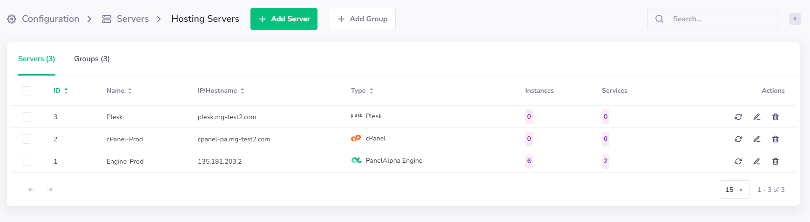
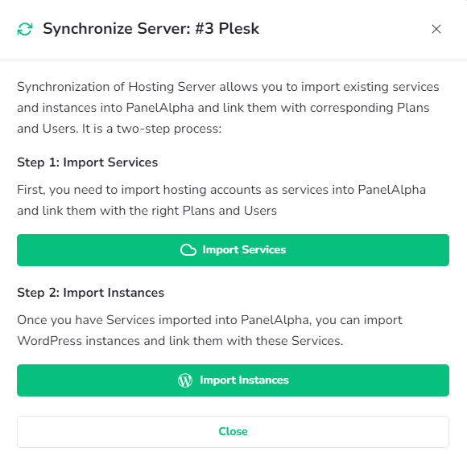
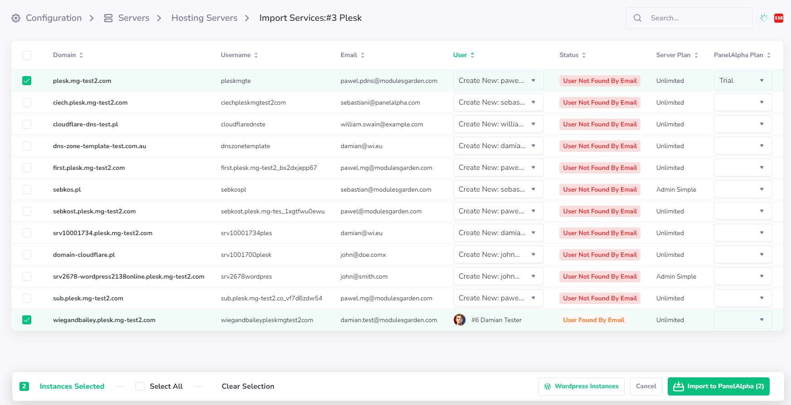
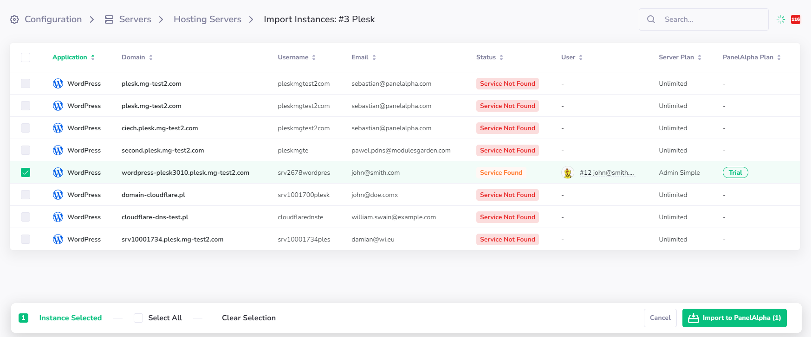
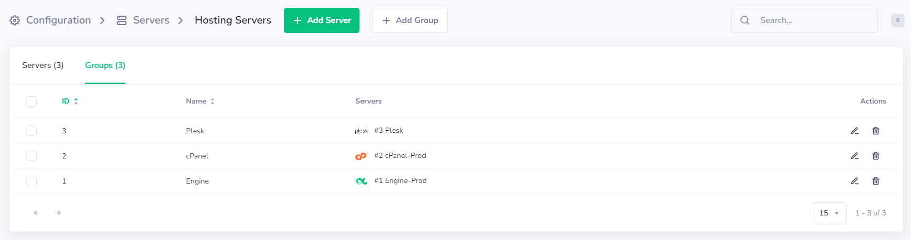
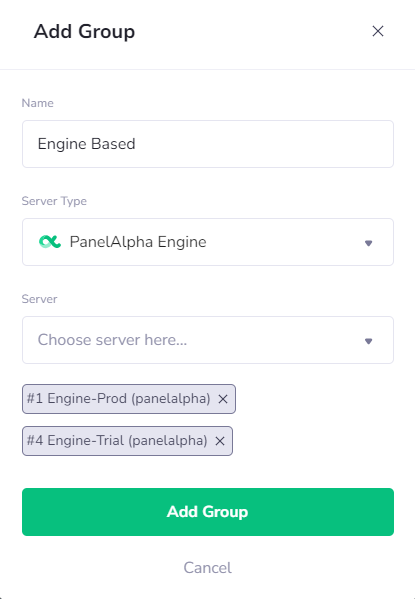
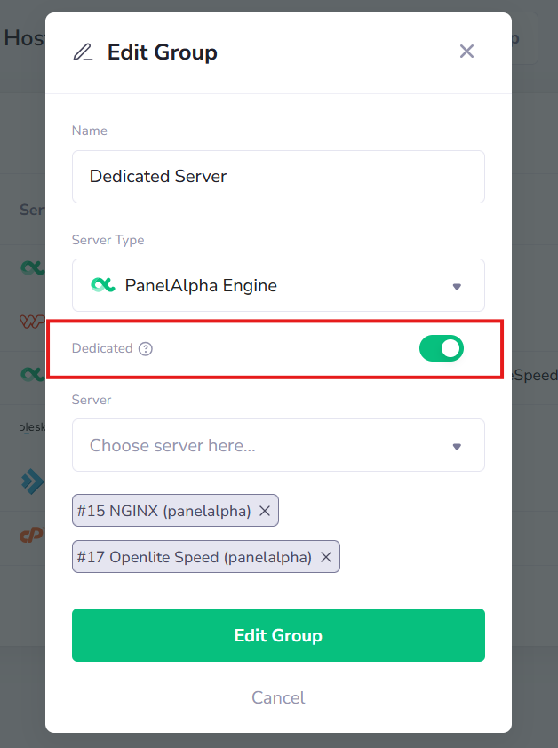
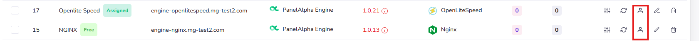
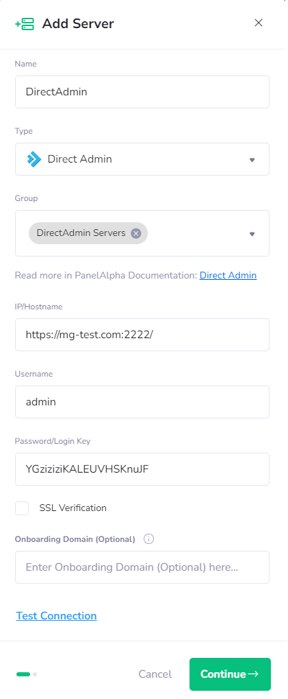
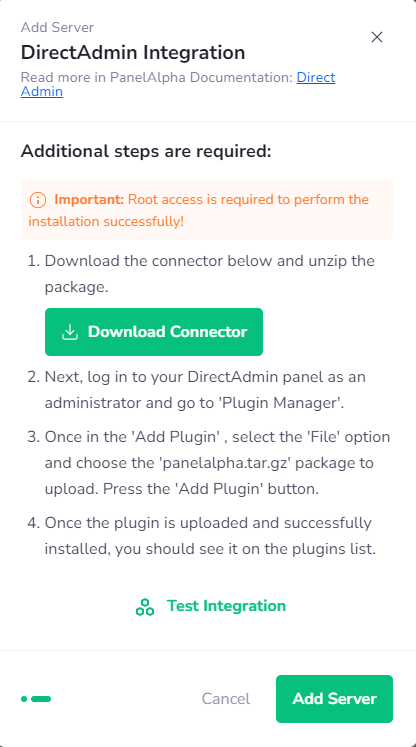

# Hosting Servers

Hosting servers store and deliver websites, applications, and other online content. They provide storage for all files and data that make up your online content. When someone wants to access your website, their browser sends a request to the hosting server, which retrieves the necessary files and sends them back.

This section provides a short description of the dedicated configuration section with basic data, options, and navigation. Specific details on hosting server connections can be found under [Hosting Scenarios](../hosting-servers/hosting-scenarios.md).

Please note that there are separate sections for [DNS Servers](dns-servers.md) and [Email Servers](email-servers.md).

## List of Servers

Navigate to **Configuration → Servers → Hosting Servers** to manage servers and groups.

The server list includes:

- ID number
- Name
- IP address or hostname
- Server type:
  - [cPanel](../hosting-servers/cpanel.md)
  - [DirectAdmin](../hosting-servers/directadmin.md)
  - [PanelAlpha Engine](../hosting-servers/engine.md)
  - [Plesk](../hosting-servers/plesk.md)
  - [WP Cloud](../hosting-servers/wp-cloud.md)
- Number of instances assigned
- Number of services assigned
- Allowed actions:
  - [Synchronize](hosting-servers.md#server-synchronization) the server
  - Assign or reassign a dedicated server to a specific user
  - Edit the server
  - Delete the server

## Server Synchronization

Hosting server synchronization enables importing existing services and instances into PanelAlpha through a two-step process.

**Step 1: Importing Services** — Import hosting accounts as services and associate them with appropriate plans and users.

**Step 2: Importing Instances** — After importing a service, import WordPress instances associated with it. Only instances with a **Service Found** status can be imported. Other instances appear blurred until the associated account is imported first.

## Groups of Servers

Server groups enable you to organize servers into sets for easy assignment of instances and services.

### Adding a New Group

Add a group from the **Servers** level via the **Add Group** button or in the dedicated tab.

To create a new group, provide:

1. The new **group name**
2. The **type of servers**
3. **Servers** to apply to this group (more than one server per group is allowed)
4. Confirm by pressing **Add Group**

Your new group will appear on the list. You may delete or edit it (name, type, and assigned servers) at any time.

### Dedicated Server Groups

You can also mark a server group as **Dedicated**. This is useful when each customer should receive their own hosting server instead of sharing the group pool with other users.

When editing or creating a group:

1. Enable the **Dedicated** switch.
2. Select the servers that belong to this dedicated group.
3. Save the group.

After that, the group can be assigned to a plan. Dedicated groups are then used for automatic or manual server-to-user assignments.

### Manual User Assignment

Dedicated servers can also be assigned manually from the server list.

In the server list, use the dedicated user-assignment action to link a server to a specific user. This is useful when:

- you want to reserve a particular server for an existing customer
- you need to reassign a dedicated server manually
- you want to prepare the assignment before the customer places a new order

Servers already linked to a user are shown as **Assigned** in the list.

## Adding a New Server

Use the quick action button to add a new server. For details on each server type, refer to the dedicated sections:

- [cPanel](../hosting-servers/cpanel.md)
- [DirectAdmin](../hosting-servers/directadmin.md)
- [PanelAlpha Engine](../hosting-servers/engine.md)
- [Plesk](../hosting-servers/plesk.md)
- [WP Cloud](../hosting-servers/wp-cloud.md)

You may add a new server during PanelAlpha installation or later from this place.

**Important:** The steps below are an example for [DirectAdmin](../hosting-servers/directadmin.md). The form and steps differ per server type.

1. **Name** — Enter the server name.
2. **Type** — Select DirectAdmin.
3. **Group** — Select a server group or create a new one.
4. **IP/Hostname** — Enter the server IP address or hostname.
5. **Username** — Enter the username for which the token has been generated.
6. **Password/Login Key** — Use your password or the previously generated [Login Key](https://docs.directadmin.com/directadmin/general-usage/securing-da-panel.html#creating-a-login-key).
7. **SSL Verification** — Keep disabled for successful test connection results.
8. **Onboarding Domain (Optional)** — If entered, this domain is used for instance creation instead of the domain specified in the plan with Quick or Super Quick onboarding. Useful when multiple servers are assigned to a single group.
9. **Test Connection** — Check if the connection is successful.

**Important:** Refer to the DirectAdmin official documentation to learn how to generate the Login Key or use the password instead. Read [this article](https://docs.directadmin.com/directadmin/general-usage/securing-da-panel.html#creating-a-login-key), section "Creating a Login Key".

Before continuing, you must test the connection. Only a successful connection allows you to proceed. Next, perform additional steps:

1. Download the connector required to complete the installation.
2. Log in to your DirectAdmin panel as an administrator and navigate to the **Plugin Manager**.
3. In the **Add Plugin** section, choose **File** and select the `panelalpha.tar.gz` package for upload. Click **Add Plugin**.
4. Upon successful upload and installation, the plugin appears in the list.
5. Verify the integration test is successful. Click **Add Server**.

