# Notifications

PanelAlpha supports two types of notifications:

- **User Notifications** — Emails sent outside the platform or in-app messages displayed in the client area.
- **Admin Notifications** — Email messages sent to admin users or in-app notification pop-ups in the admin panel.

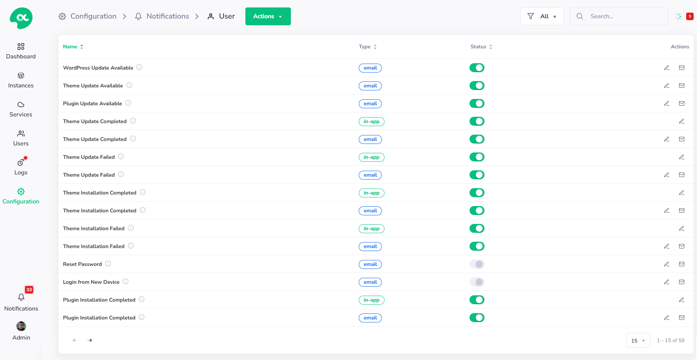

## Quick Start

1. Go to **Configuration → Notifications**.
2. Open **Settings → Email Provider**, pick SMTP (or another provider), and enter host, port, username, password, and SSL/TLS type.
3. Click **Test Connection** and **Send Test Email** to confirm delivery.
4. In the notifications list, pick any template → **Edit** to adjust subject, body, and links. Use **Reset To Default** if needed.
5. If you work with resellers, set branding and SMTP per reseller in their Reseller Area.

The notifications list displays:

- **Notification Name** — Each notification has a tooltip describing when and where it appears.
- **Type** — Categorized as **email** or **in-app**.
- **Status** — Toggle to enable or disable individual notifications.

Actions on a single notification:
- **Test Mail** — Send a test message (email notifications only).
- **Edit Template** — Customize the notification.

Notable user email templates include **Welcome User**, which is sent after Quick Registration (`/register`) and when administrators create users. For self-registration, the welcome email does not expose a plaintext password and directs the user to log in. Edit the template from the notifications list when you need custom copy or branding.

General actions:
- **Export** — Select notifications for translation and save as a `.zip` file. Choose email, in-app, or all notifications, and select a language.

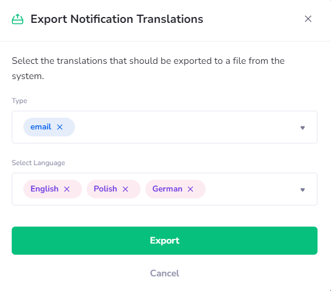

- **Import** — Select a file with notification translations. View the uploaded package structure and press **Import** to confirm. Accepted file types: `.zip` and `.tar.gz`.

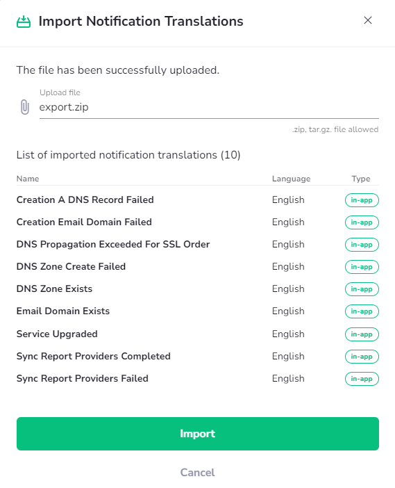

## Customize Notifications

To customize a notification, click the **Edit** icon. You will be directed to a form where you can modify the template.

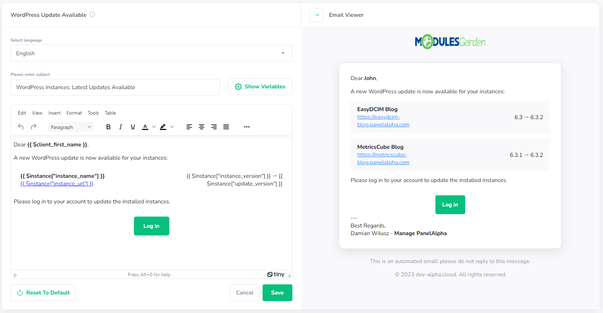

1. **Language** — Select the language. The dropdown includes only languages implemented in the platform (see [Translations](../getting-started/translations.md)). If a language is missing, run:
   ```
   docker compose -f /opt/panelalpha/app/docker-compose.yml exec -T api php artisan notifications:sync
   ```

2. **Subject & Content** — Modify the notification subject and message text. Use variables to display dynamic information. PanelAlpha uses [Blade Templates](https://laravel.com/docs/9.x/blade).

   Applicable variables:
   - Notification Fields
     ```
     {{ $theme_title }}
     {{ $theme_name }}
     {{ $theme_description }}
     {{ $theme_status }}
     {{ $theme_version }}
     {{ $theme_update_version }}
     ```
   - Message Fields
     ```
     {{ $exception_message }}
     ```
   - Instance Fields
     ```
     {{ $instance_id }}
     {{ $instance_name }}
     {{ $instance_domain }}
     {{ $instance_url }}
     {{ $instance_version }}
     {{ $instance_status }}
     ```
   - User Fields
     ```
     {{ $client_id }}
     {{ $client_name }}
     {{ $client_first_name }}
     {{ $client_last_name }}
     {{ $client_company_name }}
     {{ $client_email_address }}
     ```
   - Other
     ```
     {{ $date }}
     {{ $datetime }}
     {{ $formatted_date }}
     {{ $formatted_time }}
     {{ $admin_name }}
     {{ $app_name }}
     {{ $app_url }}
     {{ $signature }}
     {{ $logo }}
     {{ $branding_color }}
     {{ $location }}
     {{ $unsuspend_service_link }}
     ```

   Revert to the original version by clicking **Reset To Default**.

3. **Email Viewer** — Preview the email by clicking the **Email Viewer** button. This shows a real-life view of the template, including customized styles with branded logos.

## General Settings

Under **Configuration → Notifications → Settings**, specify:

- **From Name** — Required. Sender name displayed in application emails.
- **From Email** — Required. Sender email address. For [Postmark](notifications.md#postmark), this must match the **Sender Signature** in Postmark.
- **CC Messages** — Additional email addresses to receive copies.
- **BCC Messages** — Additional email addresses to receive blind copies.

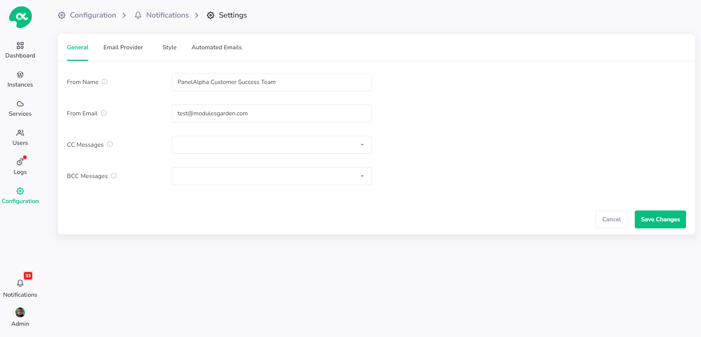

## Email Providers

Select and configure the email provider. Compatible providers: SMTP, Postmark, MailerSend, Mailgun, and SendGrid.

### SMTP

- **Host** — The email host server.
- **Port** — The port dedicated to handling email traffic.
- **Username** — The email account username.
- **Password** — The password for authentication.
- **SSL Type** — Encryption method (SSL or TLS).

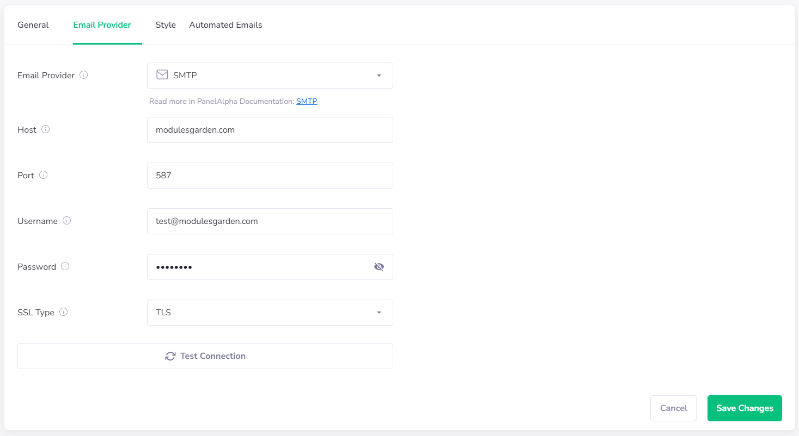

### Postmark

- **Token** — The Postmark **Server API token**. Find it at *Postmark → Servers → API Tokens → Server API Token*.
- The **From Email** in General Settings must exactly match the **Sender Signature** in Postmark (*Postmark → Sender Signature → Add Domain or Signature → Signature*).

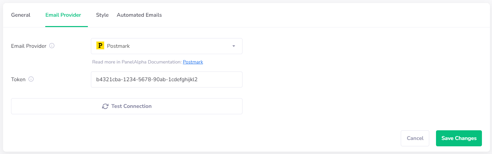

### MailerSend

- **API Token** — Choose a global token or a domain-specific token:
  - **Global API token** — Applies to the entire account.
  - **Domain API token** — Linked to a specific domain (*MailerSend → Email → Domains → Domain Details → API Token*).
- The **From Email** must match the configured domain in MailerSend (*MailerSend → Email → Domains → Add Domain*). For example, if your domain is `example.com`, your From Email should be something like `info@example.com`.


### Mailgun

- **Domain** — The domain configured in your Mailgun account. Ensure the domain has an authorized recipient with "verified" status.
- **API Key** — Use the API Key from *Mailgun → API Keys → Mailgun API Keys*.
- **Region** — Select the appropriate region:
  - **US** — For users based in or serving customers primarily in the United States.
  - **EU** — For users in Europe or those who need to comply with EU regulations.

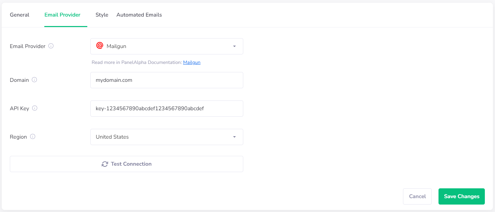

### SendGrid

- **API Key** — Use the API Key from *SendGrid → Settings → API Keys*.
- The **From Email** must match the configured sender in SendGrid (*SendGrid → Settings → Sender Authentication*).

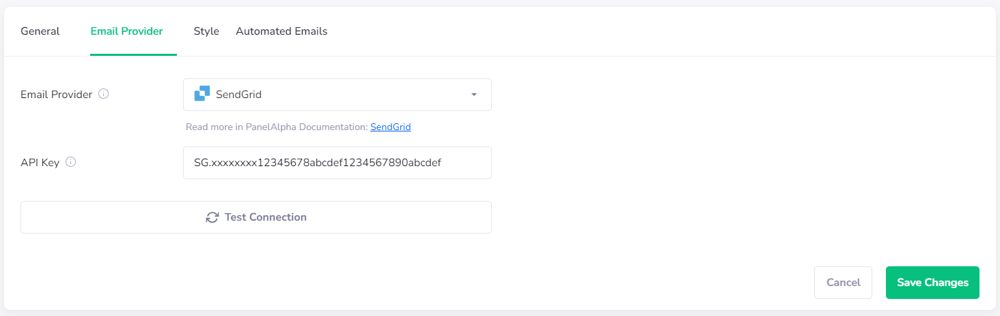

After configuring the email provider, test the connection. If successful, proceed to **Styling** your emails.

## Style

Customize:

- **Email Signature** — Displayed on every email. Example:
  ```
  --- <br />
  Best Regards, <br />
  Konrad Keck - <b>PanelAlpha CEO & Founder</b>
  ```
- **Email CSS Style** — CSS for email content and design.
- **Email Header** — Standardize the email header. Example:
  ```
  <html lang="en">
  <head>
   <meta charset="UTF-8">
   <meta name="viewport"
       content="width=device-width, user-scalable=no, initial-scale=1.0, maximum-scale=1.0, minimum-scale=1.0">
   <meta http-equiv="X-UA-Compatible" content="ie=edge">
   <title>{{ $app_name }}</title>
  </head>
  <body>
   <table>
       <tbody>
           <tr>
               <td></td>
               <td class="header">
                   
               </td>
               <td></td>
           </tr>
           <tr>
               <td>

               </td>
               <td class="content-email">
  ```
- **Email Footer** — Standardize the email footer. Example:
  ```
  </td>
               <td>

               </td>
           </tr>

           <tr>
               <td></td>
              <td class="footer">
               @if ($location !== '')
               <p style="color: #9494AD; font-size: 1em;"><a href='https://db-ip.com' target="_blank">IP Geolocation by DB-IP</a> was used to locate the device.</p>
               @endif
               <p style="color: #9494AD; font-size: 1em;">This is an automated email: please do not reply to this message.</p>
               <p style="color: #9494AD; font-size: 1em;">© 2023 {{ $app_name }}. All rights reserved</p>
           </td>
               <td></td>
           </tr>
       </tbody>
   </table>
   </body>
   </html>
  ```

Available variables for styles:
```
{{ $app_name }}
{{ $app_url }}
{{ $logo }}
{{ $branding_color }}
{{ $date }}
{{ $datetime }}
{{ $formatted_date }}
{{ $formatted_time }}
{{ $signature }}
```

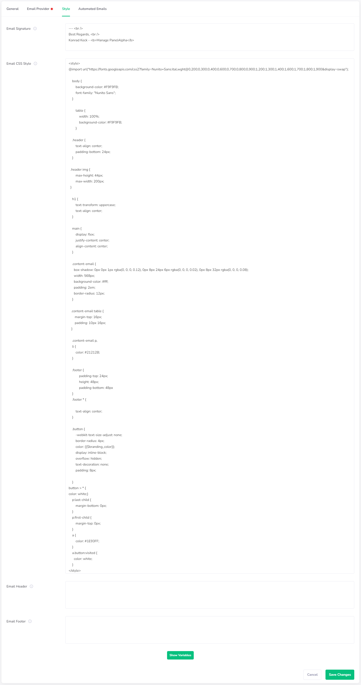

## Automated Emails

Specify the frequency of automatic email messages. Currently, you can define the frequency for notifications on available instance, plugin, and theme updates for **clients** and **admin users** separately.

Set the frequency to:
- **Daily**, **Weekly**, or **Monthly**
- **Never** — Disable.

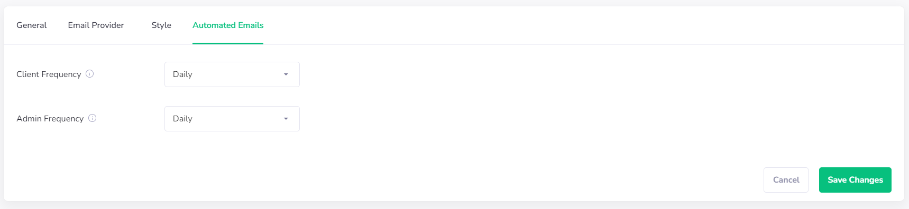
