# Plans

**Plans** in PanelAlpha are subscription options available for your customers, offering different features, resources, and limits based on user requirements.

To create your first plan, navigate to **Configuration → Plans** and press **Add**.

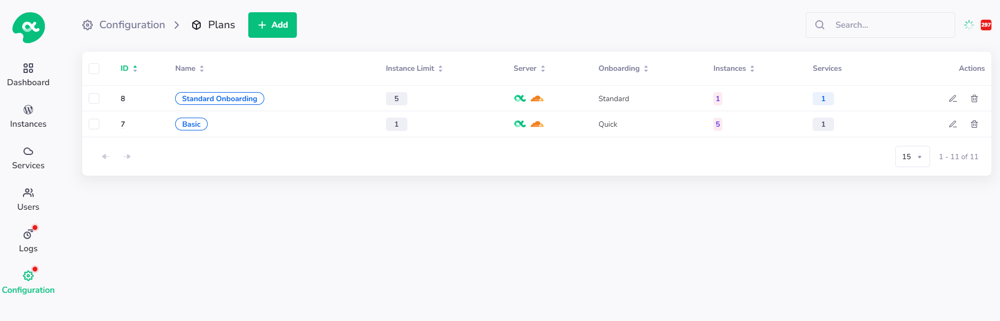

**Important:** Changes to existing plans with assigned services **will not impact** those services. Changes apply only to newly created services under the plan.

## Details

Plan configuration is divided into sections, each dedicated to a different aspect of the plan.

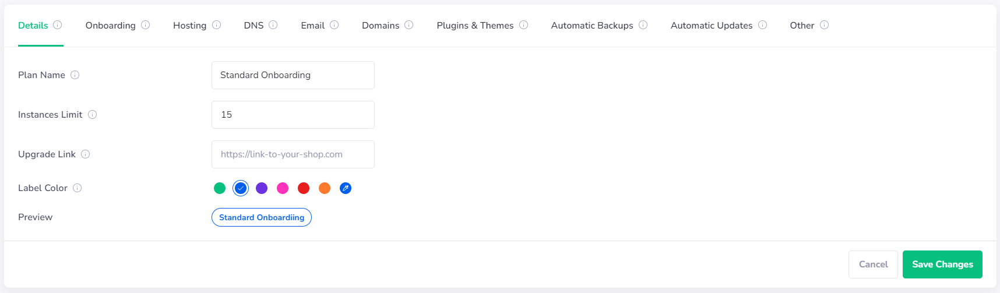

Provide basic details:

- **Plan Name** — Any name for the plan
- **Instances Limit** — Maximum instances a client with this plan can create
- **Upgrade Link** — URL to your shop where clients can upgrade. When [Direct Billing](../direct-billing/index.md) is enabled, set the upgrade URL on the **Billing** tab instead (see below).
- **Label Color** — Leading color of the client area
- **Preview** — Visualization with the selected color

## Billing

The **Billing** tab is available when **Direct Billing** is enabled (**Configuration → Direct Billing**). Until then the tab stays disabled.

Set **Enable Billing** to Yes to show the rest of the fields.

- **Product Type** — **Trial** or **Paid**

**Paid** (Stripe): Stripe product/price, **Suspend After (days)**, **Remove After (days)**, **Upgrade URL**.

**Trial:** pre-created accounts, suspend/remove after days, trial user email, default project name, **Upgrade URL**, trial registration links, and trial notification reminders.

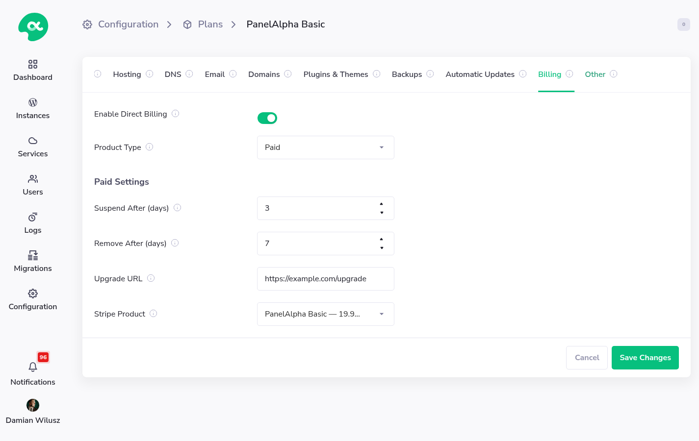

PanelAlpha appends query parameters to the Upgrade URL. Documented in [Stripe Integration](../direct-billing/stripe.md) (`trial_service_id` for trials, `paupgradeserviceid` for paid).

WHMCS plans can keep using the Details **Upgrade Link** and the [WHMCS module](../billing-systems-integrations/whmcs.md).

## Onboarding

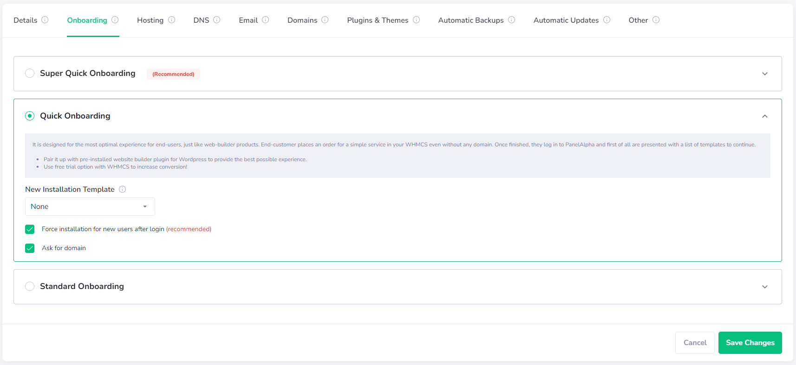

Choose between three onboarding methods:

- [Quick Onboarding](../onboarding-methods/quick-onboarding.md) — Rapid setup with website name and theme.
- [Super Quick Onboarding](../onboarding-methods/super-quick-onboarding.md) — The fastest method, most effective with [Extendify](../integrations/extendify.md).
- [Standard Onboarding](../onboarding-methods/standard-onboarding.md) — Full control over instance creation, recommended for advanced users.

### Quick Onboarding Configuration

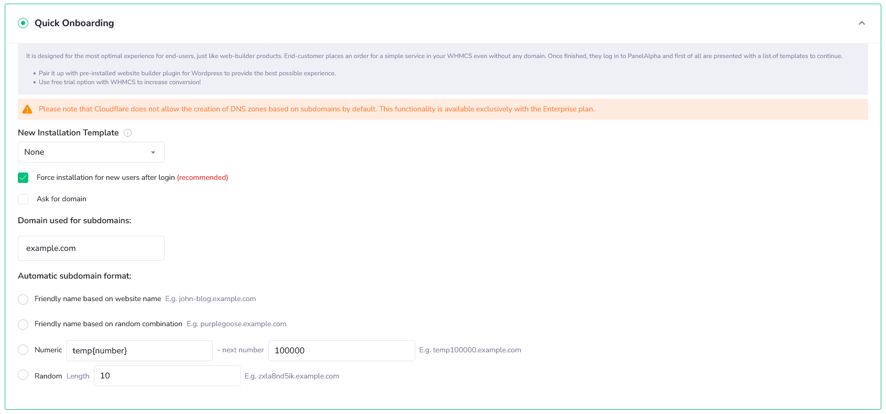

**New Installation Template**

Choose a template for new WordPress installations.

**Additional Options**

- **Force installation for new users after login** (recommended) — New users are automatically prompted to create their first instance after logging in.
- **Ask for domain** — Prompt users to provide a domain during instance creation.

**Domain Used for Subdomains**

Specify the parent domain for creating subdomains (for example `example.com` creates `john-blog.example.com`).

**Automatic Subdomain Format**

- **Friendly name based on website name** — Subdomain from the site name (for example `john-blog.example.com`)
- **Friendly name based on random combination** — Random friendly words (for example `purplegoose.example.com`)
- **Numeric** — Sequential numbers with a prefix (for example `temp100000.example.com`)
- **Random** — Random alphanumeric strings (for example `dku835595x.example.com`)

**Note:** Cloudflare does not allow creation of DNS zones based on subdomains by default. This is available exclusively with the Enterprise plan.

### Super Quick Onboarding Configuration

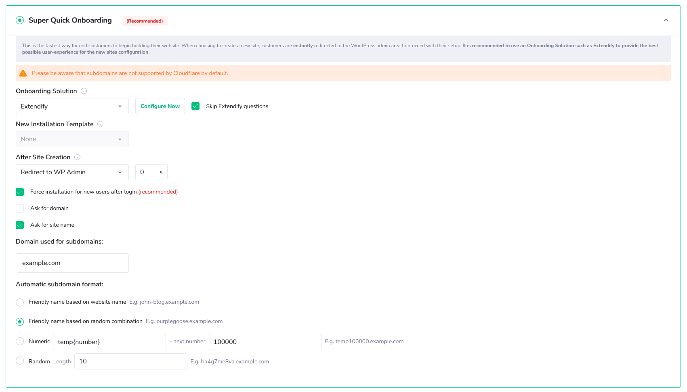

**Onboarding Solution**

Select the onboarding solution:
- **Extendify** — Integrates with [Extendify](../integrations/extendify.md) for an AI-powered website building experience. Requires Extendify configuration in **Configuration → Integrations → Extendify**.
- **10Web** — Integrates with [10Web](../integrations/ten-web.md) for AI-powered website generation inside WP Admin. Requires 10Web configuration in **Configuration → Integrations → 10Web**.

When **Extendify** is selected:
- **Skip Extendify questions** — Bypass the Extendify onboarding questionnaire during site creation.

When **10Web** is selected:
- **Website creation limit** — Maximum AI website generation allowed per instance.
- **Edit limit** — Maximum AI edits allowed per instance.

**New Installation Template**

Choose a template for new WordPress installations.

**After Site Creation**

- **Redirect to WP Admin** — Automatically redirect users to the WordPress admin dashboard after creation. Specify a delay in seconds.

**Additional Options**

- **Force installation for new users after login**
- **Ask for domain**
- **Ask for site name**

### Standard Onboarding Configuration

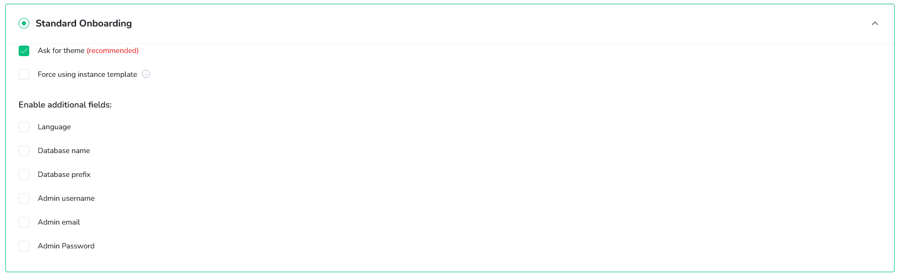

**Theme Selection**

- **Ask for theme** (recommended) — Prompt users to select a WordPress theme during instance creation.

**Instance Template**

- **Force using instance template** — Require a predefined instance template during site creation.

**Enable Additional Fields**

Configure which fields are available during instance creation:

- **Language**
- **Database name**
- **Database prefix**
- **Admin username**
- **Admin email**
- **Admin Password**

## Hosting Server

[Hosting server](hosting-servers.md) selection and configuration:

- **Server Type** — Choose from:
  - [cPanel](../hosting-servers/cpanel.md)
  - [DirectAdmin](../hosting-servers/directadmin.md)
  - [Plesk](../hosting-servers/plesk.md)
  - [WP Cloud](../hosting-servers/wp-cloud.md)
  - [PanelAlpha Engine](../hosting-servers/engine.md)
- **Server Group** — Select a previously created group.
- **Server Assignment Rule**:
  - **Random** — Service is set up on a randomly selected server.
  - **Least Accounts** — Service is set up on the server with the fewest accounts. The server is evaluated at the moment of each new instance creation, not when the service is first provisioned. This ensures the rule stays accurate over time, especially when **Separate hosting accounts** is enabled.
  - **Specific Server** — Service is set up on the selected server.
- **Separate hosting accounts** — If enabled, PanelAlpha creates separate hosting accounts for every instance. Enabled by default for new plans. For **WP Cloud**, this is always enforced. When combined with **Least Accounts**, the target server is re-evaluated on every new instance — each installation picks the server with the fewest accounts at that point in time.
- **Hosting Account Configuration** — Depends on the selected server type:
  - **DirectAdmin**: select **Package** and **IP Address**
  - **cPanel**: select the **WHM Package**
  - **Plesk**: select **Service Plan**, **Reseller Plan**, and [IP Address](https://docs.plesk.com/en-US/obsidian/administrator-guide/server-administration/ip-addresses-management.59410/)
  - **PanelAlpha Engine**: define limits such as disk space, memory, CPU, bandwidth, MySQL databases, FTP/SFTP accounts, addon domains, subdomains, inodes, Redis cache, LiteSpeed cache, PHP-FPM settings, and dedicated IPs
  - **WP Cloud**: define disk quota, PHP workers, burst settings, PHP memory per worker, location policy, default datacenter, and SSH access options

### Dedicated Server Groups

If the selected **Server Group** is marked as **Dedicated**, PanelAlpha treats it differently from standard shared groups.

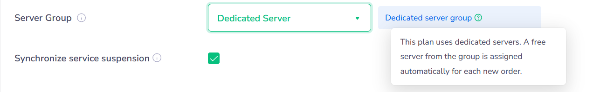

How it works:

1. First, create or edit a hosting server group and enable the **Dedicated** option.
2. Assign that dedicated group to a plan in the **Hosting Server** section.
3. When a new order or service is created with that plan, PanelAlpha automatically assigns a free server from the dedicated group to the user.

This allows you to prepare plans that provision one dedicated server per customer automatically.

## DNS

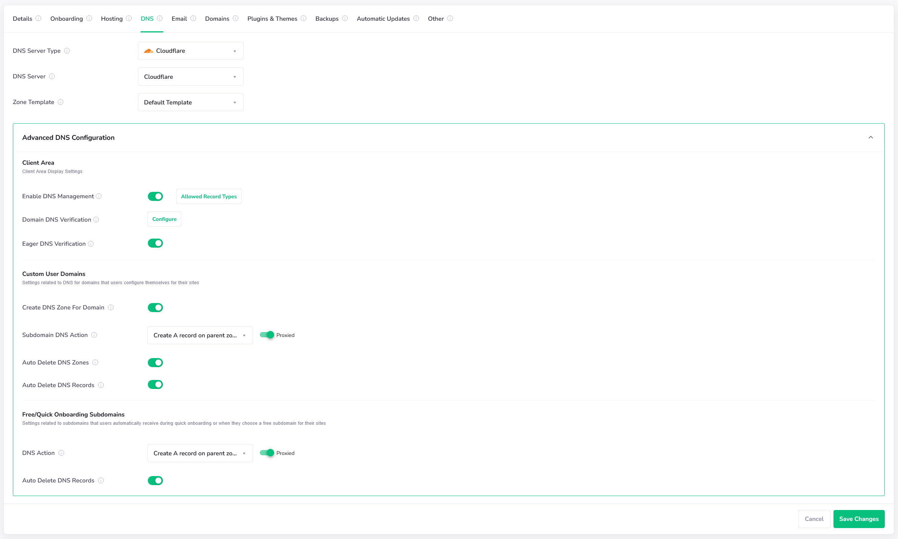

Select and configure the [DNS server](dns-servers.md) responsible for translating domain names into IP addresses.

Available DNS server types:
- [PowerDNS](../dns-servers/powerdns.md)
- [Cloudflare](../dns-servers/cloudflare.md)
- [Bunny.net](../dns-servers/bunny.md)
- [cPanel DNSOnly](../dns-servers/cpanel-dns-only.md)

You can also use the selected hosting server for DNS. For example, if DirectAdmin is the hosting server, you can select "Use DirectAdmin's DNS server" (displayed as <span v-pre>"Use {{ type }}'s DNS server"</span>). **cPanel**, **Plesk**, and **DirectAdmin** can be used as DNS servers.

After selecting a server type, configure:
- **DNS Server Type** — The DNS engine for your services.
- **DNS Server** — A specific DNS server instance. If you choose the internal option (<span v-pre>Use {{ type }}'s DNS server</span>), the server is derived from the selected hosting server.
- **Zone Template** — A DNS Zone Template with preconfigured records from your [DNS Server settings](dns-servers.md#dns-templates).

### CDN Configuration

When a CDN integration such as [Fastly](../integrations/fastly.md) is enabled, the plan DNS tab also shows **CDN Configuration**.

Select the CDN provider for instances on this plan and configure provider-specific options (for Fastly: WAF, Force HTTPS, Origin Shield, Under Attack defaults, auto purge, rate limits, and cache TTLs).

The CDN provider is separate from the DNS server. PanelAlpha still uses the selected DNS provider to publish records; with Fastly those records point at the Fastly edge instead of the origin IP.

### Advanced DNS Configuration

These options provide granular control over how DNS is exposed to end-users and how zones and records are created, updated, and cleaned up.

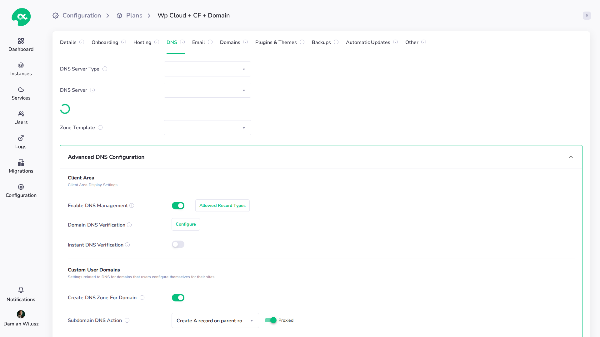

#### Client Area

- **Enable DNS Management** — Allows customers to manage DNS records in the client area. Click **Configure** to select which record types they can edit.

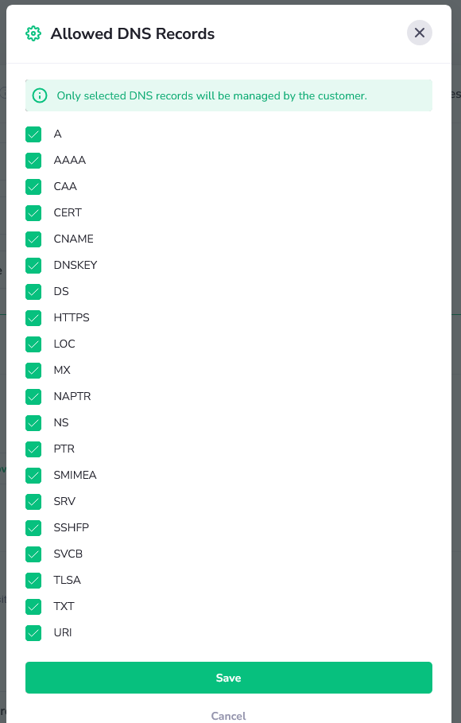

- **Domain DNS Verification** — Configure how to verify whether a domain is properly propagated. If verification fails, the client area guides users on how to fix DNS. Methods marked **if supported** run only when the connected DNS server supports that check.
  - **Compare A record with hosting IP address** — Ensures the A record points to the selected hosting server IP.
  - **Compare NS records with DNS server's nameservers** — Ensures NS records match your DNS server's nameservers.
  - **Compare DNS records from DNS server (if supported)** — Compares public DNS records with data from the connected DNS server.
  - **Compare CNAME record with onboarding subdomain** — Checks that the CNAME points to the onboarding subdomain.
  - **Compare CNAME record with custom domain** — Verifies that the CNAME matches configured targets. Use **Valid CNAME Addresses** for a comma-separated list (supports wildcards).
  - **Don't verify** — Skips DNS verification.

  **Verification condition** — choose when DNS is treated as failed:
  - **Any of the selected methods** (default) — verification fails if at least one selected method fails
  - **All of the selected methods** — verification fails only when every selected method fails

  **Note:** With **Any**, a valid A record can hide nameserver guidance even when NS records are incorrect. Use **All** when clients must satisfy every selected check (for example both A and NS).

  **Show options** (displayed when verification fails):
  - **Display hosting IP Address to be set as A record**
  - **Display DNS server's nameservers**
  - **Display DNS records from DNS server (if supported)**
  - **Display onboarding subdomain to be set as CNAME record**

  These show options also apply after Standard and Quick onboarding when a custom domain fails DNS checks, so clients can see **Set DNS Records** and/or **Set Nameservers** guidance similar to Super Quick Onboarding.

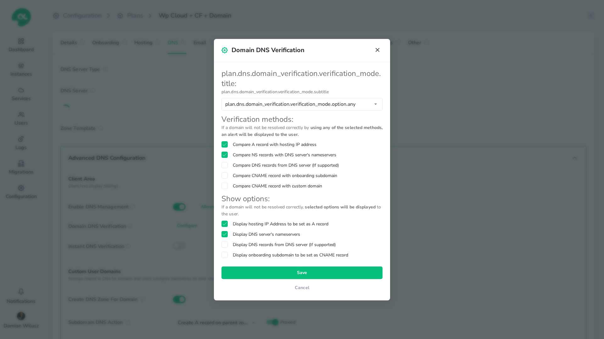

- **Instant DNS Verification** — Performs immediate DNS validation when a customer provides their own domain. Checks public DNS records according to the Domain DNS Verification settings. If issues are detected, guidance is displayed in the Client Area.

  **Note:** The system uses the RDAP library, which currently does not support all TLDs. Check RDAP support at [https://deployment.rdap.org/](https://deployment.rdap.org/).

#### Custom User Domains

Settings applied when a customer connects their own domain:

- **Create DNS Zone For Domain** — PanelAlpha automatically creates a dedicated DNS zone for each custom domain on the configured DNS server.
- **Subdomain DNS Action** — Choose what PanelAlpha should do when creating a subdomain:
  - **Create new DNS zone** — Creates a separate zone for the subdomain.
  - **Create A record on parent zone** — Adds an A record inside the parent domain's zone.
  - **None** — No zone or record is created.
- **Auto Delete DNS Zones** — Automatically removes zones created by PanelAlpha when the domain is detached or the service is deleted.
- **Auto Delete DNS Records** — Automatically removes DNS records created by PanelAlpha when the domain is detached, changed, or the service is deleted.

#### Free/Quick Onboarding Subdomains

Settings applied to subdomains provisioned during [Quick](../onboarding-methods/quick-onboarding.md) or [Super Quick](../onboarding-methods/super-quick-onboarding.md) onboarding:

- **DNS Action**:
  - **Create new DNS zone**
  - **Create A record on parent zone**
  - **None**
- **Auto Delete DNS Records** — Automatically remove DNS records created for onboarding subdomains when a site is removed or the subdomain changes.

## Email

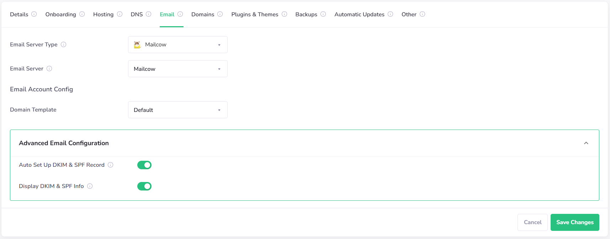

Select and configure the [email server](email-servers.md) for your services.

- **Email server type**:
  - [Mailcow](../email-servers/mailcow.md)
  - Use *Selected Hosting* email server — cPanel, Plesk, and DirectAdmin can be used as email servers.
- **Email server** — Select a specific email server.
- **Domain Template** — Enter a domain template name.

### Advanced Email Configuration

These options manage DKIM and SPF records:

- **Auto Set Up DKIM & SPF Record** — Automatically configures DKIM and SPF DNS records for better deliverability.
- **Display DKIM & SPF Info** — Shows DKIM and SPF DNS record details in the Client Area.

## Domains

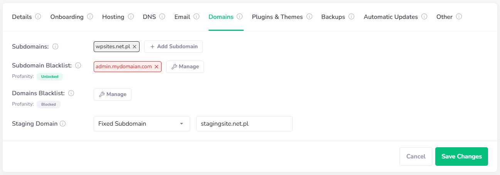

- **Subdomains** — Add domains users can use as subdomains. Click **Add Subdomain** to enter a new domain. Domains listed here appear as parent options when clients create an instance on a temporary subdomain (see [Creating New Instance](../client-area-instances/creating-new-instance.md#choosing-a-domain-or-temporary-subdomain)).
- **Subdomain Blacklist** — Create lists of forbidden words. Enable **Block Profanity** to blacklist uncensored expressions automatically.
- **Domains Blacklist** — Create lists of forbidden words. Enable **Block Profanity** to blacklist uncensored expressions automatically.
- **Staging Domain** — Define how domains are configured for staging sites:
  - **Any Domain** — Users can configure staging with any domain.
  - **Site Domain Subdomain** — Users create a subdomain based on the live site domain (for example `staging.example.com`).
  - **Fixed Subdomain** — A predefined domain set by the administrator.
- **Convert Nested Subdomains** — If enabled, nested subdomains are normalized during staging domain generation.

## Plugins & Themes

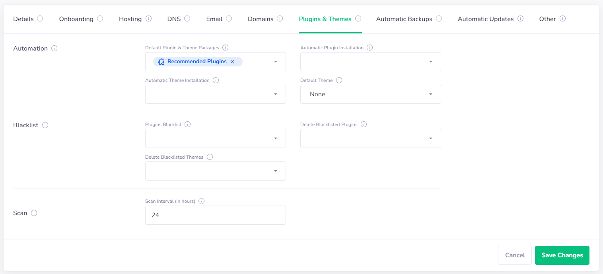

Manage plugins and themes for instances:

1. **Automation:**
   - **Default Plugin & Theme Packages** — Assign packages to instances.
   - **Automatic Plugin Installation** — Plugins automatically installed during instance creation.
   - **Automatic Theme Installation** — Themes automatically installed during instance creation.
   - **Default Theme** — Default theme for the instance.

2. **Blacklist:**
   - **Plugin Blacklist** — Prohibited plugins hidden from search results, blocked from installation, and with activation disabled.
   - **Delete Blacklisted Plugins** — Automatically removed during daily synchronization.
   - **Delete Blacklisted Themes** — Automatically removed during daily synchronization. Also hidden and blocked from installation.

**INFO:** The daily **SyncWordPressData** job automatically ensures the must-use plugin is installed, adds the admin bar feed, and removes blacklisted plugins and themes.

**WARNING:** The **Scan Interval (in hours)** setting has been removed. Synchronization now occurs automatically once daily.

## Backups

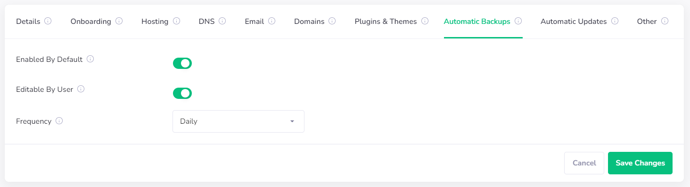

Manage backup creation and frequency:

- **Enabled By Default** — Toggle backups for client instances.
- **Editable By User** — Allow clients to manage backup creation in the client area.
- **Frequency** — Define backup frequency: **daily**, **weekly**, or **monthly**.

## Automatic Updates

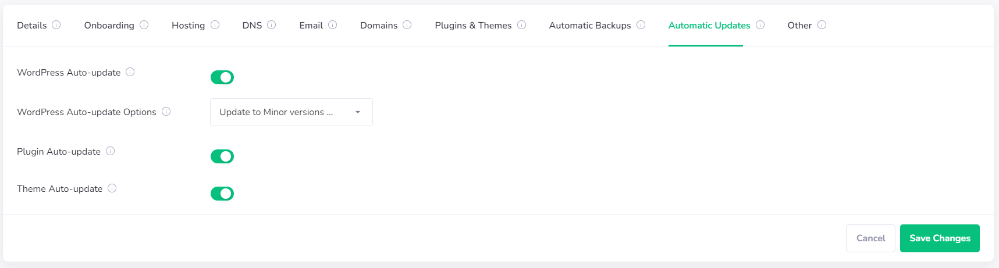

Manage automatic WordPress instance updates:

- **WordPress Auto-update** — Enable automatic WordPress updates by default. Applies only to new instances.
- **WordPress Auto-update Options**:
  - Update to any latest version (major and minor)
  - Update to minor versions only
- **Plugin Auto-update** — Enable automatic plugin updates by default. Applies only to new instances.
- **Theme Auto-update** — Enable automatic theme updates by default. Applies only to new instances.

To disable the switcher in the client area, disable the **Manage Automatic Updates** privilege under **Disable Privileges → WordPress Management** in the **Other** tab.

## Other

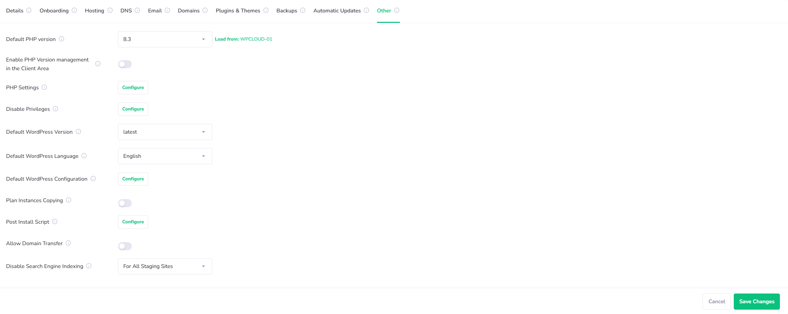

1. **Default PHP version** — Default PHP version for newly created instances.
2. **Enable PHP Version management in the Client Area** — Allow clients to choose their preferred PHP version.
3. **PHP Settings** — Define `php.ini` directives for new server accounts.
4. **Disable Privileges** — Disable specific client privileges:
   - **General Management**: change label, set domain, create staging, push to live, view logs, view reports, **Manage Reporting**, delete instance, manage shared access, **Manage GIT**
   - **WordPress Management**: WP Admin SSO, update WordPress, manage automatic updates, manage backups, manage automatic backup, update site name, clear cache, set maintenance mode, set debug mode, manage themes, manage plugins, manage WordPress configuration, manage WordPress users, **Convert to Multisite**, **View Installation Details**
   - **Manage Related Hosting**: manage email accounts, DNS, domains, **Manage SSL Certificates**, FTP accounts, SFTP accounts, MySQL databases, cron jobs, file manager, control panel SSO, phpMyAdmin SSO

   Privileges are enabled by default, except **Manage GIT** on existing plans: the 1.9.0 upgrade disables it so Git does not appear in Client Area until you uncheck it under **General Management**. Newly created plans do not disable **Manage GIT** unless you do it yourself. Disable **View Installation Details** to hide database credentials and installation paths in **Client Area → Instance → Advanced → Site Details**. Disable **Manage Reporting** to hide the **Google Analytics** page in **Client Area → Instance → Advanced**, where clients turn the panel Google Analytics tag on or off. Disable **Manage SSL Certificates** to hide SSL management in Advanced Security and **Hosting → Domains → Edit SSL**.

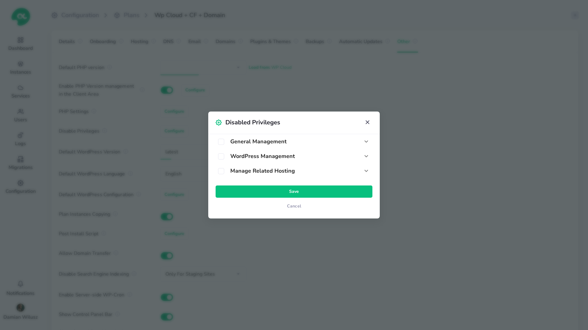

5. **Default WordPress Version** — Default WordPress version for new instances, or **latest**.
6. **Default WordPress Language** — Default installation language for new WordPress instances. Pick a specific language, or choose **Current User Language** to use each user's PanelAlpha interface language. Falls back to English if the user's language is not available in WordPress.
7. **Default WordPress Configuration** — Default configuration entries (constants or variables).
8. **Plan Instances Copying** — Allow end-clients to copy existing instances to other services with free instance limits.
9. **Post Install Script** — A PHP script executed automatically after a new WordPress installation completes, including staging installations.

   Available variables:
   ```
   $params['instance_id'];
   $params['instance_name'];
   $params['instance_domain'];
   $params['instance_dir'];
   $params['instance_url'];
   $params['instance_version'];
   $params['instance_path'];
   $params['instance_full_path'];
   $params['instance_created_at'];
   $params['parent_instance_id'];
   $params['parent_instance_name'];
   $params['parent_instance_domain'];
   $params['parent_instance_dir'];
   $params['parent_instance_url'];
   $params['parent_instance_version'];
   $params['parent_instance_path'];
   $params['parent_instance_full_path'];
   $params['parent_instance_created_at'];
   $params['user_id'];
   $params['user_email'];
   $params['server_id'];
   ```

   Example script modifying `wp-config.php`:
   ```
   $config_transformer = new WPConfigTransformer($params['instance_full_path'] . '/wp-config.php');
   $config_transformer->update('constant', 'WP_REDIS_HOST', '127.0.0.1');
   $config_transformer->update('constant', 'WP_REDIS_PORT', '6379');
   $config_transformer->update('constant', 'WP_REDIS_PREFIX', (string)rand(10000, 99999));
   $config_transformer->update('constant', 'WP_REDIS_DATABASE', '0');
   ```

10. **Allow Domain Transfer** — Allow clients to transfer domains between servers. Available only for plans using [WP Cloud](../hosting-servers/wp-cloud.md). See the dedicated [article](../hosting-servers/wp-cloud.md#transfering-domains).
11. **Disable Search Engine Indexing** — Default indexing behavior:
    - **Do Not Disable** — Indexing enabled for all websites
    - **For All Staging Sites** — Indexing disabled for staging sites only (default)
    - **For All Sites** — Indexing disabled for all sites
12. **Enable Server-side WP-Cron** — When enabled, PanelAlpha automatically sets up server-side WordPress cron handling on every new instance. Disabled by default. Available for **cPanel**, **DirectAdmin**, **PanelAlpha Engine**, and **WP Cloud** — not supported on Plesk.

    When a new instance is created with this option enabled, PanelAlpha performs two actions automatically:
    - Adds a **Cron Job** entry for WordPress in the hosting account
    - Sets `DISABLE_WP_CRON` to `true` in `wp-config.php`, disabling WordPress's built-in pseudo-cron
13. **WordPress MCP** — enables the WordPress MCP feature for instances created under this plan. When enabled, clients can connect MCP-compatible tools (such as **Codex**, **Claude Code**, or **Cursor**) to the site through the Model Context Protocol. A dedicated **WordPress MCP** section then appears in **Client Area → Instance → Advanced**, and the **WordPress MCP Adapter** plugin is installed automatically.

    Click **Configure** to edit the **WordPress MCP Config Template** shown to clients (connection snippet / links). The template can use placeholders such as <span v-pre><code>{{endpoint}}</code></span> and <span v-pre><code>{{wp_api_url}}</code></span>. **Reset to default** restores the factory template. Client documentation links in that section follow the system **Documentation Link** setting.

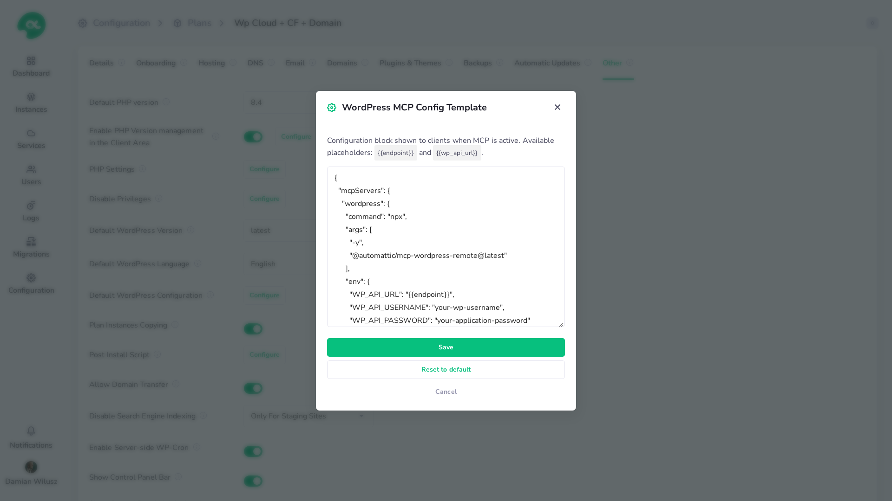
