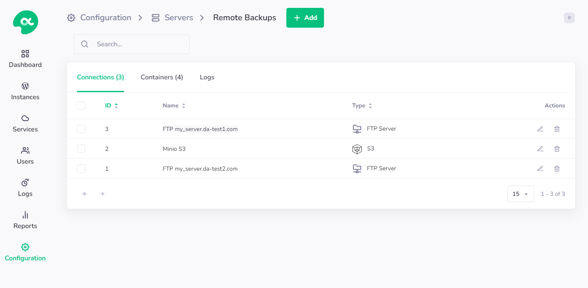
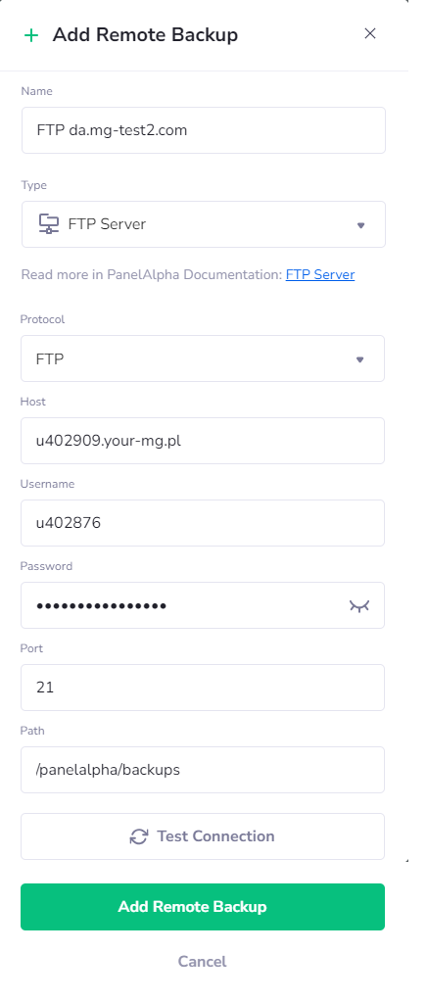
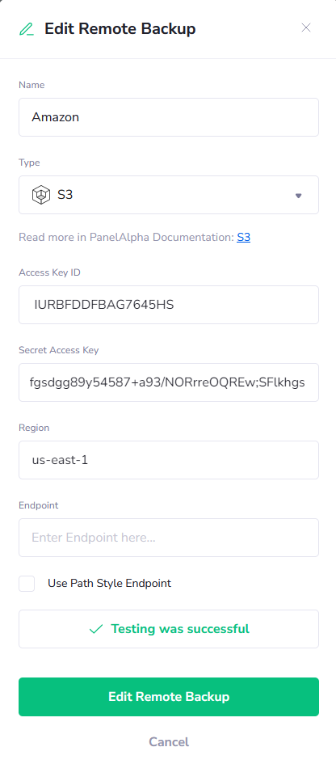
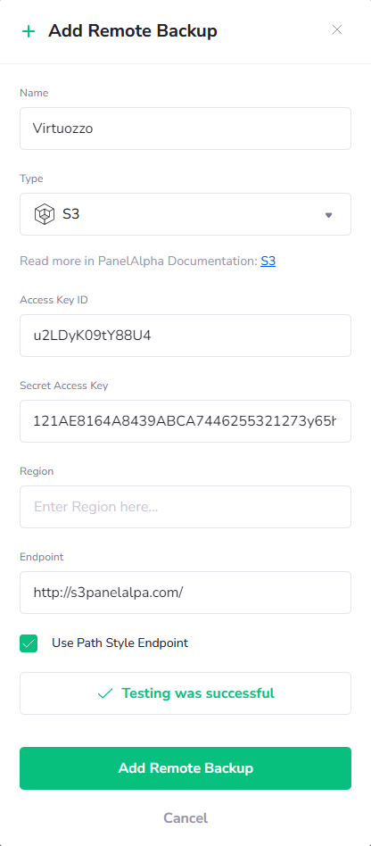
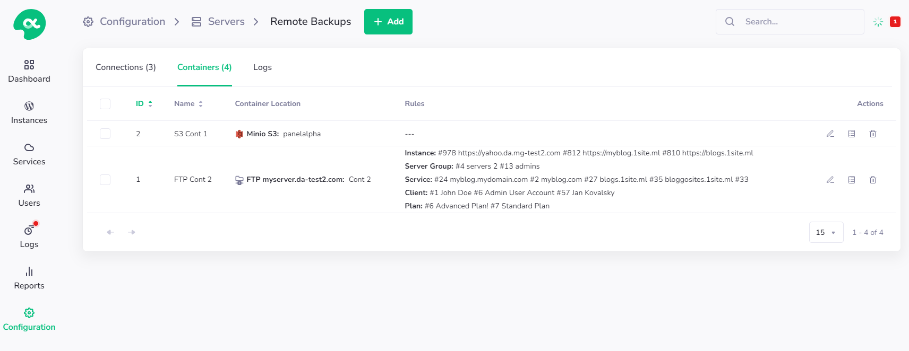
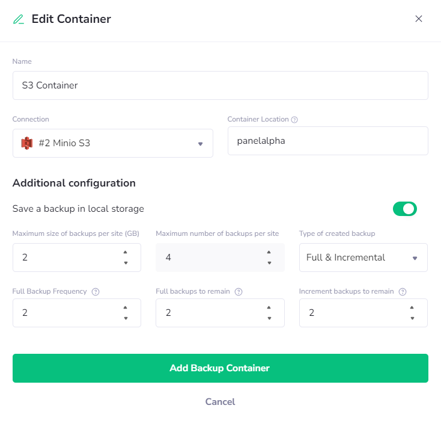
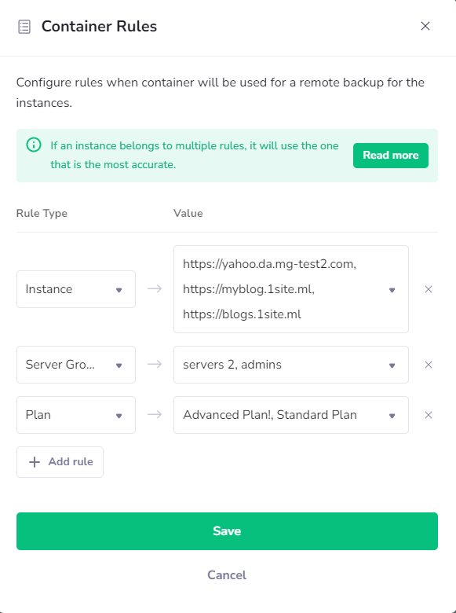
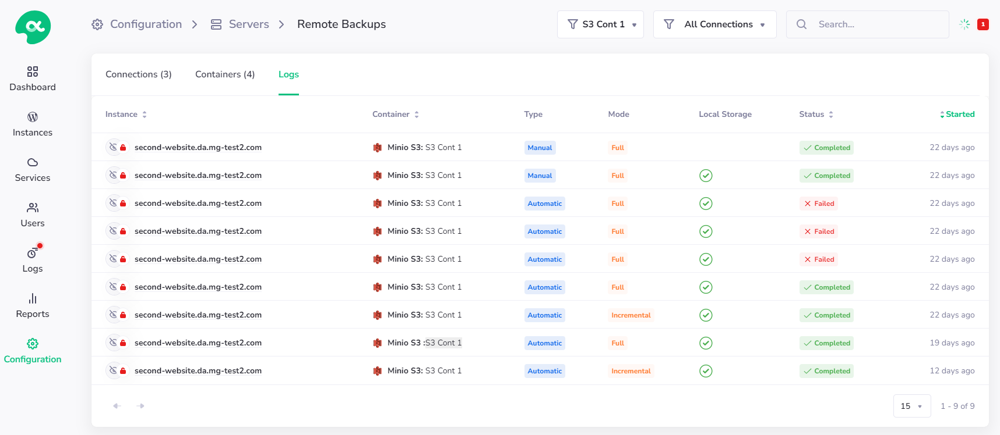

# Remote Backups

Navigate to **Configuration → Servers → Remote Backups** to manage remote backups. By default, if no remote backup is set up, only local storage backups are generated.

Connection types:
- [FTP Account](remote-backups.md#ftp-server)
- [S3 Providers](remote-backups.md#s3)

## Connections

This section displays all connections to APIs and servers, including FTP or S3 providers.

To establish the first connection, click **Add** and enter the necessary details:

- **Name** — Any name for the new connection
- **Type** — Select **S3 provider** or **FTP server**

### FTP Server

1. Select the protocol (FTP, FTPS, or SFTP) and provide connection details:
   - **Host**
   - **Username**
   - For **FTP/SFTP**: **Password**
   - For **SFTP** — Choose the authentication method:
     - **Password**, or
     - **SSH Key**:
       - **Private Key**
       - **Passphrase** (optional)
   - **Port Number**
   - **Path**

2. Test the connection. If successful, confirm by pressing **Add Remote Backup**.

### S3

For any S3 provider, enter the API connection details. Below are example configurations for popular S3 providers. Data visible on the screens is randomly generated and cannot be used in a live environment.

#### AWS

Required data:
- **Access Key ID** and **Secret Access Key** — Refer to [this guide](https://repost.aws/knowledge-center/create-access-key) for instructions.
- **Region** — Specify the region where your bucket is located using one of the [supported Amazon S3 regions](https://docs.aws.amazon.com/general/latest/gr/s3.html). For example, enter `eu-central-1` for the Europe (Frankfurt) region.
- **Endpoint data is not required**.

#### Virtuozzo

- **Access Key ID** and **Secret Access Key**
- **Endpoint**
  - **Use Path Style Endpoint** — Check if you wish to use this style. By default, Virtuozzo uses the virtual-hosted style.

#### iDriveE2

- **Access Key ID** and **Secret Access Key** — Refer to [this guide](https://www.idrive.com/s3-storage-e2/developer-guide#access-keys) for instructions.
- **Region** — Specify the region using one of the [supported iDriveE2 regions](https://www.idrive.com/s3-storage-e2/developer-guide#s3-region). For example, enter `de-fra` for the Frankfurt region.
- **Endpoint**
  - **Use Path Style Endpoint** — Check if you wish to use this style. By default, iDriveE2 uses the virtual-hosted style.

#### Backblaze

- **Access Key ID** and **Secret Access Key** — Refer to [this guide](https://www.backblaze.com/docs/cloud-storage-create-and-manage-app-keys) for instructions.
- **Endpoint**
  - **Use Path Style Endpoint** — Check if you wish to use this style. By default, Backblaze uses the virtual-hosted style.

#### DigitalOcean Spaces

DigitalOcean Spaces is an S3-compatible object storage service. To connect PanelAlpha to your Space, you need to create a Space and generate API credentials first.

**Step 1 — Create a Space**

1. Log in to your [DigitalOcean control panel](https://cloud.digitalocean.com/).
2. Navigate to **Spaces Object Storage** and click **Create a Space**.
3. Choose a **datacenter region** (e.g. `nyc3`, `ams3`, `sfo3`, `sgp1`, `fra1`).
4. Give your Space a unique name and click **Create a Space**.
5. Note the **Space name** — this is the bucket name you will use in PanelAlpha.

**Step 2 — Generate Spaces Access Keys**

1. In the DigitalOcean control panel go to **API → Spaces Keys**.
2. Click **Generate New Key**, give it a descriptive name, and click **Create Access Key**.
3. Copy both the **Access Key** and **Secret Key** immediately — the secret is shown only once.

**Step 3 — Connect in PanelAlpha**

In PanelAlpha select **S3 provider** as the connection type and fill in the following fields:

- **Access Key ID** — The Access Key generated in Step 2.
- **Secret Access Key** — The Secret Key generated in Step 2.
- **Region** — The datacenter region code of your Space (e.g. `nyc3`). Refer to the full list of [available Spaces regions](https://docs.digitalocean.com/products/spaces/details/availability/).
- **Endpoint** — Enter the endpoint matching your region, for example:
  - `https://nyc3.digitaloceanspaces.com` for New York 3
  - `https://ams3.digitaloceanspaces.com` for Amsterdam 3
  - `https://sfo3.digitaloceanspaces.com` for San Francisco 3
  - `https://sgp1.digitaloceanspaces.com` for Singapore 1
  - `https://fra1.digitaloceanspaces.com` for Frankfurt 1
- **Use Path Style Endpoint** — Leave **unchecked**. DigitalOcean Spaces uses the virtual-hosted style (`{bucket}.{region}.digitaloceanspaces.com`) by default.

After filling in the details, test the connection and confirm by pressing **Add Remote Backup**.

## Containers

Containers define where client backups are stored. For example, a single FTP connection may have three distinct containers.

The Containers section includes:
- Container ID, name, location (with icon, connection name, and location), and assigned rules
- Actions: edit, configure rules, remove container

### Adding a New Container

To add a container, navigate to the container page and click **Add**. You **must** first add at least one connection. A form will prompt you for:

- **Name**
- **Connection** — Choose from the dropdown.
- **Container location**

**Additional Configuration:**
- **Save a backup in local storage** — Enable or disable
- **Maximum size of backups per site (GB)**
- **Maximum number of backups per site**
- **Type of created backup**:
  - **Full Only**
  - **Full & Incremental** — In this case, additionally define:
    - **Full Backup Frequency** — How often a full backup is created (for example every three backups)
    - **Full Backups to Remain**
    - **Incremental backups to remain**

### Container Rules

Establish criteria for when the container is used for remote instance backups. Click the action button next to the selected container to configure rules.

Choose the rule type and allocate the relevant value. For instance, assign a server, plan, service, client, or individual instance. If an instance falls under multiple rules, it adheres to the one that is **highest in the hierarchy** (the most specific).

**Rule assignment hierarchy** (most to least important):
1. Instance
2. Service
3. Client
4. Plan
5. Server
6. Server group

**Example:** A container rule for a plan is more specific than one for a server group. If a client is assigned to container "1" and the client's plan is linked to container "2", the instance is backed up in container "1".

### Backup Retention Policy

PanelAlpha implements a clear retention policy for backup limits:

**When backup limits are reached:**

- **Manual Backups**: Creating a new manual backup is blocked. Users receive a notification and must manually delete existing backups before creating new ones.
- **Automatic Backups**: The system automatically removes the oldest automatic backup to maintain the configured maximum. This ensures continuous automatic backup functionality without manual intervention.

**Key Policy Points:**

- Automatic backups are **never** automatically deleted to accommodate manual backups.
- This prevents unintended loss of scheduled backup restore points.
- Users maintain full control over which backups to retain or remove.
- If a single backup limit exists and a manual backup is created, automatic backups pause until the manual backup is removed.

## Logs

This section stores all logs related to automated backups with filtering options per container or connection.

The logs list includes: related instance, container, backup type (manual or automatic), backup mode (full or incremental), local storage creation, action status, and start time.

Skipped automatic backups (for example Diagnostic Mode) appear in these logs with a short reason, so a gap in the schedule is visible without opening each instance.

