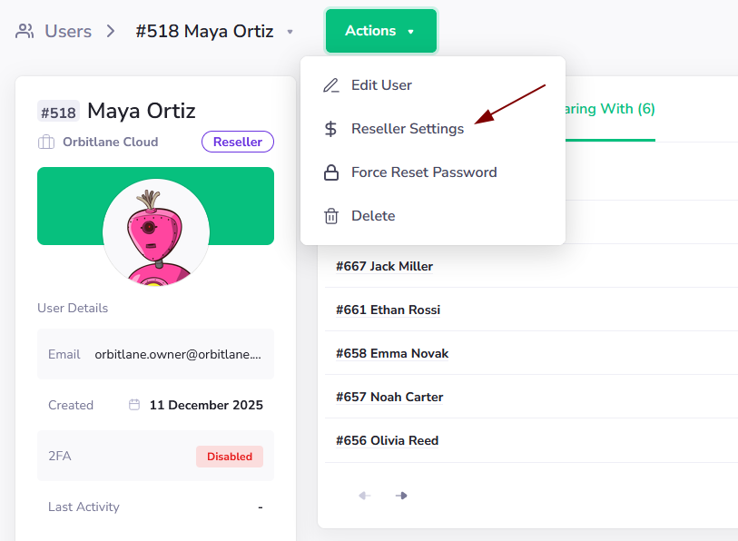
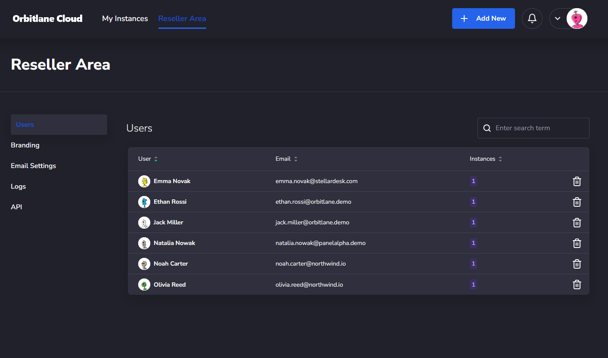
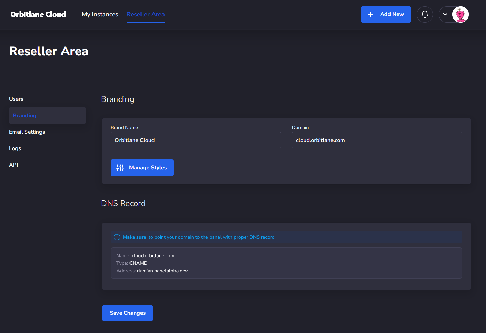
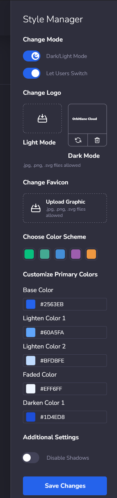
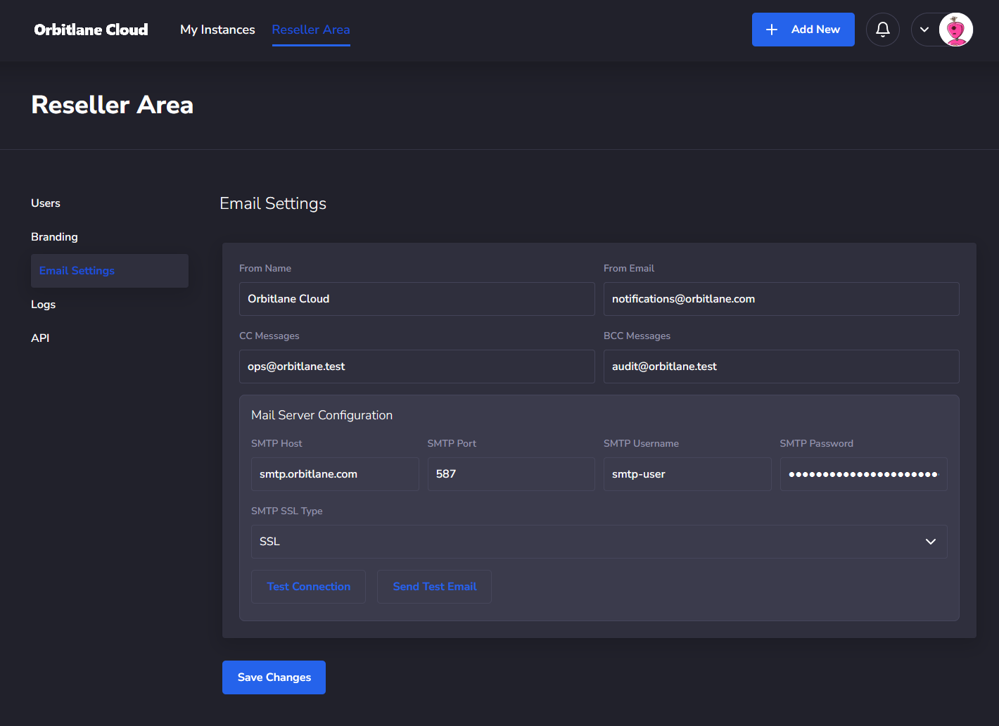
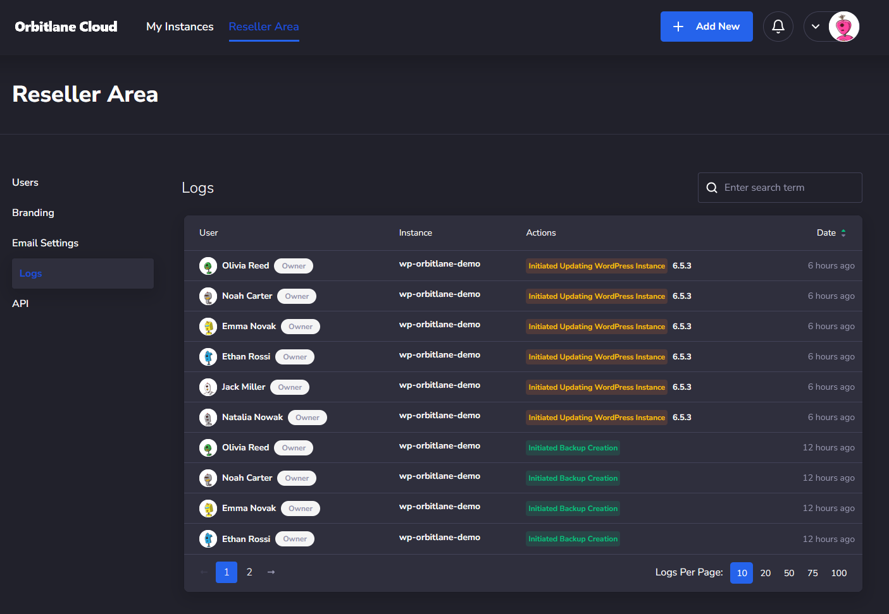
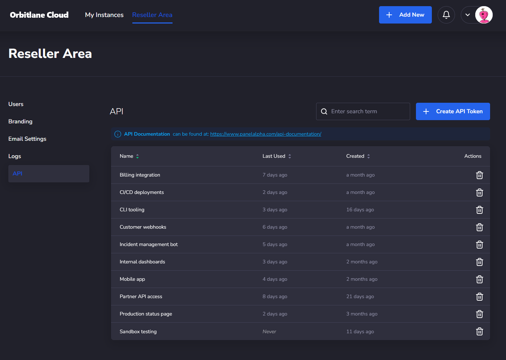

# Reseller Area

## Overview

The Reseller Area provides multi-tenant functionality that allows designated users to operate their own branded environment within PanelAlpha. Resellers can customize branding (including theme and colors), configure dedicated SMTP settings, manage their customer list, review tenant activity logs, and generate API tokens for automation.

When a user is marked as a reseller, they gain access to the **Reseller Area** tab in the client area navigation.

## Quick Start

Follow these steps to set up your first reseller:

1. **Enable reseller flag**: Admin Area → **Users** → select user → **Actions → Reseller Settings** → enable **Mark this user as reseller**.

2. **Reseller configures branding**: Reseller logs in → **Reseller Area** → **Branding** → sets brand name and (optionally) a custom domain.

3. **Reseller customizes theme (optional)**: **Branding** → **Manage Styles** → configure dark/light mode, logos, favicon, and primary colors.

4. **Reseller configures DNS for the custom domain** (optional):
   - Follow the DNS record shown in the Branding screen.
   - After DNS propagates, customers can use the reseller domain to access the panel.

5. **Reseller configures SMTP** (recommended): **Email Settings** → enter SMTP credentials → **Test Connection** → **Send Test Email**.

6. **Reseller adds customers**:
   - Creates a WordPress instance.
   - Shares the instance with the customer email.
   - Customer accepts invitation and appears in the **Users** list.

7. **Customers access the panel**: Customers log in normally. If a reseller custom domain is configured, they can also log in via that domain.

## How to Enable

To enable reseller functionality for a user:

1. Navigate to **Users** in the admin area.
2. Open the user profile you want to convert to a reseller.
3. Click **Actions → Reseller Settings**.
4. Enable **Mark this user as reseller** and click **Save changes**.

After enabling, the user must re-login to see the Reseller Area tab. The flag can be disabled at any time, which immediately revokes access to the Reseller Area.

## How Users Are Associated with a Reseller

Reseller user management works through the **instance sharing** mechanism. The Users list is derived from users who have access to at least one instance owned by the reseller.

**Association flow:**

1. Reseller creates or imports a WordPress instance (the instance is owned by the reseller).
2. Reseller shares the instance with a customer's email address.
3. Customer receives an invitation email and accepts it.
4. Customer now appears in the reseller's Users list.
5. If the reseller revokes all shared access for a user, that user is removed from the Users list.

This approach ensures that:
- Users are always linked through actual instance access, not just database records.
- Resellers can only see users who have access to their instances.
- Removing a user means revoking their access to all shared instances.

## Sections

### Users

The Users section displays customers who have shared access to at least one instance owned by the reseller.

**Displayed information:**
- Email address and name
- Number of shared instances
- Account creation date

**Available actions:**
- **View instances**: See which instances are shared with a specific user.
- **Remove**: Revoke all shared access for the user on reseller-owned instances.

Removing a user does not delete their PanelAlpha account. It only removes their access to this reseller's instances.

### Branding

Branding settings allow resellers to customize how their panel appears to customers.

| Field | Description |
|-------|-------------|
| **Brand Name** | Company name displayed in the panel header, page titles, and email notifications |
| **Domain** | Custom domain for the client area (for example `panel.acme.com`). Must be different from the main PanelAlpha domain |

**Custom domain setup:**

To use a custom domain, the reseller must:

1. Configure DNS according to the DNS record shown in the Branding screen.
2. Enter the domain in Branding settings.

You can also open **Manage Styles** to configure:

- Dark/light mode defaults and whether users can switch modes
- Logos for light and dark mode
- Favicon
- Color scheme and primary colors
- Optional UI settings (for example disabling shadows)

**Where branding is applied:**
- Client area header and navigation
- Email notifications (logo, brand name, colors)
- Page titles and browser tabs
- Links in email templates use the custom domain

### Email Settings

Resellers can configure dedicated SMTP settings to ensure all notifications to their customers are sent from their own mail server and domain.

| Field | Description |
|-------|-------------|
| **From Name** | Sender name displayed in email clients (for example "Acme Hosting Support") |
| **From Email** | Sender email address. Should match the SMTP server domain for best deliverability |
| **CC Messages** | Optional email address to receive copies of all outgoing messages |
| **BCC Messages** | Optional email address to silently receive copies of all outgoing messages |
| **SMTP Host** | Mail server hostname (for example `mail.example.com`) |
| **SMTP Port** | Server port: typically 25 (unencrypted), 465 (SSL), or 587 (TLS) |
| **SMTP Username** | Authentication username |
| **SMTP Password** | Authentication password |
| **SMTP SSL Type** | Encryption method: None, SSL/TLS, or STARTTLS |

**Testing tools:**
- **Test Connection**: Verifies that PanelAlpha can connect to the SMTP server with the provided credentials (5 second timeout).
- **Send Test Email**: Sends an actual test message to verify end-to-end email delivery.

**WARNING:** If SMTP settings are not configured, emails to the reseller's customers will be sent using the system's default mail configuration. This may result in emails appearing to come from the main PanelAlpha domain rather than the reseller's brand.

### Logs

The Logs section provides an audit trail of all activity within the reseller's tenant. This includes actions performed by the reseller's customers on shared instances.

**Logged events include:**
- User authentication (login/logout)
- Instance operations (create, modify, delete, clone, migrate)
- Domain management (add, remove, SSL changes)
- Backup operations (create, restore, delete)
- File manager operations
- Plugin and theme management
- Database operations
- WordPress core updates

**Filtering:**
- Logs can be searched by keyword.
- Pagination controls allow adjusting the number of entries per page.

**Scope:**
- Only shows activity on instances owned by the reseller.
- Admin actions (for example actions performed via "Login as User") are excluded.
- Actions by the reseller and their customers are included.

### API

Resellers can generate API tokens to programmatically manage their tenant. These tokens provide access to reseller-specific endpoints and can be used for automation, custom integrations, or building external dashboards.

**Token management:**
- **Create**: Generate a new token with a custom name for identification.
- **List**: View all active tokens with creation date and last used timestamp.
- **Delete**: Revoke a token to prevent further API access.

**Note:** A reseller can have multiple tokens (up to 100).

**API capabilities:**
API tokens offer the same capabilities available in the Reseller Area UI, so anything that can be done manually in the panel can also be automated programmatically.

Full API documentation is available at [panelalpha.com/api-documentation](https://www.panelalpha.com/api-documentation/).

## Limitations

| Limitation | Description |
|------------|-------------|
| **No sub-resellers** | Resellers cannot mark their own users as resellers. Multi-level reselling is not supported. |
| **Domain restriction** | Reseller domain cannot match the main PanelAlpha installation domain. |
| **Plan inheritance** | Instances created by reseller users follow the plan's server configuration. Resellers cannot override hosting or DNS provisioning settings. |
| **Global billing** | Subscription plans and pricing are managed globally. Resellers cannot modify plan features or pricing for their customers. |
| **Immediate flag effect** | Disabling the reseller flag immediately removes access to the Reseller Area. |

## FAQ

### Can resellers create their own plans?

No. Plans are managed globally by the administrator. Resellers use the plans assigned to their services. They cannot create, modify, or delete plans.

### Can I create multiple API tokens?

Yes. Resellers can create multiple API tokens for different integrations. The limit is 100 active tokens per reseller.

### What happens when I disable the reseller flag?

The user immediately loses access to the Reseller Area. Their instances and customers remain intact, but they can no longer manage them through the Reseller Area interface. Re-enabling the flag restores access.

### Do reseller customers see the main PanelAlpha branding?

Only if the reseller has not configured custom branding. If branding is configured, customers see the reseller's brand name, logo, and receive emails from the reseller's SMTP server (if configured). Plugin UI and WHMCS SSO errors without an instance follow the same brand name.

### Can resellers access the admin panel?

No. Resellers only have access to the client area and the Reseller Area tab. They cannot access admin-level features like server management, global settings, or other users' data.

### How do I migrate an existing user to become a reseller?

Simply enable the reseller flag on their account. Their existing instances become part of their reseller tenant. Users who already have shared access to those instances will appear in the reseller's Users list.

### What DNS records are needed for a custom domain?

Use the DNS record shown in the Branding screen. Depending on your DNS setup, this may be an A record or a CNAME.

### Are activity logs retained when a reseller is disabled?

Yes. Logs are preserved in the database. If the reseller flag is re-enabled, the logs become accessible again through the Reseller Area.
