# Themes, Plugins, and Packages

In WordPress, themes, plugins, and packages are used to customize and extend website functionality. This article explains each element and how to manage them in PanelAlpha.

## Must-Use Plugin (Control Panel Connection)

PanelAlpha automatically maintains a **must-use (MU) plugin** called **Control Panel Connection** on all WordPress instances. This plugin is essential for core functionality and cannot be disabled or removed by users.

### Key Features

- **Single Sign-On (SSO)** — Enables secure direct login to WordPress admin and control panels (cPanel, Plesk, DirectAdmin) without password entry.
- **Admin Bar Feed** — Adds PanelAlpha-specific information and quick actions to the WordPress admin bar.
- **Blacklist Enforcement** — Prevents installation and activation of blacklisted plugins and themes.

### Automatic Maintenance

The system ensures the must-use plugin is always present and up-to-date through the daily **SyncWordPressData** job, which:

- Verifies the plugin exists on every instance
- Installs it automatically if missing
- Updates it to the latest version when needed

**INFO:** Must-use plugins load before regular plugins and cannot be deactivated from the WordPress admin interface. This ensures PanelAlpha's essential functionality remains available at all times.

## Configuration

**Plugins** enhance website functionality. **Themes** determine design and layout. **Packages** bundle collections of themes or plugins together.

### Packages

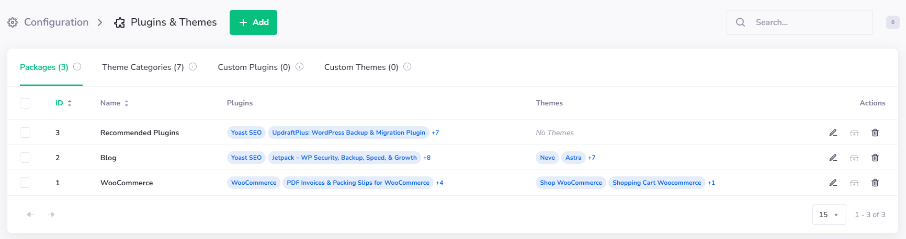

Prepare packages that allow users to install and activate included themes and plugins.

#### Adding a New Package

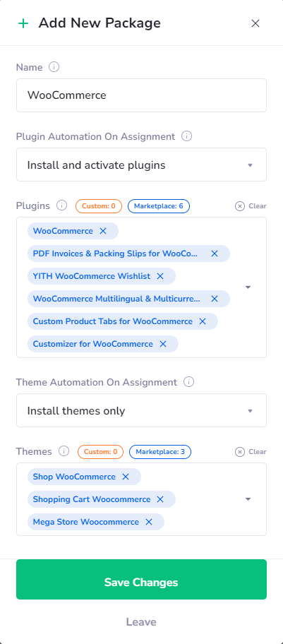

To compose a package, go to **Configuration → Plugins & Themes** and press **Add**. Fill out the form:

- Enter the package name
- Define plugin automation on assignment:
  - Install and activate plugins
  - Install plugins
  - No action
- Select plugins to include
- Define theme automation on assignment:
  - Install themes
  - No action
- Select themes to include

Allowed actions on packages:
- Edit the package
- Force installation
- Remove the package

### Theme Categories

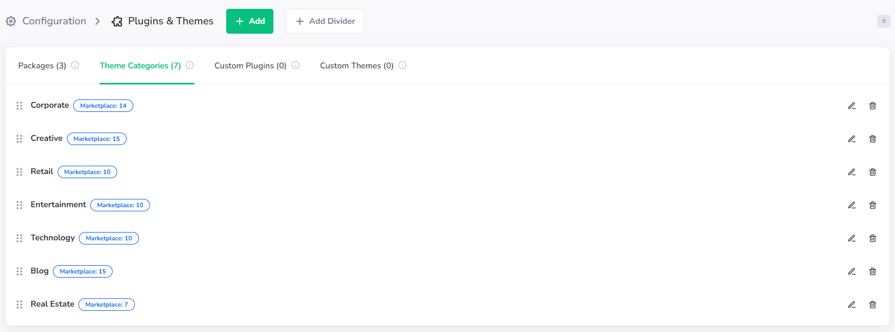

Manage theme categories here. Add, edit, or remove categories. Press **Add Divider** to separate categories and maintain a clear display.

- **Add category** — Press the corresponding button, enter the category name, and confirm.

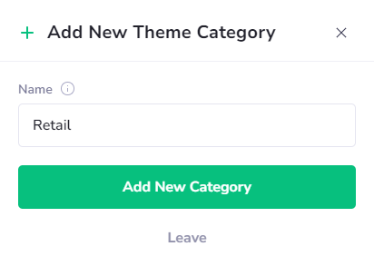

- **Edit an existing category** — Press the **Edit** button to assign themes to a single category.

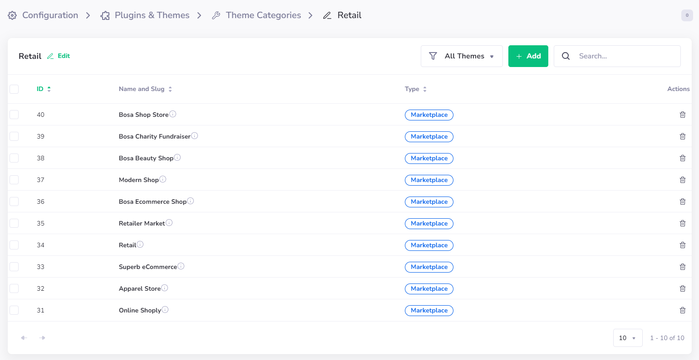

Press **Add** to assign the first theme. A form divided into **Custom** and **Marketplace** themes will appear. Type the theme name and select the checkbox to add multiple themes. You may also visit the homepage (Marketplace themes only), see its preview, and add a single theme. Reassign themes at any time.

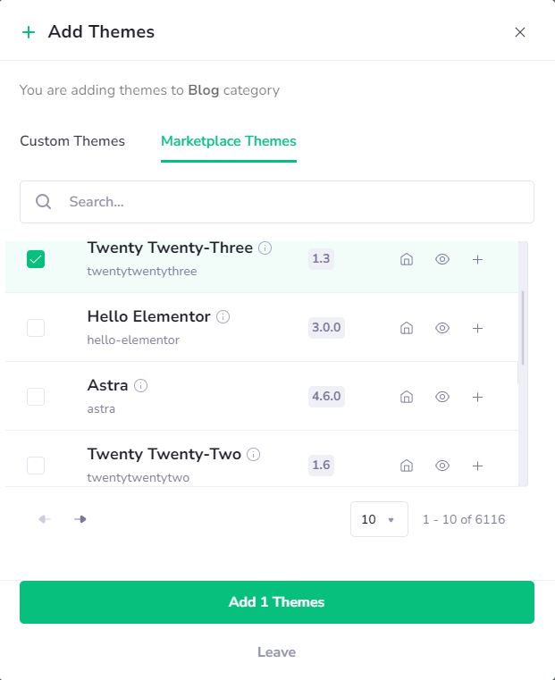

### Custom Plugins

Custom WordPress plugins are created by administrators to add specific functionality.

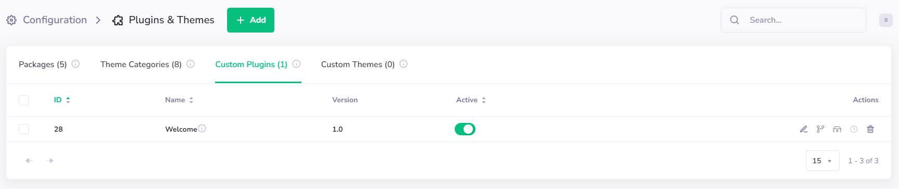

Press **Add** to create a custom plugin. Fill out the form with the following required information:

- Name
- Description
- Version
- Attach the package file — must be in `.zip` format; you may also include a screenshot

Allowed actions on a custom plugin:
- Enable/disable the plugin
- Edit the custom plugin (name, description, version number)
- Show available versions:
  - Select a version to activate
  - Delete a single version
  - Upload a new version
- Upload a new version (enter name and attach the zipped file)
- Force plugin update on instances with this plugin assigned
- Delete the plugin

### Custom Themes

Custom themes function similarly to custom plugins. They are created by administrators to give websites a unique look and feel.

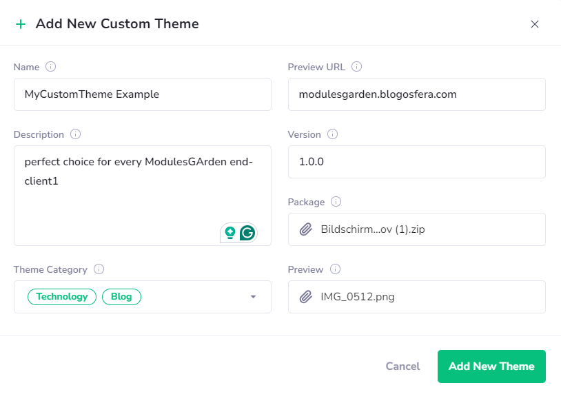

Press **Add** to create a custom theme. Fill out the form with the following required information:

- Name
- Description
- Theme category (optional)
- Preview URL (optional)
- Version
- Attach the package file — must be in `.zip` format
- Preview — include a screenshot

Allowed actions on a custom theme:
- Enable/disable the theme
- Edit (name, description, category, preview URL, version number)
- Show available versions:
  - Select a version to activate
  - Delete a single version
  - Upload a new version
- Upload a new version (enter name, attach the zipped file, attach screenshot)
- Force theme update on instances with this theme assigned
- Delete the custom theme

If the preview is not added or not included in the package, the previous screenshot remains active.

## Plan Configuration

Assigning themes and plugins is the last step of creating a plan. See [Plans](plans.md#plugins-themes) for more details.

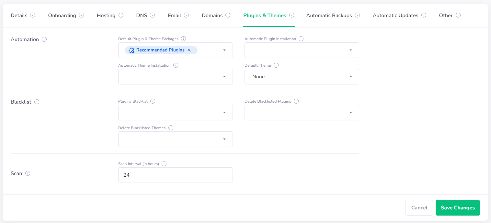

Manage the plugins and themes that will be installed or deactivated on instances:

1. **Automation:**
   - **Default Plugin & Theme Packages** — Assign packages to a WordPress instance within the plan.
   - **Automatic Plugin Installation** — Assign plugins automatically installed during instance creation.
   - **Automatic Theme Installation** — Assign themes automatically installed during instance creation.
   - **Default Theme** — Select a default theme for the instance.

2. **Blacklist:**
   - **Plugin Blacklist** — Prohibited plugins hidden from search results, blocked from installation (including ZIP uploads), and with activation disabled if already installed.
   - **Delete Blacklisted Plugins** — Prohibited plugins automatically removed from any instance during daily synchronization.
   - **Delete Blacklisted Themes** — Prohibited themes automatically removed from any instance during daily synchronization. Blacklisted themes are also hidden from search results and blocked from installation.

**INFO:** The system runs a daily **SyncWordPressData** job that automatically:
- Ensures the required must-use plugin is installed on all instances
- Adds the admin bar feed
- Removes any blacklisted plugins and themes

**WARNING:** The **Scan Interval (in hours)** setting has been removed. Plugin and theme synchronization, including blacklist enforcement, now occurs automatically once daily through the SyncWordPressData job.

## Services: Plugins & Themes

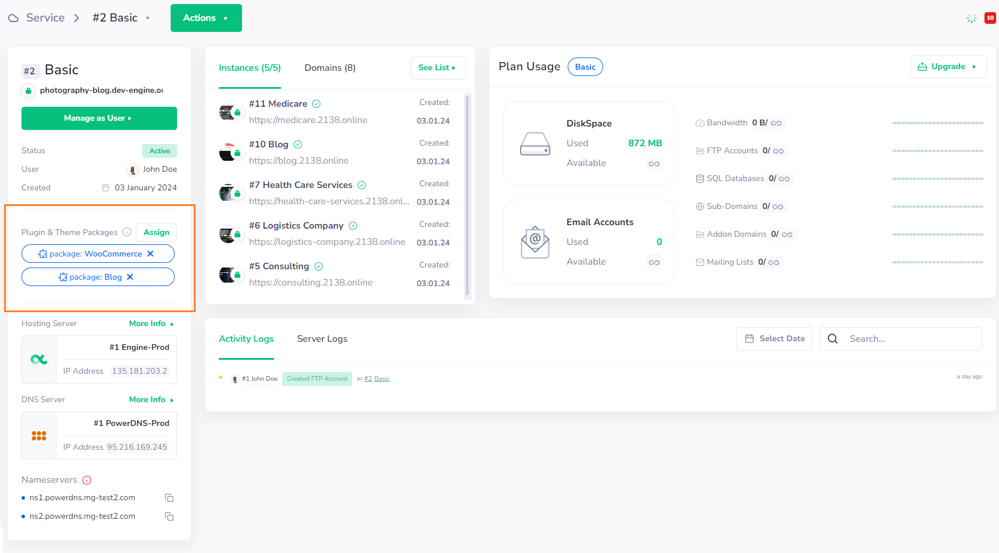

Packages containing themes and plugins can be assigned to a service directly from its details page. Navigate to [Services](../admin-area/services.md) and open the management page of the desired service.

In the first widget displaying basic plan data, find the **Plugin & Theme Packages** section. Preview currently assigned packages or assign additional ones by clicking **Assign**. A dropdown menu with available packages will appear. Select the desired package and confirm.

## Client Area: New Instance

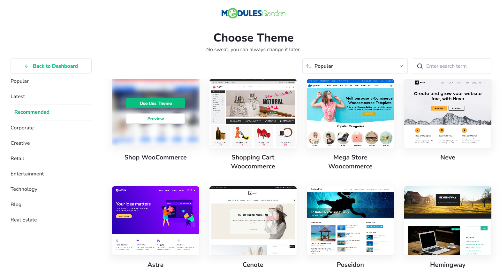

The process of [creating a new instance](../client-area-instances/creating-new-instance.md) varies by product, but theme selection is similar for all products with [Standard](../onboarding-methods/standard-onboarding.md) or [Quick](../onboarding-methods/quick-onboarding.md) onboarding.

In most cases, you will be presented with a list of website themes. Browse, use the **Preview** option for a better view, and select **Use This Theme** when satisfied. You can change the theme later.

Theme categories on the left side:
- **Popular** and **Latest** — the two default categories
- **Recommended** — themes included in [packages](plans.md#plugins-themes) assigned to the current plan
- **Other** — remaining custom [Theme Categories](themes-plugins-and-packages.md#theme-categories) created by the admin
