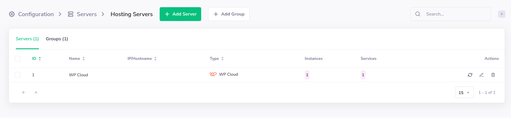
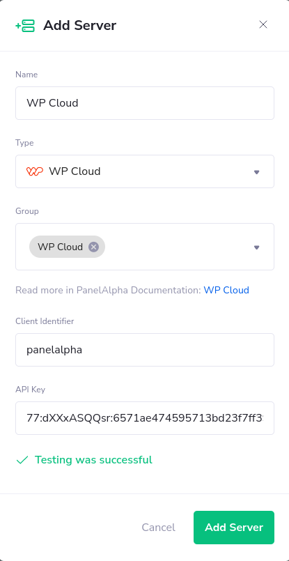
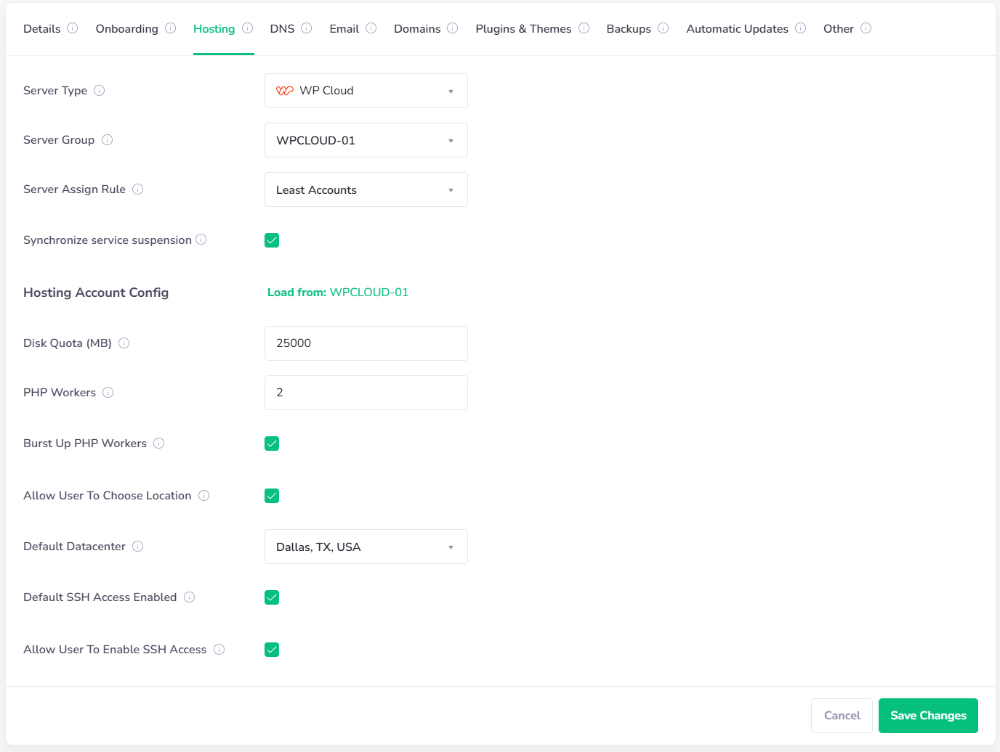
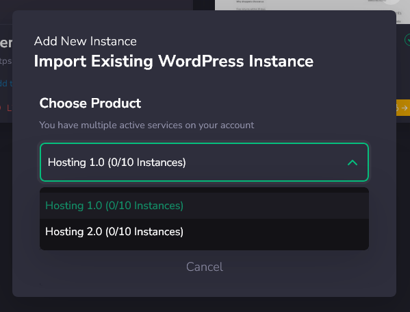
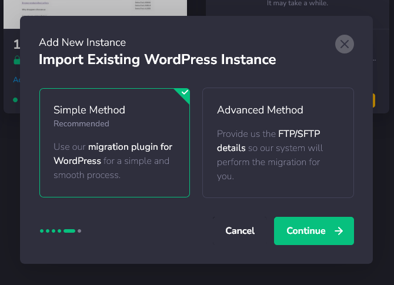
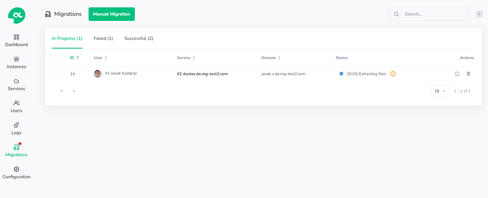
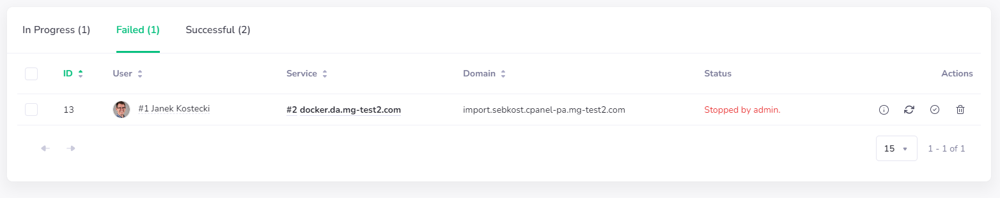

# WP Cloud Migration

This guide is designed for external teams that want to migrate existing WordPress websites to **WP Cloud** using **PanelAlpha**.

PanelAlpha handles the migration workflow end-to-end: provisioning the destination instance on WP Cloud, pulling data from the source site, and exposing full progress and logs in the Admin Area.

## What You Need to Start

Before running your first migration, ensure you have:

- A working **WP Cloud account** with API access enabled.
- **WP Cloud Client Identifier** and **API Key** (provided by WP Cloud).
- A deployed **PanelAlpha** environment (or a planned installation).
- A configured **plan/service** in PanelAlpha that uses WP Cloud as the hosting server.
- Access to the source WordPress site:
  - WordPress admin login (recommended method), or
  - FTP/SFTP access and path to the WordPress root.
- Domain/DNS access for final cutover.

## Migration Flow at a Glance

1. Connect WP Cloud in PanelAlpha.
2. Configure a plan/service that provisions instances on WP Cloud.
3. Start import from Client Area (plugin or FTP/SFTP method).
4. Monitor and manage progress in **Admin Area → Migrations**.
5. Validate the migrated site and switch production traffic.

## Step 1: Enable WP Cloud API Access

Request API access from [WP Cloud](https://wp.cloud/inquiries/) and collect:

- Client Identifier
- API Key
- Approved source IP (the public IP of your PanelAlpha environment)

Without these values, PanelAlpha cannot create destination instances on WP Cloud.

## Step 2: Prepare PanelAlpha

If you do not have PanelAlpha yet, complete installation first:

- [Installation Guide](../getting-started/installation.md)

Then verify:

- You can log in to the Admin Area.
- Your target customer has an active service/plan for migration destination.

## Step 3: Connect WP Cloud as a Hosting Server

In the Admin Area, go to **Configuration → Servers → Hosting Servers → Add Server** and add WP Cloud using your Client Identifier and API Key.

Use **Test Connection** before saving.

## Step 4: Configure a Plan for WP Cloud Provisioning

Open the plan used by the destination service and set **WP Cloud** in the hosting configuration. Confirm key options such as disk quota, workers, and location policy.

Reference:
- [WP Cloud server and plan options](../hosting-servers/wp-cloud.md)
- [Plans configuration](../system-configuration/plans.md)

## Step 5: Prepare the Source WordPress Site

Before import:

1. Create a backup on the source environment.
2. Confirm WordPress and plugins are healthy (no critical errors).
3. Decide the import method:
   - **Simple/Plugin method** (recommended)
   - **Advanced FTP/SFTP method**
4. Collect credentials and validate access before starting.

## Step 6: Start Migration from Client Area

Open **My Instances → Add New → Import Existing WordPress Instance**.

Then:

1. Select the destination service (the one mapped to WP Cloud).
2. Enter the source WordPress URL.
3. Choose the import method.
4. Provide required credentials.
5. Start migration and wait for processing.

Detailed method guide:
- [Importing Existing Instance](../client-area-instances/importing-existing-instance.md)
- [Migration Types](../migrations/migration-types.md)

## Step 7: Monitor and Manage Migration in Admin Area

Open **Admin Area → Migrations** and track progress in real time.

If migration fails:

1. Open migration details and check logs.
2. Retry if the root cause is resolved.
3. Switch to manual migration for edge cases (large sites, blocked source access, repeated failures).

## Step 8: Validate the Migrated WP Cloud Site

Before go-live, verify:

- Frontend pages and media load correctly **before DNS cutover**.
- Use [WithoutDNS](../integrations/withoutdns.md) to preview and test the migrated website without changing live DNS records.
- WordPress admin login works.
- Plugins, themes, and custom integrations behave as expected.
- Forms and transactional email work.
- SSL status and DNS records are correct.

## Step 9: Cut Over Production Traffic

After validation:

1. Update DNS to point the production domain to the WP Cloud destination.
2. Wait for propagation (based on your TTL).
3. Re-run quick smoke tests on frontend and admin.
4. Keep the source site in maintenance/read-only mode until final confirmation.

## When to Use Manual Migration Instead

Move to manual migration when:

- Plugin/FTP import repeatedly fails.
- The source host blocks required operations.
- Site size requires controlled upload and verification.

Manual procedure:
- [Manual migration flow](../migrations/migration-types.md#manual-migrations)

## Related Documentation

- [WP Cloud](../hosting-servers/wp-cloud.md)
- [Migrations Overview](../migrations/index.md)
- [Managing Migrations](../migrations/managing-migrations.md)
- [Migration Troubleshooting](../migrations/troubleshooting.md)
