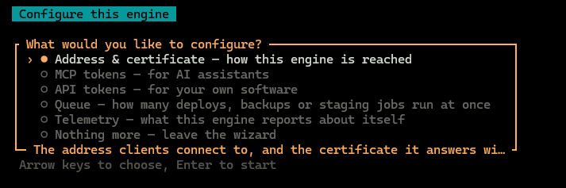

# Configure the engine

`pae configure` on your VPS walks you through the engine's own settings. You pick one area, change it and come back for the next. The areas are:

- The address assistants use.
- Which projects may call the engine's own API.
- What assistants are allowed to do.
- Tokens for your own software.
- How many jobs run at once.
- The Docker Hub login that image downloads use.
- Which base images are kept ready.
- The memory the site database keeps for caches.
- The firewall's web interface.
- What the engine reports about itself.

```bash
pae configure
```

What you should see: a menu. The arrow keys move and Enter opens the line you are on. The line under the box says what that choice changes.



When you leave, the wizard prints what it wrote. If you changed nothing, it says so.

## What each choice does

- **Address and certificate.** The address an assistant is told to connect to, including `https://` and the port, and the certificate on that name. The certificate has to cover the name in the address, or the assistant refuses the connection. Asking for a certificate takes the engine's own address down for a moment.

  **New project tunnel** sets how the engine publishes a project created without a tunnel. `panelalpha` is the default. It publishes under your base domain if you have set one, otherwise under a free `panelalpha.online` name. `none` publishes under the engine's own name and registers nothing with PanelAlpha Online. A tunnel named in a request always wins.
- **Engine API access.** Which projects may call this engine's API, for an application that manages the engine itself. Allowing a project makes a token for it. The token covers that project only, every project or a list. You can add assistant tools to the token, replace the token or take the access away. Only container projects can be allowed. The commands for the same work: [Engine API for projects](../commands/pae-cli.md#engine-api-for-projects).
- **MCP tokens.** Connect an assistant, decide which commands every assistant is offered, or give one assistant fewer of them. A token can only receive commands that the engine offers to everyone.
- **API tokens.** A token for software you run yourself, not for an assistant. You can limit which parts of the engine the token may call, or revoke it.
- **Queue.** How many deploys, backups or staging copies run at the same time. They share one queue. The wizard asks for a number from 1 to 32 and applies it.
- **Docker Hub.** The Docker Hub account that every image download on this server uses. Without one, all projects share one anonymous limit for your server's address. Busy servers hit that limit, and deploys then fail with "Docker Hub temporarily refused further downloads". Use a Docker Hub access token with the **Public Repo Read-only** scope. The wizard checks the token with Docker Hub. It warns you if the token can read private repositories, because every project on this server could then download them.
- **Prewarmed images.** Which base images the server keeps ready before any project asks for them, and how much disk that may use. By default it keeps none. The first deploy that needs an image builds or downloads it. Later deploys reuse it. The server deletes it after a few days without use. A later deploy still downloads a newer release of the same version, such as a Node.js security release, when one is out.

  Pick the images your projects use if you want their first deploy to skip the wait. A PHP version costs about 1 GB. The server downloads PanelAlpha's published copy instead of compiling it for several minutes (`DEPLOY_BASE_IMAGE_REGISTRY`, `none` to always compile).

  The **budget** is the most disk one prewarm run may spend (6G by default, `none` for no limit). The **reserve** is the free disk it always leaves (10G by default). Changes apply at the next weekly prewarm, or straight away with `pae system:image:prewarm`. To keep an image of your own ready for every project, see [Your own base images](../capabilities/base-images.md).
- **Site database.** How much memory the database for hosted PHP sites keeps for its caches: the InnoDB buffer pool (32M by default), the MyISAM key buffer (8M) and the Aria page cache (8M). Raise them when hosted sites have large databases. Write a size like `64M` or `1G`. Saving a size restarts that database, so sites lose it for a few seconds. The wizard asks first. The engine's own containers have separate memory caps: [Memory the engine keeps for itself](install.md#memory-the-engine-keeps-for-itself).
- **Telemetry.** Whether reports leave this server, how much a report carries and whether bug reports are allowed. The server still records each deploy locally either way: [Telemetry](what-is-collected.md).

**Nothing more** closes the menu.

To open one area without the menu, name it:

```bash
pae configure mcp-tokens
```

The names are `address`, `api-access`, `mcp-tokens`, `api-tokens`, `queue`, `docker-hub`, `prewarm`, `sites-db` and `telemetry`. Add `--dry-run` to see what would be written and write nothing.

The wizard needs the terminal you have over SSH. It does not run from a script.

## Offer the assistant fewer commands

A new install offers every command. Untick the ones you do not use and the assistant is offered a shorter list.

```bash
pae configure mcp-tokens
```

Choose **Global scope**. Then use these:

- **Groups** ticks whole areas on and off.
- **Commands** lists one area and lets you untick single commands.
- **Ceiling** is how far a ticked command may go: look only, change but not delete, or everything including deletion.

The hint under the menu counts how many commands would be offered.

Nothing is written until you pick **Review and save** and say yes. An assistant that is already connected keeps the list it got when it connected. Reconnect it to see the change.

To give one assistant less than the others, choose **Tokens** on the same menu, pick that assistant and untick. This can only take commands away. It cannot offer a command you turned off for everyone. `pae mcp:token:list` shows the result in its **Commands** column.

The same limits, written out as settings: [Decide what the assistant may do](../connecting-your-ai/your-assistant.md#decide-what-the-assistant-may-do).

## Troubleshooting

**It says the wizard needs a terminal.**
Run `pae configure` in the SSH session on the VPS. A script cannot answer the menu.

**I saved new limits and the assistant still does the old things.**
Reconnect it. It keeps the command list from when it connected.

**I asked for a certificate and could not reach the engine for a moment.**
This is expected. The engine's own address on port 2011 stops briefly while the certificate is fetched, then comes back.

## More requests to try

**Mode** is the lowest permission mode that allows it: read, modify or full ([Decide what the assistant may do](../connecting-your-ai/your-assistant.md#decide-what-the-assistant-may-do)).

**What this engine is**

```text
Tell me about this engine: version, webserver, address and what it runs on.
```

Mode: read. Tools: `system_info`. Check: the version matches `pae system:version` on the server, and the webserver is nginx-proxy.

## From the server

The same areas as single commands: [CLI commands](../commands/pae-cli.md#configuring-the-engine).
