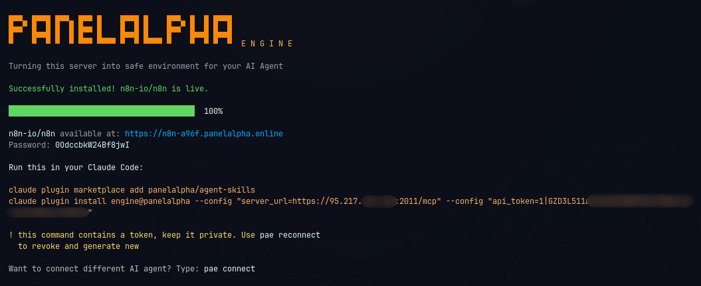
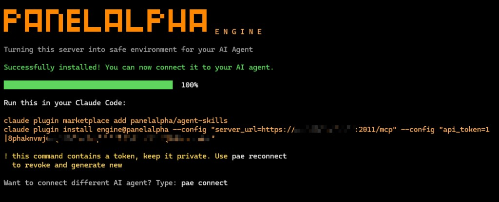
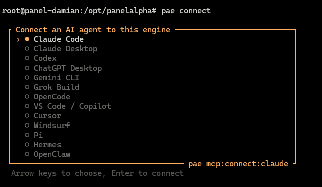

# Install

Installing is a one-time setup. Check your VPS against the list below, log in as `root` over SSH and run one command. It prints your engine's addresses and a command to connect your assistant.

It takes several minutes and asks you nothing along the way.

When it is done, the software lives in `/opt/panelalpha/shared-hosting`. The `pae` command works from anywhere. nginx-proxy runs as the public webserver that serves your sites. It is the only supported webserver.

## Before you start

You need a VPS that meets all five:

| Requirement | What you need |
|---|---|
| **Operating system** | Debian 12 or 13, or Ubuntu 22.04, 24.04 or 26.04 |
| **Access** | Logged in as `root` over SSH, not `sudo` |
| **The VPS** | Brand new, with nothing else running on it |
| **Memory** | 2 GB of RAM, more as you add projects |
| **Network** | A public IPv4 address |

The installer checks the operating system and refuses any other. It does not check the rest, so check them yourself.

> [!NOTE]
> **Why the VPS has to be brand new.** The installer takes the machine over. It installs Docker, a firewall and a watchdog. It turns on disk quota and mounts `/home` with `nosuid,nodev` (see [Troubleshooting](#troubleshooting)). It also takes over how the machine looks up domain names. That is fine on an empty VPS and destructive on one that already does a job. Do not use your laptop, a VPS that runs a website or control panel, or anything you would mind reinstalling.

**With no public IPv4 address,** the engine still works, but the install command is different. Read [Troubleshooting](#troubleshooting) first.

**Your provider may put a firewall in front of the VPS.** Hetzner Cloud Firewalls and AWS security groups are examples. The engine cannot see or change that firewall. Open the ports in [A firewall in front of the VPS](#a-firewall-in-front-of-the-vps) yourself.

## 1. Run the installer

```bash
curl -fsSL https://get.panelalpha.com/engine | sh
```

A few minutes later the engine is running. It prints its addresses and a command to connect your assistant. For a name of your own, or a VPS the internet cannot reach by IP, read [Troubleshooting](#troubleshooting) first.

## One-line app installation command

One command can install the engine and put an application from a git repository online. Use the web address of the repository, the one you would open in a browser. The installer sets up the engine, then creates a new **project** (one application or website on the VPS) from that repository. It picks the project name and the site's address for you.

Pass flags after `sh -s --` so they reach the installer:

```bash
curl -fsSL https://get.panelalpha.com/engine | sh -s -- \
  --repo https://github.com/n8n-io/n8n
```

When it finishes, it prints the web address of your new site. It starts with `https://`.

Unless you passed `--no-password`, it also prints the password that opens the site. That is the one you gave with `--password`, or one the installer made up. Copy it from the screen. If the installer could not set the password, it says so and prints the command to try again.

Below that is the same information for connecting your AI assistant as after a normal install. Continue with [Connect your AI assistant](#2-connect-your-ai-assistant) on your own computer.



`--repo` is the application you want hosted. It is not where the engine software comes from. You do not need a licence key.

| Flag | What it does |
|---|---|
| `--repo URL` | Git repository to deploy: its `https://` address, or `owner/repo` for a repository on GitHub. Addresses that start with `git@` do not work. |
| `--branch REF` | Branch, tag or commit to deploy. Leave it out to use the repository default. |
| `--git-token TOKEN` | Access token that lets the installer read a private repository. Without it, the installer refuses a private or missing repository before the install starts. |
| `--password PASS` | Site password for the new project. |
| `--no-password` | Do not set a site password on the project. |
| `--email ADDR` | Contact email for install and monitoring notices. With `--full-privileges` it is also the panel's admin. |
| `--full-privileges` | Trust the project with this engine: it is the PanelAlpha panel. **Give it only to an application you trust with the whole server.** The project gets an Engine API token for every project. It may take the server's own name and its public ports. Once it is live, it is a system project: no API or assistant token but its own can see it, and it is protected: [System projects](../capabilities/projects.md#system-projects). It needs `--repo`. No site password is set unless you pass `--password`. `--email` becomes the panel's admin, with a generated password printed at the end. `--hub-code` goes to the panel, which connects itself to PanelAlpha Hub on its first start (the engine is not connected). It needs `--email` too. Run the install again with the same `--repo` and `--full-privileges` and it deploys that project again instead of making a second one. The project keeps its admin, settings and data, so no new password is printed. |
| `--env-var KEY=VALUE` | An environment variable for the project. Repeat it for more. It needs `--repo`. The installer never prints the value. |

If the deploy fails, the engine is still installed and works. The installer prints what went wrong. Deploy again from the VPS:

```bash
pae project:create --repo https://github.com/org/app
```

Or connect an assistant and ask in chat: [Put your project online](../index.md#3-put-your-project-online).

**The engine is already on this VPS.** Run the same `curl` line with `--repo` again. If a newer engine build is available, the installer asks whether to update the engine and deploy, or only deploy the project. Without an interactive terminal it only deploys the project. Pass `--update-engine` to update and deploy without being asked. Pass `--deploy-only` to deploy without updating.

**Connect it to PanelAlpha Hub in the same run.** Add `--hub-code CODE` with the code from **Connect engine** in PanelAlpha Hub: [Install and connect in one step](connect-to-panelalpha-hub.md#install-and-connect-in-one-step).

## 2. Connect your AI assistant

You connect from **your own computer**, not from your VPS. After install you see a screen like this, with a ready-made command for Claude Code. Copy that command and run it on your computer.



If you use a different assistant, run this on your VPS. It prints the line to run on your computer, with your address and a token already filled in:

```bash
pae connect
```



> [!NOTE]
> **Run `pae connect` on your VPS, not on your own computer.**

Each assistant has a setup page. It shows how to check the connection and what usually goes wrong: [Connecting your AI](../connecting-your-ai/your-assistant.md).

**Before you connect, decide what the assistant may do.** By default it can permanently delete an entire project: [Decide what the assistant may do](../connecting-your-ai/your-assistant.md#decide-what-the-assistant-may-do).

If your assistant refuses to connect and mentions a certificate, see [If connecting asks you to trust a certificate](#if-connecting-asks-you-to-trust-a-certificate).

## What happens afterwards

The installer keeps downloading commonly used software in the background, so your first deploy is fast. You can use the engine straight away.

The installer also creates a local backup store and makes it the default. A backup that names no store goes there: [Backups](../capabilities/backups.md#first-somewhere-to-put-them).

Telemetry is on. Anonymous reports about deploys and later health checks leave your VPS unless you turn it off. The reports include the public names of your sites. [What is collected](what-is-collected.md) · [How to turn it off](how-to-turn-it-off.md).

## Change a setting

Most installs never need this. Use it to change the address your assistant connects to, or when another page tells you to edit a line in the settings file.

All settings live in `/opt/panelalpha/shared-hosting/.env-core`. A second file next to it, `.env`, holds internal passwords. **Do not edit `.env`** unless PanelAlpha support asks you to.

**Keep the file owned by root and not writable by anyone else.** The same goes for the engine's scripts, `.env` and compose files in that folder. The installer sets this. The engine refuses a file that fails the check, with a message that names the `chown` and `chmod` that fix it. Editing in `nano` as `root` keeps the file as it is.

**Editing the file changes nothing until you reload the engine.** The engine reads its settings when it starts.

**1. Open the file.**

```bash
nano /opt/panelalpha/shared-hosting/.env-core
```

Find the line with the setting name on it and change the value after the `=`. If there is no such line, add it at the end. Save with `Ctrl+O`, then close with `Ctrl+X`.

**2. Tell the engine to reload.**

```bash
docker compose -f /opt/panelalpha/shared-hosting/docker-compose.yml exec core php artisan queue:restart
```

Copy that line exactly. The API picks up the change on its next request. Background workers pick it up when the job they are running finishes, so a deploy in progress is not interrupted. The websites you host are not affected.

**3. Check it worked.** For telemetry, run `pae telemetry:status`. For what the assistant is allowed to do, run `pae mcp:tool:list`. If it still shows the old value, the restart did not take. Run step 2 again.

`APP_URL` is the address people and software use to reach the engine, including the port, for example `APP_URL=https://panel.example.com:2011`. Your AI assistant connects to it. The WordPress migrator plugin also builds its callback link from it, so a wrong value breaks WordPress imports.

The installer sets it and keeps it up to date whenever the engine gets a certificate for a new name. Change it only if you are changing that address yourself. The new address has to be one your certificate covers and one your computer can reach.

What the assistant is allowed to do lives in the same file: [Decide what the assistant may do](../connecting-your-ai/your-assistant.md#decide-what-the-assistant-may-do). To stop telemetry, the usual command does not need this file: [How to turn telemetry off](how-to-turn-it-off.md).

## Memory the engine keeps for itself

The engine runs as several containers, each with a memory cap. By default the engine's own container may use 6 GB (`MEM_LIMIT_CORE`). The root broker may use 4 GB (`MEM_LIMIT_ROOT_BROKER`, with `MEMSWAP_LIMIT_ROOT_BROKER` for its swap). These are caps, not memory set aside, so a quiet engine uses far less. Count them when you plan the VPS's memory beside your projects.

They sit in `/opt/panelalpha/shared-hosting/.env`, the file with the internal settings. Change one only when PanelAlpha support asks you to.

## Outgoing email

Your engine can send email. Ask your assistant:

```text
Show me this engine's outgoing email settings, then send a test message to me@example.com.
```

To send through a provider, tell the assistant which one and give it your details. Do not paste live passwords or keys into a chat you might share later.

Applications in container projects send mail through the engine's own mail relay. The engine gives them its address as `PA_SMTP_HOST` and `PA_SMTP_PORT`. By default a project cannot send mail straight to other servers on port 25: [Sending mail through the server](../capabilities/projects.md#sending-mail-through-the-server) · [Security](../capabilities/security.md).

## A firewall in front of the VPS

The engine runs its own firewall on the VPS (see [Security](../capabilities/security.md)). Some providers add a second firewall in front of the VPS, set in their control panel. Hetzner Cloud Firewalls, AWS security groups and DigitalOcean Cloud Firewalls are examples. The engine does not see that one. When it blocks a port, everything works from your own address and times out from everywhere else.

Open these inbound ports in the provider's firewall:

| Port (TCP) | Who connects | Who must be allowed |
|---|---|---|
| 80 | Visitors, and Let's Encrypt checking that a domain is yours | Everyone, if you want Let's Encrypt certificates |
| 443 | Visitors to your sites | Everyone who should see your sites |
| 2011 | Your AI assistant, REST API clients, PanelAlpha Hub and git hosts calling a [push-to-deploy](../capabilities/push-to-deploy.md) hook | Your own addresses, plus the addresses of those services |
| 22 | You, over SSH | Your own addresses |
| 2222 | SFTP clients | Whoever uploads files over SFTP |
| 21 and 30000-30009 | FTP clients | Whoever uploads files over FTP |

Port 80 needs the most care. Let's Encrypt checks a domain from several places on the internet and does not publish their addresses, so you cannot allow them one by one. The engine renews every certificate on its own before it expires, and each renewal is checked the same way. Keep port 80 open to everyone for as long as you use Let's Encrypt certificates, not only for the first request.

If you cannot keep it open, install your own certificate (see [Domains and SSL](../capabilities/domains-and-ssl.md)). Or publish the site through a [Cloudflare tunnel](../capabilities/cloudflare.md), which needs no inbound port at all.

Port 2011 can stay closed to the rest of the internet. For push-to-deploy, allow only the addresses your git host sends webhooks from. GitHub lists them under `hooks` at `https://api.github.com/meta`. GitLab.com and Bitbucket publish theirs in their own documentation. These lists change from time to time. Check them again if deliveries start to fail.

Signs that a firewall in front of the VPS is the problem:

- A Let's Encrypt request fails with `Timeout during connect (likely firewall problem)`, although the domain points at the VPS.
- A webhook delivery in GitHub shows `failed to connect to host`.
- Your assistant connects from your office but not from home, or the other way round.

The engine's own firewall also lets a blocked connection time out, so check it first. `ufw status` on the VPS shows what it allows. If it allows the port and the connection still times out from outside, the block is in front of the VPS.

## Next

[Put your project online](../index.md#3-put-your-project-online).

Another token later, or one for a second computer: [Create a token](../connecting-your-ai/create-a-token.md).

## If connecting asks you to trust a certificate

Most installs do not need this. You copy the command, run it on your computer and the assistant connects.

Sometimes the assistant refuses and mentions a certificate. The engine is then using a temporary certificate that your computer does not know yet. This is normal on a VPS with no public address. The engine still runs.

Tell your computer to trust the engine: [Trust a self-signed certificate](../connecting-your-ai/claude-code.md#trust-a-self-signed-engine-certificate). Or give the engine a name on the internet and request a trusted certificate, as described in [Troubleshooting](#troubleshooting).

On a VPS with a public IPv4 address, the engine gets a trusted certificate by itself. A certificate for the IP address lasts about six days and renews on its own. A certificate for a name of your own lasts longer and also renews automatically.

## Troubleshooting

**I already have a domain pointed at the VPS.**
Install with it and you skip the self-signed step. Set up the DNS record before you install, or the certificate request fails.

```bash
curl -fsSL https://get.panelalpha.com/engine | sh -s -- --domain panel.example.com
```

**My VPS has no public IPv4 address.**
This applies to offices, home connections, some cloud providers and a VPS with only an IPv6 address. Point a name at the VPS. Then tell the installer that the address on its network card is not how the internet reaches it. `--domain` is what gets you a real certificate.

```bash
curl -fsSL https://get.panelalpha.com/engine | sh -s -- --domain panel.example.com --no-local-ip --enable-nat
```

**I want a real certificate on an engine that is already self-signed.**
Point a name of your own at the VPS at your DNS provider and wait until it resolves. **Getting the certificate stops the web server for every site while Let's Encrypt checks the name.** If the request hangs, the engine stops it after 600 seconds (120 for a renewal) and the sites come back. If the certificate already covers that name and is not due for renewal, the request changes nothing and the sites keep running.

Then run:

```bash
pae ssl:engine-cert:request --domain panel.example.com
```

**I was told to use another installer option.**
The installer has a few more options, for testing and for support to point you at. Some of them switch off the protections that keep projects separate from each other. Use one only when support gives you the exact line to run.

**I used `--repo` and the deploy failed.**
The engine itself is up. Read the message at the end of the install, or run `pae project:create --repo …` again with the same URL. For a private repository, include `--git-token`. If the deploy finished but the application does not look right, ask your assistant to read the deploy log, or see [Reading errors](reading-errors.md).

**The installer warned that project disk limits will not be enforced.**
The installer turns on disk quota for the disk that holds `/home`, so a project's disk and file-count limits stop it writing. It uses its own service, `panelalpha-quota`. At every boot, before Docker starts the projects, the service turns quota back on and keeps the limits already set. `/etc/fstab` is not changed, and a quota option an older version added there is left as it is.

The installer does this itself only on ext4. On XFS the warning tells you the one setting to add and asks for a restart. On any other file system, or inside a container, limits are recorded but not enforced. To leave quota off on purpose, install with `--no-quota`.

**The project homes are mounted `nosuid,nodev`.**
The installer mounts `/home` with those two options. A file a project leaves in its home can then never run as a privileged program or act as a device on the server. Applications in projects are not affected.

The installer uses its own service, `panelalpha-home-mounts`, which runs at every boot before Docker starts the projects. `/etc/fstab` is not changed. When `/home` is a folder on the system disk, the service mounts it onto itself with the two options. When `/home` is a disk of its own, the service remounts that disk with them. `systemctl status panelalpha-home-mounts` shows whether it worked.

To leave `/home` as it is, run the installer with `PANELALPHA_HOME_HARDENING=0` set, for example `curl -fsSL https://get.panelalpha.com/engine | PANELALPHA_HOME_HARDENING=0 sh`. The uninstaller removes the service.

**A container project's disk limit and its own Docker storage.**
Disk quota counts the files a project writes as its own user. It does not count the images and build layers of a container project, because the project's own Docker writes them. The engine covers this during a deploy instead. It measures every 15 seconds. It stops the deploy when the project passes its disk limit or the server falls below `DEPLOY_HOST_MIN_FREE` (3G by default). It then clears the project's unused Docker storage. A running application that grows its own data after the deploy is bounded only by quota.

For a hard limit that also covers Docker storage, use ext4 project quota. It needs the `project` feature, which you can turn on only while the disk is unmounted. Plan it on a fresh server before you install, with `/home` on its own ext4 disk: `tune2fs -O project,quota -Q prjquota /dev/<disk>`, then mount it with `prjquota` in `/etc/fstab`. Per project, tag its home and set the limit, in KB: `chattr -R -p <uid> +P /home/<project>` and `setquota -P <uid> 0 <limit-in-KB> 0 0 /home`. The engine does not do these two steps itself.

**A repository or download address on my own network is refused with `host_refused`.**
The engine will not fetch from an address that stays inside a network. That covers the engine's own host, the private ranges (`10.x`, `172.16.x` to `172.31.x`, `192.168.x`) and similar internal addresses. This stops a public link from reaching services inside your server. If your Git server or file server is on such an address on purpose, add one of these lines to `.env-core` and reload, with the three steps in [Change a setting](#change-a-setting):

```bash
EGRESS_ALLOW_PRIVATE=true
EGRESS_ALLOW_HOSTS=git.internal,files.internal
```

The first allows every private address. The second allows only the names you list. It takes names, not addresses. Loopback, link-local and other reserved addresses stay refused either way.

A WordPress import follows the same rule for its source: the site's URL, every address it redirects to and `source_ip`. It also refuses the engine's own addresses. A refused URL always gets the same answer, "Source WordPress URL must lead to a public address", whatever is listening there.

The source site sends the import to the engine's default IPv4, or to the public address the IPv4 NAT map gives it. (`pae system:nat:build` fills that map on a server behind 1:1 NAT.) If that address is private, the engine refuses the import with `engine_address_private` before it installs anything on the source, because a site on the internet cannot reach a private address. To fix it, set the engine's public address as its default IPv4, or map it in the NAT map. If the source is on the same private network, set `EGRESS_ALLOW_PRIVATE=true` instead.

**A git pull on traditional PHP hosting is refused with `host_refused` and "git 2.37 or newer is required".**
On traditional PHP hosting, git runs on the VPS itself. The engine holds each pull to the address it has just checked, so a name that changes its answer cannot lead the pull into your server's own network. git older than 2.37 ignores that setting without saying so. The engine therefore refuses the pull rather than run it unchecked. Ubuntu 22.04 ships git 2.34, and the installer warns about it.

Upgrade git on the VPS. The git-core PPA that git-scm.com lists for Ubuntu has a current version. Or add the git host's name to `EGRESS_ALLOW_HOSTS` as above, to pull from it without the hold. The engine notices an upgraded git within an hour. Projects that run in their own container are not affected.

**I want a different webserver.**
Not supported. The engine serves sites through nginx-proxy only.

**The installer refuses my operating system.**
It is not one of the five listed in [Before you start](#before-you-start). Use a supported version.

**I got a self-signed certificate but expected a real one.**
Either the VPS has no public IPv4 address, or the name you gave was not yet pointing at the VPS when the installer checked. Fix the DNS record, wait for it to take effect, then request the certificate as above.

**The installer complains that port 53 is in use.**
Something else on the VPS already handles web-address lookups. This means the VPS was not empty. Use a fresh one.

**The install failed partway through.**
Do not run it again on top. [Remove the engine](uninstall.md), restart the VPS, then install again.

**The installer did not print a Claude Code command.**
The token step did not finish. Create one yourself:

```bash
pae connect claude
```

**`pae: command not found` after a successful install.**
The command registration step did not finish. Run it yourself:

```bash
bash /opt/panelalpha/shared-hosting/scripts/pae-command.sh register
```

**I changed a setting and nothing happened.**
You did not reload the engine. Do all three steps in [Change a setting](#change-a-setting).

**It still shows the old value after restarting.**
Reload once more and check again. If it is still wrong, you may have edited the wrong file. Make sure it was `.env-core`, not `.env`.

**A paste page for a secret will not save.**
The page keeps a `Secure` cookie, so it works only over `https`. Open the link on its `https://` address. If `.env-core` has `SESSION_SECURE_COOKIE=false`, remove the line, reload the engine as in [Change a setting](#change-a-setting), then open the link again.

**I changed `APP_URL` and my assistant stopped connecting.**
The new address has to be one your certificate covers and one your computer can reach. Put the old value back, then sort the certificate out first: [Domains and HTTPS](../capabilities/domains-and-ssl.md).
