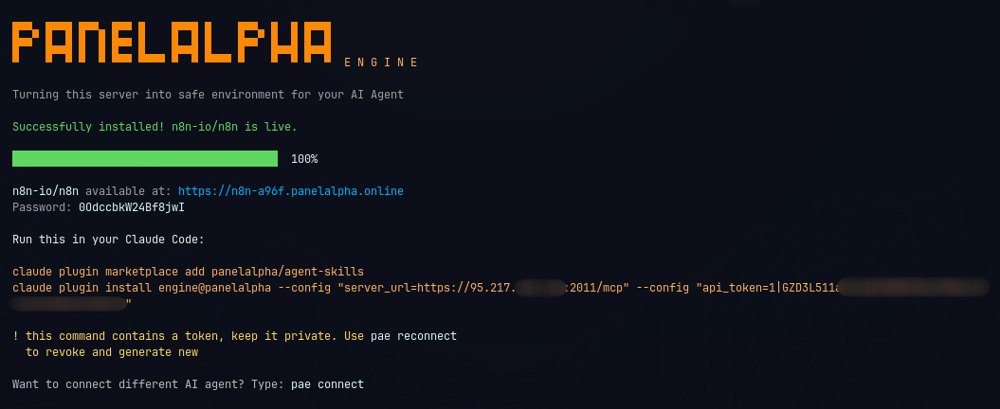
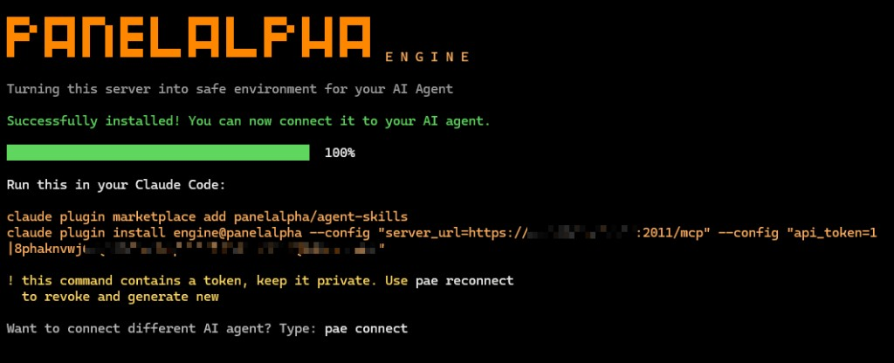
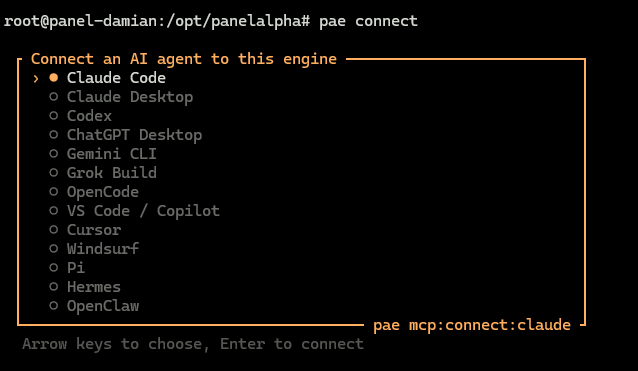

# PanelAlpha Engine

> [!NOTE]
> **This documentation covers PanelAlpha Engine version 2.0 and later.** PanelAlpha Single Server Edition 2.0 and later runs on Engine 2.3.0 and later. PanelAlpha Multi Server Edition does not support Engine 2.x yet. It uses PanelAlpha Engine 1.x, as does PanelAlpha Single Server Edition before version 2.0: [PanelAlpha Engine 1.x documentation](v1/index.md).

## What is PanelAlpha Engine?

PanelAlpha Engine is software you install on your VPS to host AI-built and vibe-coded projects, websites and open-source apps you found online.

After you install it, you connect your own AI agent to PanelAlpha Engine. The agent then handles deployments, maintenance and server management for you. **You do not have to be a sysadmin to self-host.**

PanelAlpha Engine gives you and your AI what you need to run real projects in production:

- Deploy any stack from Git or from files
- Instant preview URLs with optional password protection
- Staging and Git workflows, with separate live and staging copies
- Automatic backups and restore
- External monitoring and built-in visitor statistics
- Project isolation, each project in its own Docker container
- Firewall and OWASP/WAF protection (a filter that blocks common attacks), with per-project access rules
- Domains, SSL, cron, FTP/SFTP, databases, logs
- Cloudflare integration for DNS, tunnels and caching

Setting it up takes [three steps](#getting-started).


<!-- TODO screenshot: this GIF should show a full deploy driven from an assistant chat, cropped to the chat window and the returned project address. Keep the frame no wider than the text column so it does not overflow on mobile. -->

## How it works


## Getting started

### 1. Install on your VPS

You need a **fresh** VPS and `root` access over SSH. Requirements and options are on the [Install](getting-started/install.md) page.

The **One-line app installation command** is the fastest way to start. Add the Git repository you want after `--repo`. The installer sets up the engine and puts your application online in one go.

To install the engine and deploy n8n at the same time, run:

```bash
curl -fsSL https://get.panelalpha.com/engine | sh -s -- --repo https://github.com/n8n-io/n8n
```

When it finishes, it prints the address of your new site. Unless you pass `--no-password`, it also prints the password that opens the site. For private repositories, your own password or a server that already has the engine, see: [One-line app installation command](getting-started/install.md#one-line-app-installation-command).



To do the two steps separately, install only the engine with the command below. Deploy your application later from your assistant (step 3):

```bash
curl -fsSL https://get.panelalpha.com/engine | sh
```

A few minutes later the engine is running. It prints its addresses and a command to connect your assistant. For a custom name, your own TLS certificate or a VPS behind NAT, read [Install](getting-started/install.md) first.

### 2. Connect your AI assistant

You connect from **your own computer**, not from your VPS. After install you see a screen like this, with a ready-made command for Claude Code. Copy that command and run it on your computer.



If you use a different assistant, run this on your VPS. It prints the line to run on your computer, with your address and a token already filled in:

```bash
pae connect
```



> [!NOTE]
> **Run `pae connect` on your VPS, not on your own computer.**

Each assistant has a setup page. It shows how to check the connection and what usually goes wrong: [Connecting your AI](connecting-your-ai/your-assistant.md).

**Before you connect, decide what the assistant may do.** By default it can permanently delete an entire project. `pae configure` on the VPS walks you through that, and through the address, the queue and telemetry: [Configure the engine](getting-started/configure-the-engine.md). The settings it writes are listed under [Decide what the assistant may do](connecting-your-ai/your-assistant.md#decide-what-the-assistant-may-do).

### 3. Put your project online

Open your assistant's chat and describe what you want. A **project** is one application or website on this VPS. Each project has its own isolated space, files, address and database.

- **A new WordPress project**

  ```text
  Set up WordPress on a new project on this PanelAlpha Engine.
  ```

- **An application from a public git repository**

  ```text
  Deploy my application https://github.com/org/app on this PanelAlpha Engine.
  ```

- **A private repository.** Tell the assistant it is private. Do not put the access token in the chat. The assistant sends a page where you paste a git token: [Connecting with Git](capabilities/connecting-with-git.md).

  ```text
  Deploy https://github.com/org/private-app on this PanelAlpha Engine.
  The repository is private.
  ```

- **A zip of files, not a repository**

  ```text
  Upload this archive into the project and deploy it: /path/to/app.zip
  ```

You should get a web address back. Open it. If the deploy failed or came back "partial": [When a deploy fails](getting-started/what-happens.md). What happens during a deploy, in order: [How a deploy works](getting-started/how-a-deploy-works.md).

## How to use it

The main way to run PanelAlpha Engine is to connect an AI assistant and describe what you want in chat. You can also run commands on the VPS, or call the same operations from your own software.

- **[Connecting your AI](connecting-your-ai/your-assistant.md)**: Connect an assistant after install and run deployments, maintenance and server management from chat.
- **[CLI commands](commands/pae-cli.md)**: `pae` on your VPS over SSH, and the REST API for software you build on top of the engine.
- **[Getting Started](getting-started/install.md)**: Install, configure the engine, update, uninstall, how a deploy works, looking after a project, connecting to PanelAlpha Hub, telemetry and failed deploys.
- **[Supported projects](supported-projects/project-types.md)**: Stacks the engine can run, what your repository needs, how detection works and the `panelalpha.yaml` a repository can add.
- **[Capabilities](capabilities/connecting-with-git.md)**: Git, projects, backups, domains, databases, files, WordPress, monitoring, visitor statistics, security, Cloudflare and your own base images.
