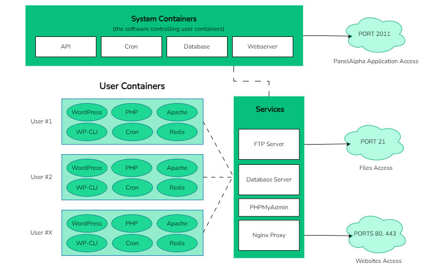

# Overview

> [!NOTE]
> **This documentation covers PanelAlpha Engine v1.x**, the version used by PanelAlpha Multi Server Edition and PanelAlpha Single Server Edition before version 2.0. PanelAlpha Single Server Edition 2.0 and later runs on Engine 2.3.0 and later: [PanelAlpha Engine](../index.md).

PanelAlpha Engine is the hosting server for PanelAlpha. You install it on its own server. PanelAlpha then creates and manages hosting accounts and WordPress instances on it through the Engine API (the way the panel sends orders to the Engine). Each hosting account runs PHP in its own Docker container. Each container has its own limits for disk, memory, CPU and other resources.

## Documentation sections

- [Installation & Updates](installation-updates/index.md): install the Engine and keep it up to date.
- [Command Reference](command-reference.md): Artisan commands for tokens, repairs and rebuilds.
- [Server Management](server-management/index.md): the server tabs in PanelAlpha (details, IP addresses, CSF firewall, ModSecurity, outgoing mail, alerts) and the files, logs and services on the server.
- [Troubleshooting](troubleshooting.md): common problems and how to fix them.

## What the Engine includes

- A choice of web server: OpenLiteSpeed, LiteSpeed, Apache, Nginx or Nginx + Apache. You can switch later from the panel.
- PHP 7.4 and 8.0 to 8.4, chosen per instance in the hosting plan.
- MariaDB for customer databases, with phpMyAdmin single sign-on from PanelAlpha.
- FTP and SFTP access for hosting accounts.
- The CSF firewall and the ModSecurity web application firewall with the OWASP Core Rule Set.
- Outgoing mail through Exim, directly or through a relay such as SendGrid, MailChannels or Amazon SES.
- Server metrics for the graphs and the disk, CPU and RAM alerts in PanelAlpha.
- WP-CLI for WordPress management.

The Engine itself does not make backups. Back up the server with your hosting provider's snapshots or your own tools.

## Architecture

The Engine is a Docker Compose project in `/opt/panelalpha/shared-hosting`. The diagram above shows its containers. For the list, see [Files, Logs and Services](server-management/files-and-logs.md).

## System requirements

- **RAM:** 4 GB minimum. More is better for production, depending on the number of sites.
- **Operating system** (fresh install):
  - Debian 12 "bookworm"
  - Debian 13 "trixie"
  - Ubuntu 22.04 LTS
  - Ubuntu 24.04 LTS
- **Access:** SSH as `root`.
- **Open ports:**
  - 22: SSH
  - 80 and 443: websites
  - 2011: Engine API, used by PanelAlpha
  - 21 and 30000-30009: FTP
  - 2222: SFTP

> [!IMPORTANT]
> **Install PanelAlpha Engine on its own server.** If you install PanelAlpha and PanelAlpha Engine on the same server, both stop working.

## Frequently asked questions

### Can I use PanelAlpha Engine 1.x without PanelAlpha?

No. You manage Engine 1.x only through PanelAlpha Multi Server Edition or PanelAlpha Single Server Edition before version 2.0. [Engine 2.0+](../index.md) can run on its own. PanelAlpha Single Server Edition 2.0 and later works with Engine 2.3.0 and later. Multi Server Edition does not support Engine 2.x yet. Support will come in a later version.

### Can I change the web server after installation?

Yes, from the server's Details tab in PanelAlpha. Site files and databases stay as they are. All sites are briefly offline while the Engine rebuilds their configuration. See [Changing web server](server-management/details.md#changing-web-server).

### Does PanelAlpha Engine host email?

No. It sends mail from websites, but it does not host mailboxes, IMAP or POP3. Use a separate mail service for mailboxes. See [Outgoing Mail](server-management/outgoing-mail.md).

### Are sites offline during an Engine update?

Briefly. The update restarts the Engine containers and rebuilds the configuration of every account. **The update does not roll back on its own, so make a backup first.** See [Update](installation-updates/update.md).

## Support

For help, contact the [Support Center](https://manage.panelalpha.com/contact), ask on the [Community Forum](https://community.panelalpha.com/) or join our [Discord server](https://discord.gg/9twHWR7xGX).
