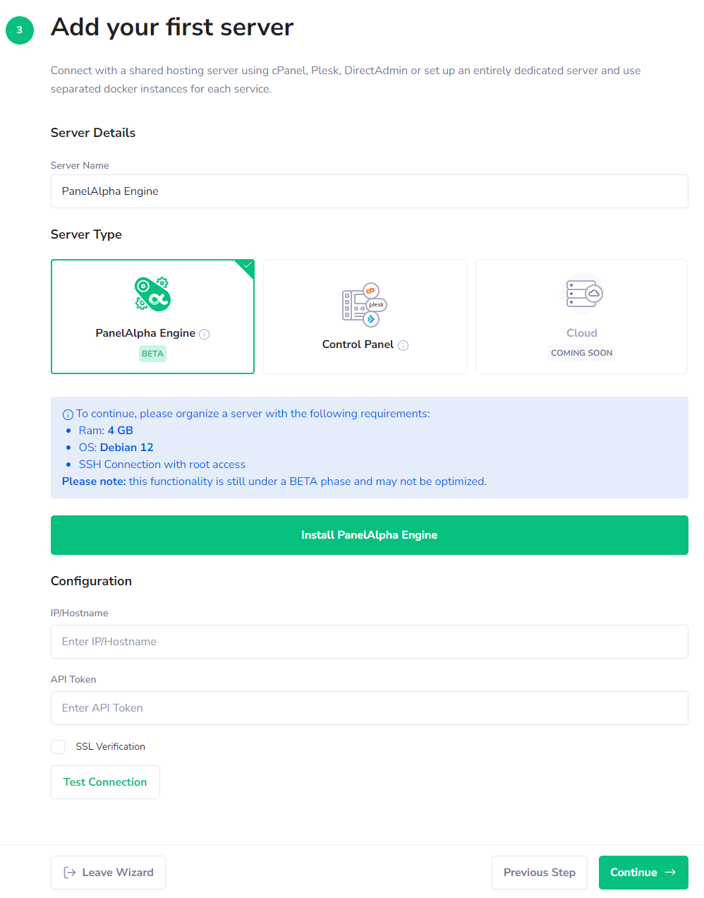

# Installation

Install PanelAlpha Engine 1.x on a server with the installer, then connect it to PanelAlpha Single Server or Multi Server.

## Before you begin

1. Use a fresh server that meets the [system requirements](../index.md#system-requirements). Do not install the Engine on the server that runs PanelAlpha.
2. Check that you can log in to the server over SSH as `root`.
3. Have your PanelAlpha licence key ready. It is in the product details under [Licenses](https://manage.panelalpha.com/clientarea.php?action=services) in the client area.
4. Check that the server can reach the internet. The installer downloads packages and Docker images.

## Download and install

The PanelAlpha installation wizard shows the same commands. See [Access the Wizard](../../../multi-server-edition/getting-started/installation.md#access-the-wizard).

1. Log in to the server as root:
   ```bash
   ssh root@your-server-ip
   ```

2. Download the installer:
   ```bash
   wget -N -P /opt/panelalpha https://license.panelalpha.com/engine-installer.sh
   ```

3. Run the installer with your licence key:
   ```bash
   bash /opt/panelalpha/engine-installer.sh --key 'YOUR_LICENSE_KEY'
   ```

   Replace `YOUR_LICENSE_KEY` with your key from the client area.

4. Wait for the installer to finish. At the end it prints the **API URL** and the **API Token**. Copy both. You need them to add the server in PanelAlpha.

The installer sets up Docker, the Engine containers, the CSF firewall, monit and some kernel settings. If the server has a public IP address, the installer also gets a Let's Encrypt certificate for that address. The Engine goes into `/opt/panelalpha/shared-hosting`.

### Installer options

| Option | What it does |
| --- | --- |
| `--key <key>` | Your PanelAlpha licence key. Required. |
| `--version <version>` | Installs a given Engine version instead of the latest. |
| `--no-local-ip` | Use this when the server's own address is private. The installer then uses the public IPv4 address (looked up online) for the API URL and the default IP. |
| `--enable-nat` | Use this for servers behind 1:1 NAT, for example on some cloud providers. The Engine looks up the public IPv4 address for each private address. |
| `--debug` | Prints more output. Use it when you send the output to support. |

### Lost API token

If you did not copy the token, create a new one on the Engine server:

```bash
docker compose -f /opt/panelalpha/shared-hosting/docker-compose.yml exec -T core php artisan api-tokens:create panelalpha --short
```

See [Artisan Commands](../command-reference.md) for listing and deleting tokens.

## Connect through the PanelAlpha installation wizard

If you install PanelAlpha and PanelAlpha Engine together, you can add the Engine in step 3 of the PanelAlpha wizard, **Add your first server**.



1. Select **PanelAlpha Engine** as the server type.
2. Click **Install PanelAlpha Engine** to see the installer commands, and run them on the Engine server as described above.
3. Paste the **API URL** and the **API Token** from the installer output.
4. Click **Test Connection**. When it shows **Finished**, continue to the next step.

## Next steps

1. [Add the server](../../../multi-server-edition/hosting-servers/engine.md#configure-in-panelalpha) in PanelAlpha, if you did not do it in the wizard.
2. [Set up a plan](../../../multi-server-edition/system-configuration/plans.md#hosting-server) that uses the server.
3. Check the [Firewall (CSF)](../server-management/firewall.md) rules, and set up [Outgoing Mail](../server-management/outgoing-mail.md) so sites can send email.

## Troubleshooting

If the installer stops with an error, see [Troubleshooting](../troubleshooting.md#installation-fails).
