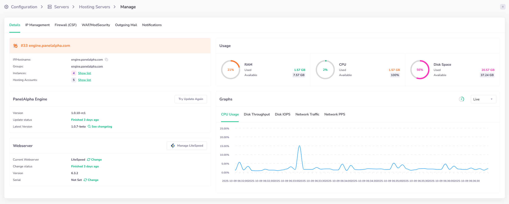
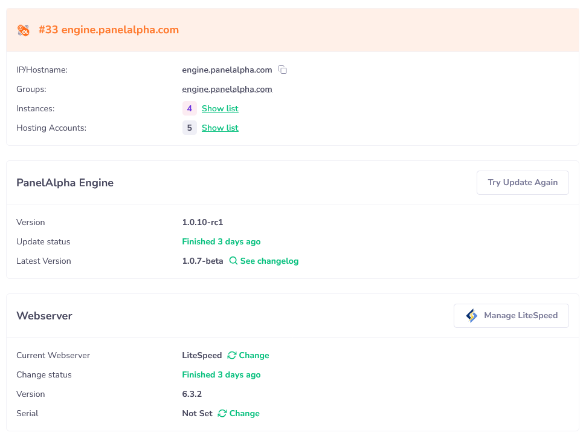
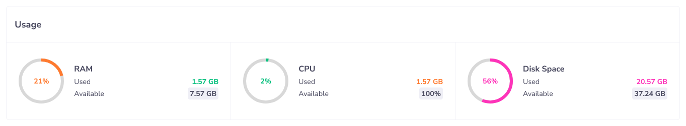
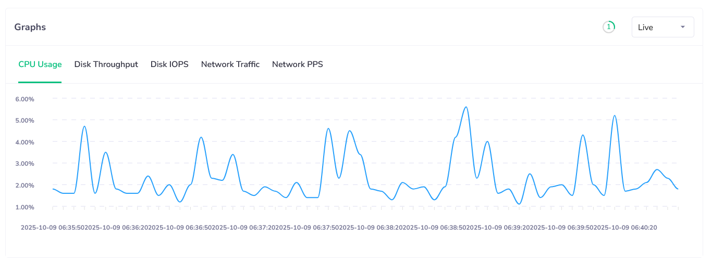
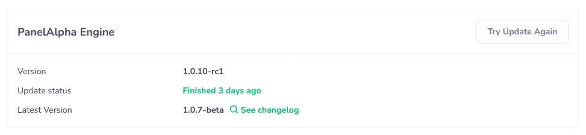
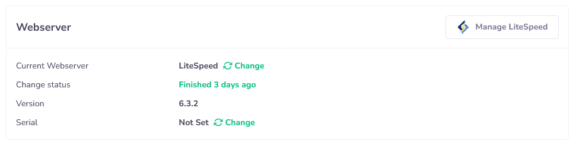
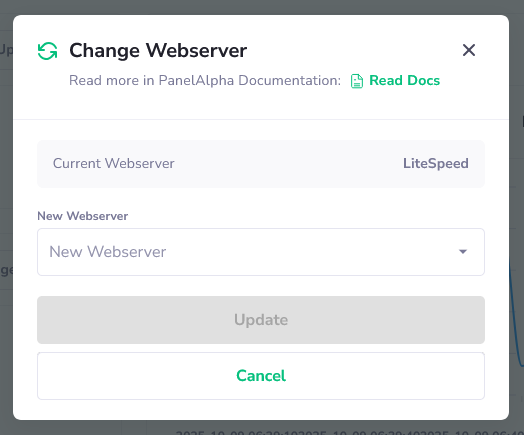

# Server Details

To open the server page, go to **Configuration → Servers → Hosting Servers** and click **Manage** next to a PanelAlpha Engine server. The **Details** tab shows resource usage, the Engine version and the web server.

While an Engine update or a web server change is running, all tabs except **Details** are greyed out with the message "Not available during an upgrade of PanelAlpha Engine". If the server runs an Engine version older than 1.0.9-beta, the page shows only "This server is outdated" and no tabs. Update the Engine from the command line in that case (see [Update](../installation-updates/update.md)).



## Server information

The card at the top shows the server ID and name, followed by:

- **IP/Hostname**: click it to copy the value.
- **Groups**: the server groups this server belongs to.
- **Dedicated**: shown only for dedicated servers. Use **Assign** or **Unassign** to link the server to one user.
- **Instances** and **Hosting Accounts**: the number of each on this server. **Show list** opens the instance or service list in a new tab.



## Resource usage

The **Usage** card shows current use of RAM, CPU and disk space as a percentage. RAM and disk space also show used and total GB.



## Performance graphs

The **Graphs** card has five graphs: CPU usage, disk throughput (read and write), disk IOPS, network traffic (in and out) and network packets per second.



Use the dropdown to pick **Live**, **1 hour** or **12 hours**. **Live** shows the last 5 minutes and refreshes on its own; a small circle counts down to the next refresh.

The Engine records a sample every 5 seconds and keeps samples for 90 days or up to 1,000,000 rows, whichever limit is reached first. A daily job removes older samples.

## PanelAlpha Engine management



### Version information

The **PanelAlpha Engine** card shows:

- **Version**: the installed version.
- **Update status**: **In Progress**, **Updated** with the time of the last update, or **Failed** with the time. Hover over **Failed** to see the updater output under "Update Error Details".
- **Latest Version**: the newest version available, with a **See changelog** link.

### Updating PanelAlpha Engine

Click **Update Now** on the PanelAlpha Engine card. The dialog shows the current and the new version.

1. Make a backup of the server first. The update has no automatic rollback.
2. Tick **I confirm that I have made a backup of the server**. The **Update** button stays disabled until you do.
3. Click **Update**.

The update runs on the server in the background, so you can close the dialog and come back later. The Details tab checks the status every few seconds. During the update the Engine stops its containers, starts them again on the new version and rebuilds the web server configuration for every account, so websites are briefly unavailable. Plan the update outside peak hours.

If the update fails, hover over **Failed** in **Update status** to read the error. Log files and recovery steps are in [Update](../installation-updates/update.md#recovering-from-a-failed-update). You can also run the update from the command line as described on that page.

### Supported PHP versions & ionCube

PanelAlpha Engine includes PHP 7.4, 8.0, 8.1, 8.2, 8.3 and 8.4. You choose the PHP version for an instance in the hosting plan.

> [!NOTE]
> **Note:** PHP 7.4 reached end of life in November 2022. Use PHP 8.x for new sites.

The ionCube Loader is available for:

- **Apache, Nginx and Nginx + Apache**: PHP 7.4, 8.1, 8.2, 8.3 and 8.4.
- **LiteSpeed and OpenLiteSpeed**: PHP 8.1, 8.2, 8.3 and 8.4.

There is no ionCube Loader for PHP 8.0 on any web server. If a site uses ionCube-encoded files, pick a PHP version from the list above.

### 404 handling

If you open the Engine server by its IP address (for example, `https://1.2.3.4`) or request a path that no site serves, you get a generic 404 page. Sites are reached only through their own domains.

## Web server configuration



### Current web server

The web server card shows:

- **Current Webserver**: the active web server, with a **Change** link.
- **Change status**: the result of the last web server change. If it failed, hover over it to see the log under "Status Error Details".
- **Version**: the web server version.
- **Serial**: the LiteSpeed licence serial number, or "Not Set". Shown only when LiteSpeed is active. Click **Change** next to it to enter a new serial.

### Changing web server

Click **Change** next to the current web server and pick one of:



- **LiteSpeed**
- **OpenLiteSpeed**
- **Apache**
- **Nginx**
- **Nginx + Apache**: Nginx handles ports 80 and 443 and passes requests to a separate Apache container for each hosting account.

For LiteSpeed, you can enter your licence in **LiteSpeed Serial Number (optional)**. Without a serial, the Engine tries to use a LiteSpeed trial licence.

During the change the Engine stops the current web server, starts the new one and rebuilds the web server configuration for every account. All sites are unavailable until that finishes, so make the change outside peak hours. Site files and databases are not touched. The other tabs are greyed out until the change is done.

### Managing LiteSpeed

When LiteSpeed or OpenLiteSpeed is active, click **Manage LiteSpeed** (or **Manage OpenLiteSpeed**) to see the login for the web server admin panel:

- **User Name**: the admin user, `admin` by default.
- **Current Webserver**: a link to the admin panel.
- **Password**: the current password.
- **Reset Password**: creates a new password and shows it with a copy button.

If you log in for the first time or do not know the password, click **Reset Password**.

## Custom error pages

The Engine has static HTML pages for HTTP errors 403, 404, 500, 502 and 503. The web server shows them when it cannot serve a site. The files are on the Engine server in:

```
/opt/panelalpha/shared-hosting/webserver-config/error-pages/
```

To change the text or design, log in to the server over SSH and edit the HTML file for that status code, for example `503.html`.

Engine updates do not overwrite files that already exist in this directory, so your changes stay after an update. For the same reason, if a new Engine version changes the default error pages, you will not get the new versions automatically.
