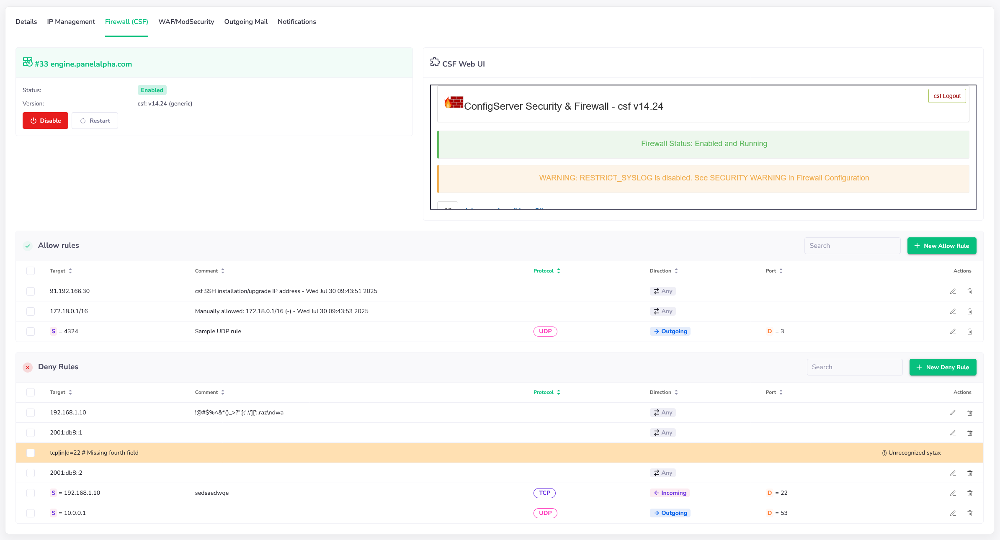
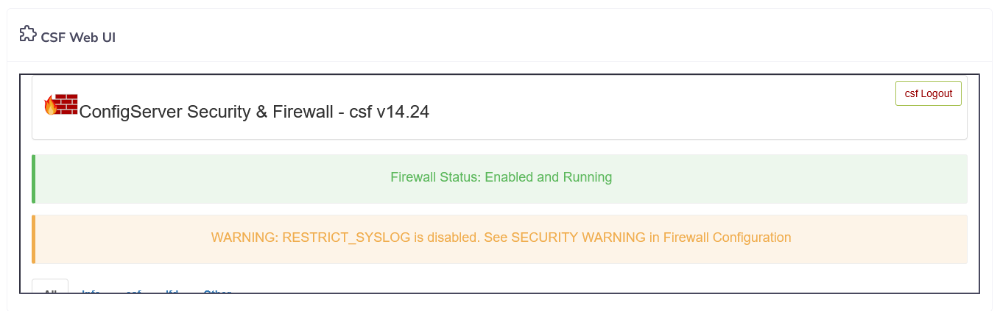
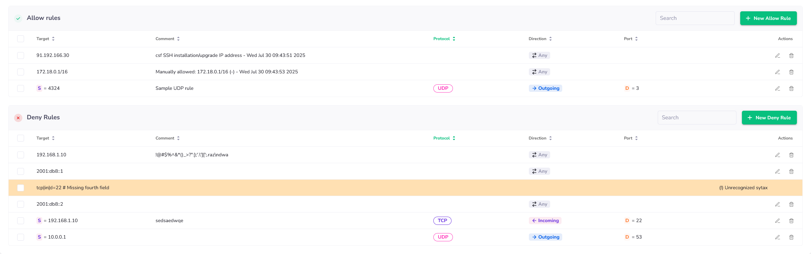

# Firewall (CSF)

PanelAlpha Engine uses ConfigServer Security & Firewall (CSF) and its login failure daemon (lfd, the part that blocks IPs after repeated failed logins). The installer sets CSF up. The **Firewall (CSF)** tab lets you manage it from the panel. For CSF itself, see the [ConfigServer Security & Firewall](https://configserver.com/csf) site.



## CSF status

The top of the tab shows:

- **Status**: `Enabled` or `Disabled`. If CSF reports an error, hover over the status to read it.
- **Version**: the CSF version, for example `csf v14.24 (generic)`.
- **Disable** and **Restart** buttons when CSF is enabled, or an **Enable** button when it is disabled.

While CSF is disabled, the rest of the tab is greyed out.

> [!WARNING]
> **Disabling the firewall leaves every port on the server open.** Enable it again as soon as you can.

## Default open ports

The installer opens these ports in CSF:

- TCP in and out: 22, 80, 443, 2011, 21, 2222, 30000-30009, 8000, 3306, 5432
- UDP in and out: 53, 67, 68, 30000-30009

The Docker network is on the allow list so the containers can talk to each other. Outgoing connections are allowed.

If you run SSH on a port other than 22, add that port before you restart CSF. Otherwise you can lock yourself out.

## CSF Web UI

The **CSF Web UI** card shows the CSF web interface inside the panel. Use **Enlarge** to make it full width and taller, and **Shrink** to go back.



The CSF web interface gives you all CSF options, logs and lfd settings, including those the panel tables do not cover. Read the warnings it shows, for example:

```
WARNING: RESTRICT_SYSLOG is disabled. See SECURITY WARNING in Firewall Configuration
```

On the server, the interface listens on port 2012 as user `panelalpha`. The password is `CSF_UI_PASSWORD` in `/opt/panelalpha/shared-hosting/.env`. The panel reaches it through the Engine API port 2011, so port 2012 does not need to be open to the internet.

## Firewall rules

The tab has two tables, **Allow rules** and **Deny Rules**. Each has a search box and these columns:



- **Target**: the IP address, range or CIDR block. Targets with a prefix (`s=`, `d=`, `u=`) are shown as coloured labels.
- **Comment**: your note about the rule.
- **Protocol**: TCP or UDP.
- **Direction**: incoming or outgoing.
- **Port**: the port or ports, with a prefix.
- **Actions**: edit or delete.

Each table has its own search, so a search in **Allow rules** does not filter **Deny Rules**.

### Rule format

CSF stores the rules in `csf.allow` and `csf.deny` in its standard format:

`protocol|direction|<s=|d=>port|<s=|d=|u=>target`

The meaning of `s=` and `d=` depends on the field:

- In the port field, `s=` is the source port and `d=` is the destination port.
- In the target field, `s=` is the source address and `d=` is the destination address.

`u=` (user or UID) is allowed only in the target field and only for outgoing rules. For the full syntax, see the [CSF documentation](https://configserver.com/csf/).

### Example rules

To block one IP from the whole server, add a deny rule with only the **Target** `198.51.100.25` and a comment. Without advanced settings, the rule covers all ports and protocols.

To allow SSH only from one office IP, add an allow rule, turn on **Advanced Settings** and set:

- Protocol: TCP
- Direction: IN (incoming)
- Port: `D` `22`
- Target: `S` `203.0.113.10`
- Comment: `Office SSH`

CSF stores this as `tcp|in|d=22|s=203.0.113.10`.

## Managing rules

### Adding new rules

1. Click **New Allow Rule** or **New Deny Rule**.
2. Enter the **Target**: an IP address, range or CIDR block.
3. Add a **Comment**.
4. To limit the rule to a protocol, direction or port, turn on **Advanced Settings** and fill in:
   - **Protocol**: TCP or UDP.
   - **Direction**: IN or OUT.
   - **Port**: one or more ports or ranges, separated by commas, with the `S` (source) or `D` (destination) prefix.
   - The target prefix: `S`, `D` or `U` for a user or UID on outgoing rules.
5. Click **Add Rule**.

### Editing and deleting rules

Click the pencil icon in **Actions** to edit a rule, or the trash icon to delete it. To delete several rules, tick them first.

If a change does not seem to take effect, click **Restart** at the top of the tab.
