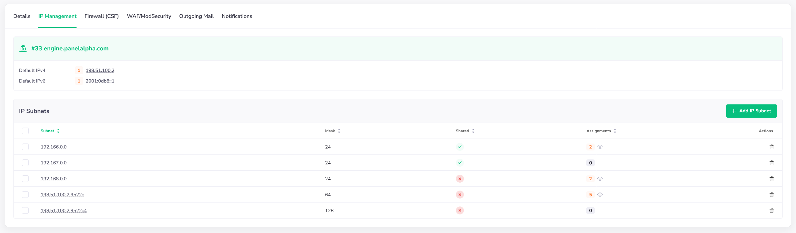
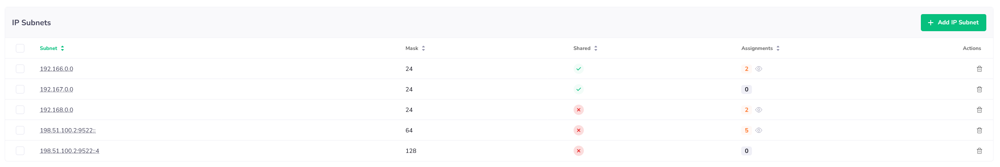

# IP Management

The **IP Management** tab lists the IP addresses and subnets on the Engine server and shows which hosting accounts use them.

## Default IP Addresses

At the top of the tab you see the server's default IPv4 and IPv6 addresses. New accounts use these unless you assign another IP.

- Click the copy icon next to an address to copy it.
- The orange badge shows how many accounts use the address. Click the address to open the full assignment list.

## IP Subnets

The **IP Subnets** table lists every subnet added to the server.

### Subnet Information

The columns are:

- **Subnet**: the network address, for example `192.0.2.0` or `2001:db8::`.
- **Mask**: the prefix length, for example `/24` for 256 IPv4 addresses or `/64` for IPv6.
- **Shared**: whether accounts can share IPs from this subnet.
- **Assignments**: how many IPs from the subnet are assigned. Click the number to open the assignment list.
- **Actions**: a trash icon to delete the subnet.

### Shared vs. Dedicated Subnets

In a shared subnet, one IP can be used by several accounts. In a subnet that is not shared, each IP goes to one account only. Use non-shared subnets when a customer needs a dedicated IP, for example for mail reputation.

## Adding IP Subnets

### Prerequisites

Your hosting provider must route the subnet to this server before you add it. The panel does not check routing.

### Steps

1. Click **Add IP Subnet**.
2. Enter the **Subnet** and the **Mask**.
3. Tick **Shared** if accounts may share IPs from this subnet.
4. Save.

## Managing Subnet Assignments

### Viewing Assignments

Click the number in **Assignments** to open **IP Address Assignments**. The table shows each IP with its **Username**, **Service** and **Domains**.

- To assign an IP, click **Assign IP to Account** above the table and choose the account.
- To unassign an IP, click the trash icon in its row.
- Tick several rows to act on them together.

### Removing Subnets

1. Click the trash icon in the **Actions** column. To delete several subnets, tick them first and use the action bar.
2. Read the warning, tick the confirmation box and confirm.

> [!WARNING]
> **Warning:** Deleting a subnet removes all its IP addresses, including IPs that are still assigned. Sites and services using those IPs stop being reachable. Move the accounts to other IPs before you delete a subnet that has assignments.
