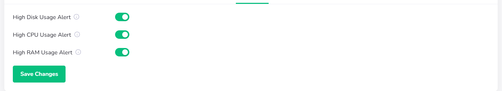

# Notifications

The **Notifications** tab turns on alerts for high disk, CPU and RAM use on this Engine server. PanelAlpha checks the server once an hour. It sends an alert to admins when a limit is reached.

## Alerts and thresholds

| Alert | Sent when |
| --- | --- |
| **High Disk Usage Alert** | Disk usage is 90% or more at the time of the check. |
| **High CPU Usage Alert** | Average CPU usage over the last hour is 85% or more. |
| **High RAM Usage Alert** | Average RAM usage over the last hour is 90% or more. |

The thresholds are fixed and cannot be changed in the panel.

PanelAlpha sends the same alert for the same server at most once every 24 hours, even if use stays high. There is no message when use goes back to normal.

## Saving notification settings

1. Turn on the alerts you want.
2. Click **Save Changes**.

To silence alerts from a server for a while, turn them off and save. Remember to turn them on again later.

## Notification recipients

The alert is the admin notification **Server Alert**. PanelAlpha sends it to two groups of active admins: those whose admin group has full access, and those whose group has **Server Alert** among its notifications.

The alert arrives as an email and as a notification in the admin area. You can turn either one on or off, and edit the email template, in **Configuration → Notifications** under admin notifications: [Notifications](../../../multi-server-edition/system-configuration/notifications.md).

## Responding to alerts

### High disk usage

1. Find what uses the space. Check `df -h` on the server and the disk usage of hosting accounts in the panel.
2. Look at logs in `/opt/panelalpha/shared-hosting/logs/` and `/opt/panelalpha/shared-hosting/webserver-logs/`, and at old Docker images (`docker system df`).
3. Remove what you no longer need, move accounts to another server or add disk space.

**A full disk stops containers and can break running sites.** Act before use reaches 100%.

### High CPU or RAM usage

1. Run `docker stats` on the server to see which containers use the most CPU or memory.
2. Check the sites in those accounts for heavy plugins, cron jobs, bot traffic or malware.
3. Lower the plan limits for the account, turn on caching on the site or add CPU or RAM to the server.

Use the graphs on the [Details](details.md#performance-graphs) tab to see when the load started.

## Troubleshooting notifications

If alerts do not arrive:

- Check that the alert is turned on for the server and saved.
- Check that use really reached the threshold. CPU and RAM use the hourly average, so short peaks do not trigger an alert.
- Check that **Server Alert** is enabled in **Configuration → Notifications** and that your admin group receives it.
- Check that PanelAlpha can send email. Use **Send Test Email** in the email provider settings.
- Check that PanelAlpha can reach the Engine server. If it cannot read the metrics, it skips the check and writes a warning to the PanelAlpha log.
