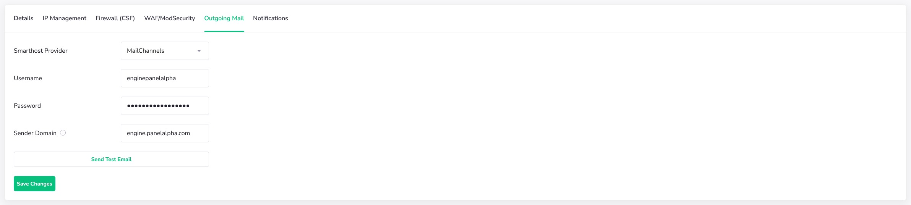
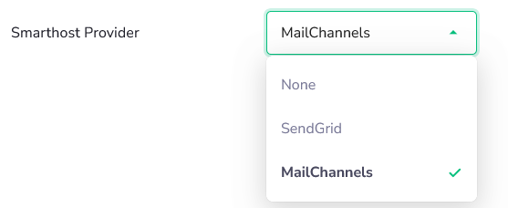

# Outgoing Mail

Sites on PanelAlpha Engine send mail through Exim, which runs in its own container on the server. The **Outgoing Mail** tab decides where Exim delivers that mail: straight to the recipients' mail servers, or through a relay (smarthost) such as SendGrid. The setting applies to every site on the server.

The Engine handles outgoing mail only. It does not host mailboxes, IMAP or POP3.



## Configuration options



### Smarthost provider

Pick one option in **Smarthost Provider**:

- **None**: Exim delivers mail directly to the recipients' servers from the Engine server's IP. Many providers block port 25 or mark mail from server IPs as spam, so use this only for tests.
- **SendGrid**: mail goes through `smtp.sendgrid.net` on port 587.
- **MailChannels**: mail goes through `smtp.mailchannels.net` on port 25.
- **Amazon SES**: mail goes through the SES SMTP endpoint you enter.
- **SMTP**: mail goes through any other relay. You enter the host, port and login.

For production, use a relay.

### Sender domain

Relays accept mail only from domains you have verified with them. On a hosting server, sites send mail from many different domains, and you usually cannot verify all of them. **Sender Domain** solves this.

- When you set a sender domain, Exim rewrites the sender of every message to that domain. For example, with the sender domain `mail.example.net`, a message from `info@customer.com` leaves the server as `info_at_customer.com@mail.example.net`. You verify only `mail.example.net` with the relay.
- When you leave it empty, every message keeps its own sender address. The relay must then accept every domain your sites send from.

Set up SPF and DKIM for the sender domain as your relay describes. See [DNS configuration](#dns-configuration).

## Saving configuration

1. Pick the **Smarthost Provider** and fill in its fields (see below).
2. Enter the **Sender Domain** if you use one.
3. Click **Save Changes**.

The Engine rebuilds the Exim configuration. New messages use the new settings at once.

> [!WARNING]
> **Security note:** Relay passwords and API keys are stored in the Engine's database and in the Exim configuration on the server. Keep root access to the server limited.

## Testing email delivery

1. Click **Send Test Email** below the form.
2. In **Send test email to address**, enter a mailbox you can check.
3. Send, then check that mailbox, including the spam folder.

If the message does not arrive:

- Check the credentials for the relay.
- Check that the relay has verified your sender domain and that its SPF and DKIM records are in DNS.
- Look at the relay's own activity log. It usually shows the reason for a rejected message.
- Check that the account at the relay is active and has sending quota left.

## SMTP provider setup

### SendGrid

1. In SendGrid, authenticate your sender domain and create an API key with permission to send mail.
2. Select **Smarthost Provider > SendGrid** and paste the key into **API Token**.
3. Set the **Sender Domain** to the domain you authenticated.
4. Add the DNS records SendGrid gives you.
5. Save and send a test email.

### MailChannels

1. Sign up with MailChannels and get SMTP credentials.
2. Select **Smarthost Provider > MailChannels** and fill in **Username** and **Password**.
3. Set the **Sender Domain**.
4. Add the SPF and DKIM records MailChannels asks for.
5. Save and send a test email.

### Amazon SES

1. In the SES console, verify the sender domain. If your account is still in the SES sandbox, request production access, otherwise SES sends only to verified addresses.
2. Create SMTP credentials in SES.
3. Select **Smarthost Provider > Amazon SES** and fill in:
   - **SMTP Endpoint**, for example `email-smtp.us-east-1.amazonaws.com`
   - **STARTTLS Port**, usually `587`
   - **SMTP Username** and **SMTP Password**
4. Set the **Sender Domain**.
5. Save and send a test email.

### Custom SMTP

1. Select **Smarthost Provider > SMTP**.
2. Fill in **SMTP Host**, **SMTP Port**, **SMTP Username** and **SMTP Password**.
3. Turn on **SMTP over Implicit TLS** only if the relay expects TLS from the first byte, which usually means port `465`. Leave it off for port 587 with STARTTLS.
4. Set the **Sender Domain** if the relay accepts only verified domains.
5. Save and send a test email.

## DNS configuration

Add these records in the DNS zone of the sender domain, or of each site's domain if you do not use a sender domain. Your relay tells you the exact values.

- **SPF**: a TXT record that lists the relay, for example `v=spf1 include:sendgrid.net ~all` for SendGrid or `v=spf1 include:relay.mailchannels.net ~all` for MailChannels. A domain can have only one SPF record, so add the relay to the existing record if there is one.
- **DKIM**: the TXT or CNAME records from the relay.
- **DMARC**: a TXT record at `_dmarc.<domain>`, for example `v=DMARC1; p=none; rua=mailto:dmarc@example.com`.
- **Domain verification**: some relays ask for an extra TXT record to prove you own the domain.

DNS changes can take up to 48 hours to reach all resolvers.

## Common issues

### Emails not sending

- The relay credentials are wrong, or the relay account is suspended or out of quota.
- The sender domain is not verified with the relay.
- With **None**, your hosting provider may block outgoing port 25.

Send a test email from this tab, then check the relay's activity log. To see what Exim did with a message, read its log on the Engine server:

```bash
docker compose -f /opt/panelalpha/shared-hosting/docker-compose.yml exec exim tail -n 100 /var/log/exim4/mainlog
```

### Emails going to spam

- SPF, DKIM or DMARC records are missing or wrong for the domain the mail is sent from.
- With **None**, the server IP has no mail reputation or is on a block list. Use a relay.
- The content of the message itself triggers spam filters.

### Authentication failures

- Check the username, password or API key.
- For SendGrid, the API key needs permission to send mail.
- For Amazon SES, use SMTP credentials created in SES, not your AWS access keys.
