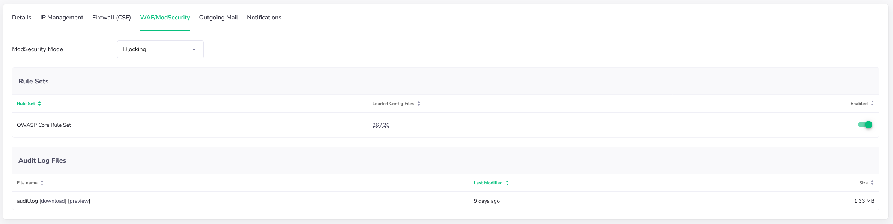
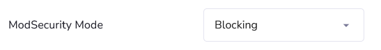
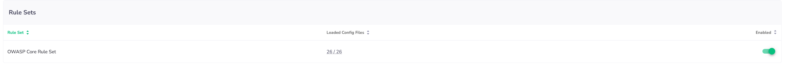
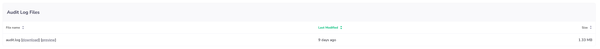

# WAF/ModSecurity

PanelAlpha Engine includes ModSecurity, a web application firewall (WAF) that checks HTTP requests to all sites on the server against a set of rules. It works with every supported web server: LiteSpeed, OpenLiteSpeed, Apache, Nginx and Nginx + Apache. The **WAF/ModSecurity** tab controls it for the whole server.

## ModSecurity Mode

Pick the mode in the **ModSecurity Mode** dropdown. The change is applied as soon as you pick it.

- **Off**: ModSecurity does not check requests.
- **Detection Only**: ModSecurity checks requests and writes matches to the audit log, but does not block anything. Use this to see which rules would fire before you start blocking.
- **Blocking**: ModSecurity blocks requests that match the rules, usually with a 403 response.

## Rule Sets

The **Rule Sets** table lists the rule sets on the server:

- **Rule Set**: the name, for example "OWASP Core Rule Set".
- **Loaded Config Files**: how many of the rule set's files are loaded, for example `26 / 26`.
- **Enabled**: a switch that turns the whole rule set on or off.

### OWASP Core Rule Set

The main rule set is the [OWASP Core Rule Set](https://coreruleset.org/) (CRS) version 4. It covers common attacks such as SQL injection, cross-site scripting, file inclusion and command injection.

The Engine adds its own exclusions on top of CRS for known false positives in WooCommerce checkout and AJAX requests, and in phpMyAdmin.

### Adjusting Loaded Config Files

Click the number in **Loaded Config Files** to open a list of all files in the rule set. Loaded files are ticked.

- Untick a file to stop loading it while the rest of the rule set stays on.
- Tick a file to load it again.
- Click **Save**.

This is the way to switch off one part of a rule set, for example one attack category that blocks a customer's site.

When you save the list, or switch a rule set on or off, the Engine writes the new ModSecurity configuration and then reloads Nginx and Nginx + Apache, or restarts Apache, LiteSpeed and OpenLiteSpeed. A restart briefly interrupts all sites.

## Custom Rules

Below **Rule Sets**, the **Custom Rules** panel lets you write your own ModSecurity rules for this server.

- Enter the rules in the text field. Rule IDs must be in the range shown above the field.
- Click **Save**. The web server checks the rules before they are saved. If a rule is not valid, you see the error and the rules are not saved.
- Click **Insert WordPress/Elementor exclusions** to add a ready set of exclusions for common WordPress and Elementor false positives. If they are already in the text, you see a message and nothing is added twice.

The rules work only when the custom rule set is enabled in **Rule Sets**. The panel tells you whether the rules are in effect. If the custom rule set is disabled, enable it in **Rule Sets** after you save.

If the server runs an older PanelAlpha Engine version, the panel shows "Custom rules require a newer PanelAlpha Engine version on this server." Update the Engine on the server to use this feature.

## Audit Log Files

The **Audit Log Files** table lists the ModSecurity audit logs:

- **File name**, **Last Modified** and **Size** of each log.
- **[download]** saves the whole file.
- **[preview]** shows the last part of the file in a dialog.

ModSecurity logs only requests that matched a rule. Each entry is one line of JSON with the client IP, the request, the IDs and messages of the rules that matched, and the action taken. Use the rule IDs to decide which file or rule to switch off.

On the server, the log is `/opt/panelalpha/shared-hosting/logs/modsecurity/audit.log`. It is rotated every day or when it reaches 100 MB, and 30 compressed old files are kept.

## Configuration Best Practices

1. Start in **Detection Only** for a week or two while sites get normal traffic.
2. Look through the audit log for requests from real users or plugins that matched a rule.
3. Fix those false positives: untick the rule file, or add an exclusion in **Custom Rules**.
4. Switch to **Blocking** and keep checking the log, especially after customers install new plugins.
