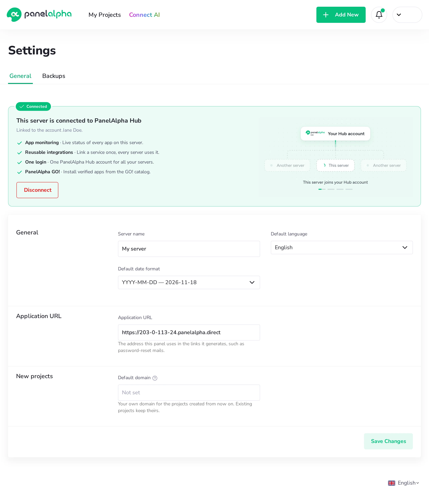

# The panel address

The panel address is the web address you open the panel on, for example `https://panel.example.com`. The installer sets it and prints it when it finishes. You can move it later in **Settings**. The panel works over HTTPS only, so it needs a certificate.

## Where the panel answers

What your browser shows depends on the name:

- **The server's own name.** PanelAlpha Engine, the hosting software the panel runs on, gets a trusted certificate for it from Let's Encrypt at install. This works when the server has a public address and port 80 is open. Without a public address, the panel keeps a self-signed certificate (one the server signed itself, so browsers warn about it).
- **A domain of your own.** It gets its own certificate from Let's Encrypt. The domain's A record must point at the server (`203.0.113.10`) and port 80 must be open.
- **A name under `panelalpha.direct` that is not the server's own name**, such as `panel.203-0-113-10.panelalpha.direct`. It keeps a self-signed certificate, and your browser warns about it. Use a domain of your own for a trusted certificate.

You cannot move the panel to a `panelalpha.direct` name later. The engine does not request certificates for shared names. You can allow it on the server: [Certificates for shared names](on-the-server.md#certificates-for-shared-names).

## Moving the panel to another address

**Saving a new address moves the panel there, and the address it has now stops answering.** You sign in again at the new address.

1. Point the new domain's A record at the server.
2. Open **Settings**. On the **General** tab, find **Application URL**.
3. Replace the address. Use `https://` and a host, with no path, for example `https://panel.example.com` or `https://panel.example.com:8443`.

   

4. Select **Save Changes**.

The panel gets a certificate for the new domain and moves there. This takes a few minutes. When it is done, the page shows `The panel has moved`. Select **Open the new address**.

:docs-video{src="../../assets/single-server-edition/panel-address-moved-page.webm" title="Moving the panel: the Application URL is replaced with https://panel.example.com, Save Changes, then the message The panel has moved appears with the button Open the new address"}

If you use social login, a dialog titled `Update your login providers` lists new callback URLs. **Add them to each provider's settings, or social login stops working.**

The panel answers on port 443 unless you allow another port on the server: [Allowing another port for the panel](on-the-server.md#allowing-another-port-for-the-panel).

Something not working? [Troubleshooting: The panel and your account](../troubleshooting/panel-and-account.md#the-panel-address).
