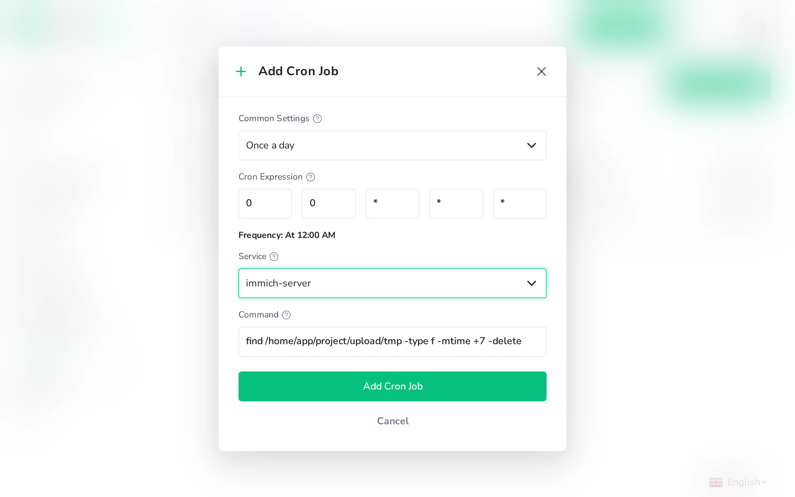
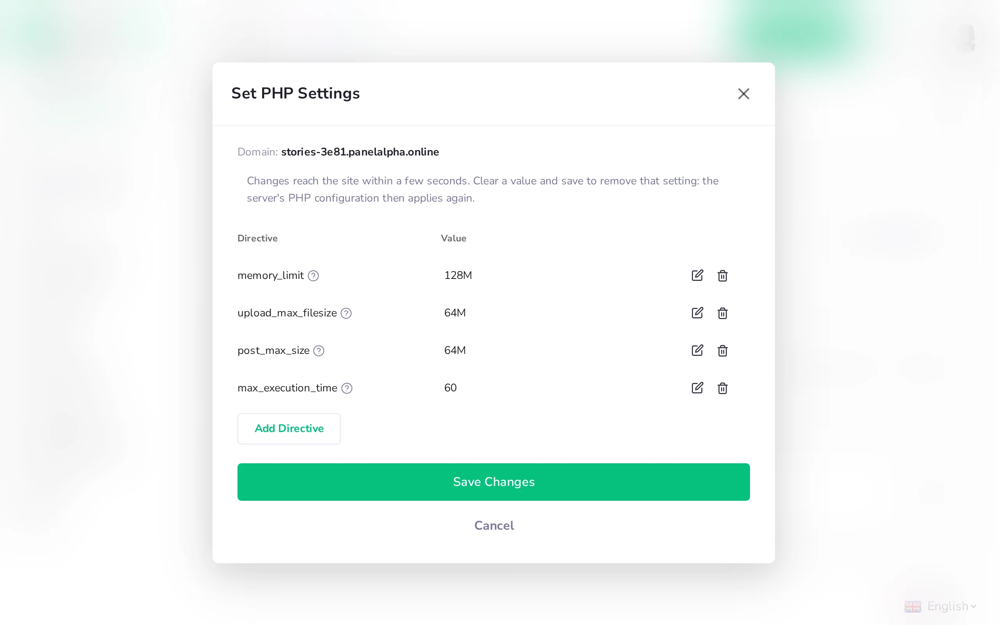

# Cron jobs and PHP

A **cron job** is a command that the server runs again and again on a schedule, for example every night. PHP settings set the PHP version and limits (such as memory) of a PHP hosting project. Both are in the project under **Advanced**.

**PHP version and PHP settings are not available for container projects.** They run their own PHP: [Projects](../projects/projects.md).

## Adding a cron job

1. Open the project, go to **Advanced > Cron Jobs** and select **Add Cron Job**. The list shows the jobs the project already has, with the columns **Cron Expression** (the schedule), **Description** (the schedule in words), **Service** (container projects only), **Command** and **Actions** (edit and delete).
2. In **Add Cron Job**, set **Common Settings**. This is a list of ready-made schedules: **Every minute**, **Every 5 minutes**, **Twice an hour**, **Once an hour**, **Twice a day**, **Once a day**, **Once a week**, **Twice a month** (the 1st and the 15th), **Once a month** and **Once a year**. Pick the one that fits. Pick **Custom** if none does.
3. **Cron Expression** has five boxes: minute, hour, day of the month, month and day of the week. A ready-made schedule fills them for you. With **Custom** you type your own. A `*` means every. The **Frequency** line under the boxes reads the schedule back in words. Check that line before you save.
4. On a container project, choose the **Service** the command runs in. Immich, for example, has `immich-server`, `immich-machine-learning`, `redis` and `database`. **A run is skipped while that service is not running.**
5. Enter the **Command**. It must be on one line. It is the text the server runs, for example `find /home/app/project/upload/tmp -type f -mtime +7 -delete`.
6. Select **Add Cron Job**. Select **Cancel** to close the window without saving.

   

You can edit or delete a job from its row. If the schedule is not valid, the panel does not save it and shows the reason.

### Where the command runs

On a PHP hosting project the command runs from the project's home folder, `/home/<name>`. **You cannot write files in the home folder itself**, so write them in the site's folder. For example, this command writes a line to a log file in the folder of `example.com`:

```
date >> /home/<name>/example.com/cron.log
```

**Never write the job's output in `public_html`.** Every visitor of the site can read files there.

## The Developer Settings page

PHP is set on **Advanced > Developer Settings**. The page of a WordPress project such as Stories has five cards:

- **Debug Mode:** a switch. When it is on, WordPress shows its errors while you browse the site. It also fills the WordPress error log: [Statistics and logs](statistics-and-logs.md#logs).
- **Maintenance Mode:** a switch. When it is on, visitors see a notice that the site is being worked on.
- **PHPMyAdmin:** a button, **Log In to PHPMyAdmin**, for people who know databases: [Databases](databases.md#phpmyadmin).
- **PHP Version:** the version PHP runs with.
- **PHP Settings:** limits such as memory.

## Changing the PHP version

**The PHP version applies to a domain, so it changes all projects on that domain.**

1. Open the project and go to **Advanced > Developer Settings**.
2. In the card **PHP Version**, read **Current PHP version** and select **Manage**.
3. In **Set PHP Version**, the window names the **Domain** and offers a list of versions. Choose one.
4. Select **Save Changes**. Select **Cancel** to leave the version as it is.

## Changing PHP settings

1. Go to **Advanced > Developer Settings**.
2. In the card **PHP Settings**, select **Manage**. When the card says `PHP Settings cannot be changed in this domain.`, the button is grey and you cannot open it.
3. **Set PHP Settings** lists the settings as **Directive** and **Value**. To change one, select the pencil button on its row, type the new value and select **Save Changes**. The trash button removes a setting. **Add Directive** takes any other setting.
4. The site uses the new value within a few seconds.

The dialog always lists four settings:

- `memory_limit`: how much memory one PHP request may use.
- `upload_max_filesize`: the largest single file a visitor can upload.
- `post_max_size`: the largest amount of data one form submission can send, uploads included. Keep it at least as large as `upload_max_filesize`.
- `max_execution_time`: how many seconds a PHP request may run before it is stopped.

An empty value means this project does not set that setting, so the server's own value applies. To go back to it, clear the value and save.



Something not working? Messages and fixes: [Troubleshooting: Looking after a project](../troubleshooting/looking-after-a-project.md#cron-jobs-and-php).
