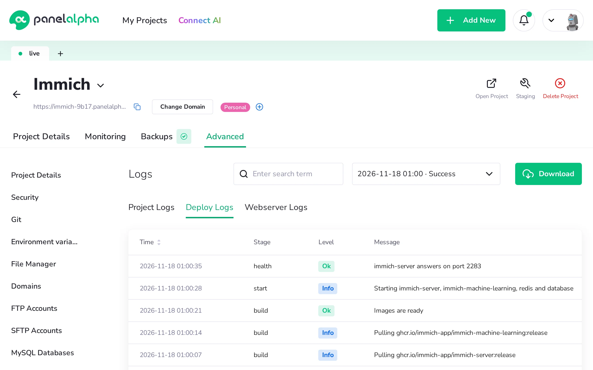
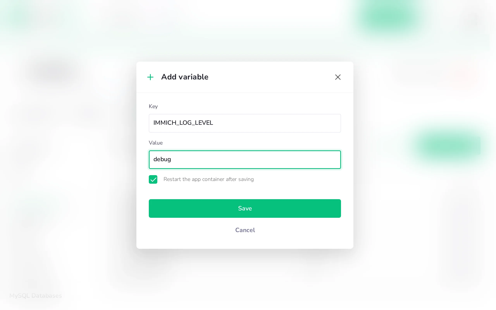
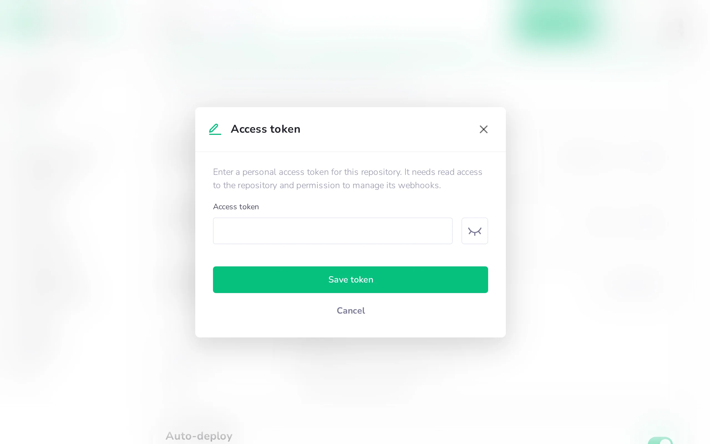
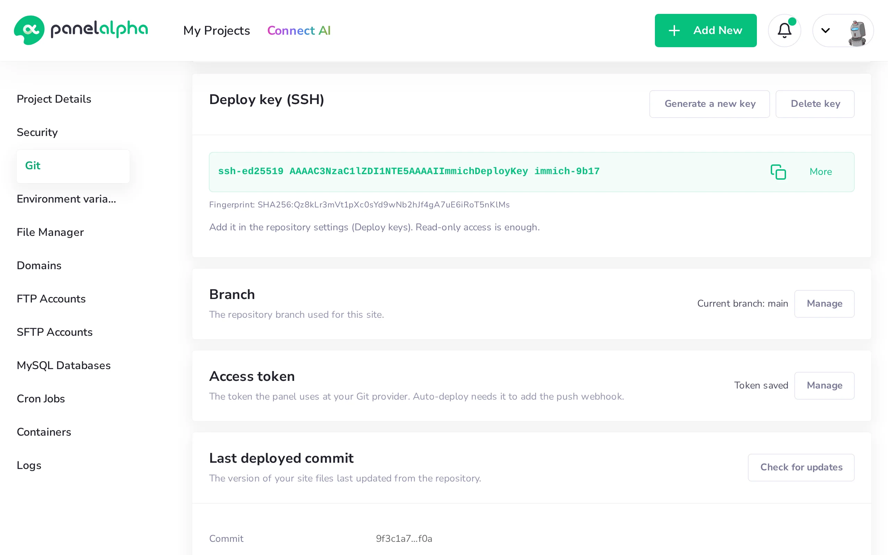
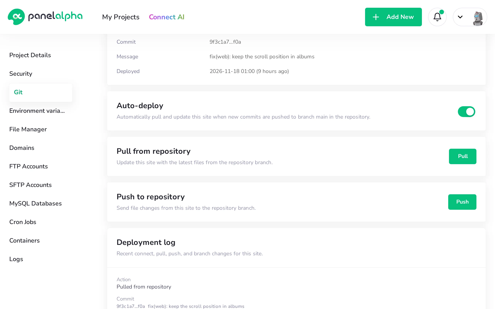

# Git

This page is for people who keep their site's code in a Git repository (GitHub, GitLab or Bitbucket). It covers redeploying, branches, variables, tokens and keys.

A Git project is a container project that the panel builds from your repository. Create one first: [Create a project](create-a-project.md).

A **deploy** builds and starts the project from the latest commit of a branch. A **commit** is one saved change in your repository. A **branch** is one line of work in it.

**The panel cannot roll a project back to an earlier commit.** It always deploys the latest commit of a branch.

## Redeploying

A redeploy runs the deploy again with the newest commits. The **Source** card on **Project Details** shows the repository, the deployed commit and whether the project is `Up to date`.

1. Open the project and select **Redeploy** at the bottom of the **Source** card.
2. In the **Redeploy** window, the **Branch** list shows the branch that is deployed now. Open it to pick another branch. If you choose a branch other than the deployed one, the window warns `This resets the target to origin of the selected branch.`
3. Read the list of new commits under the branch. Each line is one change, with a short code and the text the author wrote. If the project deploys with commands of its own, the panel lists its deploy steps below the commits. Untick a step to skip it for this deploy.
4. Select **Redeploy** to start. Select **Cancel** to leave without deploying.

::docs-video{src="../../assets/single-server-edition/git-redeploy.webm" title="On the Immich project page the Redeploy button on the Source card opens the Redeploy window with the branch main and two new commits, the Branch list is opened and release is chosen, and the window warns that this resets the target"}
::

Once the project has a staging copy, the window also offers **Deploy to staging environment**. If you tick it, the chosen branch goes to the copy and production stays as it is: [Staging and preview](staging-and-preview.md).

## Deploy logs

The deploy log shows what a deploy did, step by step. To open it, select **Show Logs** on the project's card, or in the **Actions** menu of its row in the table view.

The **Deploy Logs** window lists the steps with their times and the log below them. A step that failed shows **Failed**, or **Cancelled** if you stopped the deploy. **Cancel Deploy** stops a deploy that is running. **Download Logs** saves the log. You can close the window and the deploy continues.

Earlier deploys are in **Advanced > Logs**, on the **Deploy Logs** tab.

1. Open the project and select the **Advanced** tab.
2. In the list on the left, select **Logs**.
3. Select the **Deploy Logs** tab.
4. The box at the top picks the deploy, by its date and result (for example `Success`). The table lists each line of that deploy with its time, its **Stage** (for example `clone`, `build`, `start`, `health`), its **Level** (`Ok` or `Info`) and its **Message**. Use the search box to find a word. **Download** saves the log as a file.

## Changing the branch

Changing the branch deploys the project again from another branch.

1. Open the project and go to **Advanced > Git**.
2. In the **Branch** card, select **Manage**. Choose the branch in **Branch name** and select **Change branch**.

If the site has files that are not in the repository, the panel opens the **Local changes detected** dialog instead of switching: [Local changes on the server](#local-changes-on-the-server).

## Local changes on the server

A site connected to Git can get files that its repository does not have. These are files you upload or edit in **Files**, and files a deploy step writes (a lock file, `node_modules`). Pulling and changing the branch both stop at these files and open the **Local changes detected** dialog.

**Discard local changes and Force pull both delete the changed files on the server, and they cannot be recovered.** To keep your changes, use **Push local changes first, then pull**, or copy them out in **Files** first.

1. **Discard local changes** deletes the files the repository does not have and puts back the rest from the last commit of the branch.
2. **Force pull (overwrite changes)** replaces the site's files with the branch's content.
3. **Push local changes first, then pull** sends the site's changes to the branch, then pulls it, so nothing is lost.

After **Discard local changes** or **Force pull**, select **Pull** or **Change branch** again to run what you started.

## Environment variables

Environment variables are settings that your app reads when it starts, such as an address or a key. **Advanced > Environment variables** keeps them.

- **Add variable** adds one. It asks for a **Key** (the name, for example `IMMICH_LOG_LEVEL`) and a **Value**. Select **Save** to keep it or **Cancel** to leave.
- The pencil on a row edits it and the bin deletes it.
- **Import** adds a block of `KEY=value` lines at once. Turn on **Overwrite existing keys** to replace values you already have.
- The search box above the table finds a variable by its name.

Saving restarts the app container, and the new values are in place a few seconds later. If you untick **Restart the app container after saving** in the window, the panel only stores the variables and the next **Redeploy** applies them. **Restart** in **Advanced > Containers** does not apply them. A redeploy does not lose the variables.

Every project that is not WordPress has this page. A WordPress project keeps its configuration in **Advanced > System Configuration** instead.

## Connecting and disconnecting a repository

Connecting links a project to a Git repository. **Advanced > Git** starts with a **Connect repository** card when the project has no repository. A WordPress site starts this way. A project created from Git or from PanelAlpha GO! is already connected and has no **Disconnect** button.

1. Enter the **Repository URL**.
2. For a private repository over HTTPS, turn on **Private repository** and enter the **Access token**: [Access token](#access-token).
3. Select **Connect repository**.

The panel downloads the branch into the site. A site file with the same name as one in the repository is replaced with the repository's version. Other files stay where they are. If the panel cannot download the branch, nothing is connected: [Troubleshooting: Git](../troubleshooting/git.md).

An SSH address asks for the branch and shows a deploy key instead: [Deploy key](#deploy-key).

**Disconnect** asks you to confirm. It removes the Git link from the panel and leaves the files on the server.

## Pull, push and the deployment log

Once a repository is connected, **Advanced > Git** also has these cards:

- **Last deployed commit** shows the commit and when it was deployed. **Check for updates** compares the site with the repository.
- **Pull from repository** updates the site with the latest files from the branch. If the site has files of its own, the panel asks first: [Local changes on the server](#local-changes-on-the-server).
- **Push to repository** sends the site's file changes to the branch. If the repository has newer commits, the card says `The repository has newer commits. Pull those changes before pushing from this site.` A project deployed from its repository cannot push. The panel shows `Git is managed by deploy.`
- **Deployment log** lists the recent connects, pulls, pushes and branch changes of the site, each with its status.

## Access token

An HTTPS repository uses an **access token**, a password-like text that your Git provider gives you. The token needs read access to the repository and permission to manage its **webhooks**. A webhook is how your Git provider tells the panel about a new push.

1. Open **Advanced > Git** and find the **Access token** card.
2. Select **Manage**.
3. Paste the token and select **Save token**.

The card shows `Token saved` or `No token saved`. The window never shows a token that you saved before. If the repository stops answering, the page shows `Cannot access the repository. Update your access token.` The panel does not save a token that your Git provider does not accept.

## Deploy key

An SSH repository uses a **deploy key**, an SSH key you add to the repository so the panel can read it. The **Deploy key (SSH)** card in **Advanced > Git** shows the public key and its **Fingerprint**. Add the key in the **Deploy keys** settings of your repository. Read-only access is enough.

**Generate a new key replaces the old one, and pull and deploy stop working until you add the new key to the repository.** If you select **Delete key**, pull and deploy over SSH stop working. Remove the key at your Git provider as well.

## Auto-deploy

**Auto-deploy** redeploys the project when someone pushes to the branch.

1. Open **Advanced > Git**.
2. Turn on the switch in the **Auto-deploy** card.

The panel adds a webhook at your Git provider with your saved token, so the token must be allowed to manage webhooks. If there is no token, or the provider refuses it, the switch goes back off and the panel shows the reason: [Troubleshooting: Git](../troubleshooting/git.md). Turning the switch off removes the webhook.

Something not working? Messages and fixes: [Troubleshooting: Git](../troubleshooting/git.md).
