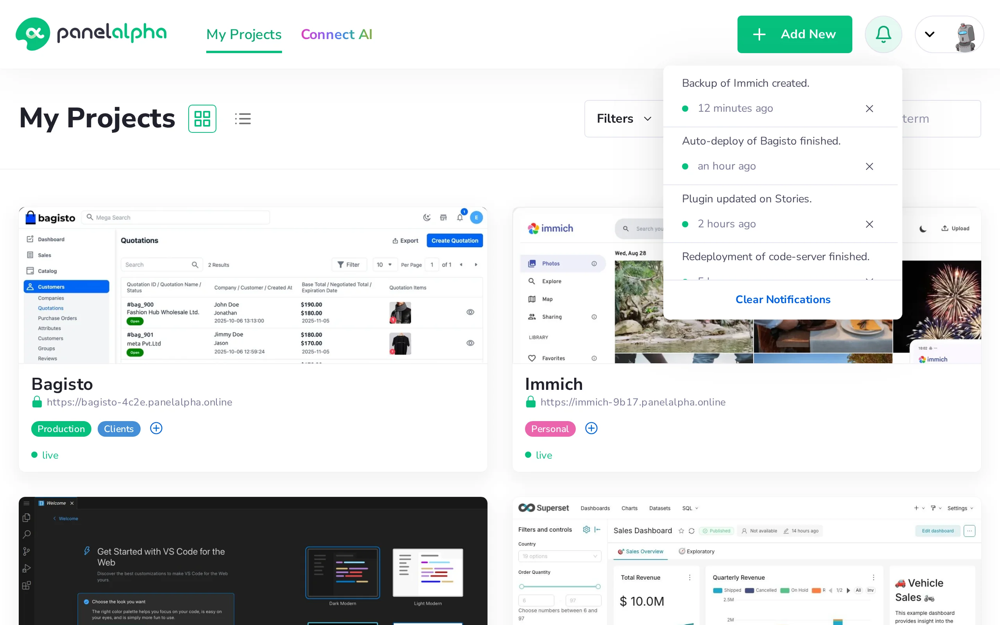
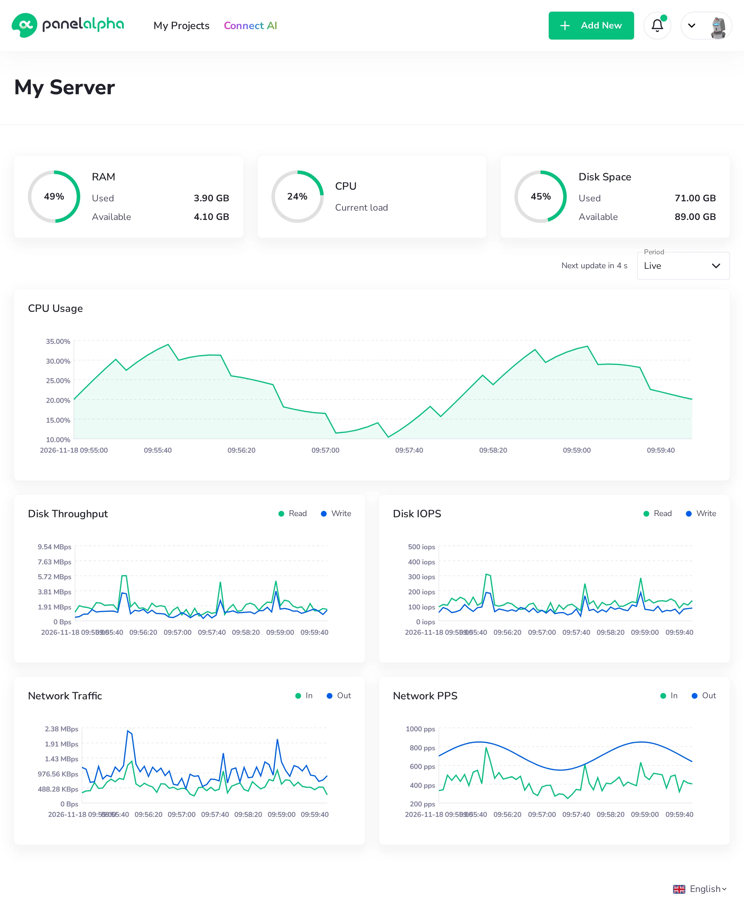

# Around the panel

The top bar of the panel holds the menu, the notifications bell and the user menu. The project page adds a project search.

## The top menu

The tabs are **My Projects** and **Connect AI**. The **Add New** button, which creates a project, is beside the bell. **My Server** is in the user menu.

## Searching for a project

On a project page, select the project name at the top. A search field opens. Type a name and select a project to go to it.

## Notifications

The bell shows a dot while there are notifications you have not seen. Select it to open the list. Opening the list marks the notifications as read.

**Dismiss** closes one notification. **Clear Notifications** removes all of them.

## The user menu

Select your avatar to open it:

- **Dark Mode**: a switch for the dark colour scheme. Select anywhere on the row. The panel remembers your choice.
- **Account Details**: your sign-in details: [Your account](your-account.md).
- **My Server**: how much RAM, CPU, disk and network the whole server uses: [Statistics and logs](../looking-after-a-project/statistics-and-logs.md#usage-of-the-server).
- **Tasks**: the work PanelAlpha Engine does for your projects. A dot shows while a task runs: [Tasks](tasks.md).
- **Settings**: the panel's own options: [Settings](settings.md).
- **Join Our Community**: opens the PanelAlpha Discord in a new tab.
- **Log Out**: ends your session: [Signing in](../getting-started/signing-in.md#signing-out).

**Connect AI** is not in this menu. It is a tab in the top menu: [Connect AI](connect-ai.md).

A warning dot on the avatar and on **Settings** means the server is not connected to PanelAlpha Hub. You can connect it or ignore the dot: [Settings](settings.md#panelalpha-hub).

::docs-video{src="../../assets/single-server-edition/around-the-panel-dark-mode.webm" title="The user menu opens with Dark Mode at the top, selecting the Dark Mode row turns Settings dark, My Projects opens in the dark scheme, and Dark Mode is switched off again"}
::

