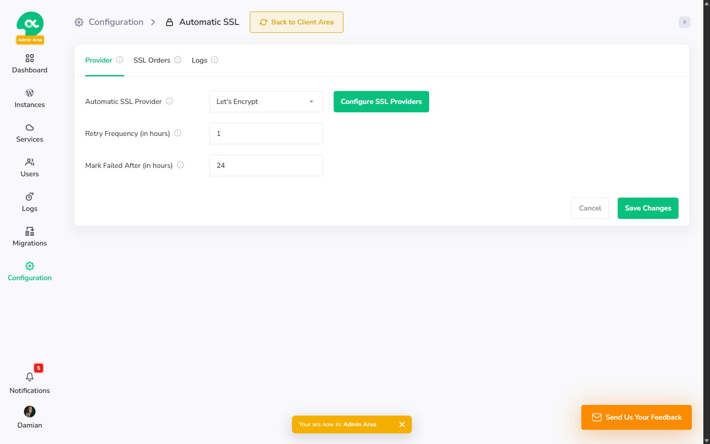
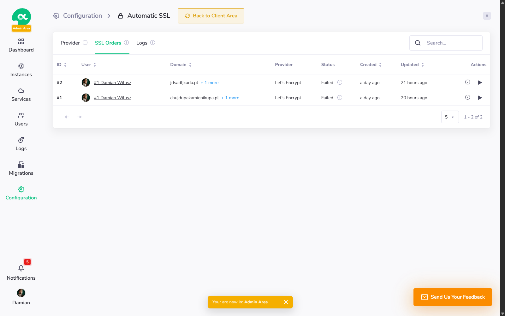
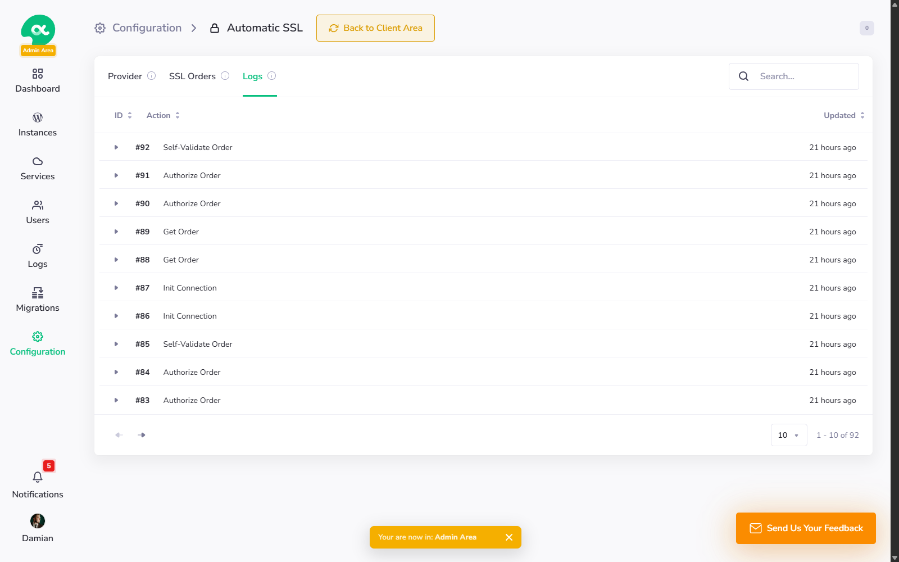

# Configuration - Automatic SSL

This section controls how SSL certificates are issued and monitored for your instances.

## Prerequisite

Before using automatic issuance, configure at least one SSL provider in **Integrations**.
For most environments, this is **Let's Encrypt**.
If your hosting server already runs its own automatic SSL engine, avoid enabling both automation layers to prevent conflicts.

- [Integrations (Configuration)](integrations.md)

## Tab Overview

- **Provider**: global SSL automation settings
- **SSL Orders**: live queue of certificate orders
- **Logs**: technical request/response history

## Provider Tab

Use this tab to configure:
- **Automatic SSL Provider**
- **Retry Frequency (hours)**
- **Fail After (hours)**

How these settings work:
- **Automatic SSL Provider** selects which enabled integration handles orders.
- **Retry Frequency** controls how often retryable orders are processed again.
- **Fail After** defines the timeout window after which unresolved orders are marked as failed.

Practical tuning:
1. Keep the retry interval short enough for normal DNS propagation delays.
2. Keep the fail window long enough for external DNS/provider latency.
3. Revisit values after incidents where many orders stay pending too long.

## SSL Orders Tab

This tab is the operational list of certificate orders.
Typical row data includes:
- order ID
- user
- domain set
- provider
- status
- created/updated timestamps

Common statuses:
- `pending`
- `in_progress`
- `awaiting_dns_propagation`
- `finished`
- `failed`
- `abandoned`
- `skipped`

Available row actions (status-dependent):
- **Show Logs**
- **Process Now**
- **Abandon**

Operational guidance:
- Use **Process Now** after fixing prerequisites (DNS records, domain routing, provider config).
- Use **Abandon** for orders you intentionally want to stop and not reprocess automatically.

## Logs Tab

Use this tab to inspect request-level SSL processing data, including:
- SSL order ID and action
- request payload
- response payload
- processing time
- update timestamp

This is the primary place to diagnose integration, validation, or provider communication issues.

## Recommended Operating Flow

1. Confirm provider setup in **Integrations**.
2. Set provider and timing values in **Provider**.
3. Monitor **SSL Orders** for failed or long-pending records.
4. Open **Logs** for root-cause analysis before retrying.
5. Reprocess only after DNS/domain issues are resolved.

## Practical Notes

- In DNS-related failures, fix DNS first and retry afterward.
- For repeated failures, validate provider credentials and integration health before reprocessing.
- Review failed/abandoned orders regularly to avoid delayed go-live windows.
