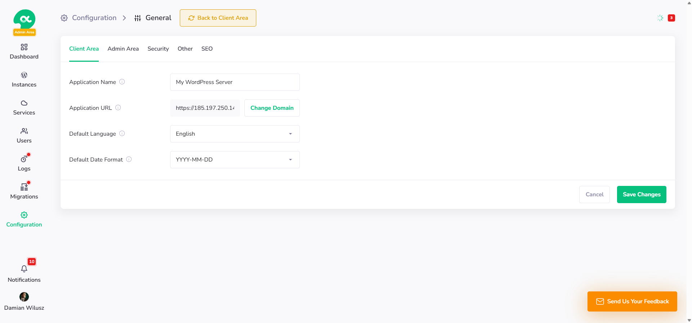
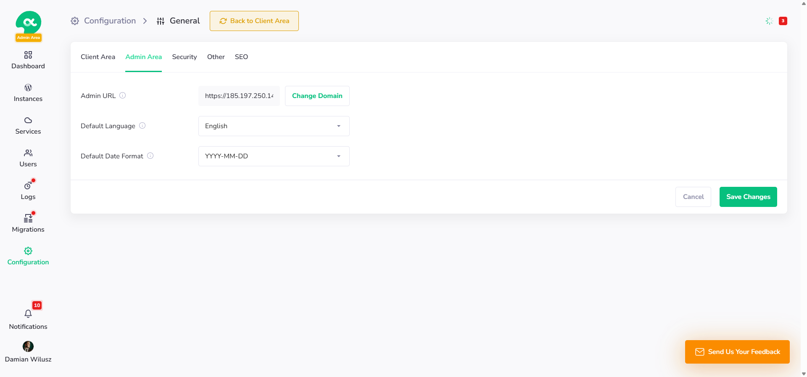
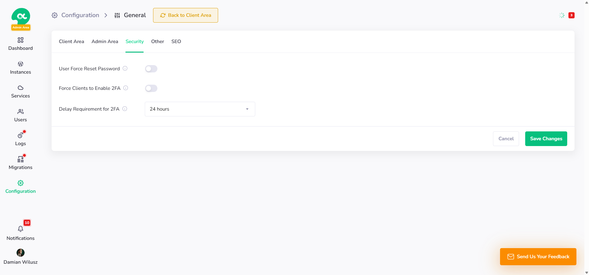
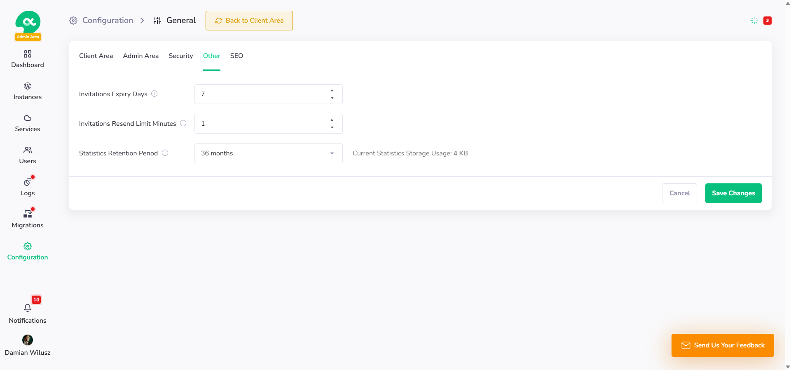
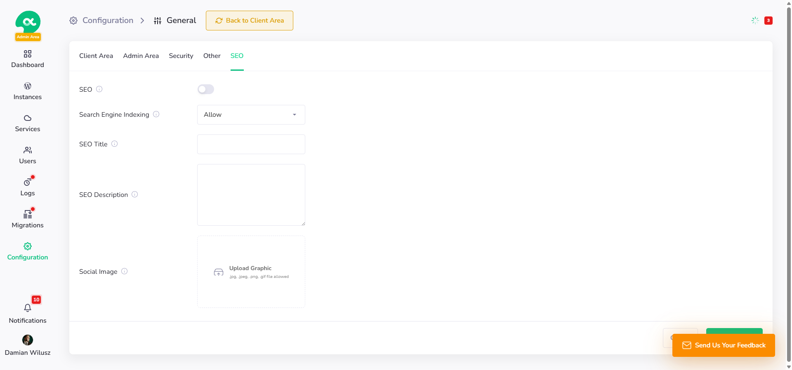

# Configuration - General

Use this page to control global behavior of both panel interfaces.
Settings here affect URLs, localization defaults, account security defaults, support redirects, and SEO metadata.

## Before You Edit

- Plan URL changes in a maintenance window.
- Security settings in this section apply to newly created users.
- Keep external links in the **Other** tab valid, so users do not hit dead-end pages.

## Available Tabs

The page is split into:
- **Client Area**
- **Admin Area**
- **Security**
- **Other**
- **SEO**

## Client Area tab

This tab controls how end users see and use Client Area.

Main options and what they change:
- **Application Name**
  Name displayed in client-facing interface branding.
- **Application URL** (`Change Domain`)
  Base URL used by clients to access the panel.
- **Default Language**
  Preselected language for the client UI.
- **Default Date Format**
  Format used for dates and timestamps.
- **Branding** (`Configure`)
  Opens branding customization in user context.
- **Client Area CSS**
  Custom CSS overrides for the client UI.
- **Client Area Header** / **Client Area Footer**
  Custom JavaScript injected into the client header and footer.

Use this tab when you need white-label customization or client-facing UX changes.

## Admin Area tab

Main options and what they change:
- **Admin URL** (`Change Domain`)
  Base URL for administrator access.
- **Default Language**
  Language used by default in Admin Area.
- **Default Date Format**
  Date format used in admin lists and logs.

Use this tab to keep admin access separated from client access and consistent for your team.

## Security tab

Main options and what they change:
- **User Force Reset Password**
  Newly created users must set a new password at first login.
- **Force Clients to Enable 2FA**
  Newly created users are required to configure two-factor authentication.
- **Delay Requirement for 2FA**
  Defines the grace period before 2FA becomes mandatory.

Recommended rollout:
1. Enable forced password reset.
2. Enable 2FA with a delay.
3. Reduce delay once onboarding is complete.

## Other tab

This tab covers invitation policy, statistics retention, and redirect links used by UI actions.

Main options and what they change:
- **Invitations Expiry Days**
  Number of days for invitation acceptance.
- **Invitations Resend Limit Minutes**
  Minimum interval before invitation resend.
- **Statistics Retention Period**
  Defines how long traffic statistics are stored before cleanup.
- **Order Service Link**
  Redirect target when users want to order a service.
- **Order Domain Link**
  Redirect target for domain ordering.
- **Order Custom SSL Certificate Link**
  Redirect target for custom SSL purchase flow.
- **Unsuspend Service Link**
  Redirect target for service reactivation flow.
- **Support Link**
  Redirect target for support/helpdesk access.

Use this tab to connect panel actions with your billing and support workflows.

## SEO tab

Main options and what they change:
- **SEO** (enable/disable)
  Global toggle for SEO metadata behavior.
- **Search Engine Indexing**
  Controls whether indexing is allowed.
- **SEO Title** / **SEO Description**
  Default metadata for search engines.
- **Social Image**
  Preview image used by social platforms.

Use this tab when client-facing pages are public and should have controlled metadata.

## After Saving

- Most settings apply immediately.
- URL changes require DNS and routing readiness.
- After major changes, verify both admin (`:8443`) and client (`:8444`) access paths.
