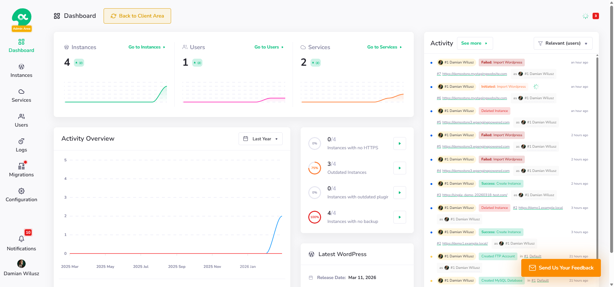

# Dashboard

The admin dashboard is the operational overview for daily administration.
It gives quick access to the most important platform data and shortcuts to key sections.

### Widgets

The dashboard includes several widgets with key data:

- **Instances, Users & Services** — quick counters with trend indicators and shortcuts to lists
- **Activity Overview** — line chart for instance/plugin activity with selectable time range
- **Instances Summary** — share of instances by technical status:
  - number of instances with no HTTPS
  - number of outdated instances
  - number of instances with outdated plugins
  - number of instances with no backups
- **Latest WordPress** — latest release version, release date, and changelog link
- **Activity** — recent events feed with category filter (default: Most Relevant). Available categories:
  - Most Relevant
  - Instances
  - Plugins
  - Backups
  - Themes
  - Hosting
  - Users
  - Subusers
  - Sharing access
  - Log-ins
  - Admins
  - Config

### Side Menu

Quick access in the admin side menu:
- Dashboard
- [Instances](instances.md)
- [Services](services.md)
- [Users](users.md)
- [Logs](logs.md)
- [Migrations](migrations.md)
- [Configuration](configuration-general.md)
- [Notifications](notifications.md)
- Profile details
