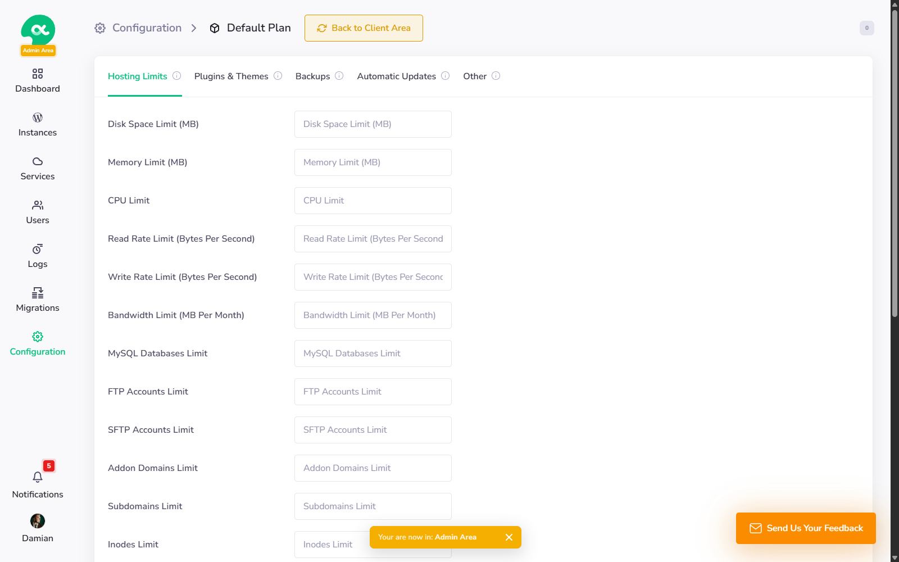
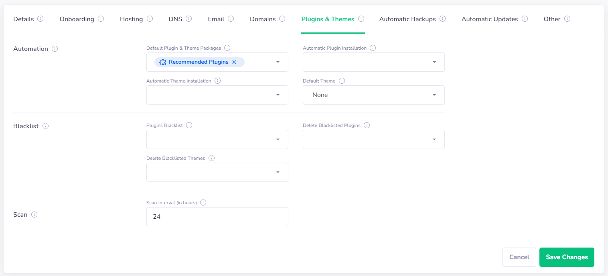
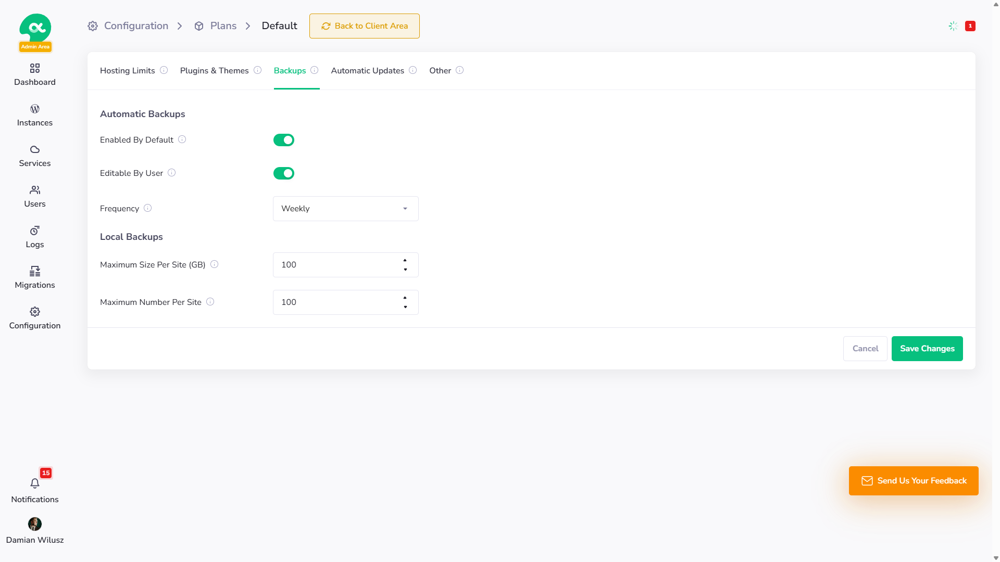
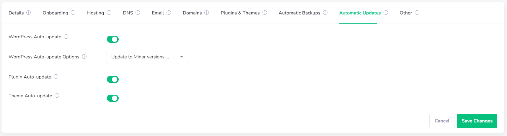
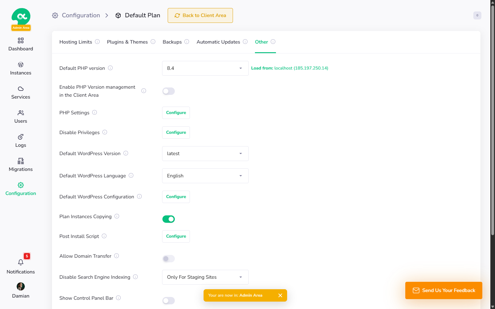

# Default Plan (Configuration)

Use **Default Plan** to define baseline behavior for newly created services and WordPress instances.
Treat this section as your policy template for limits, backups, updates, and user permissions.

## What this section controls

You configure five tabs:
- **Hosting Limits**
- **Plugins & Themes**
- **Backups**
- **Automatic Updates**
- **Other**

There is also a plan selector at the top, so you can switch between available plans and edit each one independently.

## Hosting Limits

Use this tab to define technical capacity for new hosting accounts under the selected plan.

Typical options include:
- Disk space, memory, CPU, read/write speed, and monthly bandwidth.
- Limits for MySQL databases, FTP accounts, SFTP accounts, addon domains, subdomains, and inodes.
- Redis and LiteSpeed cache toggles.
- PHP-FPM / LSPHP related account settings.
- Dedicated IPv4 / Dedicated IPv6 options (if supported by server type).

Use this tab to build clear package tiers (for example Starter/Pro/Agency) and prevent over-allocation.

## Plugins & Themes

This tab controls what plugin/theme stack is prepared for new sites.

Core options:
- Default plugin/theme package.
- Automatic plugin installation list.
- Automatic theme installation list.
- Default theme selection.

Control options:
- Plugin blacklist.
- Delete blacklisted plugins.
- Delete blacklisted themes.
- Scan interval for blacklist enforcement (when available).

Use this tab to enforce technical standards and block unsupported tooling from day one.

## Backups

This tab defines default backup policy for new instances.

Main options:
- **Enabled by Default** - whether backups are turned on automatically
- **Editable by User** - whether end users can change backup settings
- **Frequency** - daily, weekly, monthly (depending on available options)
- Local backup limits:
  - Maximum size per site (GB)
  - Maximum number of backups per site

Use this tab to balance recovery readiness and storage usage.

## Automatic Updates

This tab defines update policy for newly created sites.

Main options:
- **Editable by User** - allows or blocks user-level update-policy changes
- WordPress auto-update
- WordPress update policy (for example, minor-only)
- Plugin auto-update
- Theme auto-update

Use this tab to reduce manual maintenance while controlling regression risk.

## Other

This tab includes global defaults and permissions.

Main options:
- Default PHP version
- Enable PHP version management in Client Area
- PHP settings (Configure)
- Disable privileges (Configure)
- Default WordPress version
- Default WordPress language — default installation locale for new instances, or **Current User Language** to inherit the WordPress language from the creating user's PanelAlpha interface language (falls back to English if the user's language has no WordPress equivalent). Used only when the client does not pick a language themselves.
- Default WordPress configuration (Configure)
- Plan instances copying
- Post install script (Configure)
- Allow domain transfer (available only for selected server types, e.g. WP Cloud)
- Disable search engine indexing policy
- Show control panel bar
- Show control panel link in admin menu
- Show control panel link in admin bar

Use this tab for final policy decisions: what users can change, what is locked by admin, and what every new site receives by default.

## Important behavior

Plan changes usually apply to newly created services and instances. Existing services typically keep current values unless changed separately.

Before changing production defaults:
1. Save changes in a low-risk period.
2. Create a test service or instance.
3. Confirm limits, backups, updates, and permissions in that test site.
4. Roll out changes to production workflows.
