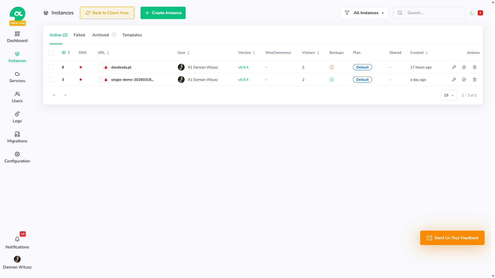
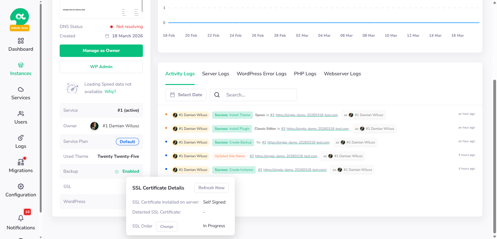
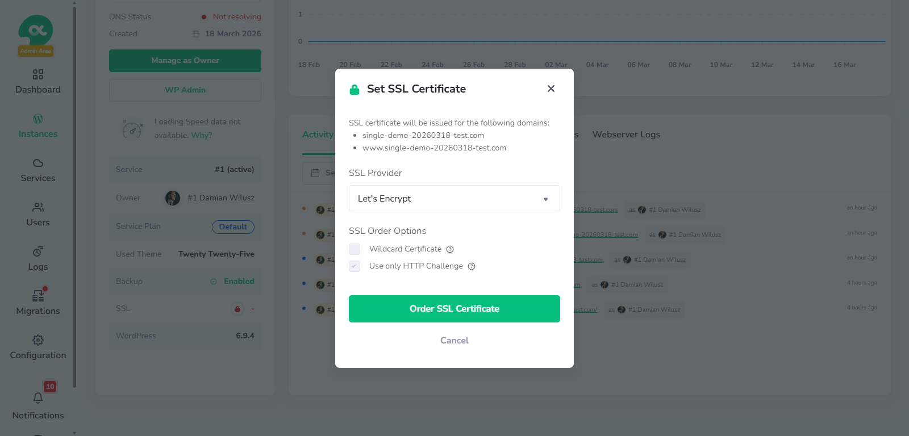
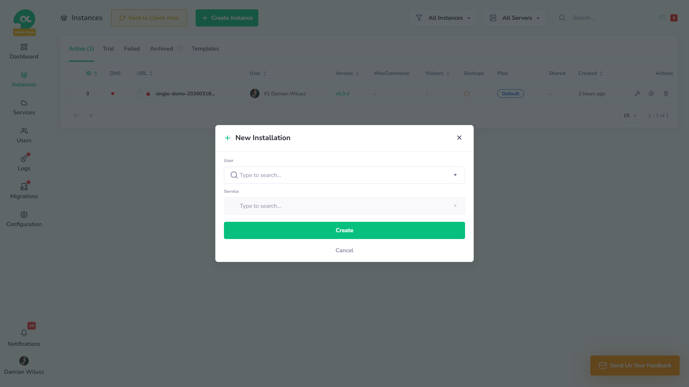
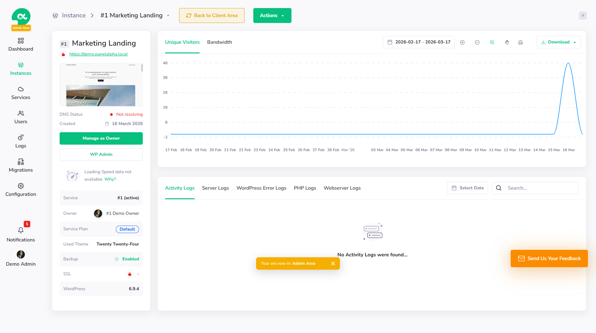
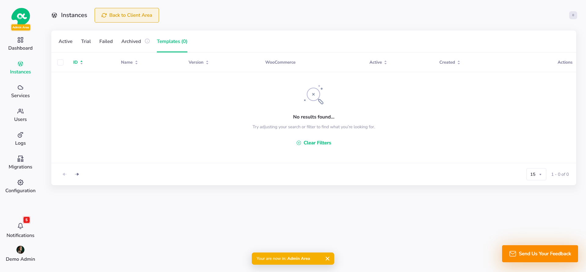

# Instances

The **Instances** section in Admin Area is used to manage all client WordPress websites from one place.

Instance creation is bound to the default owner (`#1`) and default service (`#1`).

The top filter includes **All Instances** only.
The **All Servers** filter is not available because only one server is managed.

## Main Tabs

### Active

The **Active** tab lists working instances and operational metrics.
Depending on your integration, enabled modules, and table mode, columns can include:
- instance ID
- DNS / SSL status
- URL
- owner (user)
- WordPress / WooCommerce version
- traffic and backup indicators
- plan information
- row actions

In lighter setups, the table can be simplified (for example only ID, DNS, URL, and Actions).

Common row actions:
- **Manage Instance** (open admin instance details)
- **Open URL / preview context**
- **Delete / archive related actions** (based on status and permissions)

### Failed

The **Failed** tab contains installations that did not finish successfully.
Available follow-up actions include retry and permanent cleanup.

### Archived

The **Archived** tab contains deactivated instances kept for reference or controlled cleanup.
From here, instances can be removed permanently.

### Instance Templates

The **Instance Templates** tab stores reusable website templates for fast provisioning.
Only templates with active status are available during instance creation.

> [!NOTE]
> Standard instance data shown in Admin Area is available without requiring Google PageSpeed integration.

## SSL Certificate Details

Administrators can inspect SSL status from the instance details view.
Clicking the **SSL** field opens certificate information and order details.

From the **Set SSL Certificate** dialog, you can change:
- SSL provider
- validation challenge type
- wildcard option (if applicable)

## Creating a New Instance

Use the **Create Instance** button at the top of the list.

The creation flow includes:
1. **User** is fixed to default owner `#1`.
2. **Service** is fixed to default service `#1`.
3. Enter basic site data (site name, domain, optional subdirectory).
4. Choose installation mode:
   - **New Clean Installation**
   - **Clone Existing Installation**
   - **Create From Template**
5. Complete plan-dependent fields (for example language, admin credentials, or other onboarding fields).
6. Submit creation.

**Notes:**
- There is no workflow for adding a new user or service from this modal.
- In domain transfer scenarios, additional DNS verification may be requested before final submission.
- Instance provisioning is asynchronous, so new rows can initially show partial data until installation finishes.

## Instance Details View

Open details by clicking ID, URL, or **Manage Instance**.

The details page provides:
- summary card with core metadata and quick actions
- traffic/resource charts with date range controls and export options
- logs area for activity and technical diagnostics
- direct operational actions

Typical quick actions:
- **Manage as Owner**
- **WP Admin** (SSO)
- **Save as Template**
- **Restore from Backup**

## Instance Templates Management

Templates are managed in **Instances -> Instance Templates**.

Available operations:
- enable or disable template
- create a new instance from template
- rename template
- delete template

Recommended process:
1. Prepare a reference instance.
2. Save it as template from instance details.
3. Activate the template.
4. Use it in admin/client creation flows where suitable.
