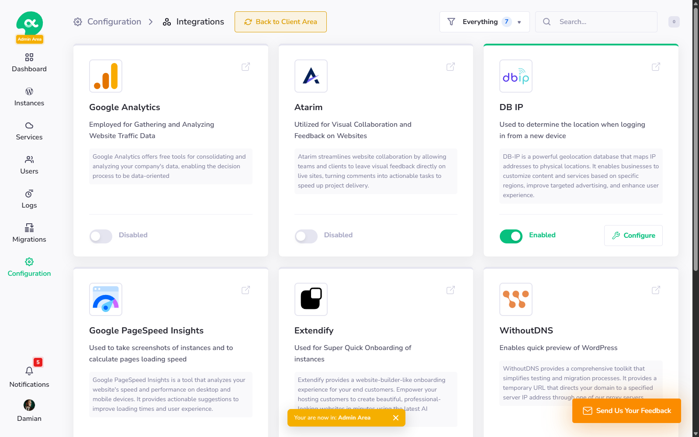
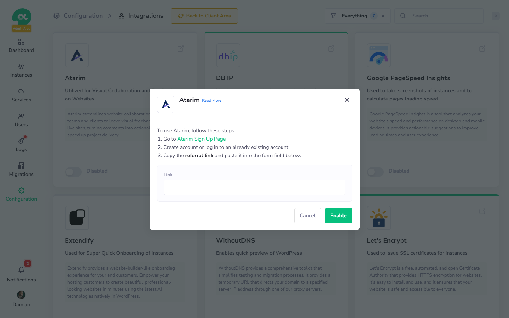
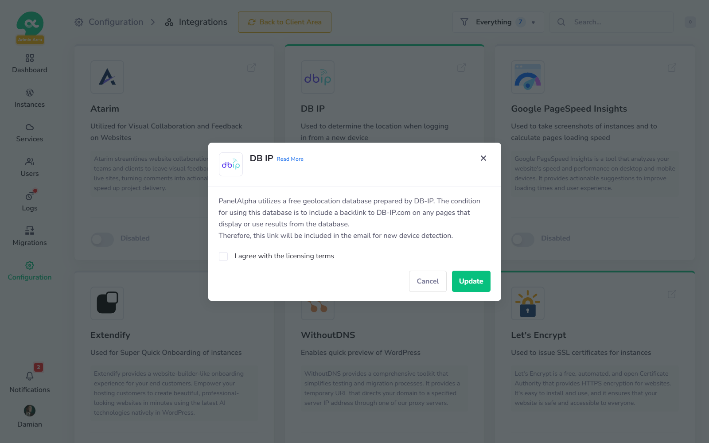
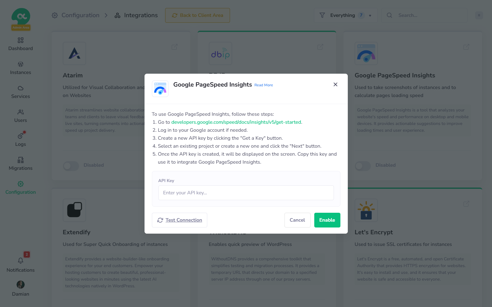
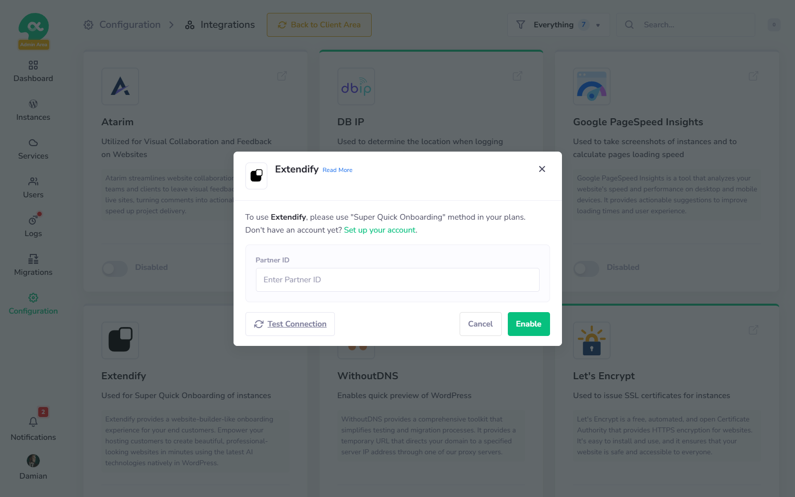
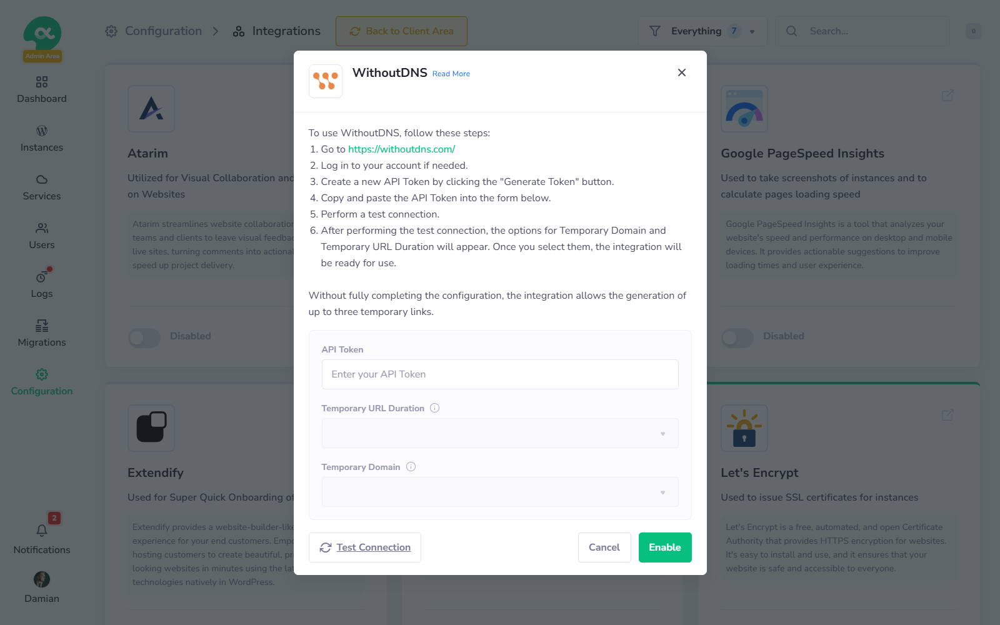
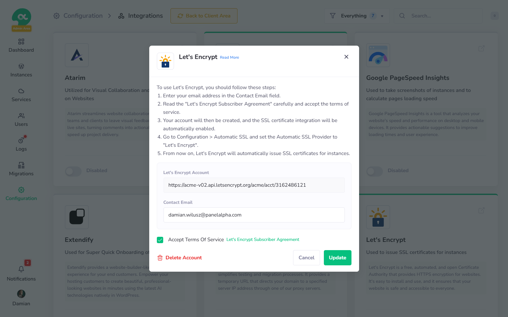
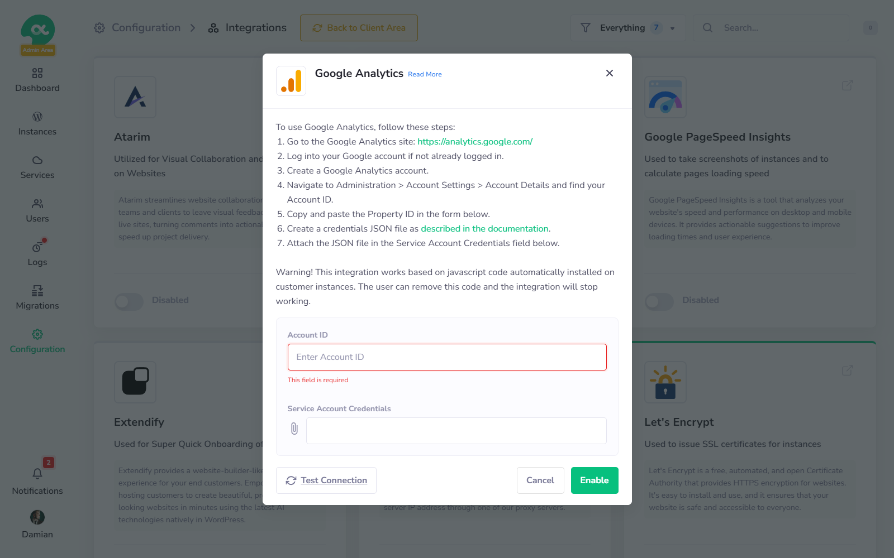

# Configuration - Integrations

Use this section to enable and manage third-party services connected to the platform.

## Capabilities

From this page, administrators can:
- Browse all available integrations
- Filter and search by status
- Enable or disable integrations
- Open the configuration form for each enabled integration
- Run connection checks for integrations that support connection testing

Most integrations are configured in a modal window with dedicated fields, then saved with **Enable** (first setup) or **Update** (existing setup).

Use this page as an integration inventory: keep only integrations that have a clear operational owner and business purpose.

## Integration Setup Model

Each integration card follows the same lifecycle:
1. Turn the integration on.
2. Complete required fields.
3. Run **Test Connection** when available.
4. Save configuration.
5. Validate the user-facing result in Client Area or related admin modules.

For some integrations, additional configuration options appear only after successful connection testing.

## Integration Reference

### Atarim

**Purpose**
- Enables visual website collaboration by generating collaboration links for clients and teams.

**Configuration fields**
- `Link` (your Atarim referral link)

**Setup notes**
- The link must be a valid URL and include referral data.
- No separate test-connection step is required.

**Where it is used**
- In Client Area instance views as **Collaborate** actions.

### DB-IP

**Purpose**
- Adds geolocation context for login-from-new-device notifications.

**Configuration fields**
- `I agree with the licensing terms` (required checkbox)

**Setup notes**
- This integration requires accepting DB-IP licensing terms before activation.
- No additional credentials are required.

### Google PageSpeed Insights

**Purpose**
- Optional integration for page speed analysis.

**Configuration fields**
- `API Key`

**Setup notes**
- Generate an API key in Google Cloud for PageSpeed API.
- Run test connection before saving.
- This integration is not required for standard instance data in Client Area or Admin Area.

### Extendify

**Purpose**
- Enables Extendify-based onboarding experience for new WordPress installations.

**Configuration fields**
- `Partner ID`

**Setup notes**
- Use this integration with onboarding flows that support Extendify.
- Connection test validates Partner ID.

**Operational dependency**
- Plan onboarding settings determine when Extendify is actually used during site creation.

### WithoutDNS

**Purpose**
- Provides temporary preview URLs before final DNS propagation.

**Configuration fields**
- `API Token`
- `Temporary URL Duration`
- `Temporary Domain`

**Setup notes**
- Add API token first, then run **Test Connection**.
- After successful test, additional selectable options become available.
- Without full configuration, the integration allows a limited trial mode.

**Where it is used**
- In Client Area, **Preview** actions for instances waiting for DNS propagation.

### Let's Encrypt

**Purpose**
- Issues SSL certificates for domains managed by PanelAlpha.

**Configuration fields**
- `Let's Encrypt Account` (auto-generated)
- `Contact Email`
- `Accept Terms Of Service` (required)

**Setup notes**
- Account data is generated after saving valid email and accepted terms.
- After enabling, configure **Configuration -> Automatic SSL** provider behavior.

**Related article**
- [Automatic SSL (Configuration)](automatic-ssl.md)

### Google Analytics

**Purpose**
- Connects instances to Google Analytics data collection and reporting.

**Configuration fields**
- `Account ID`
- `Service Account Credentials` (JSON file)

**Setup notes**
- Both fields are required for a successful connection test.
- Credentials file must match the configured account permissions.
- Integration relies on JavaScript code injected into instances; if removed from a site, data collection will stop for that site.

## Security And Governance

Recommended administrative practices:
1. Enable only integrations actively used by your business.
2. Store API keys and credentials with restricted admin access.
3. Revalidate critical integrations after panel updates.
4. Assign an owner for each integration in your internal runbook.

## Troubleshooting Checklist

If an integration does not work as expected:
1. Verify it is enabled.
2. Reopen configuration and confirm required fields are still valid.
3. Run test connection again when the option is available.
4. Check dependent modules (for example Automatic SSL, preview actions, or onboarding flow).
5. Confirm the related user privilege is enabled in plan/user permissions where applicable.
