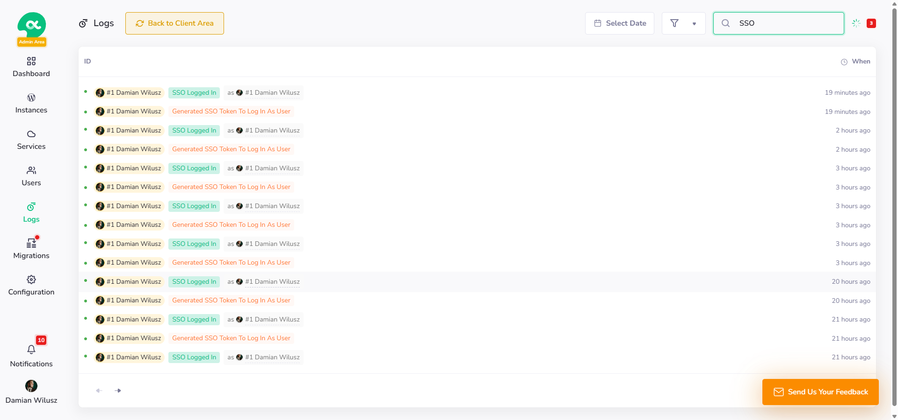

# Logs

Use **Logs** when you need to answer three questions quickly:

- What happened?
- When did it happen?
- Who triggered it?

This section is split into dedicated views so you can find events faster without searching the whole system manually.

## Activity Logs

Main activity view available at `Admin Area -> Logs` (`/logs`).

In this view you can:

- Review global activity (instances, users, services, logins, admin actions)
- Filter by date range
- Search by phrase
- Narrow results with quick filters (for example **Users** or **Admins**)

Use this tab first when you need a general timeline of platform actions.

## Tasks Logs

Use this tab to monitor background operations (for example staging creation, push to live, or push to staging).

You can:

- Filter by date, task type, status, and search phrase
- Track current status (`pending`, running, failed, completed)
- Retry selected failed tasks
- Cancel tasks that are still pending

## Servers Logs

This tab lists API and hosting request logs.

Use it to:

- Search request/response payloads
- Check request path, execution time, and timestamp
- Copy request or response content for troubleshooting
- Open full payload in a modal when the table preview is not enough

## Diagnostic Mode Logs

This section has two tabs:

- **Current Incidents**: currently affected instances/services
- **Logs**: chronological history of diagnostic events

Expand rows to see health-check details and use entity links to jump directly to the affected instance or service.

## Download System Logs

Use **Logs -> Download System Logs** to download a `.zip` archive with current system logs.
This is useful when sharing diagnostics with your internal team or PanelAlpha support.
