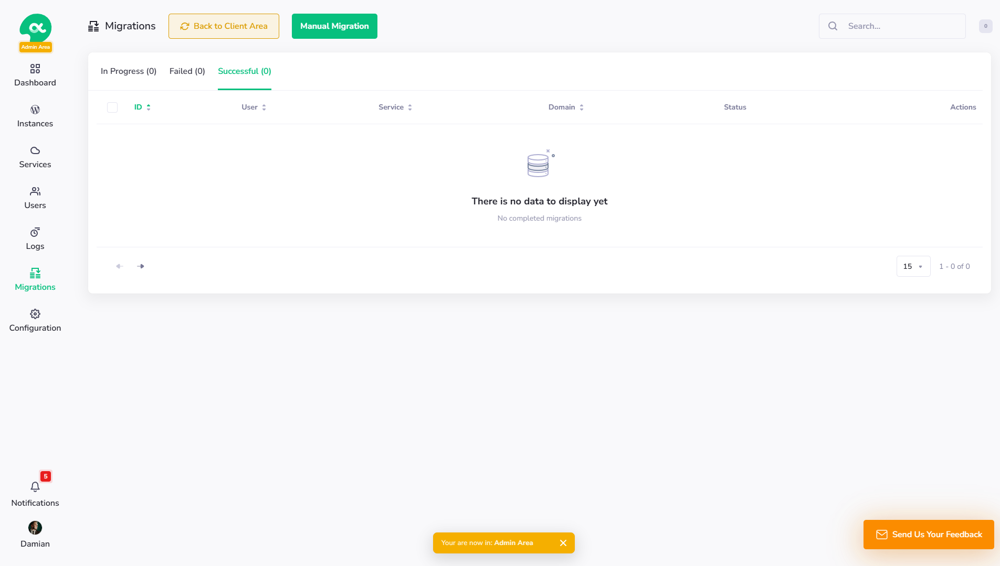
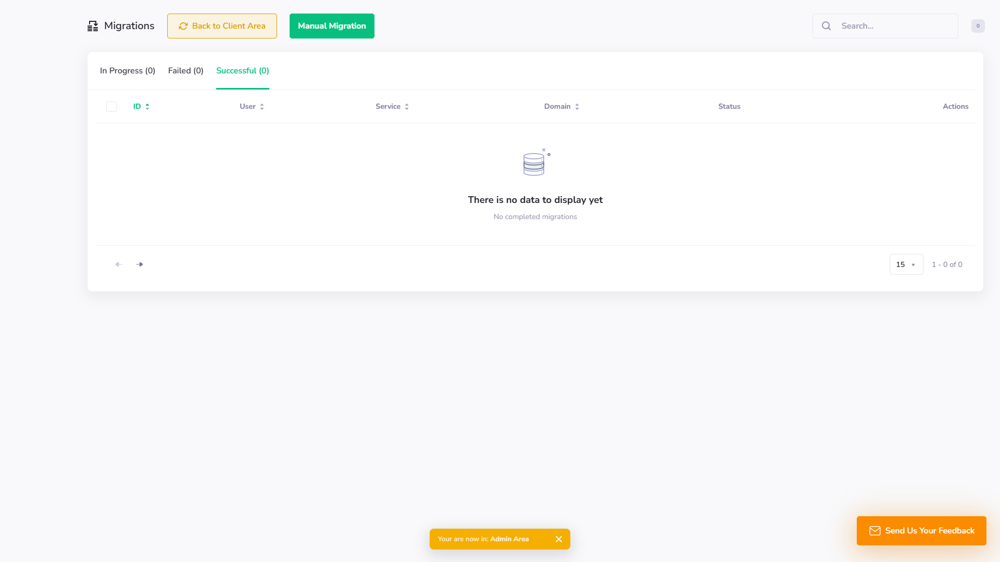
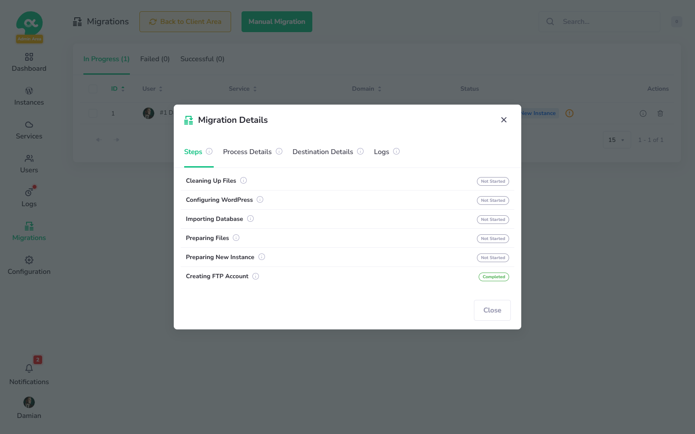
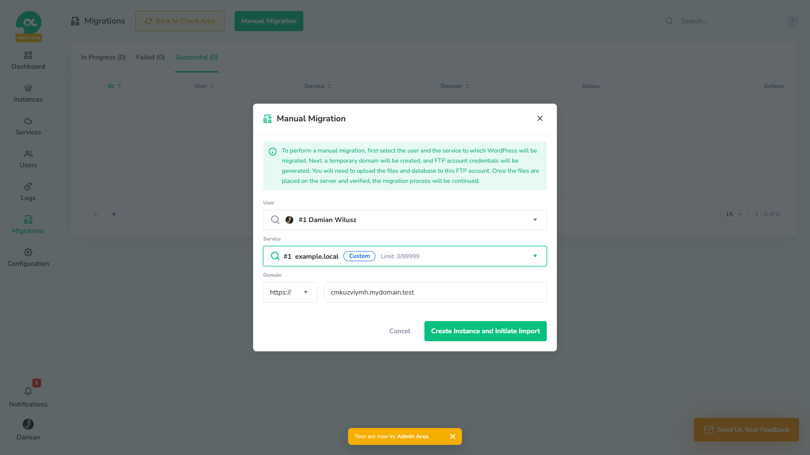

# Migrations

The **Migrations** section is the operational center for website imports.
Use it to monitor progress, resolve failures, and complete manual migration workflows.

## Main Interface

The main page includes:
- status tabs: **In Progress**, **Failed**, **Successful**
- search field for filtering migrations
- **Manual Migration** button for administrator-led imports

## What You Can Manage

For each migration, administrators can:
- open full migration details
- retry failed migrations
- stop selected in-progress automatic migrations
- mark selected failed migrations as successful (when verification confirms success)
- remove non-completed records

Bulk actions are available through row selection.

## Migration Details Modal

The details modal provides a full process breakdown.
Typical tabs include:
- **Steps**
- **Source Details** (for automatic migrations)
- **Process Details**
- **Destination Details**
- **Logs**

Inside this modal you can:
- track per-step statuses (`completed`, `in-progress`, `failed`, `not-started`)
- copy key technical values (paths, database data, credentials)
- inspect process logs with detailed messages and metadata
- continue manual imports after required files are verified

## Manual Migration Workflow

When you start **Manual Migration**, the admin form collects:
- target user
- target service
- target domain and protocol
- selected user-configurable options (if present in service plan settings)

After preparation, the migration appears in **In Progress**, and import continuation is handled from the details modal.

## Operational Routine

Recommended daily routine:
1. Check **In Progress** for stalled imports.
2. Review **Failed** and decide: retry, fix prerequisites, or remove.
3. Verify newly completed migrations in **Successful**.
4. Use details logs before escalating issues.

## Troubleshooting Guidance

If a migration fails:
1. Open **Details -> Logs** and identify the first failing step.
2. Validate source credentials and destination service constraints.
3. Confirm domain, DNS, and destination storage/database readiness.
4. Retry only after root cause is corrected.
