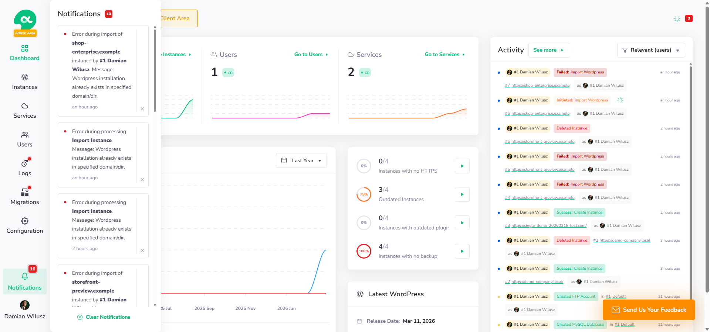

# Notifications

The **Notifications** section in Admin Area is used to review platform alerts and important events.

## What This Section Is For

- reviewing system alerts
- tracking operational warnings
- checking events that may need admin action

The exact content depends on enabled modules and current platform activity.

## What to Prioritize

Start with alerts related to:
- failed backups
- SSL order failures
- migration errors
- server health thresholds

## Suggested Daily Routine

1. Open Notifications at the start of the day.
2. Triage by impact (availability and security first).
3. Resolve or assign each actionable item.
4. Verify closure by checking related sections (Logs, Migrations, Automatic SSL).

## Escalation Guidance

- **Immediate action:** SSL failures on active domains, repeated backup failures, critical server alerts.
- **Same-day action:** migration warnings, integration errors, unusual activity spikes.
- **Planned action:** non-critical optimization or informational notices.
