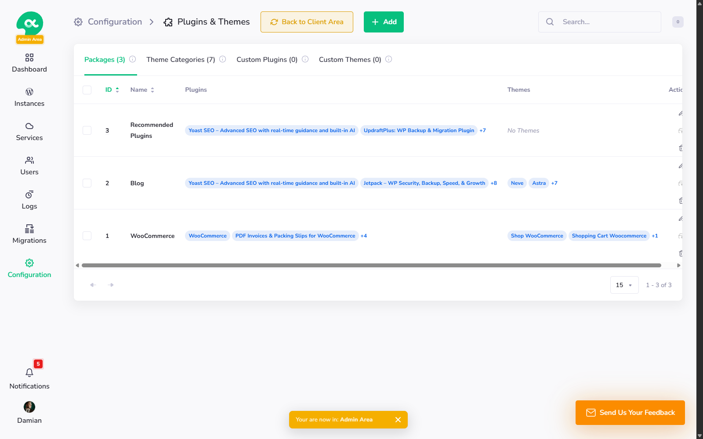
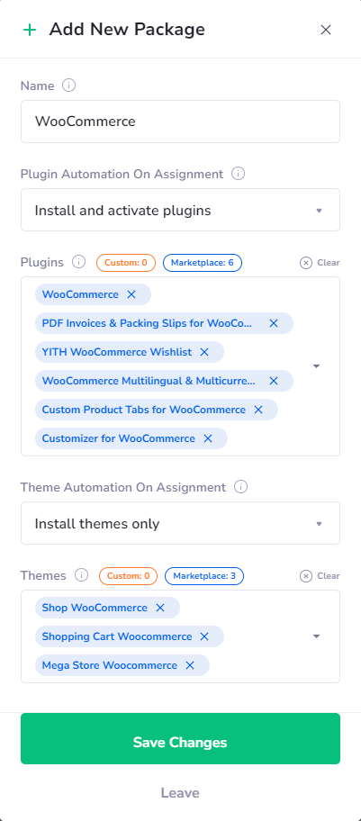
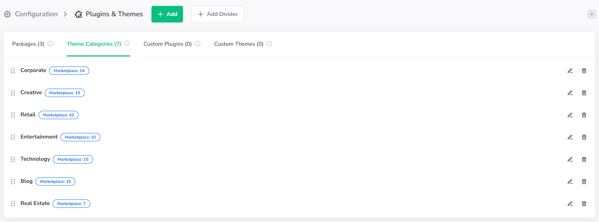
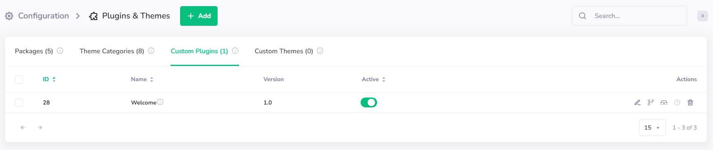
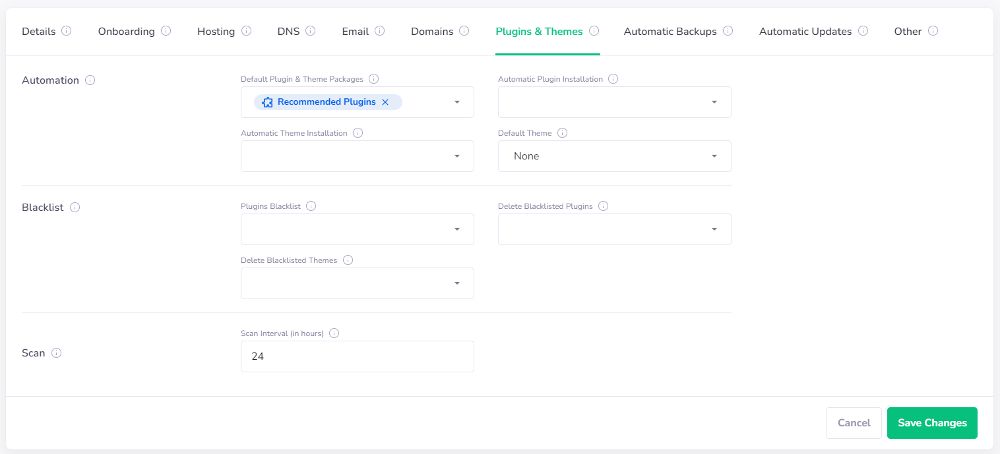

# Configuration - Plugins & Themes

This section centralizes plugin and theme assets used in onboarding and default-plan automation.
Use it to keep new sites consistent and reduce manual post-install cleanup.

## Main tabs

- **Packages**
- **Theme Categories**
- **Custom Plugins**
- **Custom Themes**

## Packages tab

Use this tab to build reusable bundles of plugins and themes.

Typical workflow:
1. Build the package once.
2. Assign the package in **Default Plan**.
3. New instances inherit that stack automatically.

When to use:
- Standardized agency builds
- Vertical-specific starter stacks
- Controlled migration from ad-hoc plugin choices to managed bundles

## Theme Categories tab

Use this tab to group themes into logical catalogs for onboarding.

This shortens decision time for non-technical users and keeps theme choices curated.

## Custom Plugins and Custom Themes tabs

Use these tabs to register internally approved assets (custom ZIPs/versions).

Use this when you need strict control over what can be installed across managed sites.

## Relation to Default Plan

Packages defined here can be assigned in:
- [Default Plan (Configuration)](default-plan.md)

This makes package policy enforceable during new-site provisioning.
