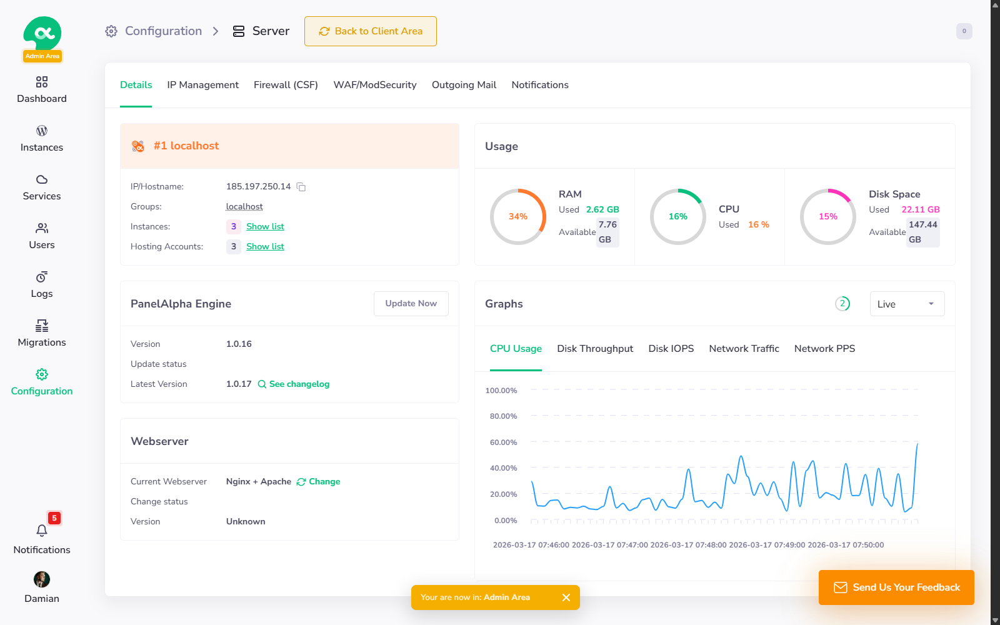
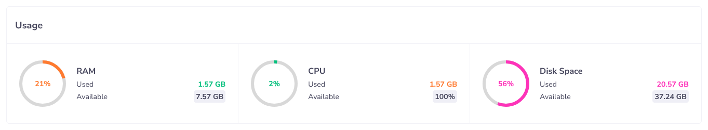
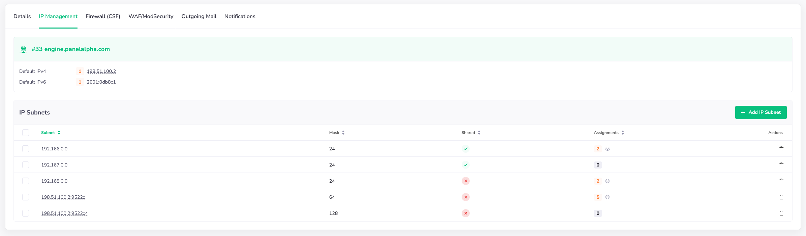
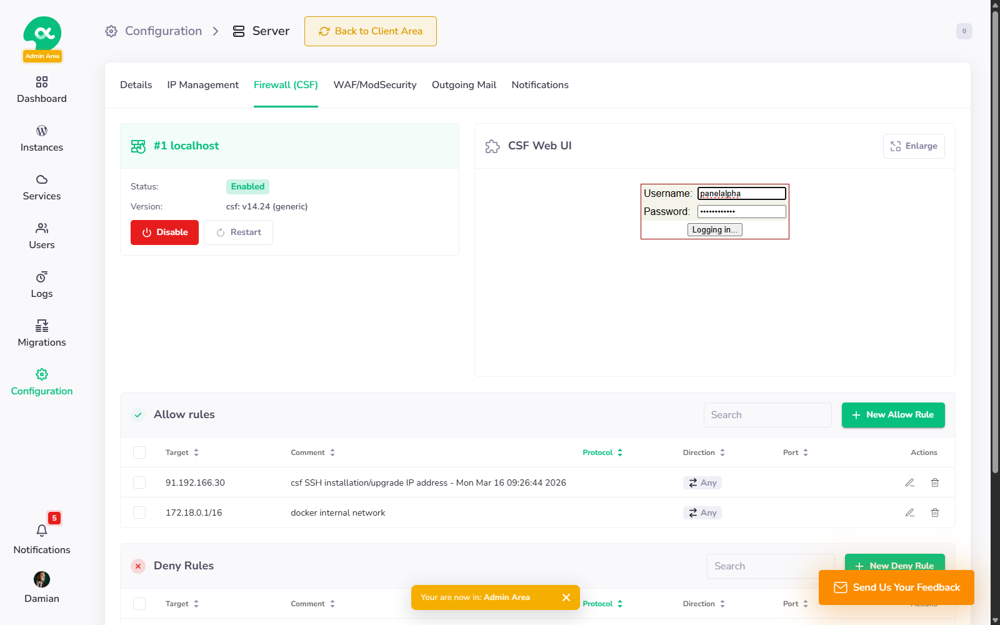
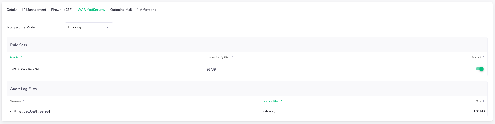
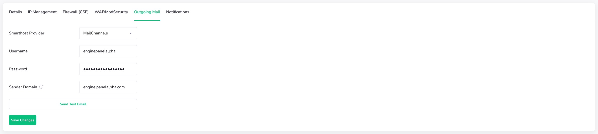
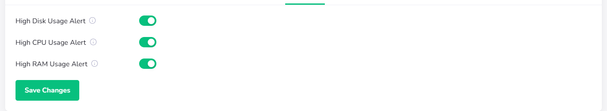

# Configuration - Server

Use this section for server-level monitoring and security operations.
It is the main place for checking server health, network configuration, firewall policy, and outgoing mail setup.

## Availability Notes

- While a PanelAlpha Engine update or a web server change is running, all tabs except **Details** are greyed out.
- If the Engine is older than 1.0.9-beta, the page shows "This server is outdated" and no tabs. Update the Engine from the command line. See [Update](../../panelalpha-engine/v1/installation-updates/update.md).

## Available Tabs

Server management is split into:
- **Details**
- **IP Management**
- **Firewall (CSF)**
- **WAF/ModSecurity**
- **Outgoing Mail**
- **Notifications**

## Details

Shows the server's address, the number of instances and hosting accounts, RAM, CPU and disk usage, and performance graphs. From here you update the Engine and change the web server. See [Server Details](../../panelalpha-engine/v1/server-management/details.md).

## IP Management

Shows the default IPv4 and IPv6 addresses and the IP subnets on the server, and which accounts use each IP. See [IP Management](../../panelalpha-engine/v1/server-management/ip-management.md).

## Firewall (CSF)

Turns the CSF firewall on or off, manages allow and deny rules, and opens the CSF web interface. Add an allow rule for your own IP before you block ranges, so you do not lock yourself out. See [Firewall (CSF)](../../panelalpha-engine/v1/server-management/firewall.md).

## WAF/ModSecurity

Sets the ModSecurity mode (Off, Detection Only or Blocking), turns rule sets and single rule files on or off, holds custom rules, and shows the audit logs. See [WAF/ModSecurity](../../panelalpha-engine/v1/server-management/waf-modsecurity.md).

## Outgoing Mail

Decides how websites on the server send email: directly, or through a relay such as SendGrid, MailChannels, Amazon SES or another SMTP server. This does not change how PanelAlpha itself sends its notifications; that is set in **Configuration → Notifications**. See [Outgoing Mail](../../panelalpha-engine/v1/server-management/outgoing-mail.md).

## Notifications

Turns on email alerts for high disk usage (90%), high CPU usage (85% hourly average) and high RAM usage (90% hourly average). The thresholds are fixed. See [Notifications](../../panelalpha-engine/v1/server-management/notifications.md).

For files, logs and commands on the server itself, see the [PanelAlpha Engine v1 documentation](../../panelalpha-engine/v1/index.md).
