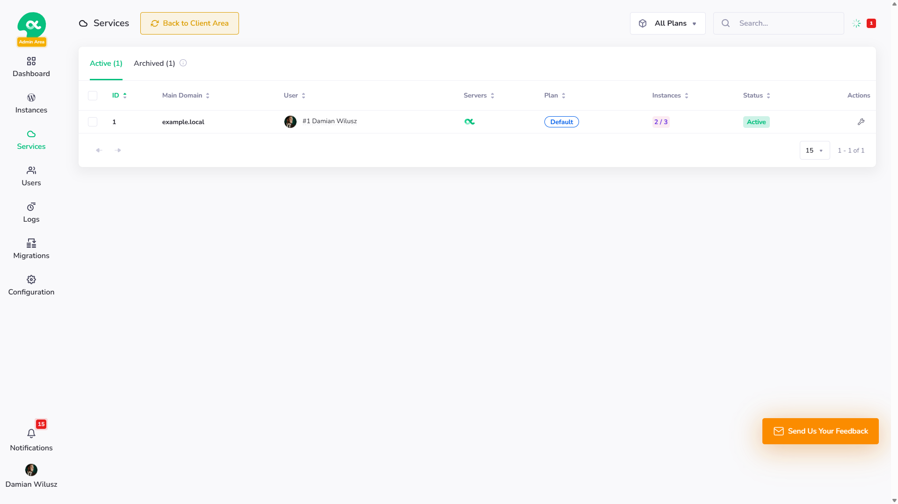
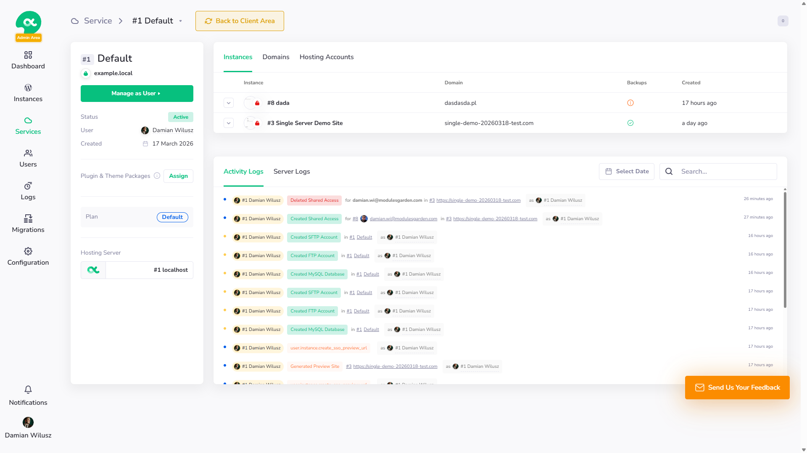
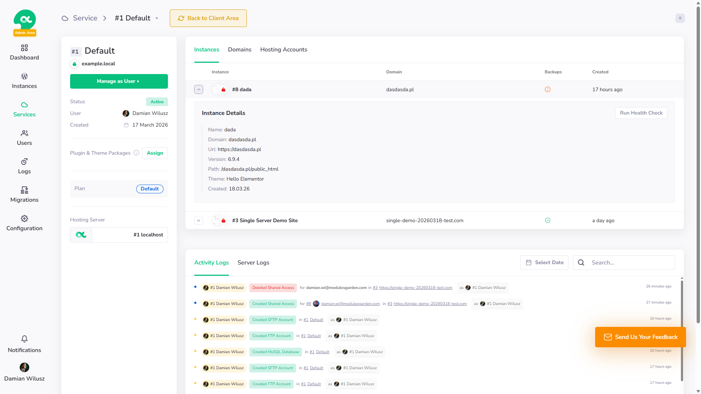
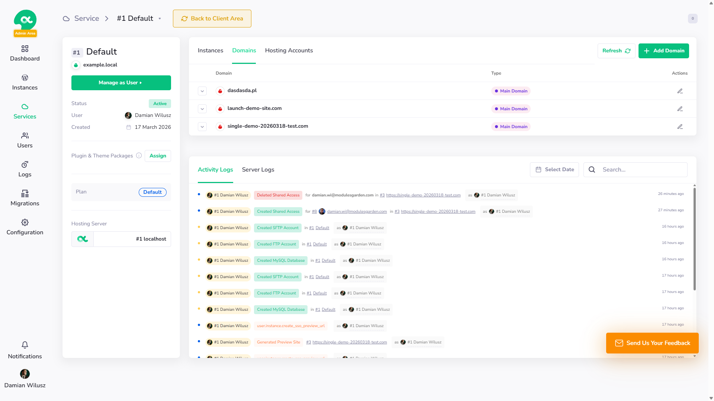
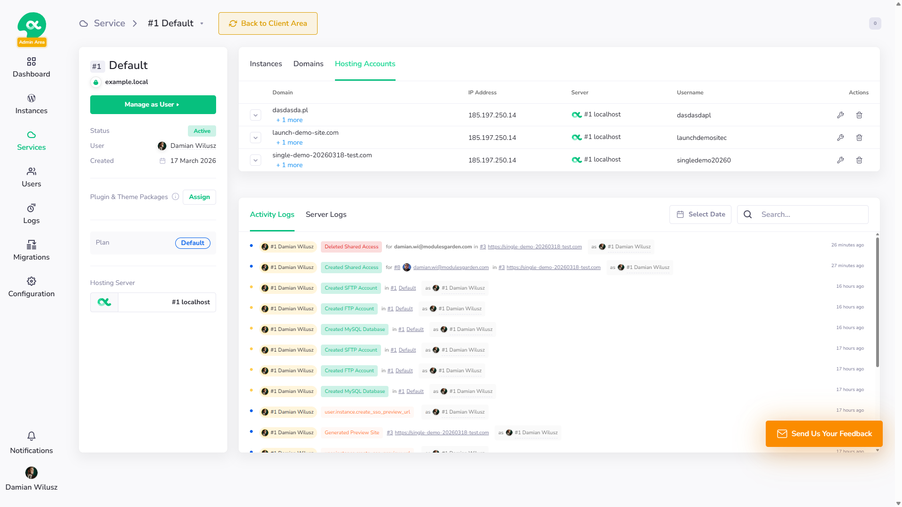
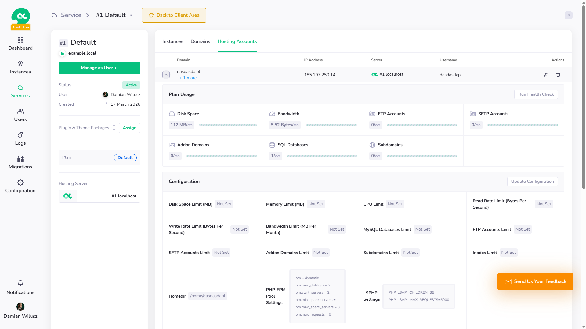
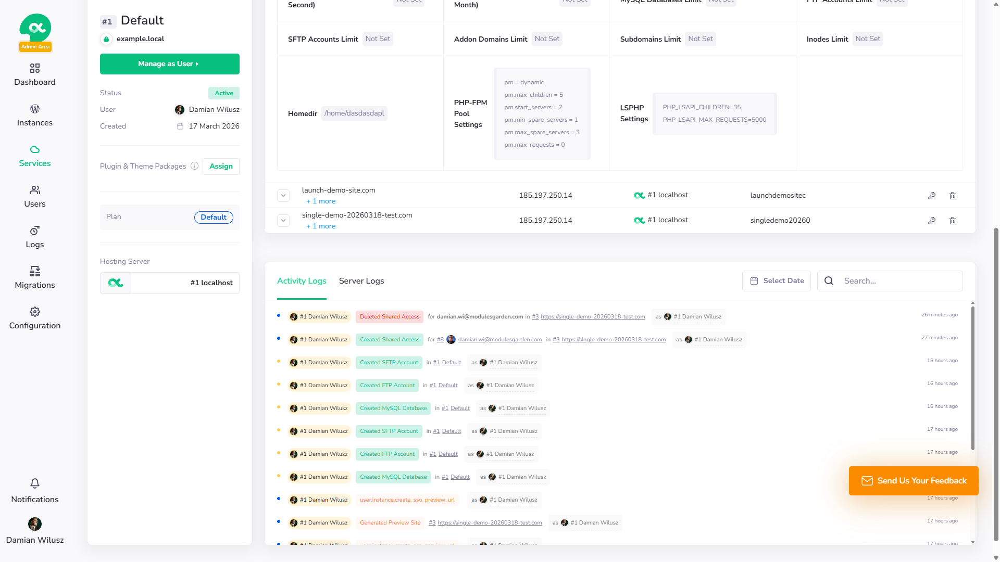
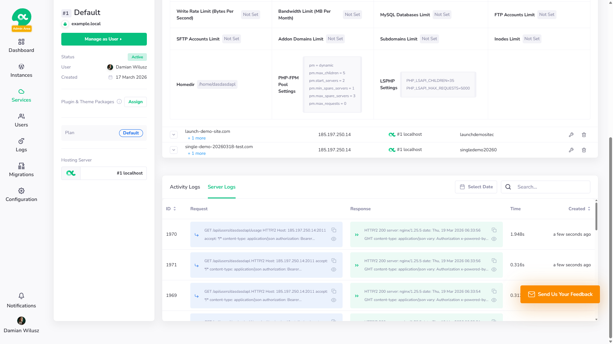

# Services

The **Services** section groups services by lifecycle status: **Active** and **Archived**.

> [!NOTE]
> The environment uses one default service (`#1`) assigned to the default owner (`#1` user).

Creating additional services from Admin Area is not available.

## List of services

  

The main services table includes:

- **ID** - click to open service details.
- **Main Domain** - primary domain; instance list can be shown on hover.
- **User** - assigned owner account.
- **Server** - hosting server assigned to the service.
- **Plan** - selected plan.
- **Instances** - number of instances versus plan limit.
- **Status** - current service state.
- **Actions** - row-level and bulk actions (when multiple rows are selected).

You can filter the list by plan or show all plans.  
The **Trial** and **Pre-Created** tabs are not available, and the **Suspended Only** switch is not available.

## Service Creation

Service creation is disabled. The default service (`#1`) is provided by the system and used for all instance operations.

### Service details

Use **Manage Service** to open the full service details view with configuration data and usage context.

  

The Service Details view is divided into areas and dedicated tabs. Each tab focuses on one resource domain so you can drill down quickly and perform contextual actions.

Available service tabs:
- **Instances**
- **Domains**
- **Hosting Accounts**

The **DNS Zones** and **Email Domains** tabs are not available.
The top-right **Actions** button is not available in service details.

### Layout Overview

**Left sidebar** contains all static / general service details including:
- Service name, status (active / suspended), URL, assigned user, and creation date
- Plugin & Theme Packages assigned to the service (with versions / counts)
- Information about infrastructure: hosting server(s), DNS server(s), email server(s) - when available

**Middle section** is a tabbed interface with detailed, real-time resource data:

### Instances tab

Shows every WordPress instance created within the service.
- Key columns: Instance name & ID, primary domain, backup status, creation date.
- Expand an instance row to reveal: version, path, theme, direct URL, created date and contextual actions (e.g. Run Health Check).
- Health Check: launches an on-demand diagnostic for that single instance (does not affect others). Results appear inline and are also written to Activity Logs.
- Bulk selection (when supported) lets you trigger multi-instance actions.

### Domains tab

Provides a consolidated list of all domains associated with the service, categorized (main, addon, mapped, parked, etc.).
- Hover tooltips expose DNS status and verification hints.
- Use this list to verify domain-instance relationships and detect unused domains.
- If integrated with DNS servers, domain status badges indicate propagation / zone presence.

### Hosting Accounts tab

Displays hosting account(s) connected to the service and their provisioned limits.
- Core data: domain, IP addresses (with +N more expansion), server label, username, creation date.
- Plan Usage block: disk usage, SFTP accounts and other resource gauges (visual progress bars for quick capacity assessment).
- Per-account Actions: Run Health Check.
- Configuration block: plan quota, PHP workers, burst capability, datacenter / location, SSH access type, other environment attributes.

### Configuration Options Update

The Update Configuration option, located in the top-right corner of the Configuration block, allows you to upgrade your environment attributes. The available attributes are dependent on your hosting plan.

### Service Reassignment

Service reassignment is not available because all operations use the default service (`#1`).

### Activity Logs

Chronological record of service events (provisioning, health checks, status changes, suspension, etc.).
- Advanced filtering by date range and search bar.
- Use for auditing and troubleshooting sequence of changes.

### Server Logs

Aggregated server-level logs relevant to the service (performance, errors, background tasks) with powerful filters for pinpoint analysis.
